# 文字稿｜微软刷新：大公司的自我革新之路

> 来源：[https://leonzhang.feishu.cn/docx/WXyud2ocwoeOkoxMaCkcMbuZnfe](https://leonzhang.feishu.cn/docx/WXyud2ocwoeOkoxMaCkcMbuZnfe)

> 讲师：崔晓明｜混沌创新院主讲导师 混沌创新领教 复旦大学管理学博士

> 2014 年，微软市值较 1999 年最高位腰斩，在微软 CEO 任上工作了 14 年的鲍尔默黯然离场。

> 

> 从 2002 年鲍尔默的改革入手，提出一个问题：为什么改革的方向和要素都对了，但是改革却以失败而告终？

> 

> 2023 年，ChatGPT 横空出世，举世震惊，比尔·盖茨说这是互联网革命以来第二次重大的技术突破。让人惊奇的是，这种突破竟然来自已经“老气横秋”、早已不在聚光灯下的微软，它在成功地跨越第二或第三条曲线。时隔不到十年，微软市值从不足 3000 亿美金增长到目前 25000 亿美金以上，实现近十倍的增长。伴随着 OpenAI 的横空出世，更是让微软重回巅峰，而这背后离不开微软第三任掌门人——萨提亚·纳德拉，以及微软系统的变革。

> 

> 本堂课程，崔晓明老师以微软如何自我“刷新”和迭代为案例，全景化还原微软变革的过程，带我们层层拆解大公司如何进行自我革新，帮助大家形成对企业本质的理解，构建创新战略思维。

## 第一部分 ｜微软的刷新

崔晓明：大家好，我是崔晓明，今天要跟大家分享的是微软刷新的案例，来去看大家所熟悉的这样的一家企业，它曾经经历的过程以及它中间遇到的问题，以及今天的变革。微软对我们来讲是一个又熟悉又陌生的公司，它既包含 toC 的业务，又包含 toB 的业务，那在微软整个发展过程当中，它跟每个人是息息相关的，但同时它又渗透在各个领域里，所以有的人开玩笑说，其实最好的创业的领域，就是微软没有涉足的领域。

乔布斯对微软的评价也是非常两极的评价，首先你看盖茨是个商人，我很佩服他，但是微软总体上没有 Taste（品位），这是盖茨一直对微软的评价，没有 Taste，然后他对计算机的统治是极其之黑暗的。但是另一方面他又极度地赞扬他，他一手创建了这个世界上第一家软件公司，而且他将微软真正变成了全民的微软。包括在这个公司工作的人，就很多离开这家公司的人有一种同感，就是很矛盾，我不喜欢它到了非辞职不可的程度，但我又钦佩，它是 IT 史上最伟大的公司。所以微软是一家极其之复杂的公司，那今天我们就来看一下这家复杂的公司背后所发生的种种的变革的故事。

那我们这个案例要探究的问题就是，巨大的成功，15 年的困顿，然后在这个过程当中重启，那在这个过程当中经历了什么。那我们将通过几个部分来慢慢慢慢给大家拆解微软这个极其之复杂的案例。第一部分，可能大家更熟悉的一部分，微软的刷新；第二部分，我们将去看说微软成功、失败，15 年的困顿背后，那个真正牵绊约束它的组织心智，最底层的那个基因到底是什么，那是盖茨先生为微软所种下的最核心的基因；那到了第三个部分，我们会去尝试理解，盖茨所有的这些大一统的梦想，他背后真正要做的事情是什么，那这个要做的出发点，怎么使得它走向弯路的，那又是怎么调整回来的；第四部分，我们用了纳德拉本人的一句原话叫 Nothing happen to me，就是我没有发生，是表达的是个体在成长的过程当中，包括微软在成长的过程当中，看似发生了很多惊天动地的事情，但本质上，围绕着价值本身的内容没有成长，没有发生。我们来看第一部分，微软的刷新。

| 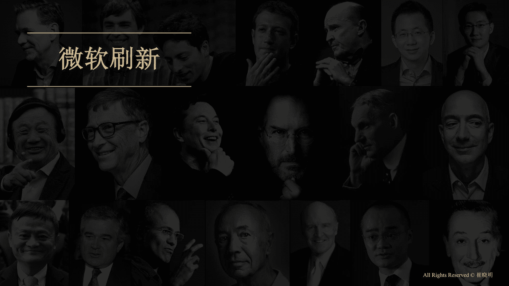 | 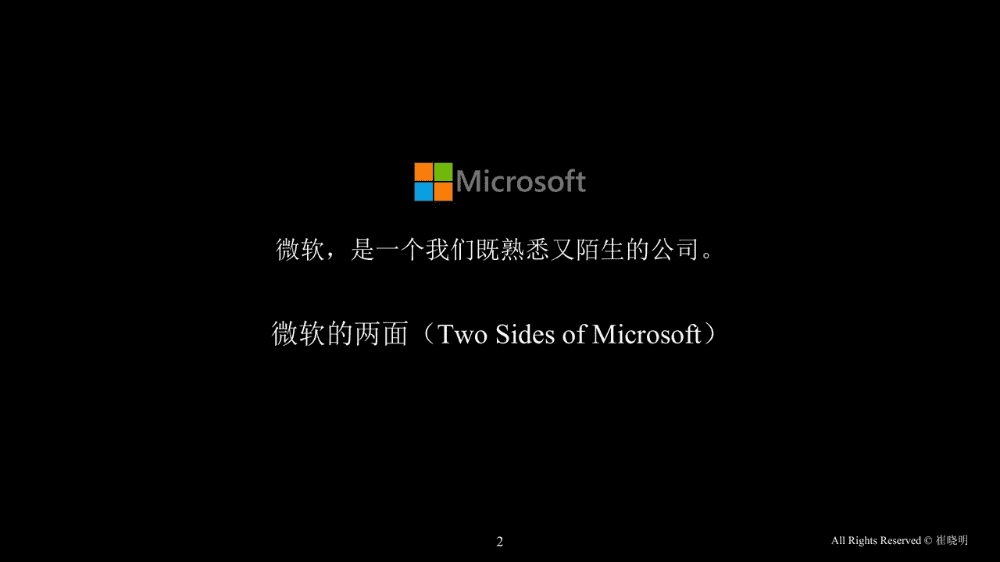 | 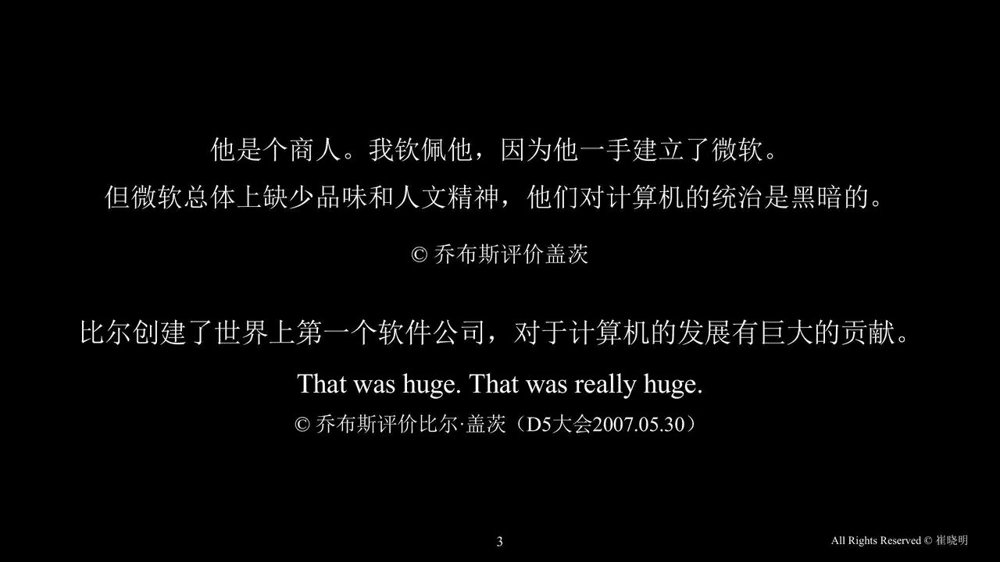 |
| --- | --- | --- |
| 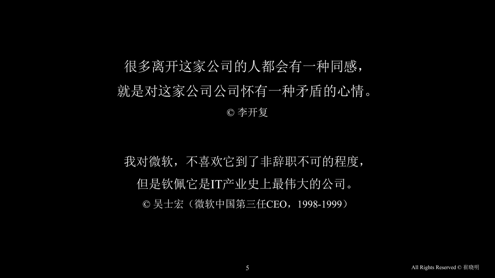 | 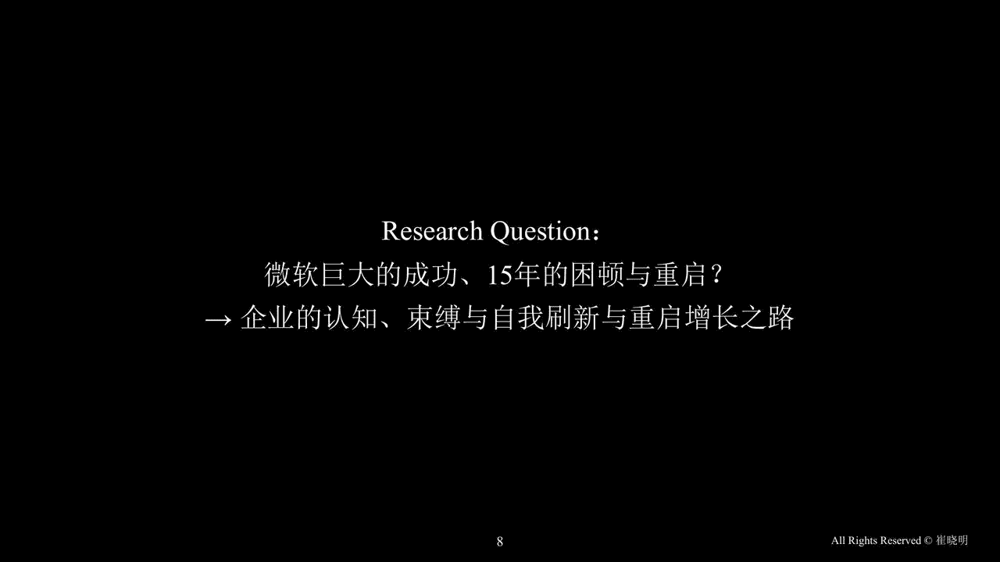 | 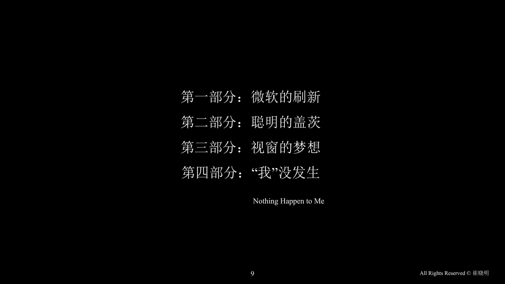 |

那微软的刷新可以说是堪称教科书级别的了，我们通过下面这张表格来了解一下微软变革的核心内容。微软之前的使命是让每个家庭的每张桌子上都有一台电脑，但是我们要来感受一下这句话的表达，它到底是一个使命还是个愿景？或者说在 PC 刚刚创立的那个时代，它背后有没有那种说更多的赋能大家让 PC 走进千家万户的那样的使命感。但是随着这个目标不断地达成，其实它越来越不具备指引着微软发展方向。所以在这个时刻的前提之下，微软开始了使命的变革，从 PC 的售卖到生产力的赋能。相应的对于使命变革对应的是关于战略、文化以及组织，包括团队的变革。

在战略的角度来讲，从慢慢地 PC 跟操作系统，开始到赋能更多的协同性，赋能更高的生产力；从文化上，不管对内，从独立的小团队相互之间的竞争，技术人员的竞争，开始更多地转向大家之间的通力合作，对外，从更多的竞争转向更广泛的合作网络，相对应的微软也在组织方面做出调整，从原先的垂直的组织结构尽可能地向以客户为中心的流程型的组织结构进行转型，包括在团队理念上，推动着大家更通力合作，共同去赋能生产力的角度来进行转型。这是微软变革的一些核心内容，我要确认一下我没有说错，刚才那张表格里的内容，今天我们看到的奉为经典的，把它当作纳德拉 2014 年刷新微软的变革的内容，都是 2002 年鲍尔默作为第二任 CEO 的变革的内容。今天我们对鲍尔默满是批判，认为他是微软 15 年衰落的主要的原因，特别是乔布斯的那句话，做销售的人经营公司，如果鲍尔默还在执掌微软，我不认为他会有什么起色。所以今天我们都将鲍尔默当作那个暴力的、独裁的，将微软带向深渊的，错失了移动时代的罪人，我们先通过一个小视频来了解一下鲍尔默这个人，他被称为网红带货的鼻祖。

鲍尔默是一个极其有激情的人，而整个人也没有我们想象当中的所谓的那种独裁的形象，反而是一个特别生动、鲜活的人，而且鲍尔默竭尽了自己所有的力量在推动着微软一场真正的战略变革。更有意思的就是我们看到说，鲍尔默的变革内容跟纳德拉的变革内容几乎是一模一样的，所以我们要复盘一下，2002 年为什么鲍尔默的改革失败了，那这场改革背后失败的核心是什么，以及纳德拉 2014 年的这场改革又是如何成功的。

| 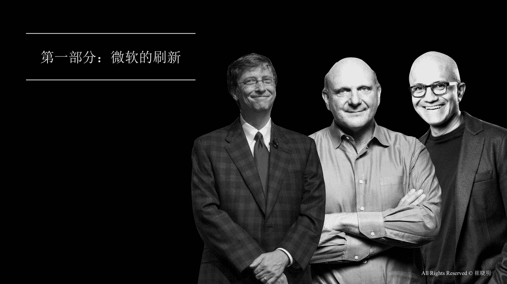 | 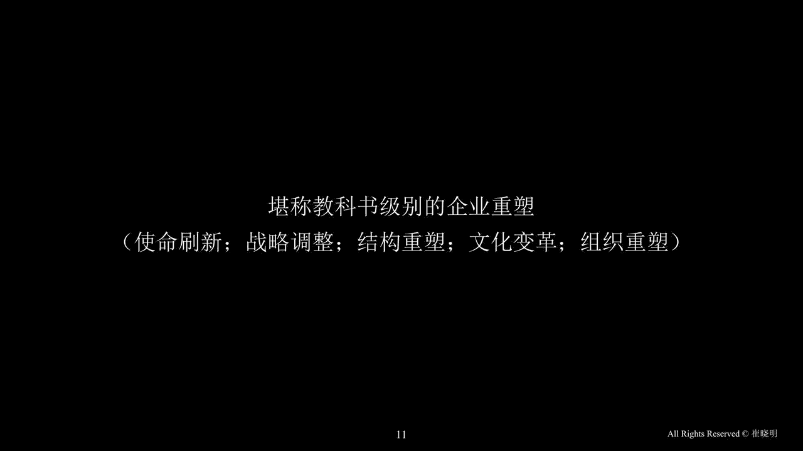 | 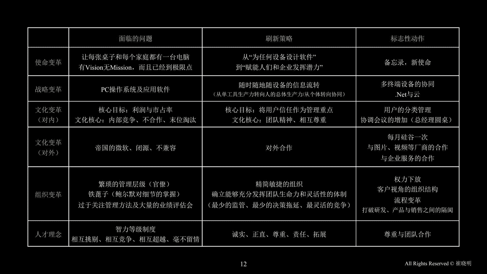 |
| --- | --- | --- |

要理解鲍尔默的改革，可以去看一封信，2002 年 6 月 6 号，微软内部发整个的公开信叫做《发挥潜力》，这是鲍尔默针对所有人的战略变革的公开信，在这封信里，阐述了他所有的战略变革主张。那无独有偶，2014 年 7 月 10 号，纳德拉在内部发了公开信，如果你把这两封信拿过来对比，你就会发现其中的内容大同小异。我来摘取几段给大家看一下。

2002 年鲍尔默的信，25 年前我们有一个愿景，让每一个办公桌，每一个家庭有一台电脑，那时候人们以为我们在说梦话，但今天一切都变成了现实。到了纳德拉，2014 年，当我 1992 年加入微软的时候，我们习惯于谈论微软的那个使命，但是上世纪 90 年代末，我们已经完成了该目标，所以我们经常混淆了长期使命跟短期目标。然后在鲍尔默的信当中他说，那我要为微软找到微软的使命跟灵魂，我怎么找到微软的使命跟灵魂呢，那我回到几个基本的问题，就是那时候我从斯坦福辍学加入微软的时候，我的父亲问我第一个问题，什么是软件？我母亲问的问题，人为什么需要电脑？我从这两个基本问题去找到说微软为什么存在。纳德拉，对于我的第一个问题，也就是微软为什么存在的问题，那我要思考的是，当时激励我们开发 PC 的，激励着我们写下第一行代码的，激励着我们做出两个伟大的产品，Windows、Office，这背后的核心的动力是什么。所以鲍尔默在 2002 年之后，提出了微软的使命，助力世界每一人、每一组织发挥他们的潜力，纳德拉提出使命，予力全球每一人、每一组织成就不凡。所以你看他们问的问题是一样的，他们思考的问题是一样的，他们给的答案也是极其相似的。

那我们去尝试说，去理解这两者之间有什么微小的差异，那这些差异又是不是十分之重要，会影响到说整个战略变革的进程，我们慢慢慢慢会去对比。有意思的是，当你回顾这两封信的时候，你会发现一个特别有意思的地方，这两封信内容几乎一致，但是结构上不完全一致。梳理鲍尔默这封信，你会发现它里面分为四个部分，第一，使命，第二，愿景，想象的未来，第三，为了实现这些愿景我们的战略与举措，第四，我们的组织与价值观，看起来怎么样？完美 对不对，可是我们自己在公司当中建立这个完美的结构，之后你会遇到什么问题？从使命出发，我们的愿景是这样，从愿景出发，我们的目标是这样，从目标出发，我们的解码是这样，从解码出发，整个部门的、整个组织的明年的核心目标又是什么样子。所以在这个过程当中，你会看到说使命赋能每一个人，但是我们要提醒自己很重要的一点是什么，到每一个环节的时候是谁在起作用？是愿景指导着战略，还是使命指导着战略？使命。但是，我们最有意思的就在于，一个企业当中一旦建立了使命、愿景、价值观、战略，我们往往就会谁来指导了？就会愿景来指导了，大家可以去看看自己身边的公司、自己的公司，会不会经常发生这种情况，就是你好不容易精心地讨论，明确地提出的那个使命，其实因为它在最顶层，那可能是我们一战略背后讲的那个一，那个出发点，但是我们大多数人都把它怎么样？搁置了，包括整个组织这场鲍尔默的过程当中，本来是开放的、想要变革的运动，最后真正指导着整个公司变成了七个字，叫做随时随地随设备，就是以前我要让 PC 装有 Windows 系统，现在我要让电视装有 Windows 系统，我要让游戏机 X-box 装有 Windows 的操作系统，所以如果没有纪律般的价值遵循，战略的核心方向会逐渐分散成机动的战术策略，一系列看似理性的活动最终使整体活动失去理性。

| --- | --- | --- |
| 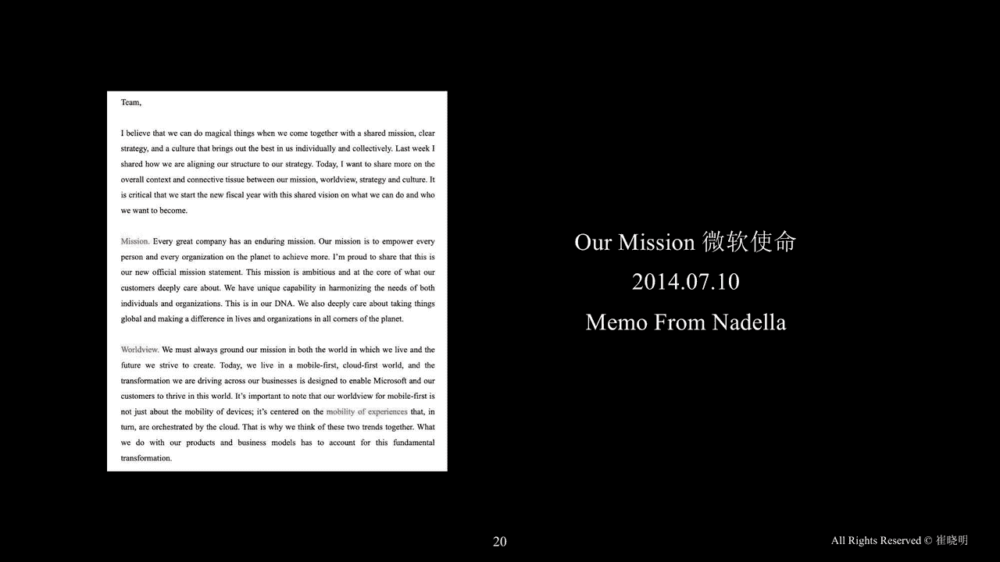 | 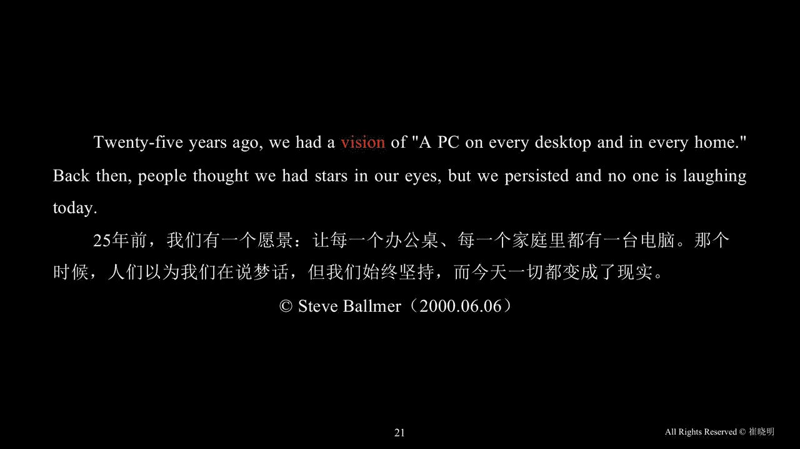 | 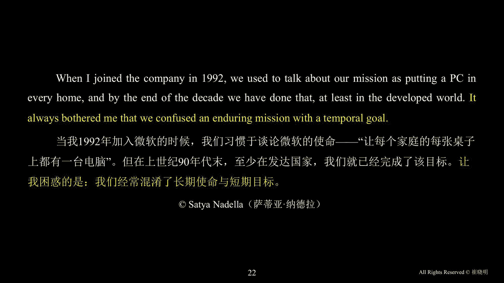 |

所以当你看了鲍尔**默的那个结构之后**，我们反过头来去看纳德拉这封信的结构，你会发现它们的结构不太一样，使命、世界观，在使命和世界观之下，我们的战略是什么。你看他把愿景放在了一个什么位置呢？如果我的战略实现了，我们有可能实现哪些抱负跟雄心。愿景是怎么来的？如果我的使命达成了，接下来 20 年、10 年之后，我的企业会变成什么样子，而且接下来出现了一个我们在日常的管理词汇当中不太常听见的一个词，叫内部结构关系，就是价值创造的协作性网络。当纳德拉上任之后，他说很多人认为坐在我的位子上的应该是他们，但我的核心工作不是证明给任何人看，我的核心工作不是证明我比所有人更聪明，我更适合当这个 CEO，我是要打造一个足够简单的框架，让微软能够在这之上去运行。所以我们今天所讲的所有的核心内容，大家都要牢记一个很重要的点，结构比内容还重要。就是你要理解使命在公司当中的位置是什么，它决定什么，愿景在公司当中的位置是什么，它决定什么，结构在公司当中的位置是什么，什么是组织结构，什么是流程，什么是文化？你会发现说，我们所有公司当中最大的成本，就来自于对这几个词的概念理解以及它们相互之间关系的排列上出现了问题，我们往往觉得说使命、愿景、价值观，人才、流程、KPI，所有的这些上三板斧、下三板斧，所有的 BLM，所有的 SWOT，所有的流程、所有的制度、所有的文件拿过来就可以了。我们讲一思维、一思维、一思维，所有的东西从一出发，而不是使命、愿景、战略一点点地替代，让下一层去替代，而且你一层一层之间又没有很好的这种推理逻辑关系的时候，它很容易因为你想建构公司完美的体系而使得公司僵化。管理最大的成本就是什么是战略，什么是组织，什么是文化，什么是绩效，什么是流程，这些基本概念的理解，以及组织内的同频。

所以我们回到这样一张图，当随时随地随设备，让每一个家庭、每一张桌子上都有一台电脑的那个愿景的延续成为了新的指导整个微软的时候，一场开放的战略变革变成了攻城掠地的运动，我们后边会慢慢去看说，对于纳德拉而言，他这种赋能的生产力，如何慢慢到个体生产力以及业务之间协同，业务流程的关系的协同过程当中，慢慢慢慢一步步去推导他的产品创新出来的。

如果我们把这两场变革的举措，用我们的一战略的模型稍微地梳理一下的话，我们会发现它会隐含着说，我们经常会犯的一些小小的问题，但是这些小小的问题差之毫厘，失之千里，就是那个确定的为真的起点到底是什么？到底你要响应当下的问题，你要响应的是什么？纳德拉有一个伟大之处，就是自他上任（以）来，除了今年在所谓的 ChatGPT 上有所谓的大动作之外，10 年了，他没有推出一款所谓任何的新产品，他只是梳理了原有的业务的关系，让原有的产品更好地解决用户的问题，这是纳德拉一个鲜为人知，但极其之重要的贡献。所以这两场变革，是发生在同一家企业，内容几乎相似，但是又有巨多差异的两场变革。这背后，很多事情没有调整到位，关系没有梳理清楚，反而鲍尔默的变革带来了更复杂的问题，其中一个重要的问题就是，当他要把整体的组织结构，从垂直的组织结构变成按客户分类的流程制的组织结构的时候，这时候微软有什么用户？toB 的大企业用户跟 toC 的用户，toB 的大企业用户占微软营收多少，70%以上，以前没分类，没有按客户做流程型组织还好，一分类，一从客户出发，于是形成了什么？两大阵营，大客户服务的和 toC 的用户阵营，于是出现了一个重大的微软的问题，就是越来越没有 Taste，因为大企业的服务部门占据了至高无上的话语权。

鲍尔默在讲他的变革的时候，有一次他在所有的高管的会议上宣讲，过去我们喜欢竞争，我们出了很多的问题，人们都认为我们很傲慢，我们刚刚被反垄断，我们希望以后我们更多的尊重，我们把用户放在首位，我们要去 Windows，那个时候历史上真正提出了我们要去 Windows，我们要做公司组织结构调整，我们要以客户为中心。但是所有的这些举措，在执行的过程当中，当被随时随地随设备，统一所有人的目标占领之后，他们有一个副总裁在鲍尔默宣讲整体战略变革的时候站出来，然后拂袖而去，离开了微软。他说你在台上讲着我们以客户为中心，但是我们所有的组织变革赋予了大客户无限的权利，我们越来越不看重每一个 toC 的客户，我们开始要占领客厅，我们要去占领每一台游戏机，占领每一台设备。其实鲍尔默整个职业生涯，他一直受到一个重要的牵扯其实就是比尔·盖茨，在鲍尔默长达 15 年的 CEO 的生涯当中，盖茨当了 13 年的董事长，然后盖茨，表面上我放权了，背后怎么样？暗戳戳地给你控制。更重要的是，鲍尔默的变革当中有一个微软很根基的东西一直没有被触达、没有被改变，所以鲍尔默其实是主动决定离开，而且纳德拉是鲍尔默一手培养出来的。

然后他在离开的时候他说，微软这家公司无法改变其实很大一部分是这个文化。有一次他在南加大演讲，他曾经讲过说，这些年我最大的教训是什么？这个教训也一直是微软我们后面讲第二部分很重要的一个教训，就是我们认为所有的创新、所有的业务、所有的战略，就是 idea First（想法优先），就是我们先要想到一个好的 idea。这些年我们做战略，最大的我们的执念，就是要找到那张正确的地图。那鲍尔默其实为纳德拉留下了巨大的贡献，才有了后面我们所熟知的纳德拉的这一系列的变革，他留下了巨量的现金，他留下了一个 3000 亿（美元）估值的市值的公司，而且他一直致力于一件事情，就是公司微软一直要建立 Windows 操作系统跟 Office 之外的竞争力，所以他一直致力于做搜索，包括对云的尝试，而且他是 ONE Microsoft（一个微软）的概念的提出者。

ONE Microsoft 的概念，第一次是由鲍尔默在把艾伦·穆拉利，就是福特的 CEO 请为顾问之后，在 ONE 福特、一个福特的启发之下，提出了 ONE Microsoft，然后想着说我这个分裂的组织如何形成合力，而且他一手提拔、发掘、培养了纳德拉，并把纳德拉推上了董事长兼 CEO。他以自己的离任，推动着盖茨卸任全部职务，为纳德拉留下了变革的空间，所以这是鲍尔默很重要的遗产。

## 第二部分 ｜聪明的盖茨

崔晓明：我们刚才讲到说，在鲍尔默的整个变革体系当中有一个微软很底层的、根深蒂固的基因是一直没有被触达的，这个基因是盖茨先生一手种下的，就是我们要讲的第二部分，聪明的盖茨。

如果你去看盖茨，你要找到一个词来形容他，那就是聪明，而且微软充满了这种聪明人，想展示自己聪明的人。盖茨对聪明有非常多的理解，他说聪明是什么呢？就是迅速地、有创建地理解，深入研究复杂的问题，善于接受新事物，反应敏捷，能够迅速进入一个新领域，并做出头头是道的解释。提出的问题往往一针见血，正中要害，能及时学习，博闻强记，把原来认为互不相干的东西联系在一起。所以这既是聪明的优点，也是聪明的缺点。所以当你回顾整个微软这些年的发展战略的过程当中，最能够集中体现盖茨聪明的其实就是他退任 CEO，成为董事长，在 21 世纪的两次重大战略，一次叫 .Net，一次叫 Windows Vista，我们稍微来看一下这两大伟大的战略。

我们将计算机的运行环境简单一点，那些年硬件、操作系统、软件，到了上世纪 1995 年左右，突然出现了一个什么东西，浏览器，今天你看我们怎么理解浏览器？浏览器是软件的一种，还有没有其他的可能，在当时浏览器诞生之后，所有人冲浪在这个世界里的时候，盖茨第一时间就敏锐地觉察到浏览器没那么简单，有没有可能有一天，大家打开电脑就是一个浏览器，不需要经历 Windows 的这个操作系统，所有的服务运行在浏览器之上，这是今天的什么概念？云的概念。所以那个时候诞生了浏览器之后，让微软是为之震惊，于是在他发的公开信 1995 年内部的《互联网浪潮备忘录》当中，这一软件使得 Internet 改变所有的程序成为可能，这一体系使得 Windows 在整个互联网世界当中的地位变得无足轻重，它把 Windows 变成稍微有一点那么瑕疵的驱动程序。所以当很多人还把浏览器当作一个软件的时候，其实微软迅速地将互联网列为了战略的首位，于是他采取了各种捆绑的策略，将自己的 IE 与 Windows 捆绑，将其他的浏览器全部干掉了，所以微软被送上了反垄断的（被告席），后来这场反垄断，微软是赢了还是输了？赢了，浏览器不是一种软件，而是一种通用网络技术，就在这一个观点上然后微软赢得了整个反垄断。我们来看一段视频，是比尔·盖茨在反垄断听证会上对浏览器的解释。

我们使用的 IE 是通用网络技术，但是今天 IE 有没有实现这个功能？没有。

所以随着反垄断之后，IE 把所有的浏览器干掉之后，英特尔联盟开始瓦解，Sun 开始推出 Office，Linux 更多的人开始支持，那个时候微软开始出现真正第一次因为反垄断触发的各种问题导致的发展危机。 所以这个时候，聪明的盖茨在 IE 的基础上，推出了他一个伟大的构想，就是 .Net.     将 IE 降低为浏览器，把网络技术上升为叫做 .Net，把 Windows 降级为驱动，使得所有的服务软件都在一个叫 .Net 的框架下，你看那时候所有的宣讲的 PPT，下一时代的操作系统。

2001 年 1 月 5 号，比尔·盖茨在拉斯维加斯发布了数字客厅 .Net, . NET 是针对开发人员的，数字客厅是针对消费者的。那他的目的是，用 .Net 的框架支撑所有的软件服务，而它不需要 Windows 安装这个复杂的系统，于是乎所有的设备，从 PC 到电视、到游戏机都可以安装，实现人们数字的连接。我们先来看一段视频，是当年的比尔·盖茨发布 .Net 的一段视频。

软件将成为服务，这个词第一次在历史上出现。 那更有意思的是，因为时隔两天，乔布斯也准备发表数字中枢，在《成为乔布斯》这本书当中讲了一句非常有意思的话，2001 年的 1 月 5 号，在拉斯维加斯的消费电子展上，比尔·盖茨率先描绘了苹果的未来，他描绘的未来一步一步被苹果实现了。 但是微软提出的数字客厅是一个技术的伟大构想，它是一个宏大的框架，那微软最大要执行这个问题，在于说大企业的束缚，它现在解决不了，数字客厅这个大的技术构想不可能一蹴而就。接下来最有意思的就是，我们来对比一下，什么是苹果的数字中枢，什么是微软的数字客厅。

苹果的数字中枢跟微软的数字客厅，它的共同点在于说，都想让系统 PC 成为人们数字生活的中心，将你的摄影机、数码设备、电视，等等设备连接起来，这个构想是一模一样的。但是你看乔布斯的数字中枢，在回应一个最基本的问题是什么问题？用户用录像机拍了视频之后，他在录像机上回顾视频的成本太高，用户有了 MP3 之后，他那个 MP3 的歌曲没法编辑形成歌单，我将这一个小小的功能，通过 PC 来完成，然后将 PC 已经完成的制作能力再同步给原有的设备，原有的数码相机、原有的 MP3。一个是什么？伟大的技术构想，宏大的技术框架，一个是什么？一个小小的、见血的、马上就能付诸实践的问题，我就是要解决用户的这种创作能力被限制的问题，我要用极简的方式来去解决这个问题。所以苹果的数字中枢跟微软的数字客厅，一个宏大的愿景，一个关于用户端到端，使用音乐、剪辑视频过程当中的小环节的小问题。

当这种 .Net 的战略，被盖茨这种宏大的构想提出来的时候，他在内部跟大家来宣讲战略，他说我们所有的 Windows 要走向历史，完成它历史的使命，我们下一时代的操作系统是。    NET. 然后在高群耀的《创变》当中，有回忆这一段话，他说，盖茨用他特殊的那种童男子的声线来讲这个宏大的战略的时候，大部分人都睡着了，即便在精英云集的微软，大家也消纳不了、理解不了他这个宏大的技术构想。OK，这是为了推。    NET.

你看 .Net 的构想是什么，没有系统了，所有的系统，Linux 系统也好，其他系统也好，用一个通用网络技术然后去支撑所有的软件跟服务，这时候你怎么去推？竞争对手不买单，软件开发商觉得说我又要给系统开发，又要给一个所谓的 .Net 开发，没有足够多的用户基础，那这个时候推广 Windows 成了推广 NET 计划的手段，我得让更多的人用 Windows，在更多的人上装 .Net，让更多的人用 .Net，以去影响那些开发者，以去影响更多的人，但是 Windows 这个手段最终成为了目的， .Net 的推广方式影响了微软看待自己的方式。所以 .Net 的使命是干吗？去 Windows，然后 Windows 的市场占有率史无前例地从 80%增长到了 96.97%。

然后在推广 .Net 的过程当中谁崛起了？苹果崛起、Google 崛起，所以上节课我们讲 Google 的时候，Google 有一个理念是什么，让一切都在 Web 上运行，当 Google 崛起，当 Google 跟微软所有的业务重叠的时候，微软不得已采取了一项战略，展现盖茨聪明的新的一个战略就是 Windows Vista。我们很多人理解 Windows Vista 就是 XP 之上又一代的操作系统，但是当你理解 Windows Vista 是什么的时候，你才发现它背后想要解决的问题。Windows Vista 要支持开发更快的语言来对标 Linux，他要建立一个 Win FS 的系统，盖茨曾经回忆说，我这一生最后悔的一件事情，就是 Win FS 系统没有开发成功，Win FS 系统就是把用户所有的文件存在你的桌面上，用一个独特的数据结构去定义它，这个数据结构会使得 Google 的搜索引擎搜索不到这些用户的数据，他想让一切用户行为、一切数据结构回到桌面，大家记得那时候把 MSN 改成 Live，在桌面用各种 Hotmail 的账户，目标是什么呢，将用户所有的本来在互联网上的邮件、沟通等等行为全部引到桌面上，这是为了跟 Google 竞争所采取的 Windows Vista，这相当于多次向月球发射。对于这个混合策略，更多的人表达了自己听不明白，Windows Vist 他是个彻底的灾难，因为它承担了太多的任务，承担了太多的雄心了。

那 Windows Vista 还有一个直接的负面的作用是把谁给干掉了呢？把它自己的移动操作系统给干掉了，因为那个时候为了推 Windows Vista，为了推 Win FS，要求所有的移动操作系统全部改为 Windows Vista 的操作界面，那个 Windows Vista 那么炫酷的效果，在 PC 层面都卡得要死，到了手机层面直接把它占据 30%的移动操作系统市场份额拱手让给了塞班。所以很多人说它是被塞班干掉的，它根本就没有等到 iOS，等到安卓那一刻，但其实它是被 Windows Vist 他这个多重野心的目标把自己给干掉的。当 Vista 失败之后，Windows 就不再是手段，而正式成为目的了。在做 .Net 的时候，忽视了 Apple 的崛起，忽视了 Google，在做 Windows Vista 的时候，忽视了云，忽视了移动，所以那个时候暴风雨已经集结在微软了。

当回顾这段过程的时候，盖茨曾经回顾说，我日益意识到我自己犯了一个巨大的错误，这个错误是什么呢？就是我们非常依赖技术洞见，我们这家公司极其依赖聪明人的技术洞见。我们所有的错误在于说，当我们需要使命感来指引我们前进的时候，我们将所有的希望寄托在了一个人，就是盖茨一个人，这个科技极客的个人的技术洞见之上。我们讲远见于当下，在所有的远见的可能性当中最靠谱一点点的是什么？技术的洞见。但是当这种宏大的结构，这种技术人的炫酷，放到用户身上的时候，它对微软造成了无与伦比的灾难。

而且盖茨后来有一个习惯，就是闭关，不知道在座有些同学有没有闭关的这个习惯，每次闭关出去，就像带着什么，新的蓝图、新的战略，来宣告世界一样。就像在座各位来学习，不要回去就要宣布新的思想、新的想法、新的战略，能不能回应当下的问题，用你的技术洞见回应当下的问题，而不是致力于建立那个复杂的框架。

那在整个微软这种文化，聪明人所形成的这种文化，他们很在意去展现自己的聪明才智，他们力图在会议上、在辩论当中赢得自己，然后去赢得辩论，然后它会使得 Windows 当中 10%的功能才会被我们所用到，更多的人根本没有用过其他的功能，每个人只用了 Office 不到 5%的功能，每个人都在研发炫酷，炫耀自己的技术的高端。盖茨一直认为自己可以预测未来，他一共写了三本书，《未来之路》《未来时速》《气候经济与人类未来》，全都是关于预测未来。接下来我会放三段小视频，非常有意思，是 2007 年的 D5 峰会上，乔布斯跟盖茨最后一次同台接受采访，那个主持人反复让他们预测未来，大家来看说这两个人对预测未来的态度是什么样子的，第一段，你们接下来的五年展望是什么，五年之后什么是我们的主要设备？

第二个，你们预测将来这个口袋设备的核心功能是什么？

第三个，关于元宇宙。

一开始的时候主持人跟乔布斯说，你能不能真诚一点，不要老是说好像有什么东西都要藏着掖着，你看盖茨都分享了那么多了。后来乔布斯用了那句话，我不是不讲，因为我所有的哲学是，转角之后的美好。因为未来是不可预测的，我们要去创造未来，我们创造未来的过程，就在于像我们的数字中枢一样，回应客户当下一个一个一个见血的、具体的问题，然后考虑我们用技术怎么来去解决，带给人们简洁、方便、便利性，帮助大家。所以盖茨说，在我 20 岁的时候，我有一个基本理论，智商极其之重要，甚至我认为聪明人不应该给笨人打工，所以整个公司建立了一种智商的等级制度。微软因为聪明人很多，其实它今天非常像我们的小团队作战，它相对而言灵活，但是彼此之间竞争，赋予他们自由度，但是这个竞争的过程，这个个体的聪明超越组织的过程，就像比尔·盖茨在讲到回顾组织的状态的时候讲到，拥有大量聪明的个体的公司，会很容易退变成一个由极端傲慢、独立的个人组成的混乱的集团，组织的本质价值协同。

所以在前两年盖茨反复推荐一本书，叫做《成长边界》。在《成长边界》这本书当中，极其重要的反思跟思考，就是他对于聪明的这个执着。聪明有很多优点，他是纵深的专才，深入到一个问题一针见血，他能够迅速地跳入另外一个领域，他习惯于建立宏大的架构，说得头头是道，聪明人不习惯失败，因为每次开会讨论的时候他总是赢的那一方，他习惯证明给别人看，他很独立，他不需要团队合作，我一个人就比我整个部门工作得要好，他没有组织感，聪明人，用了一句词叫以未来感赢得当下的胜利。这句话表达的意思是什么呢？聪明人在今天开会的过程当中，包括大家在讨论的过程当中，有时候开会，必然就陷在那个开会的局里，有的人总想证明自己的观点是对的，这个时候，如果在某些现有的问题里他得不到他想要赢的答案，聪明人就会干吗？我认为未来的样子是那样的，我背后的依据是什么，并能对其做出头头是道的解释，以未来的状态赢得当下的胜利。

但同时聪明的人有很多弱点，他不善于横向地、更深地去了解，他不善于连续性地推进，他喜欢做演算题的时候跳跃，我一步从 A 到 D，我不习惯从 A 到 B 到 C 到 D，所以聪明人反过头来看的时候这怎么？ABCD 背后的规律他没有掌握，他不断地要从 A 到 D，聪明人不善于做这种连续性的事情。聪明人习惯跳到下一个机会、下一个领域，他不善于持续推动组织进展，聪明人喜欢怎么样？憋大招。然后总是想让自己的体系看起来很完美，为了自己的面子，为了显示自己的聪明，然后不善于将不完美的方案、不成熟的思考真诚地分享出来，即便自己知道它不完美，也要把它伪装得很完美，并对其做出头头是道的解释。聪明人不善于合作，不善于使得公司形成组织感，不善于形成整体，聪明人不善于专注当下，不善于解决今天的用户的皮毛的那些问题。聪明人总想建立一个大的框架，一个畅想的未来，一个宏大的愿景，用户有那个小问题，这跟我有什么关系。聪明人喜欢复杂带来的挑战，通常跳过两三步分析问题，不喜欢团队讨论，浪费自己的时间，以我要秒杀众人为目的拿出产品，在讨论当中轻松碾压众人，刚性太强，容易做承诺升级，承诺升级就是明显发现自己已经错了，还要一错再错，为了掩饰自己过去这一系列过程当中因为聪明所犯的问题。所以纳德拉上任之初的第一件事情是干吗？让人们知道，怎么不断地追求探索的这个过程。

于是在纳德拉上任第一年的他一个任务清单里有几件重要的事情，我们拿出来给大家看一下，非常有意思。第一，核心之核心，将微软的整个技术洞见构建战略的核心，慢慢调整到以生产力赋能跟协同为核心的价值洞见，纳德拉罕见地在公司内部反复讲乔布斯，一个重要的原因就是我们要让战略的动作变小，回应用户当下的问题，我们要把所有人的成就动机，从展示自己的聪明才智，彰显自己的技术能力，转变成推动着价值解决了用户一个小问题，推动着价值往前走了一小步。第二、承认我们的短板，只有承认我们无法成为什么，我们才能够知道我们自己将来能成为什么，纳德拉一个很重要的点就是，我们要理解我们的价值是什么，我们的价值是全民的微软，让所有人在一个统一的，高效的框架下运作，而不是像苹果那样细磕每个细节，拿出所谓美好的美的那些产品来。第三、修改团队的目标逻辑，这就涉及到一个非常基本的概念，到底什么是目标。你看我们经常定义目标，是那些宏大的、伟大的构想，什么是目标？目标就是解决用户当前的问题，你是用三个月的时间，还是六个月的时间，还是用一年的时间，解决用户哪一个问题，将这些对当下的回应变成目标。在这个基础上将战略动作变小之后，才能实现一个什么事情，就是大家所熟悉的纳德拉的成长性思维，迭代、反馈，成长性思维。但是成长性思维要建立一个重要的前提，你得知道哪里是灵活涌现，哪里是深思熟虑，哪里是我们战略最重要的要让动作变小的地方，推动着大家具有这种成长性的思维，一点点、一点点往前进步。

那我想大家在做文化的时候，很容易陷入到某些大的理念的提炼，宣传的过程当中，你会看到，除了这些之外，纳德拉做了非常多小的动作。文化当中很重要的是要以小见大，不能以大见大，要通过很多大家可感知的形式，让大家去理解，例如说，像纳德拉将自己从公司，就是我们整个微软作为行业的领导者，将这三个字改了一个字，从领导者改成叫在位者。以后我们再也不要说，我们微软是某个行业的领导者，我们只能说我们微软是某个行业的现在的在位者。这简单的这些词背后，所对于人的心智的影响是极其之巨大的，不再用宏大的，用战略这个词，你看我又要开战略会了，每次开战略会你都会让自己觉得我很高级、我很牛，很多公司不愿意或者是慎用，慎用，只在关键的时候用战略这两个词。将战略用计划，他将高中基层，高层、中层、基层改成叫什么呢，核心、链接、运营，我们没有高中基的概念，叫核心、链接、运营。整体文化当中非常强调，让所有人不能展现你很酷，不要去比酷，以前的时候，微软全部以未来感、科技感来设计自己的办公室，因为我们是高科技公司，现在全部变成朴实的，将那些所谓的未来感的东西移除掉，要让大家理解，我们就是很平凡的、普通的人，我们是为了让用户酷，而不是让你自己觉得酷。所以这是微软根子里一个重要的基因，聪明的人总能赢得当下，当下的人总能赢得未来，不断解决问题的人才能够不断创造未来。纳德拉最大的贡献是从根子上，将微软这种拿着水晶球预测未来，以技术洞见做大的战略动作的状态，变成了一个将战略动作变小，持续迭代、持续进化的状态。

## 第三部分 ｜视窗的梦想

崔晓明：第三部分我们来看，微软这些年的发展过程当中，作为 Windows，作为视窗，它真正的梦想到底是什么。

微软的 2000 年，那个时候他之所以出现这些技术洞见，就是我在该用使命引领公司的时候，建立在个人洞见的基础之上，因为那个时候，他第一次发现自己进入到了无人之境。以前所有的他都是跟随别人进驻，但是迅速成了第一，但是现在没有标杆了。那盖茨有一个核心理论，他相信亚当·斯密的理想市场，什么是亚当·斯密的理想市场呢？技术相融、兼容性高、价格便宜、形成正循环，所以这也形成了微软核心的简单的增长的结构，用户和用户之间因为技术相融，带来双边网络效应，用户之间更多的用户，带来开发者更多的双边网络效应，在这整个规模构建的基础上实现规模效应，带动成本结构的下降，使得更多的用户进来带动双边、带动单边、形成循环。那在这个过程当中，为了让这个循环形成，有一个一直是微软很重要的武器，是什么武器？就是不兼容。

例如说你在苹果的 Office，做了一个文档导出成 Word，放到 Windows 系统里，你会发现略微格式要变化，那它一定要做这个动作，就是为了不兼容，这是它重要的一个手段，但是这个手段也对它的影响是极大的，所以我们完美地错过了那十年所有的重大创新。就是当他在做 .Net，在做 Windows Vista 的时候，微软的策略是什么呢？你看，我要把 PC，把 Windows 系统装进 PC，然后装进低性能的设备里，但是这个时候，有人从后路抄了他的家，这个人就是 VMware，虚拟机，以前的时候软硬件一对一绑定英特尔温特尔联盟，一台电脑装一个系统，什么是虚拟机，就是你的电脑可以装 N 个系统，我将你的电脑虚拟成 N 台设备，虚拟机是什么的开始？云的开始，还记得贝佐斯那句话吗，虚拟机是个好东西，我们要用起来，VMware 出现之后它的使命就是解锁的力量。所以虚拟机彻底解锁了软硬件的一对一生死绑定，然后云的魔盒被打开了。

但是我们知道，微软最终补齐了云这一课，我们现在把微软的云很大程度上归功于纳德拉，但其实不然，这其实是三代人，从盖茨提出软件式服务，从鲍尔默坚定地推搜索，坚定地做分布式计算开始，云的概念一直在微软里边存在着。但是你不可否认的是，是纳德拉的出现把微软的云带到了一个新的高度，所以当你去看 Gartner 的魔力的云象限的时候，微软的云是怎么在落后这么多年之后，在纳德拉的领导下，实现了这个前所未有的高度呢？当纳德拉被鲍尔默提拔去负责云的时候，他说他回顾他去云部门的时候，他说，我一去云部门，我去问说，你们的工作方向是什么呢，他们跟我说，我们在着力研究下一代云，我们在着力研究 Amazon 之外的下一代云。纳德拉在看了这三个团队的汇报工作之后，做了一段时间的整理，给整个云团队讲了三句话，这三句话叫回应客户当前的需求，采取与竞争对手区隔的策略，利用微软的优势，不要再给我想下一代云了，他说这是微软新世纪十几年历史上最没有雄心的决策。

那我们回应客户当前的需求，Amazon 的云是服务于谁的，中小企业，云最重要的一个概念是什么？成本，对不对，那这个成本你要想象一下，是不是在所有的情况下，它都是低于你自己架设的成本，是什么情况下不成立？如果规模小，云是一种什么成本？可变成本，随着你规模的增加，这个成本会不断增加，而自己架设是什么？固定成本。所以到了大企业里，你就会发现这里有个边界，这个成本到了一定规模之后它就不成立了，下一代云，回应客户当前的问题。

那到了中大规模型的企业，它在面对公有云的时候，还有一个安全性的顾虑，于是微软找到了这个点，回应客户当前的需求，与竞争对手区隔的策略，利用微软的优势，历史上第一次提出了混合云的概念。下一代云，下一代云，下一代云，所有的三个云团队，致力于我在技术上超越亚马逊，打造下一代云，纳德拉把他们拉回来，回应一下客户当前的需求，混合云。所以核心策略，第一、混合云。

第二、还有什么用户的痛点，大家用云的时候还有什么痛点？云是个什么感觉，云是天边的，对不对，天上的无穷的生产力，对不对，那这个无穷的生产力要发挥边界，它取决于一个什么条件，网络，只有网络是通畅的情况下，这个天边的生产力才属于我，我想要 iCloud 里某张照片的时候，它就是下载不下来。所以微软的第二个阶段，利用微软的优势，微软是干什么的？手边的生产力，随手可得的 PC、系统、软件，微软作为生产力赋能的公司，当看到这种生产力赋能的时候，微软非常有意思地重新定义云的概念，重新定义这个无边的生产力，怎么服务于大家，云是无边的生产力，Windows 是手边的生产力。除非有一天网络发展到随时随地，即时即刻，没有任何障碍了，那么我们就应该充分利用我们的优势，手边的生产力。

接下来再回应用户当前的问题。我们现在进入到移动时代了，我们有各种移动的设备，那大家在用移动设备的过程当中，会有什么问题？不同的平台之间，如果你有安卓的设备，也有苹果的设备，信息怎么同步的问题，那如果有可能实现跨平台的信息同步，跨平台的云概念，谁最有可能？微软，如果某一个平台统一了天下了，跨平台就没有意义了，但是还好，今天有多平台跨平台，真正能跨平台的，就是云所筑就的移动体验。所以我们都以为说，微软是一个错失了移动时代的人，我们看纳德拉的这句话，虽然竞争对手定义了产品的移动性，就是设备的移动性，但是我们可以定义人类体验的移动性，不是 PC 为先，也不是手机为先，我们要想象一个人类的体验，跨设备、跨平台流动的移动体验。我相信很多人都知道这句话，但是我想很多人可能没有理解这句话，纳德拉的核心战略叫做移动为先，云为先，这是纳德拉变革的核心战略。我们发现了一个移动时代竞争对手所留下的巨大的空间，它错失了整个移动时代，但今天它是世界上最大的移动公司之一，而三代人的努力，最终推动着云移动的体验，整个微软带向了新的高度。

大家要知道，纳德拉在推云的时候，推移动的体验的时候那个决心，是什么呢？Office 移动化之后，因为他推的第一个产品是 iPad 版的 Office，他在财务上就设计了一个不合理，但是如果你不遵守就立马走人的规矩，就是将 50%的营收计入移动，就是没有任何道理地将 50%的营收计入移动，他只想实现一个什么目的？让移动部门跟云部门有话语权，而不只是成本部门，就只有这一个目的，我要对抗强大的 Windows 部门，强大的企业部门，我要让他们有话语权。所以你看他对于部门的设置，从 Windows+Office，慢慢地将 Office 云化、移动化之后，把它改名叫做移动部门，Windows+移动，将这种移动的体验注入云，改成叫 Windows 部门+云部门，Windows 还存在。然后把 Windows 分拆，一部分是服务企业的，一部分是服务个人的，将服务企业的部门，改名为生产力与业务流程部，将服务个人的 Windows 部门并入一个新部门，叫个性化计算部，一步一步赋予移动跟云以话语权，一步一步将 Windows 分拆，慢慢将 Windows 彻底从微软的部门当中消失。我们来看一小段视频。

所以你看，纳德拉非常有意思的一点在于什么呢？你看他把部门改名怎么改的，改的方向是什么，Windows+Office 产品命名，慢慢改为云跟生产力，以产业命名，慢慢把它改成叫做业务流程与生产力，改成叫个性化计算，以用户命名，这是纳德拉改整个微软组织的名字，所有部门的名字跟结构，背后一以贯之的一个逻辑，推动着它一点点变化，一点点变化，一点点变化。今天我们脑子当中出现的那张组织结构图，里面我们能够叫得出来的那些部门的名字都是什么命名的？要么是产品，要么是产业链命名的，因为我们已经习惯了，好像这是工业时代，这么多年历史上已经遗留下来的，已经渗透在我们思想里的，就是这么命名的。而且当他回顾这段故事的时候他说，我是世界排名第一的公司，所以我没有标杆，然后我们没有标杆的时候，我们所有人好像都在一个叫什么？看不见的市场里打仗，这是对我们而言很危险的时候。大家也可以做一个自我的反思，就是你有没有把自己置身在一个看不见的市场里，因为我总是在想要创造一个东西，你想要创造一个伟大的梦想、美好的理想、愿景的时候，其实你反过头来也在把自己置身一个你看不见的市场里，当你置身于这个看不见市场里的时候，你也就没有分析对象了，你也就不知道你要响应什么，你要用什么能力解决什么问题。那纳德拉说，虽然我们是领导者，我要让它成为在位者，我要转身将我们看不见的市场置身于看得见的市场里，我们的云要在看得见的市场里玩，不要老把自己置身于那种抽象的，需要无边的想象力才能够模拟出来的世界，把自己置身一个具象的、鲜活的、有人的、生动的、有具体问题的世界。

同时云也在根本上改变着微软，从技术向服务的转变，移动的体验，而不是移动的设备，这件事情在微软上下的震动是极其大的。然后我们错失了移动时代，我们居然又成为了移动的公司，这是所有人都预料不到的，这也是推动着纳德拉成为 CEO 的一个重要的空间。所以在 2013 年时候，在开一次重要的战略会的时候盖茨说，很多人对微软有批评，觉得我们要统一世界，那有没有人理解我们这背后真正想要做的事情是什么？鲍尔默的回答是，技术的民主化。但是技术的民主化，我们在推动的过程当中，我们一直在用兼容性作为我们的武器，我让不兼容作为我的武器，可是我们真正想要做的是这种开放的让大家都能够使用的网络。所以盖茨其实你真正了解他，他有非常多的理想，他是一个技术人，想要改变世界的理想，他跟乔布斯非常大的差异，在于说盖茨的核心是 Everyone，每一个人，我可能眼里没有具体的你这一个人，鲜活的这一个人，但是我要服务于全世界的所有人。那乔布斯很容易打动我们是什么呢？因为他要看到眼前每一个鲜活的人，这是两者本质的思维的差异。所以在 NetFlix 对比尔盖茨做的一段纪录片当中，记者曾经说，问他关于这方面的一些思考，盖茨说，要确实消弭痛苦，就不能停留在我只关注某一个个体，我必须上升到宏观视野，用我所谓的技术框架去处理这些模型。那记者说，你这样说来可没有乔布斯那样好像鼓舞人心。盖茨说，鼓舞人心不是我的目的，我想要效果最大化。我们更容易被乔布斯所鼓舞，但是从对世界的贡献来讲，你会觉得谁的贡献更大呢？那每个人的结论可能不一样，但是至少我们去看到说，他做这些事情背后的初衷是什么。

那接下来就有一个很矛盾的点，又要服务 Everyone，但又不能封闭，我不要让我的用户流出去，那以前兼容性是我重要的工具，我让在其他设备上不兼容，接下来纳德拉如何改变这种局面？纳德拉引入了一个在互联网领域可以说是很多人都熟悉的指标，作为微软的核心指标，以慢慢地代替这个兼容性的武器，这个指标叫做可访问性。当我们的可访问性越来越高，越来越高，跨平台越来越兼容，应对极端环境越来越能够在不同的环境当中去展现、被触达，甚至到被残障人士，被各种不能够处理信息的人士所触达的时候，我们将我们的可访问性不断提高，慢慢替换掉将不兼容作为武器，成为微软一步一步从封闭走向开放的重要的关键点。随着可访问性程度的提高，随着正反馈的建立，一步步一步步降低不兼容这个武器。所以你能理解合作与开放，这是纳德拉上台之后，我没有做任何新产品，但是我一步步将自己的产品，在可访问性上、在开放度上不断地去提升，这成为微软从封闭走向开放的一个重要的过程。

## 第四部分 ｜“我”没发生

崔晓明：最后一部分，我们来看一下纳德拉这个人。鲍尔默是比尔·盖茨个性当中的另一面，但是你会看见纳德拉跟所有的这些人，他的状态都不一样，他的性格特别内敛沉稳，没什么目标、没什么雄心，在 2014 年微软选 CEO 的人选当中，纳德拉是最末人选，第一人选是福特的 CEO 艾伦·穆拉利，甚至陆奇都排在纳德拉之前，因为那时候陆奇是纳德拉的直接领导。但是在整个过程之中，纳德拉除了在微软内部，那个时候在整个行业里他是个 Nobody，但是最终让他决定成为重要的候选人其实有三个重要的事件。第一个，就是纳德拉被派去负责云的时候，他成功整合了云的三支小团队，所以鲍尔默大力推行 ONE Microsoft 一个微软的过程当中，只有纳德拉有过曾经整合分散的小团队的经验。第二件事情就是陆奇的到来其实让鲍尔默对纳德拉刮目相看，因为那个时候为了挖陆奇来负责搜索，然后鲍尔默专门跟纳德拉对话说，如果陆奇来的话，他就是你的领导，但是纳德拉很欣然地接受了这一建议，并且跟陆奇配合得十分之好。另外就是他业绩上的贡献，对于云、对于移动的贡献。但是那个时候讨论到纳德拉的时候，董事会对纳德拉最大的争论就是，这个人好像没什么企图心，董事会跟他谈话说，如果你作为 CEO，你将来要怎么怎么怎么样的时候，然后纳德拉他往往的反应就是，如果你们选了其他 CEO，我也会很好地配合，如果你们选我的话我也会怎么样，我好像没有展现出特别的企图心。包括纳德拉甚至被董事会谈话之后，他去找鲍尔默，因为鲍尔默是他的提拔者，是他的人生的真正的贵人，他找鲍尔默说，鲍尔默，如果你要想成为首席官的话，你要得表达，我是不是应该表达一些，鲍尔默说太晚了，大家对你的理解已经这样了。

最后集中到几个候选人的时候，其实最终打动董事会的，是他对董事会写的一封备忘录。他说过去微软习惯于通过嫉妒心来激发改变，但嫉妒是消极的，虽然它看起来很有力量，我们全部的战火都要瞄准这个竞争对手，员工对 CEO 的期望是能够做出改变，但是我希望我能带来的改变是以一以贯之的方式来改变。纳德拉回顾自己的历程，考上大学也没考上理想的大学，去美国是为了移民，后来移民拿不到，为了结婚又要回国，去微软也是误打误撞，好像所有东西，当我们回过头来看这些故事的时候，好像给人一种步步规划的感觉，但事实并没有那么简单。我没有任何总体规划，他的座右铭叫做活在当下，坦然无惧，这是纳德拉的座右铭，时刻提醒自己活在当下，坦然无惧。

而且当他到了微软不久之后，他就反复跟公司讲一句话，任何可以宣称预测未来的人，都不值得信任，所以他到了微软成为 CEO 之后，反复强调，反复要我们卸下来的就是酷。就是在座的大家也要反复卸下来的就是，我为了上台，我为了表达，我为了自己创业，我得让大家觉得我讲的东西有点价值，能不能卸下这种感觉，真实地面对自己的问题，这是核心要卸下来的东西。当然在外面的社交圈子里，有时候可能卸不下来，但是回到公司里边能不能卸得下来。那种酷会让我们很激动、很兴奋，但是它会让用户很迷茫，而且你在创造那种酷的时候，你永远意识不到，打造一个一致性的产品跟服务，打造企业的系统是多么的重要。讲到使命，这是我见过的最有力量的一种表达，在明年结束的时候，如果我们被法院审判，指控罪名是我们有没有追求我们的使命，那么是否有足够的证据判罚我们有罪。

《刷新》这本书，就是在他怎么提出重塑使命，在他决定怎么跟员工沟通这个使命，在他怎么纪律般地执行使命，使命不是自由的意志，而是自律的精神。大家都知道他所提出的使命，助力全球每一人、每一组织成就不凡。

所以在纳德拉成为 CEO 之后，他说我们之前花了太多的时间来解释那个复杂的战略了，我所有的责任就是简单、简单、简单，让大家全部能够理解，我们要把所有的东西放在一张纸上，把它清晰明确地表达出来，他说这对微软来讲是一个很大的成就，因为我们过去的要解释一个战略，要解释所有的决策，太复杂了，这张纸极其之简单，核心生产力，第一价值是个体的生产力，第二价值是协同的生产力，可访问性成为最关键的、最核心的那个指标，我们所有的决策都在致力于解决可访问性这一件事情上。

2015 年的 7 月份召开全球峰会，为了让我们赋能的使命被员工所认知，我们必须围绕三个重要的事情。这三个重要的事情，第一、重塑业务生产力与业务流程。第二、构建智能云平台，这与第一个事情紧密相关，我们要创建个性化的计算，服务于 toC 的，这与第一个事情紧密相关，纳德拉做到什么程度？战略跟组织你中有我，一体两面，它的组织三大部门，就叫生产力与业务流程部，就叫智能云，就叫个性化计算，它的战略跟它的组织是同样命名的。那更细节的过程当中，将生产力跟业务流程细致地展开出来，去推导每一个环节，去定义每一个产品，在这个生产力的过程当中，在业务流程的过程当中，每一个产品的角色跟位置，每一个产品的发展方向，每一个产品当前的问题，生产力哪里高、哪里低，哪里可以更协同，哪里可以推动着它更往前走一步，我的方法不是关于任何特定的策略跟东西，它是一个元框架。

然后当他形成了这一页纸的东西之后，他说每次讲话之前，我都想要更改一两个词，但是我都忍住了，我提醒自己，内容上一致性胜过完美。所以纳德拉没有做一款新的产品，但是微软又不一样了。所以这是他的名字，书名为什么叫做《刷新》，什么都没做，但什么都不一样了。

那在整个过程当中，通过把注意力从酷上移开，让用户变得更酷，这背后我相信大家稍微熟悉一点纳德拉，在纳德拉身上有个关键的词叫做同理心，给用户的同理心，内部团队之间的同理心，以及说我们整个公司如何建构这种同理心的文化。对于纳德拉来讲，最重要的是他回顾自己生活当中跟家庭的故事给了他这种同理心，就是永久地改变了他生命轨迹的那一刻。那一刻呢，就是他第一个儿子出生的那一刻。

他的第一个儿子叫扎因，出生的时候严重脑瘫，在去年的时候已经去世了。他的第三个孩子是一个女儿，出生的时候严重的学习障碍，所以他的三个孩子有两个孩子，出生的那一天起就面临着非常复杂的，需要一辈子照顾的问题，他也从这个过程当中去理解同理心对他的影响。他曾经回顾说他儿子出生的那一刻，这是他的儿子跟他的女儿。你知道那时候初为人父，当护士告诉他，你的孩子是严重脑瘫的时候，他说天哪，到底发生了什么，就是回应我们刚才标题的那句话，What happened to me，这件事情困扰了他很长的时间，他曾经有两年多的时间，因为他儿子的出生，使得他整个人陷入人生的低谷，他觉得天哪，为什么会有这样的事情发生在我的身上。但是也就是在他两年觉得自己经历了很多的时候，他的太太全职回家照顾他的儿子，他的太太叫安努，他的太太跟他说，你要知道一件事情，你要区分一件事情，你什么也没发生，你不要整天觉得说你发生了什么事情。我们的企业、我们的组织、我们每个人，有没有这样一个时刻，就是忙忙碌碌做了很多的事情，天哪，什么发生在我身上了，为什么我遭遇了这么多，但是真正的你、真正的企业、真正的组织，到底有没有发生什么。他说，这一刻，我意识到我什么也没有发生，是我的儿子发生了什么，我必须要区分这件事情，是我发生了什么，还是我的儿子发生了什么，这一个小小的区分，对我来讲是巨大的精神的突破，他说在那一刻起，在这之前跟之后，我对自己的认识发生了根本性的变化，因为之前我经常会把没有发生在我身上的东西当作我发生了，那企业有没有把很多其实你的价值没有成长，但是你觉得你的企业发生了很多的事情，What happened to me，重点不是什么。

所以当他把这个问题带到微软，微软这 15 年有没有发生什么？我今天跟 Google 打，明天跟 Apple 打，我今天推这个技术构想，我明天做那个技术构想，可是我、我的用户，微软成长了什么，发生了什么，我什么也没有发生，微软什么也没有发生。所以纳德拉对同理心有一个简单的定义，同理心讲的是我们在自我独立性的基础之上，构建人与人之间的关系。那我们要回到说我们怎么去理解组织的本质，组织的本质，首先就是人与人之间的关系，但是人与人之间的关系是为了更好地进行价值的协同，所以就会有了 ONE Microsoft，整个统一的微软共同去实现价值创造的这个过程。但是这个过程要真正被组织起来，特别是我们要去回应用户那些现实的问题。我们要知道说在这个回应的过程当中，我们需要激发每一个人的主动性跟积极性，但在激发的过程当中，我们很重要的是尊重每一个人的独立性。所以这是组织的本质，在协作性的基础之上，在这种清晰的界面之上，去支持每一个人的主体性，但是个人的主体性是要符合整体 ONE Microsoft，整个企业长期价值的推进的。所以这是组织的本质，在协同性的基础上，激发每个人的独立性，这也是同理心去暗含地说，我们在自我独立性的基础之上构建人与人之间的关系，这种组织的关系。在纳德拉跟儿子的区分，在微软跟所有的竞争对手区分，跟用户区分，每一个人都有自己的独立性的基础之上，去建构人与人之间的关系。

所以当你回到微软的使命，我们就回到一个微软很根深蒂固的问题，赋能全球每一人、每一组织成就不凡。当面对这个企业用户的时候，当面对着 ONE Microsoft 在推进的过程当中，面临着大的企业用户占 2/3 的收入来源的时候，我们要去理解那些企业的用户，他真正的需求是什么，你看企业的用户，我卖给大客户微软去搞定谁？IT 部门的某个负责人，纳德拉对于微软 toB 跟 toC 的业务有一个新的理解，什么是 toB 的业务，什么是 toC 的业务，什么是企业用户？纳德拉定义企业用户为，将每一个个体视为独立用户，将协作性视为企业解决方案。将每一个个体，我不再是卖给 IT 部门的那个负责人，而是我要知道，我卖给这家企业，但是我要把企业里的每一个人当作独立的用户，然后在这基础之上构建协作性，把它当作企业的需求。微软的 Taste 还没有那么强，但是当它有了这个转变之后，它在一点一点一点地增强。所以这也对应微软的战略，我是个体生产力，这是我的第一价值，我的第二价值叫有协作的生产力。所以它的组织也对应它的战略，我的第一价值赋能每一个人生产的提高，我的企业用户是协作的生产力。企业用户跟个人消费用户的问题，困扰了微软很多年，我们在很长时间，甚至想过放弃用户市场，放弃个人用户，但是纳德拉居然在同理心的基础上，巧妙地重新地定义了这个问题。

对内也是一样，赋能每一个人，将每一个员工视作独立的个体，追寻他们的独立性，赋予他们主动性跟积极性。文化的变革要点燃每一个人，所以纳德拉说我想打造的组织的状态，是一种摇摆的状态，我们要协同，这是组织的本质，同时要让每一个人在这里找到自己舒服的状态，能实现个人价值的状态。

所以这是我们讲的微软的案例，四个部分，微软的刷新，聪明的盖茨，视窗的梦想，纳德拉的同理心，以及在这个过程当中对微软的帮助。所以为什么大家理解微软的这个故事叫做刷新，而不叫变革，而不叫第二曲线，刷新、点击刷新，什么都没变，什么都变了。

2014 年 3 月 27 号，这是他上任 CEO 之后第一次公开露面，这是他发布的第一款产品，就是叫 iPad 版的 Office，在这场发布会上，然后他引用了一首诗，我们来一起看一段小的视频。

最后把这首诗送给大家，艾略特的一首诗，在爱的憧憬和使命的召唤下，我们永不停止探索，而我们一切探索的终点，将是到达我们出发的地方，而且也是生平又一次地重新认识这个地方。

## 相关内容

1.  微软刷新：大公司的自我革新之路 | 崔晓明 - 混沌学园

1.  微软刷新：大公司的自我革新之路_哔哩哔哩_bilibili

| 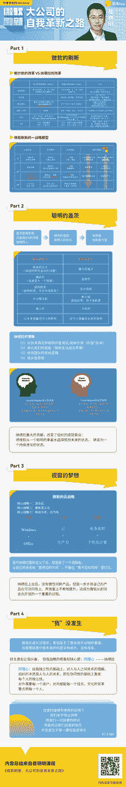 |
| --- |

首发于 2023 年 11 月 6 日