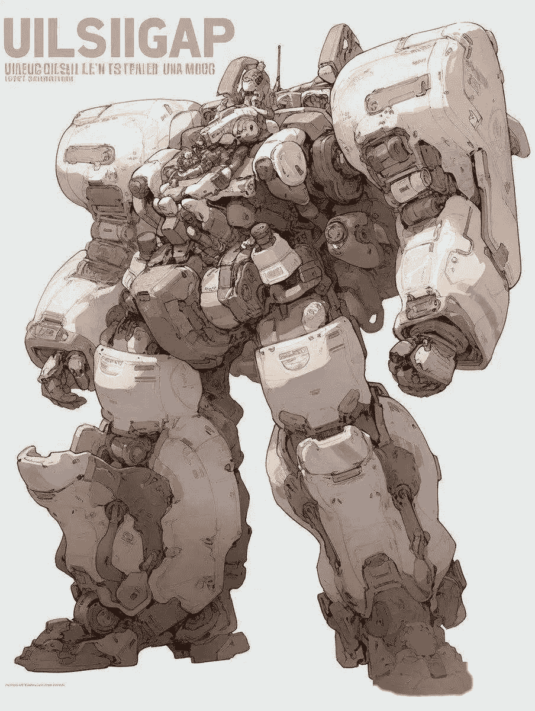
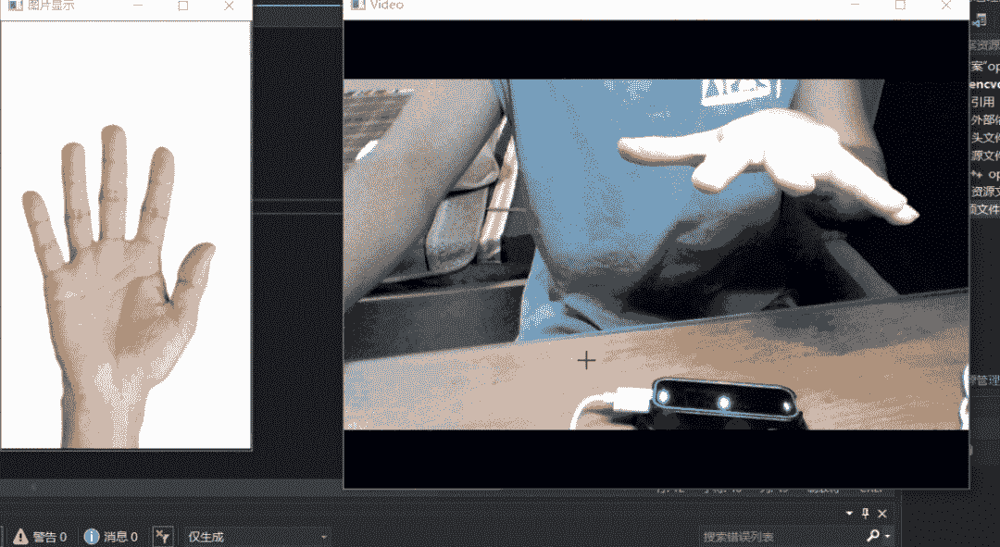
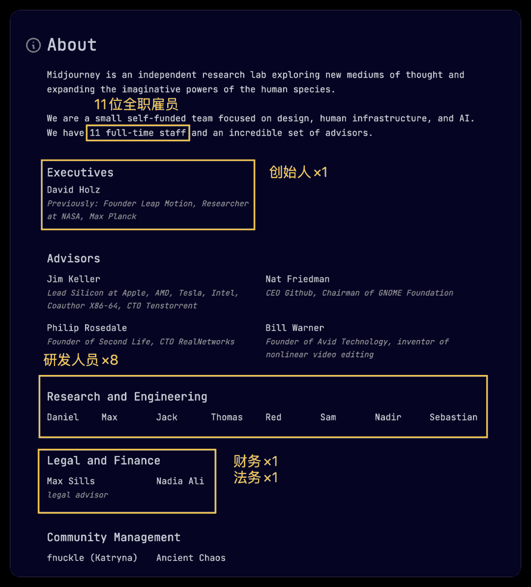
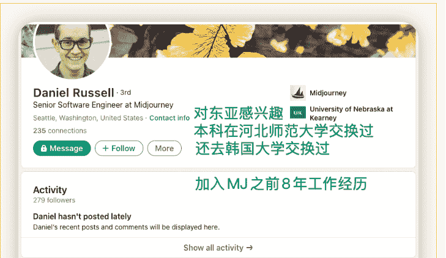
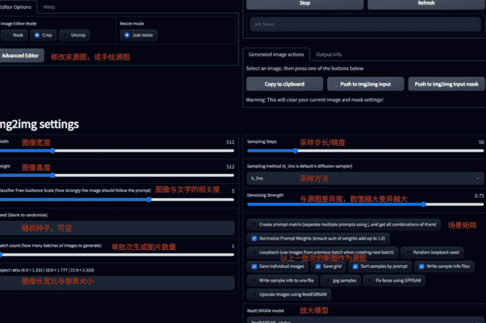
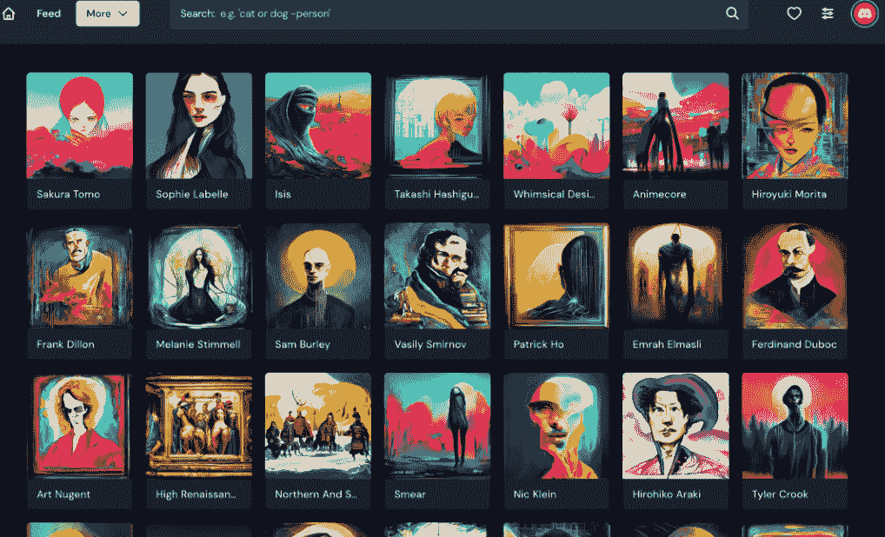
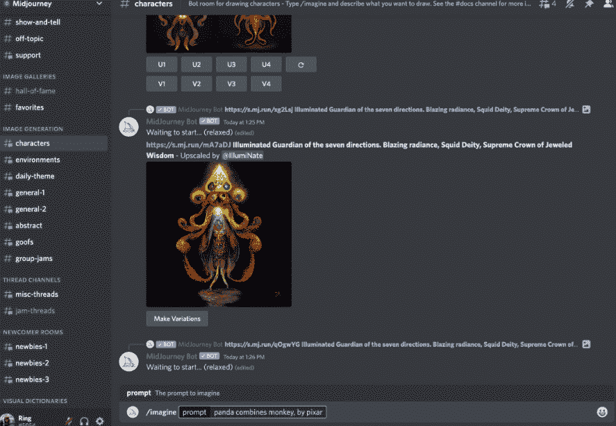
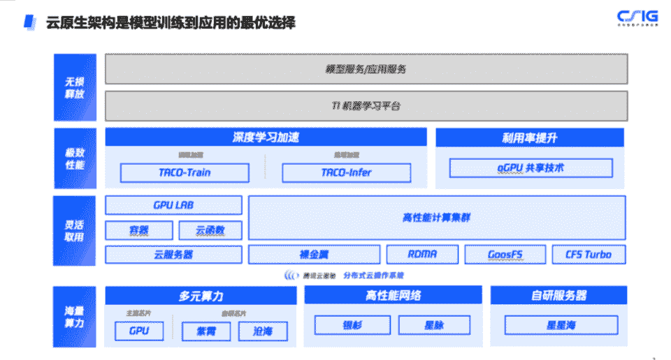

# Midjourney：伟大的公司只需要十一人

> 来源：[https://leonzhang.feishu.cn/docx/YKvBdl3nloN3T6xMqwGcb3mAnmm](https://leonzhang.feishu.cn/docx/YKvBdl3nloN3T6xMqwGcb3mAnmm)

在生成式 AI、云计算等技术逐渐抹平大企业与中小企业之间的技术、成本差距后，各企业真正比拼的，只剩下人才、创意与执行力。

目前，随着 AI 技术的快速迭代，各种基于 AIGC（人工智能内容生成）技术的产品不断涌向社会，而其中最普遍的，则莫过于大量的 AI 绘图模型，如 Midjourney、Dreambooth、Novel AI 和 Stable Diffusion 等。

虽然 AI 绘图领域，看似进入了百花齐放的时代，但目前业内的顶流，仍然是 Midjourney 和 Stable Diffusion 为代表两大龙头。

今年 4 月，Midjourney 进一步宣布推出针对二次元、动漫风格的绘图模型 Niji-journey V5。

这一模型与以往最大的不同，就是它能“取代”高级原画师了。

凭借着出众的造型张力和色彩使用、以及丰富的风格化表现力，Niji V5 不光看傻一众吃瓜群众，甚至惊艳了业内画师，让人直呼其已经具有了大师插画的味道。

之所以能够如此质变，一大原因在于相较此前版本，Niji V5 支持了风格化（stylize）参数设置。

简而言之，在该版本下，用户只需使用风格化命令，就能引用不同艺术家设计风格产出图片。

在 Niji V5 的助力下，人们轻易地生成了许多“大师级”的作品。

Niji V5 产出图片的品质相当优秀，几乎覆盖市面上的常见风格。在此基础上，使用者只需要微调设计，基本能够达到大部分优秀高级原画的工作需求。

如此出色的技术，不禁让人对其背后的 Midjourney 公司产生了强烈的兴趣。

实际上，虽然 Midjourney 和 Stable Diffusion 同为当前 AI 绘画的两大领军者，但其当下的境遇却有着天壤之别。

Stable Diffusion 背后的明星公司——Stability AI，目前正面临严重的财政困境，由于没有明确的盈利途径，公司正面临倒闭的危机。

相较之下，Midjourney 却运行得风生水起，凭借着付费订阅的商业模式，Midjourney 不仅获得了每年 1 亿美元的营收，并且在 Discord 上已经积累了 1000 多万用户。

同为开发绘画 AI 的团队，Midjourney 是怎么取得今天的成就的呢？

1

**延伸人类想象力**

虽然 Midjourney 在不融资的情况下就实现了盈利，但从创建的背景来看，创始人大卫·霍尔茨（David Holz），并不像那种钻进钱眼里的人。

他为 Midjourney 设立了一个非常不“铜臭”的宗旨：AI 不是现实世界的复刻，而是人类想象力的延伸。

而这样充满科幻色彩的宗旨，和大卫的背景、经历有着很大的关系。

MidJourney 的创始人大卫·霍尔茨

作为一个数学专业的博士生，大卫曾在大学期间研究激光雷达、大气科学和火星任务，可谓是一个涉猎甚广，且充满好奇心的“怪才”。

经过了广泛的探索后，大卫似乎找到了自己真正的兴趣所在，于是，在 2010 年便创立了一家研发手部跟踪技术为主的公司——Leap Motion。

然而，由于与之相关的 VR/AR 技术一直不成熟，Leap Motion 也始终没能做出有具体应用场景的产品。

大卫之前研发的手部追踪产品

最终，2019 年，大卫把 Leap Motion 公司卖给了竞争对手 Ultrahaptics。随后，他成立了一个工作室来探索新的机会，

恰巧在这时，AI 在生成艺术方面取得了突破。

Transformer 架构的出现，彻底改写了图像合成的历史。从此，多模态深度学习整合了 NLP 和计算机视觉的技术，成为图像合成的艺术方法。

于是，借着生成式 AI 的东风，大卫创建了 Midjourney。

公司团队成员仅 11 人，其中 1 位创始人、8 位研发人员、1 位法务、1 位财务。

在公司的构成中，完全没有产品经理、市场销售人员，除了创始人、两个支持性岗位（法务、财务），80%的人员都是研发人员。

而作为中坚力量的研发成员，一半（4 位）都是尚未毕业的本科生。

虽然这四位本科生都有一些实操甚至是创业经历，但是确实经验有限，而且也非毕业顶尖名校。

剩下来的几位研发人员，都有着比较丰富的职业经历。

在聚拢人才后，大卫也进一步明确了自己对于 Midjourney 的理念。

大卫将公司 Logos 设计成了一艘在波浪中航行的帆船，意为水既危险，又是文明的驱动力。

懂得如何与水一起生活和工作的人类，将有能力在水中游泳、做船、筑坝发电，从而更好的生活，因此，大卫认为 AI 是人类想象力的引擎。

然而，在当时生成式 AI 的竞争格局上，有这类“雄心壮志”的团队，可不只 Midjourney 一家。

例如 Stable Diffusion 的母公司 Stability.AI，在创立时也声称要将自己的使命定格为成为世界领先的开源 AI 公司，并发扬将 AI 共享于全世界的理念。

然而，口号喊得震天响，理念终归是不能当饭吃的啊。

情怀满满的大卫，之后是怎么解决一系列公司融资、盈利的问题的呢？

2

**开源 VS 闭源 **

从今天来看，Midjourney 的盈利模式看上去十分简单，即通过付费订阅的商业模式，按月向用户收取费用，其标准有 3 种套餐，分别是 10/30/60 美元/月。

不过，这样的模式要想行得通，得解决两大关键问题：

1.凭什么让用户产生付费的意愿？

2.大模型训练所需要的高昂成本怎么解决？

先来说说第一点，实际上，当 AI 图像生成技术开始方兴未艾之时，很多使用者并不觉得这种技术是需要“付费”的。

原因就在于，当时像 Stable Diffusion 这样的行业龙头，为了吸引大量的开发者，最大程度的把模型用起来，因此采取了开源的模式。

和 Dall·E、Midjourney 不同，Stable Diffusion 是完全免费、不限次数、任何人都可用的。

虽然对硬件有着一定要求，但也能在几秒钟内生成高清图像。

这样的好处在于，开源社区会齐心协力地完善模型文档，共同解决技术难题。这使得代码的迭代速度非常快，优化效率远远高于闭源系统。

但缺点也很显而易见，那就是商业化不够直接，可能为别人“做了嫁衣”。

而相较之下，Midjourney 却采用了不那么开放的“闭源系统”。

如果说闭源系统真的有什么好处，那就是针对性更强了。

因为模型闭源，并通过庞大的用户量积累了独有的数据集，可以根据用户需求不断地针对性训练模型，长期来看更有利于建立竞争壁垒。

在探索用户需求这点上，大卫采取了产品上线后边测试边改进的办法。

例如 Midjourney 模型最开始很慢，需要 20 分钟才能出一张高质量的图片。后来团队推出了一个做 15 秒生产图片，但是质量没那么高的版本，

经过多轮测试，团队了解到，速度和质量其实都只是表象，因为不同用户的选择，实际上是多维度的。

在针对用户需求进行调整后，无论是创意行业设计者，还是普通爱好者，都能通过 Midjourney 满足自身的绘画需求。

除了了解用户需求外，在使用流程方面，Midjourney 也并不像 Stable Diffusion 需要本地部署，操作十分便捷，对显卡和硬件性能也几乎没有要求。

虽为闭源，但 Midjourney 在使用难易度上，却更像一个“亲民”的大众产品。

于是，Midjourney 获得大量用户后，养成了用户使用习惯，且在开启付费订阅后就进一步加强了用户粘性。

3

**算力难题**

刚才提到，Midjourney 在硬件方面，对用户几乎没什么要求。而这样的原因，则是由于 Midjourney 所有的图片都是在云上完成并训练的。

但如此庞大的云计算量，必然需要高昂的成本，这就回到了刚才的第二个问题：

在没有融资的情况下，在云上进行大模型训练所需要的高昂，该成本怎么解决？

实际上，大卫解决这个问题的方式很简单，也很不可思议。

当大卫需要找到一个云供应商提供 10,000 个 GPU 时，他直接给云供应商的负责人发了封电子邮件，结果对方就直接给到了这些资源，完全不需要风险投资。

看到这儿，也许有人惊得下巴都掉了，这种事在现实中真的可能吗？

当然，供应商并不是抽风了，而是看中了大卫之前的成就和声誉。

大卫之前的创业已经获得了声誉，大卫打从创办 Leap Motion 的时候起就有一个观点，他觉得技术的最大限制不是规模、成本或速度，而是人们如何与之互动。

Leap Motion 的手势互动是一个尝试，到了 Midjourney 这里，他开始使用更短的绘画关键词（prompt）来催动 AI 产出。

这样的理念，吸引了每一个了解大卫的人，也让他得到了云供应商的支持。

然而，在获得了供应商的鼎力支持后，大卫也仍然要面对算力捉襟见肘的问题。

从成本来说，Midjourney 大约 10%的云成本用于训练，90%是用户制作图像的推理。所以几乎所有的成本都在制作图像上。

为解决这一点，Midjourney 在世界上八个不同的地区，设立了自己的服务器，比如韩国、日本或荷兰等，在每个时区的夜间，当地人都在睡觉，没有人使用 GPU。Midjourney 就可以充分利用这些算力，实现 GPU 负载平衡。

实际上，这种依靠云端服务器来降低成本、加快模型训练的做法，与目前腾讯训练大模型的策略十分相似。

在算力已经愈发成为大模型训练瓶颈的今天，如果在训练开发环节，直接调用云端的大模型和 AI 算力资源，完成后一键分发到用户终端上，就可以大大降低成本，减少工作量。

因此，Midjourney “云上计算”的这一步棋，着实是摸准了时代的方向。

互联网的演进之路，已经说明，无论 To B 还是 To C 行业，都在追求越来越集约精简的终端硬件、越来越低门槛的交互入口、越来越轻盈的软件应用。

所以说，大模型从云入端，是模型服务商实现商业化的必争之地。

4

**总结**

从 Midjourney 看似不可思议的创业经历，我们可以发现，在这次 AIGC 时代的浪潮中，能够脱颖而出的企业、团队，未必是财大气粗的头部大厂。

因为在生成式 AI、云计算等技术逐渐抹平大企业与中小企业之间的技术、成本差距后，各企业真正比拼的，只剩下人才、创意与执行力。

而这也是为什么， Midjourney 这类仅有寥寥十几人的小团队能脱颖而出的原因。因为这样依靠少数尖端人才组建的团队，具有大企业所没有的灵活性、创见和魄力。

而这类小团队的创意、灵感，若要真正在市场、社会中扎下根，就离不开对用户多样化、个性化需求的追踪。

这是因为，AIGC 技术的“泛用性”，决定了其绝不是针对某一行业、人群，或是某一类企业的技术。

只有在这多样化的需求中，尽可能地满足不同层级用户的特定需求，一款产品才能真正地具有长远的生命。

既服务所有人，又不忽视每一个特殊的人，这或许就是 Midjourney 成功的最大原因。

#

**一封邀请信**

您好！诚邀您加入我们的 AI 精英俱乐部，这是一个永久免费但门槛较高的、聚集 AI 精英与爱好者的专业组织。我们致力于推动 AI 技术在投资领域的应用，为成员们提供一个共享和交流的平台，促进互相学习和合作，共同探索 AI 技术在投资中的无限可能性。

作为成员，您将有机会与世界各地的 AI 专业人士互动，分享您的知识和经验，以及从他们那里学习到更多的技术和行业见解。

我们要求加入俱乐部的成员满足以下标准：

一、乐于分享：我们希望能积极分享自己的知识和经验，与俱乐部的其他成员共同成长和进步；

二、有 AI 技术背景：我们欢迎在 AI 领域具有丰富经验和专业知识的成员，包括但不限于机器学习、深度学习、自然语言处理、计算机视觉等领域的从业者和研究者；

三、愿意将 AI 技术应用到投资领域：包括但不限于量化交易、资产管理、风险评估、市场预测等，共同探索 AI 技术在投资领域的应用前景；

四、拥有独特资源：包括但不限于资金、人脉、数据资源等，这将有助于俱乐部的技术和项目合作。

如果您满足以上标准，并且对 AI 技术在投资领域有浓厚兴趣，我们诚邀您加入。

> 🔗 原文链接： h[ttps://mp.weixin.q](https://mp.weixin.qq.com/s/Eo4WS_z2yenPJ-rA7B1PUw)q.com/s/Eo4WS_z2...