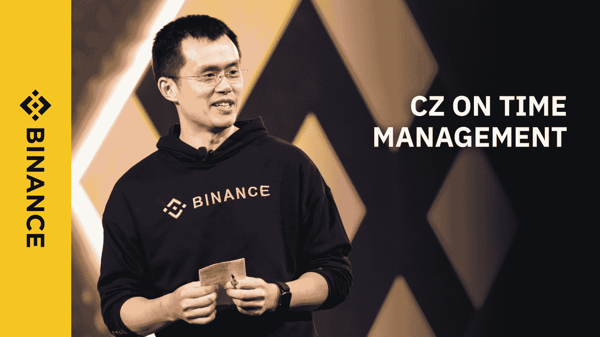

# 币安创始人赵长鹏（CZ）：我的时间管理法则 | 币安资讯

> 来源：[https://leonzhang.feishu.cn/docx/RaqZd3qpRoBiHQxtlDxc9AbEnjf](https://leonzhang.feishu.cn/docx/RaqZd3qpRoBiHQxtlDxc9AbEnjf)

> 🔗 原文链接： h[ttps://www.binance](https://www.binance.com/zh-CN/blog/from-our-ceo/%E5%B8%81%E5%AE%89%E5%88%9B%E5%A7%8B%E4%BA%BA%E8%B5%B5%E9%95%BF%E9%B9%8Fcz%E6%88%91%E7%9A%84%E6%97%B6%E9%97%B4%E7%AE%A1%E7%90%86%E6%B3%95%E5%88%99-937115089915394194).com/zh-CN/blog/...

今天，有人问我：“您怎么有时间读这么多书？”以下就是我的秘诀。

在我看来，时间管理主要是一门说“不”的艺术，不做什么比做什么更重要。

我[不参加任何](https://www.binance.com/en/blog/from-cz/communication-tips-from-cz-399492046094925824)见面会、推介会或探索会等，这些会议需要消耗大量的时间，且通常效率极低。我会毫不留情地直接拒绝，甚至到了不礼貌的地步，比如我会把 这篇文章 发给他们看。这可能不太礼貌，但可以节省时间。

我喜欢简洁，这样就可以腾出时间做其他事情。如果某件事可以总结，那它只需要总结就好了。

我会把大部分会议控制在 15 分钟以内，即使是面对面开会也是如此。而且，一开始我就会告诉他们，我只有 15 分钟时间。

如果不需要我出席，我便不参会。我不只是听，我还要求给我一份能在 30 秒内读完的会议摘要。

无论是在工作还是在个人场合中，无论是在网络上还是在现实生活中，我从不闲聊。我总是直接问：“您想让我做什么？”如果不需要我做任何事情，我就会结束或忽略对话。我聊天不是为了好玩。

无论是在工作还是在个人场合中，我都会退出不再需要我在其中发言的聊天群。这样我就少了一个需要点击的东西。少一个通知，就少一个弹出窗口。

我也很少参加社交活动。我不是一个“枢纽”，不会和很多人保持联系。我的交际圈很小。我会确保我的交际圈中有几个“枢纽”（社交达人）。当我需要的时候，我可以依靠他们来联系他人。

我确实会和少数朋友一起社交，但频率可能比大多数人要少得多。

我不购物，我讨厌做这件事。我大部分的东西都是在网上成批买的，比如 10 件同款的裤子、衬衫和袜子等。多数情况下，我会在前 5 个搜索结果中挑一个，或者直接选择 AI 推荐的东西，这样我就不必花时间进行挑选了。

我不做饭（没这个天赋）。我会在菜单上看到的前三样东西中点一样。我点餐的时间不会超过 10 秒。比起“法式大餐”，我更喜欢快餐。对不起法国，不是法餐口味不好，只是时间问题。我总会要求法国厨师一次性端上“所有菜肴”，并尽量忽略他们脸上被冒犯的表情。

我不整理房间、桌子或行李箱，它们总是一团糟。

我不看新闻，除非有人给我发链接。即便如此，我也只会花 10 秒钟扫一眼。我的阅读速度很快。

我不看体育比赛，除非我们有赞助，比如 CR7 或阿根廷参加世界杯，实际上我只在电视上看了世界杯的最后一场比赛，非常精彩的一场比赛！我知道，为了挤出时间，我必须放弃一些东西。

我不看电视。过去我常常会看很多电影，但现在，我发现大多数电影都很无聊。也许是我变老了。

我不刷抖音或视频推送等。针对我的背痛问题，我在 Instagram 上关注了一些“整骨/脊椎按摩师/锻炼”类型的账号，这样我每天都有动力做一些简单的锻炼。

我确实在 Twitter 上花了不少时间，也写了一些博客。

我不听音乐，也讨厌在餐厅或会议场所播放嘈杂的音乐。我总是让他们小点声。我喜欢安静的地方。

基本上，我是一个非常非常无聊的人。

我喜欢听书。我洗澡、刷牙、当然还有上厕所的时候都会听书。我在车里或是机场时，也会听书。我每天睡前会听一小时左右的书（仅这一点就很容易做到一周听一本书）。不过，听书时间花得最多的地方是在飞机上。如果我灵感来了，我会试着写一篇博客之类的。当我累的时候，我只听书。我可以在一次长途飞行中听 2-3 本书。我经常到处飞。去年在空中飞行了 600 小时。

多数时候我都是以 2.5 倍速听（过段时间你就会习惯的）。大多数书的平均听书时间约为 4 小时。

关于如何选书，有些是朋友推荐的，有些是 AI 根据我的阅读偏好推荐的。

对于我不喜欢的书，一旦我发觉不喜欢，我就不再听了。我买的书大部分都没读完。

对于我喜欢的书，我会听很多遍，还会买 Kindle 版本来读。

时间是最有限的资源，而知识是最强大的杠杆。不要用时间去交换任何不重要的东西。

## 延伸阅读

+   [《赵长鹏（CZ）的完整书单》](https://www.binance.com/en/blog/from-cz/the-complete-cz-reading-list-421499824684900802)

+   [《赵长鹏（CZ）的推荐书目》](https://www.binance.com/en/blog/from-cz/czs-book-recommendations-3164932959824224096)

+   《来自币安首席执行官的一封信：2022，韧性为王》

+   [《赵长鹏（CZ）的信条》](https://www.binance.com/en/blog/from-cz/czs-principles-6343713009794494746)