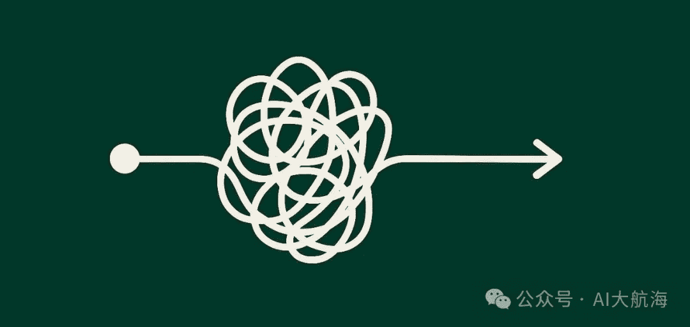

# 伟大的起点无法被计划

> 来源：[https://leonzhang.feishu.cn/docx/ZtapdfjS3oK7hoxTUTLcIjcCnFc](https://leonzhang.feishu.cn/docx/ZtapdfjS3oK7hoxTUTLcIjcCnFc)

> 🔗 原文链接： h[ttps://mp.weixin.q](https://mp.weixin.qq.com/s/iYBKUxwy5Rtz1KHmhvxvOQ)q.com/s/iYBKUxwy...

> 原创 吴炳见 AI 大航海 2025 年 06 月 23 日 21:04  北京

十几年前，大概有上千份 BP 写着想做一个种草社区、穿搭社区、和中国的 Instagram，后来实现这个的是📕，它的起点是境外购物指南。

很多 BP 写着想做下沉版淘宝，解决乡村购物的问题，有人铺终端，有人用分销，后来实现这个的是拼多多，他的起点是拼团买水果。

有上千份 BP 写着他们想做移动互动娱乐平台，有人做游戏，有人做社交，后来实现这个的是抖音，抖音的起点是年轻人的音乐小视频，而 字节的起点是内涵段子。

这说明什么？ **终**点常常被期待 ，也有不少人能看到，但难以预测起点，也无法 精准预测终点的产品形态。伟大无法计划，因此 只能做对用户有价值、有留存的事情。

今天的 AI 创业，很多 BP 上也写着下一代 AI 抖音、下一代 Agent 平台，十多年后我们会发现这些平台真的存在，只是切入点又一次超出我们想象。

有上千人在 BP 上写着下一代 AI 某某平台时，这是个共同期待，这个平台是有挺大概率出现的，问题是这个产品 day one 长什么样子？从起点到终点的路径如何走？这是无法计划的。

（创业 is like...)

总结上一代优秀产品的共性，就是他们的起点都解决了一个真实需求。

作为创业者，唯一能计划的就是——day one 我瞄准了什么细分人群，解决了一个什么具体问题？我的产品从体验上是否击穿了用户。

即便是个粗糙些的产品，只要路子对，击穿了用户，一定会带来留存。

**这群用户就是实验室，后面的迭代和泛化都是基于这群用户做实验， 如果上线**了 killer feature，大概率会形成口口相传，带来自来水流量。反之，如果功能不对，即便反复雕琢，增长也乏力。用户在用留存和付费投票。

这是摸着用户过河， 正是这样的正负反馈，才形成了从起点到终点的路径。

探路的过程也是演进的过程，回头看，演进的力量是惊人的，上面提到的📕、拼多多们不仅活成了“种草社区”和“下沉版淘宝”，而是远超这些定位，并且吃掉了其他的垂直社区，和垂直电商，形成更大体量。

当时很多人都质疑过，📕会不会只在白富美人群？拼多多会不会只在下沉市场？现在答案不言而喻，这都是上亿日活的产品，已经泛化到普罗大众了。这种泛化背后，每家有每家的武器，📕的内容质量，拼多多的低价，抖音的内容趣味性。用户林林总总的需求没有分散到 N 个垂直 App，而是收敛到了这十几个头部 App。

初始的垂直，和后期的泛化，形成强烈对比，更具戏剧性。

初始的垂直和聚焦，对当下的 AI 创业来说也照样适用，如果产品上线第一年我们 ARR 想做 1000 万美金，我们并不需要太多用户。假设一个用户一年付 500 美金，我们只需要 2 万个付费用户，我们是可以在用户上做取舍的，只做欧美还是只做日韩？只做忍受度高的 early adoptor 还是大众用户？只做专业创作者还是泛 C？

核心问题是，你击中这 2 万个用户了吗？他愿意掏钱吗？

在移动互联网时代，曾有个很有名的失败案例 Color，现在已经被忘了。

2011 年，最热的概念是 SoLoMo——Social、Location、Mobile，Color 就是这样一个 SoLoMo 的产品，诞生在硅谷。用户无需注册，打开应用即可拍照，内容自动分享给附近 30 米内的用户，主打“弹性社交网络”——通过光线、距离、声音等环境数据自动分组，进行社交互动。（是不是没听懂？我当时用了也没懂啊）

Color 的团队极为豪华，CEO Bill 是连续创业者，做过三家互联网公司，一家 IPO，两家被收购，累计退出了 9 亿美金。联创 Peter 是金融服务工具 BillShrink 的创始人，被 MasterCard 收购。产品负责人 DJ 是 LinkedIn 首席科学家。在天使轮，还没有产品的时候，就获得 4100 万美元的投资，背后是红杉美国、贝恩资本、硅谷银行。

最热的概念+豪华团队+大额融资，这是当时硅谷最靓的仔。发布前被媒体热捧，被誉为"革命性社交应用"，"硅谷每十年改变世界的一两个公司之一"，“Facebook 的颠覆者”。

2011 年 3 月，Color 发布当日登顶 App Store，才推出 24 小时，已经有几百篇文章在专门讨论它。但口碑迅速崩塌——闪退、操作混乱、没有内容可看，出现最多的评价是“毫无用处”，60%的评分仅 1 星。2012 年 11 月，Color 承认失败，关停服务，以 700 万美元的估值被 Apple 收购了。

显然，Color 没有击中任何用户，脱靶了。伟大的抱负还是需要一个靠谱的产品来承载。

不仅创业的起点无法被计划，投资的起点也很难被计划。

**一**个常识：如果你投了一个项目的天使轮，如果这个项目成了，回头你翻下投资 memo，产品和商业模式一定已经面目全非，只有人那一段是一样的。

最近刷屏的两个案例，3200 亿市值的泡泡玛特，700 亿市值的影石创新都是这样，第一天和上市时是不一样的。2012 年，麦刚投资泡泡玛特天使轮时，泡泡还在做潮流杂货集合店，卖文具、玩具、饰品，直到 2016 年，泡泡转型潮玩，推出首个自有 IP“Molly 星座系列”盲盒。2015 年，IDG 在投资影石的天使轮时，这家公司还叫“岚锋创视”，做直播软件，之后转型开始做 360 度全景相机，今天他的定位是智能影像设备。

我相信每个做早期投资的人，都会有类似的体感，尊重不确定性，尊重演进，就是尊重常识。

**一**棵树能长很高，并不是因为它细胞多，而是它的单个细胞足够强壮——这个细胞就是创始人，和它创立之初的 PMF （ Product Market Fit）。

Day one 就面向真实需求，解决具体问题的公司，往往长得高一些，这一点不区分是 mobile 时代，还是 AI 时代。

祝你做个 super cell。

作者介绍：吴炳见，心资本 Soul Capital 合伙人，从事 AI 相关的风险投资。前某大厂 mobile 产品经理+战略分析，之前就职于险峰和联想之星。参与投资过多个大模型和 AI 应用项目。关键词 LLM、AI Native、AI 基础设施、Robotics。

如果我们关键词刚好一样，如果你是 AI 从业者，欢迎加🛰️认识，wx：wubingjian。（加的时候请说下自己的公司、职务，有什么能一起交流的）

「对 AI 创业 的深度思考 」