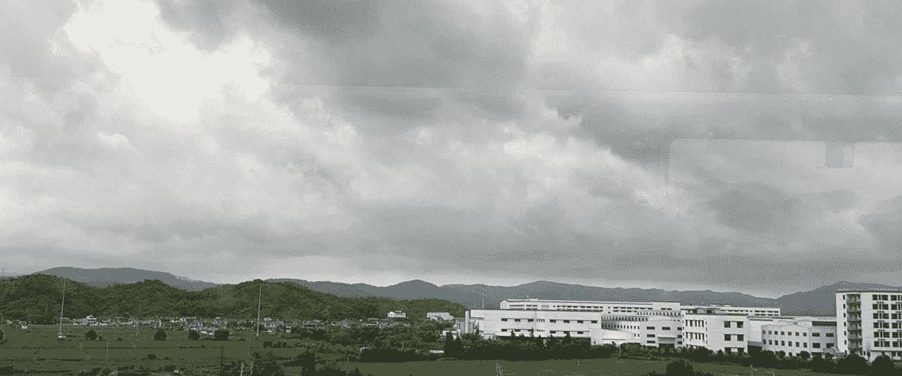
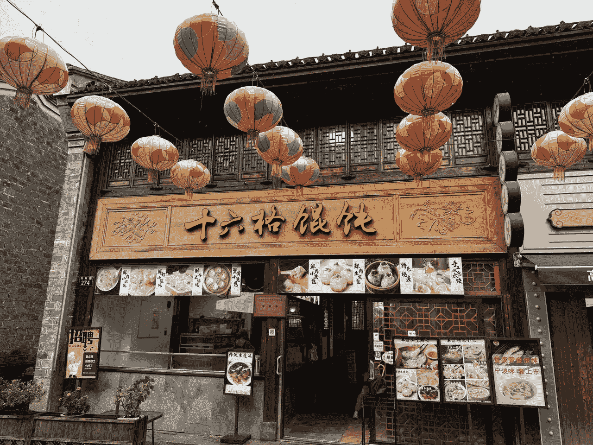
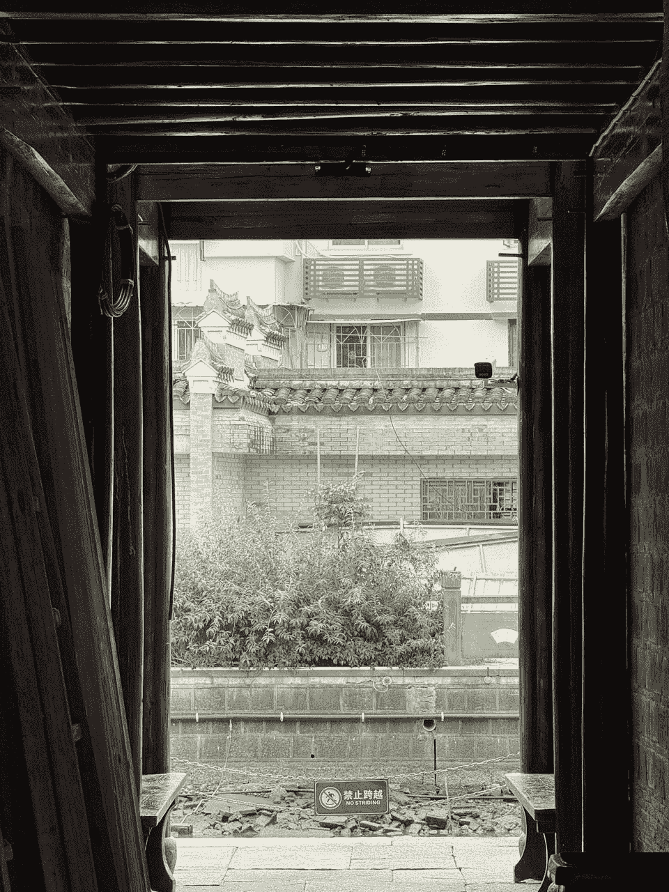
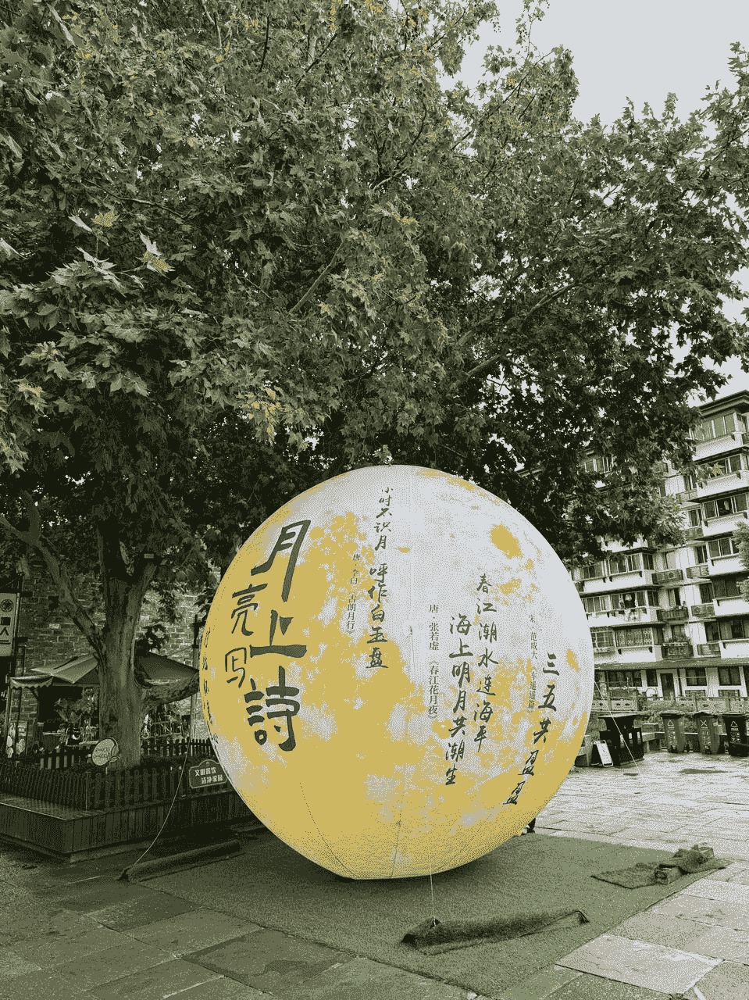
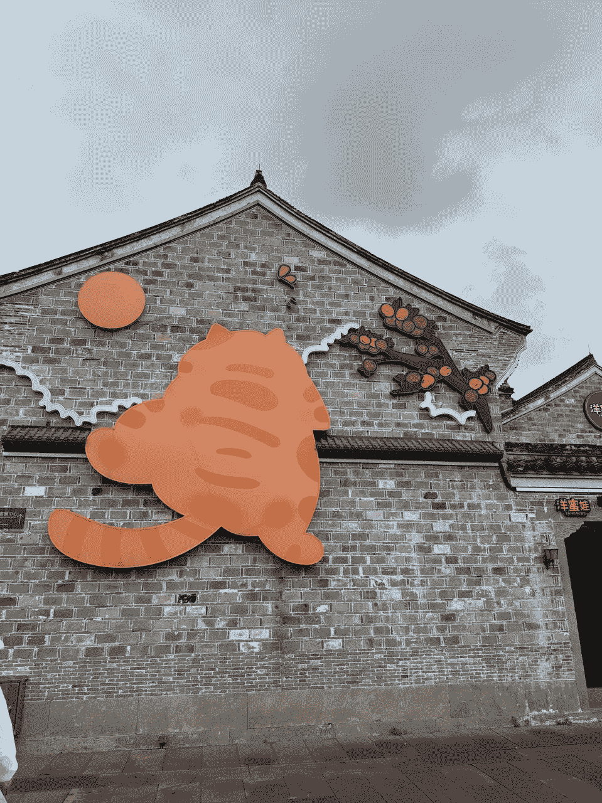
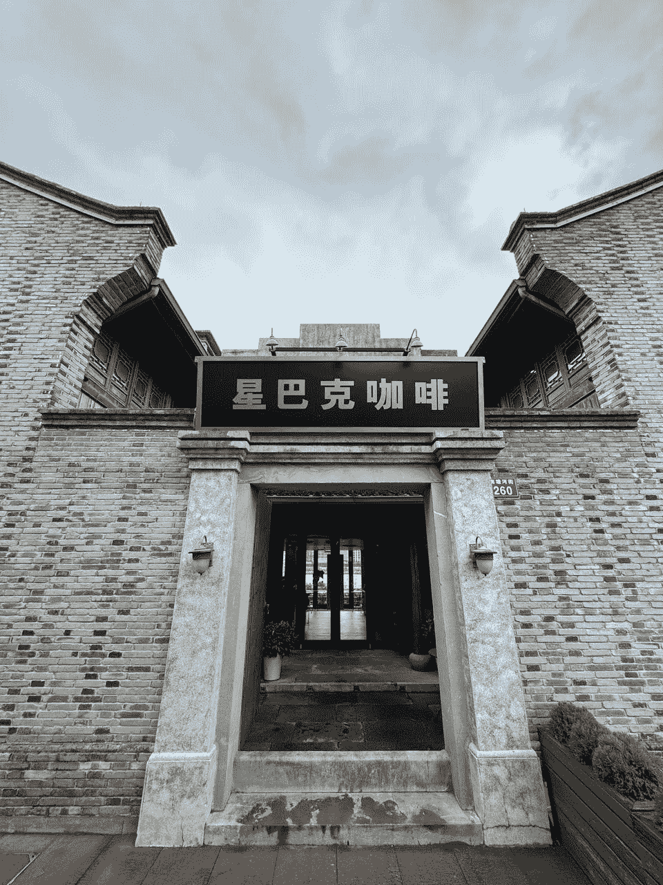
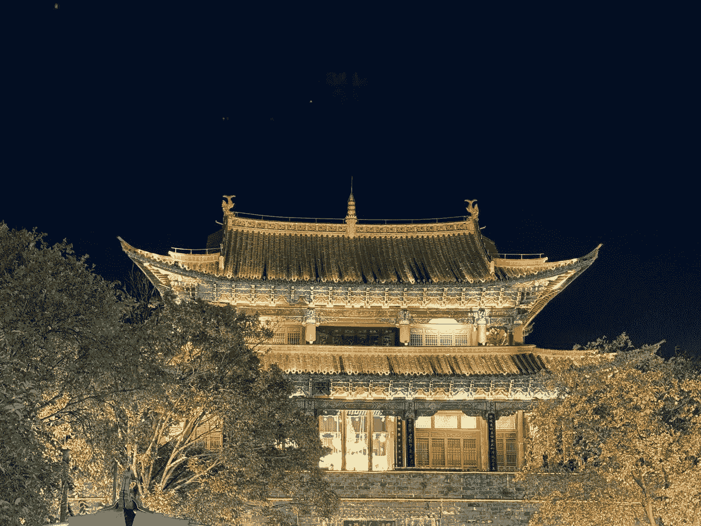
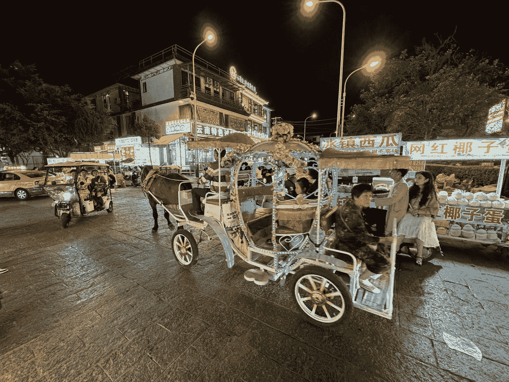
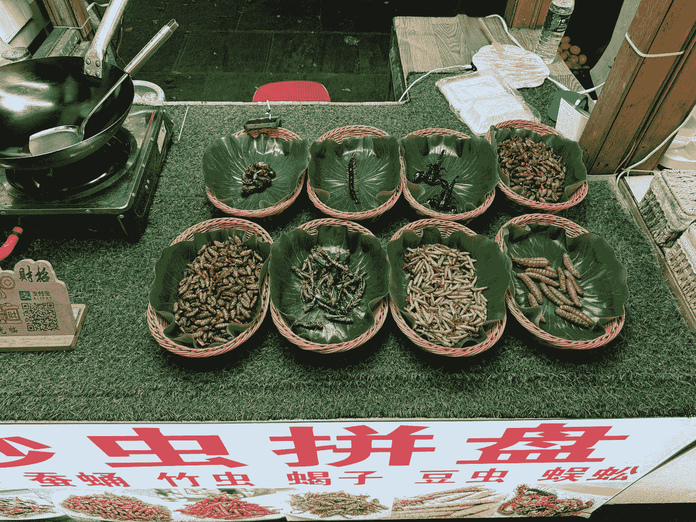
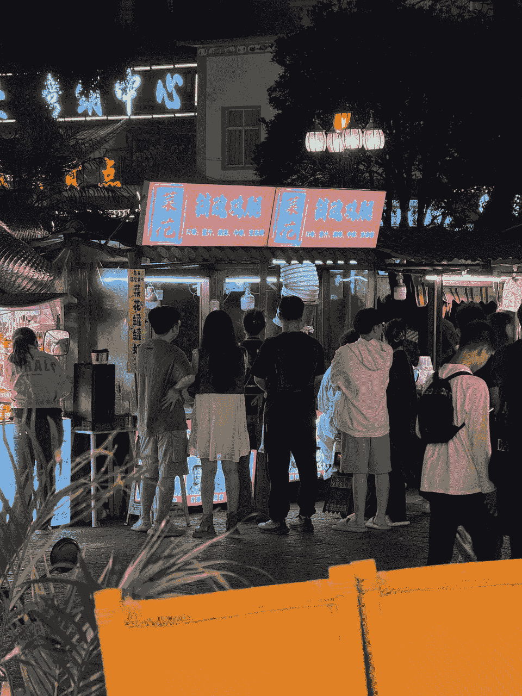

# 游记｜云南中秋行 Day 1

> 来源：[https://leonzhang.feishu.cn/docx/KsnndcL0tov1HkxeVV6cTuclnBe](https://leonzhang.feishu.cn/docx/KsnndcL0tov1HkxeVV6cTuclnBe)

### 前言

关于这次中秋之行，最早要从 Sunny 提议是否要一起去英国游玩开始～

我还没有去过，所以当 Sunny 和我提起的时候，我很兴奋，直接就答应了，可后来慎重考虑后还是放弃了，当然，里面有很大部分是 👛 不够鼓。

不过没关系，这次去不了，那就下次再去！

考虑到，既然太远的地方去不了，那就再去一趟云南吧～

其实在看机票的时候就发现订票平台上显示“请 3 休 8”的提示了，在我每看一次的时候便告诉我一次，仿佛在不停的“暗示”我，“走吧，出去玩吧”，哈哈～

之后便是爽快的（提前）请假，准备去玩！！

毕竟难得出远门，工作电脑不会带，甚至自己的电脑都没带，只有手机和充电宝。我的考虑是如果在路上听到、看到，或吃到好吃的东西，先记录关键词或句子在 flomo 上，然后回来再用电脑编辑，完全也来得及，所以就这样做了。

出行前还是很忐忑的，毕竟第一次出门 8 天，那边天气和杭州又完全不相同，带多少种类型的衣服、带多少衣服，都成了我要考虑的内容，再加上出行前还有台风“贝碧嘉”的影响，提前买了延误险，以防万一。不过幸运的是，这次并没有用上延误险，才得以让这次云南之旅顺利地进行，感谢眷顾！

### 出发前｜准备工作

还没有出发前，看那边的天气，可能需要穿着厚些～

因为当时的杭州温度大约是 25℃ 到 35℃，对比大理或丽江，却只有 16℃ 到 25℃，平均下降了近 10℃，我甚至还买了新的冲锋衣和运动鞋，结果冲锋衣因为不好穿，最后选择了退货，但是运动鞋是买值了，毕竟走的路很多，无论是在古城还是路上，运动鞋肯定要比板鞋舒服，原计划我是想穿板鞋的，还好没穿。

我带了三件外套，有防晒、薄外套和冲锋衣，两条裤子，短裤、四五件短袖。想着如果冲锋衣穿不上的话，到时候就寄回来，或者不够的话就到当地再买。充电宝是 2 万毫安的酷态科，无论是容量、快充速度还是便携程度都远超我预期，推荐。

幸运的是，落地之后并没有我想象中的那么冷，到之后发现还是有人短袖短裤，当然，也有可能是外地人。可我们有次早上逛早市的时候发现，也是有很多当地人穿短袖的，而且很多！！就超离谱，不过大概率和他们这里常年这温度有关，就不冷不热。

对了，本次出行所有的拍摄图片均为 iPhone 15 Pro Max，感谢苹果，可以让我随拍随用，原图直给就很好看，当然，云南的天气也是很 Nice 👍

差不多了，以下便是我的 8 天之旅，也分享给你～

### 出发｜从杭州到宁波

工作日结束后，经历旅行前的最后一次收拾，便开始休息了～

次日凌晨 4 点半起床，5 点半迎着日出便出发了，又一次拍到了复兴大桥的日出，上次拍到是 8 月份去上海，上上次是 7 月份去湖州，每次都好看～

因为机票是从宁波起飞到昆明，所以才能在从杭州到宁波的高铁上看到本是晴朗的天空，然后变成这样乌云笼罩的天空，有种向着乌云进发的感觉。杭州到宁波的方向正好是东南方向，没错，列车在冲着台风“贝碧嘉”方向前进～

### 🛫 前｜宁波

又一次到了宁波，我们伴着小雨逛了南塘老街，吃了十六格馄饨，也吃了王升大的汤圆，也第一次听说，关于“王升大”的故事。

王升大创始人叫王兴儒，最初是米店（“王兴记”），在当时卖米的时候，王升大选择在卖米量米的时候，多留一些给客户，为的是多给人家一些，相当于是让利给客户，由此便使大家熟知，随着生意的兴旺，后来被人们称“王兴记”米店为“王升大”，后来也就改名如此。这个行为颇有我了解到的浙商风格，之前看电视剧《鸡毛飞上天》也有类似的说法，也就是剧中提到敲糖帮的“进四出六”。

在南塘老街的最后，也看到一家从来没有见过的星巴克风格，这个风格很老街。

|  |  |  |
| --- | --- | --- |
|  |  |  |

### ✈️ ☁️｜从宁波到昆明

候机的时候听到有飞机因为目的地的天气原因无法起飞，当时还在想，轮到出发航班的时候，会不会改为“因为出发地天气原因，无法起飞”。

不过我也很清楚，即便无法起飞也是正常，毕竟对比杭州，台风对宁波的影响会更大。最后很幸运，航班没有延误，很幸运的按时起飞了～

附上一张好看的云 ☁️

和上次的行程一样，落地昆明后，我们又乘高铁到达了大理～

到达大理古城已经是晚上，便开始逛吃逛吃～

夜景的古城城楼还是一样的好看，这次距离古城南门比较近，小吃街上看到了许多当地特色，比如城市看不到的马车、城市里少见的石板烧、城市不敢吃的野山菌和炒虫子。没错，是真正意义上的虫子，除了蚕蛹和竹虫，甚至还有蝎子和蜈蚣（真的很佩服第一个吃这俩东西的人）。

我是有些怂的，怕吃了后出现“小人”，就直接放弃掉了野山菌和炒虫子，实在怕接下来几天会在医院里度过...

|  |  |  |
| --- | --- | --- |

对了，还听到小吃街的酒馆门前小姐姐们的吆喝～

最后吃了石板烧，还有菜花家的销魂鸡腿，太辣了，辣到忘记拍照，甚至现在都想不起来石板烧吃的好不好吃。虽然销魂鸡腿很辣，但好吃也是真好吃，不争气的我，走的时候又买了一份，甚至第二天又去买了一份...

非常推荐这家，因为吃了真的会流口水，吃了还想吃，跟火鸡面一样馋人和离谱。

|  |
| --- |

以上，基本是第一天的行程。

### **相关阅读**

1.  老字号档案，王升大——这个以米店为祖业的品牌拉开百年传奇!

1.  [游记｜云南中秋行 Day 2](https://leonzhang.feishu.cn/wiki/SbpKwj4UOioAxlkP4oQcN5qKn4b)