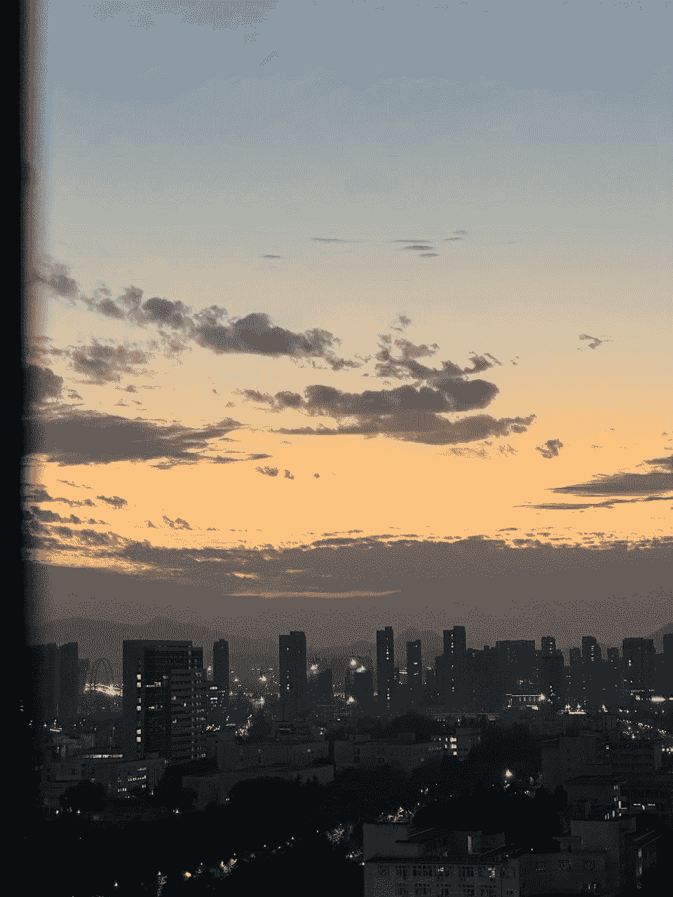
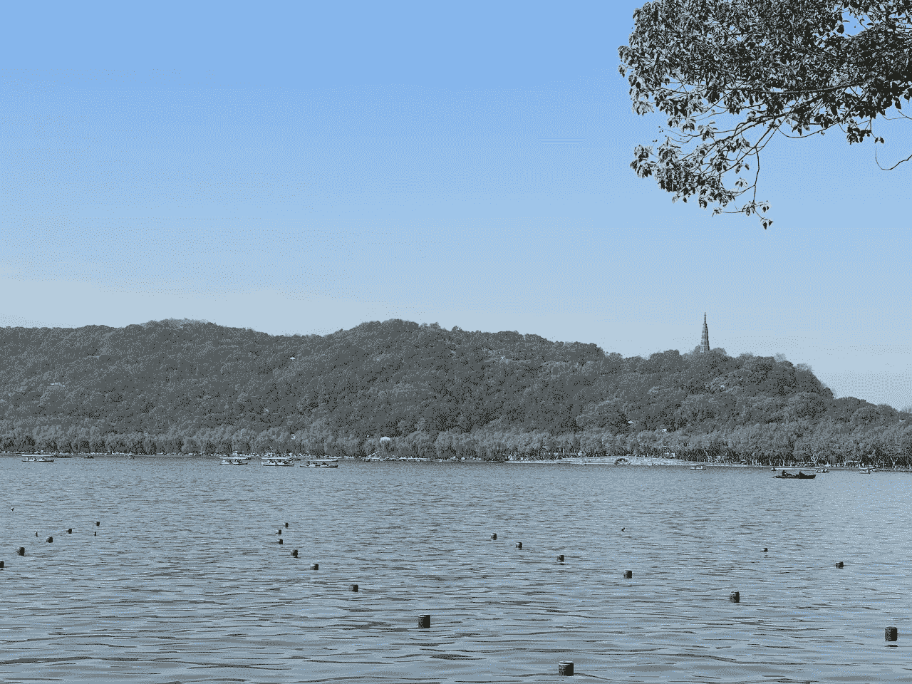

# 浙江 - 杭州

> 来源：[https://leonzhang.feishu.cn/docx/BMFTdlV9GoNJrvxCAdmcR1hRnUc](https://leonzhang.feishu.cn/docx/BMFTdlV9GoNJrvxCAdmcR1hRnUc)

<https://my.feishu.cn/sync/CWEhdJRV2sNTbLbJcXyc2qMRnKc>

### 杨公堤、西湖银泰 in77、钱江新城市民中心

|  |  |  |
| --- | --- | --- |

### 老和云起、北高峰、灵隐寺

<https://my.feishu.cn/sync/EL5sdo3WDsl2AGbGCwvcwH8knqc>

### 西湖文化广场

<https://my.feishu.cn/sync/CbGJdVMdFs44gqbD9PPcmfh9nHa>

### 西溪湿地公园

<https://my.feishu.cn/sync/SsjgdVhfVsVSKRbKOx1c3XBenoh>

### 满觉陇、花港观鱼

<https://my.feishu.cn/sync/WLRCdxOHAs2hs3buxMhch5wonKm>

### 桐庐县 - OMG 心跳乐园、大奇山

<https://my.feishu.cn/sync/KDwvdQqSNsFX6qbSA7ncdQVYnpf>

### 虎跑

<https://my.feishu.cn/sync/EyXDdGaKjsM16ObA6bRcV193nkf>

### 西湖夜景

<https://my.feishu.cn/sync/BqHLdBgz8sjh5RbwbFTc0uASn7s>

### 湘湖的花

<https://my.feishu.cn/sync/RKxFdTmX4sx4rJbIci9ckYudnXh>