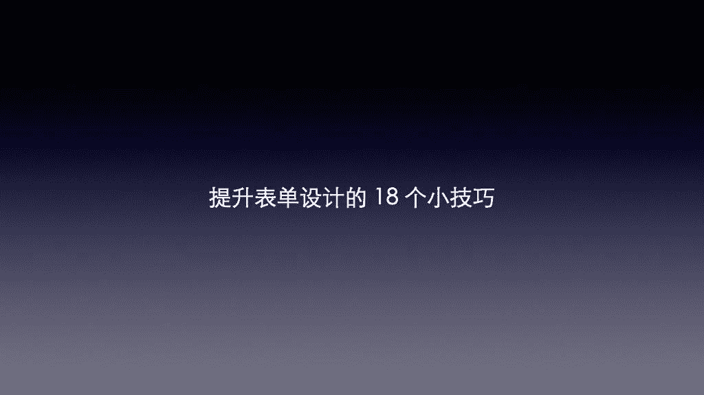
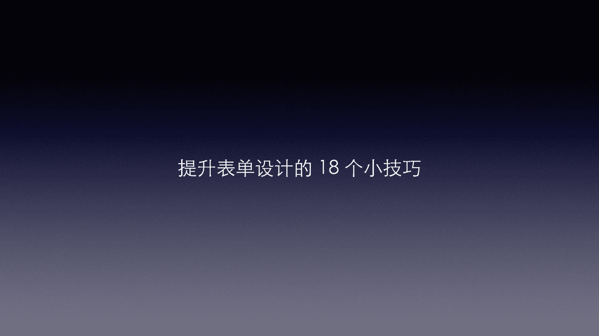

# 幻灯片 - Keynote

> 来源：[https://leonzhang.feishu.cn/docx/ZJprdyElXo1yDlxBtelcYy7Xnuh](https://leonzhang.feishu.cn/docx/ZJprdyElXo1yDlxBtelcYy7Xnuh)

> 原本以为云文档支持 Keynote 文件，结果仅支持首页展示，那我把 keynote 文件放标题吧。

> 因为这些幻灯片是给人“讲”的，所以只是“看”的话，确实会不太好理解...

> 不过非常欢迎感兴趣的小伙伴一起交流内容～

> 如果你在使用 Mac，欢迎下载到本地用 keynote 打开，可以查看一些简单的动画；使用 Windows 的同学，本地是打不开 keynote 文件的哈，建议查看下面的 PDF 文件哈。

> 另外，欢迎喜欢使用 Keynote 的同学也欢迎留言沟通呀，交流不限内容、幻灯片制作～

###

[《微信背后的产品观》 内部分享 - 2023年5月.key](https://internal-api-drive-stream.feishu.cn/space/api/box/stream/download/all/MUd1b28v9oukElx0aujcji9Cnsh)

[《微信背后的产品观》 内部分享 - 2023年5月.pdf](https://internal-api-drive-stream.feishu.cn/space/api/box/stream/download/all/XDdKbs8m0o1uiXxwnkAcEs01nte)

###

[提升表单设计的 18 个小技巧 - 2023年6月.key](https://internal-api-drive-stream.feishu.cn/space/api/box/stream/download/all/DB6Nb5x59o8Ai2xB8NrcqF4zndg)

[提升表单设计的 18 个小技巧 - 2023年6月.pdf](https://internal-api-drive-stream.feishu.cn/space/api/box/stream/download/all/WllUbRkU2oEsGtxbX3hcdaOgnYu)

### [Apple - 词条（半成品）.pdf](https://sm84lfdag7.feishu.cn/wiki/wikcnUAauGIBKr1y7xbyUVo1HRI) （这个是PDF文件哈）