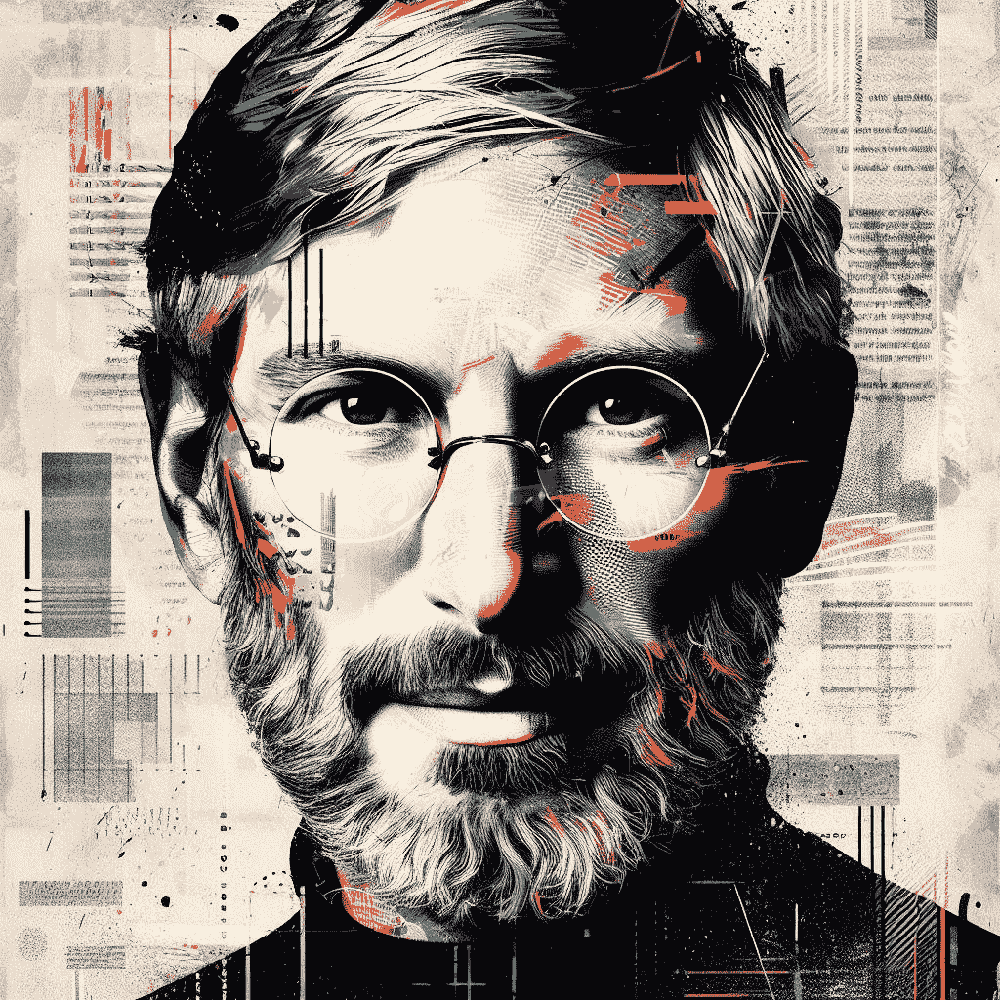
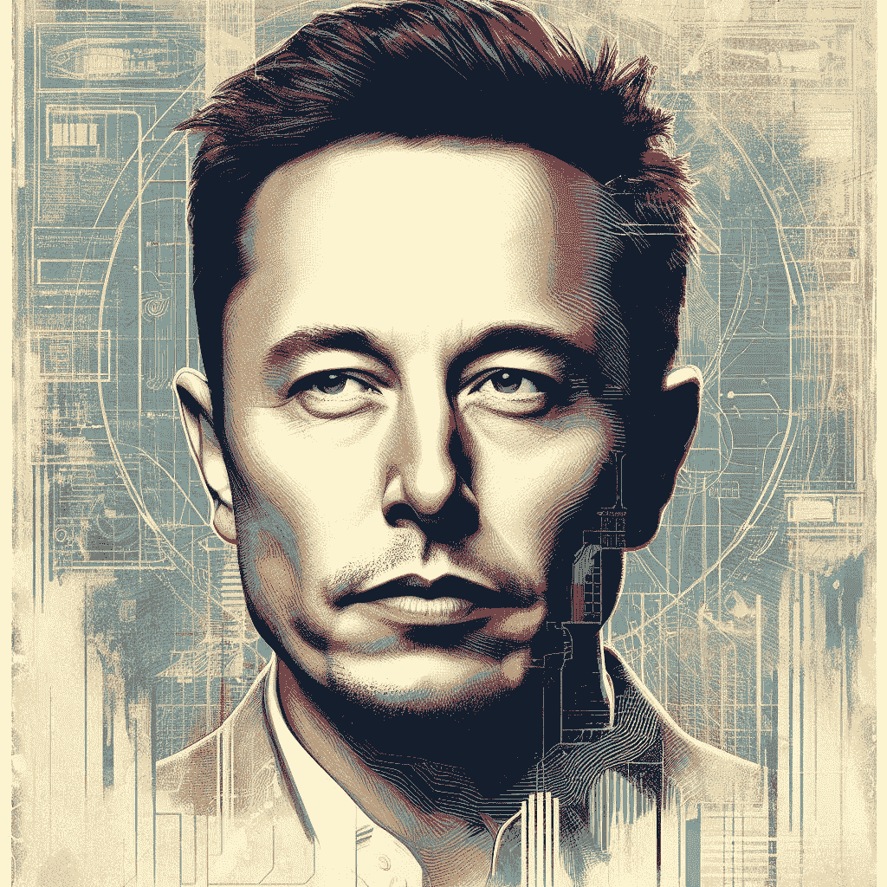
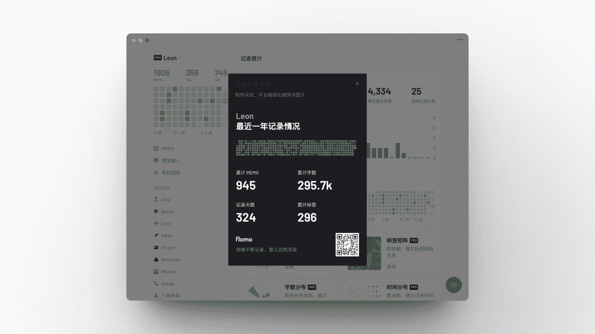

# Leon's Notes

# Leon's User Manual 2（对外）

> 来源：[https://leonzhang.feishu.cn/docx/ZCaAdNaLgozRuMxAbndcdfzgndh](https://leonzhang.feishu.cn/docx/ZCaAdNaLgozRuMxAbndcdfzgndh)

👋 Hi! 我是 Leon。这里是我的个人说明书，你可以在这里快速的了解我。

---

### 😃 关于我

👋 你好呀！我是 Leon，一个生在北方、现居江南且热爱生活的互联网产品经理，曾在一家智能硬件的创业公司做了两年的智能硬件，主要负责移动端的相关业务。

关注 AI[**、前沿科技和数码产品，同时**](https://mp.weixin.qq.com/mp/profile_ext?action=home&__biz=MzU1ODc2MDA3OQ==&scene=124#wechat_redirect)也是一名摄影爱好者，👸号名称是「Stay Thinking」，也欢迎你不忙的时候来看看～

### 🏷️ 关于工作

+   行业：互联网产品、工具产品、存储硬件。

+   技能：产品功能/交互/服务设计、项目管理、数据分析。

+   兴趣：工具控，喜好科技产品，Smartisan 和 Apple 产品爱好者。

+   下面是使用 DALL·E 3 作的图，如果你[AI 绘画之 New Bing，基于 DALL·E 3 ](https://sm84lfdag7.feishu.cn/wiki/BGtNwTqkzixvC6kVw5gcGyR4ng3)感兴趣，这里是当时的 Prompt:

|  |  |  |  |  |
| --- | --- | --- | --- | --- |

### ☁️ 关于生活

#### ❤️ 个人喜好

+   [浙江 - 杭州](https://leonzhang.feishu.cn/wiki/U8l8wD748i76bGkhY7ucyL4En1g)好游玩，在西湖旁、公园里溜达或者坐着，看着水、看着人，放空自己。

+   喜好爬山，好奇山顶的风光如何，也好奇山的另一侧风景有什么。越高的山，人就越少。

+   喜好运动，骑自行车追公路车的那种（两小时骑行 30 公里），打篮球进学院篮球队，还会一点羽毛球。

+   喜欢尝试新鲜事物、喜欢干饭，遇到好吃的东西连续吃上一周都不会腻。

+   喜好写内容，除本 Wiki 外，我的 [flomo](https://v.flomoapp.com/register/?MzA3MTI5)（笔记工具）中平均每天新增 2-3 张卡片，平均每月[04 Leon Thinking 副本](https://leonzhang.feishu.cn/wiki/Pa8mwwyEHi7LKdkBq0KcvRernDg)增 1 万字以上，了解更多请移至模块

#### 🎒 去过一些好玩的地方，以及拍过的风景和建筑

多维表格（KqyTbrYeHa0HJUsUC9LcHVpQnDf_tblcKMG7p8xGVEt7）

更多请移步至：[07 Work & Life Balance 副本](https://leonzhang.feishu.cn/wiki/KJgOwn5Z1iAJBKk1UoucqghXnfd)

### 🦋 推荐播客、书籍、电影

#### 🐚 推荐播客

**《三五环》**

主播刘飞，互联网产品老兵（曾先后就职于锤科、滴滴、阿里），冷泡茶《三五杯》联创，《产品思维》作者。

《三五环》是他的独立播客，其中包括他的个人单口和许多朋友（少楠、61、半佛等）的聊天内容。不同的嘉宾，不同风格的飞哥比如听完他与少楠的对话，再听下他与半佛的对话，要不是声音一致，都怀疑是两个人，哈哈。

**《半拿铁｜商业沉浮录》**

刘飞的另一档播客节目，另一位主播是财经媒体人潇磊，是一档用相声的方式讲述商业故事的播客节目，时不时就会被一句歇后语（俏皮话）逗乐。推荐专题《苹果简史》《人工智能风云录》与《芯片江湖》。

**《组织进化论》**

原主播是 Zara，现主播是小北。是字节飞书旗下的播客节目，主要是职业话题与企业管理相关的话题。

Zara 是飞书营销团队的产品负责人，23 年 8 [月份](https://zarazhang.com/)回到了旧金山，英文 Blog 更新在这里。从她身上及节目里，真真切切学到了很多管理类的技巧以及个人工作提效的方法，感谢 Zara。

**《商业就是这样》**

主播是 Tiller 和约小亚，用通俗易懂的话分析、拆解商业现象。

推荐单集：《Vol.131 恒大的债为什么越滚越大》《Vol.127 越南首富的造车梦》《Vol.121 小历史 | 2010，吉利终于买到了沃尔沃》《Vol.118 英伟达如何变得“不可替代”？》《Vol.96 机票价格为什么变化多端》

**《故事 ****FM****》**

主播爱哲。如题，记录各种故事，其中一期印象最深的是《E664。 打工异闻录，深圳 2000》，讲述了普通人在深圳的不普通生活以及故事背后的平凡与辛酸，真实的底层人民。

推荐单集：《E7[56。狱警树先生：我还想回](https://www.xiaoyuzhoufm.com/episode/64ec71f9cb5d7698f29b434b)到三年前，当个小管教》《E750。断缴社保的年轻人》《E719。进工厂、做技师、端盘子，高学历的我脱下「长衫」穿「汗衫」》

#### 📚 推荐书籍

《马斯克传》，英文版《Elon Musk》

> 作者：艾萨克森

Day one 愿景：让人类成为跨行星物种。

马斯克（Elon Musk）是一个性格非常复杂的人，时而偏执、疯狂、暴躁，时而宽容、理智、平静。他有着对技术的热爱、对创新的执着以及对梦想的坚定信念。

被称为“硅谷钢铁侠”的他和漫威电影中的钢铁侠一样有着多重身份：天才、企业家、慈善家、亿万富翁（千亿级别的那种），同时也是个“花花公子”。当然，多重身份也必然使他成为了一个争议人物，但这些都无法掩盖他的成就。

[读《马斯克传》后记：人生不设限，成功无上限](https://leonzhang.feishu.cn/wiki/RhOuwl4pKi41bZk8gbYcR5cOnlh)

**《****5000 天后的世界****》**

> 作者：凯文·凯利

AI 将成为社会中的重要组成部分，融入并影响着我们的生活。在食品、交通、能源、教育等产业帮助我们解决一些当前无法解决的事情。

书中也提到，个人如何提前建立能够匹配未来的能力，也很多。比如“活到老，学到老”、“依靠数据判断未来“、”正确认识自己“、”保持适应能力与学习能力“、“不断挑战自己，不断学习新鲜事物”...

[KK 的《5000 天后的世界》｜摘录](https://leonzhang.feishu.cn/wiki/L8iLwRByXihwBrkts74cX9YEnLq)

**《金钱心理学》**

> 作者：摩根·豪泽尔

1.  没有人真的对钱失去理智。一定要知道，我们什么也不知道，不要盲目相信自己已有的金钱观。带着白纸的心态，动态地调整每次和金钱有关的决策。

1.  运气与风险。不要指望在低端局的努力在高端局获胜。

1.  复利。设置一些复利的项目，坚持待在场上。持续保证每次进步一点点，就能滚出巨大的雪球。

1.  快速试错。降低试错成本，增加量，从而才能增加机会。

1.  **财富不是花**出去的钱，而是你看不到**的东西。**是你没花出去的钱，是灵活度基金，财富给我们带来的是「时间自由」。

1.  Everything hes a price.心甘情愿的去支付“门票”。

**《倦怠社会》**

> 作者韩炳哲，韩裔德国新生代思想家

功绩社会中的人，虽然摆脱了规训社会，却又陷入了新的精神规训社会，比起他人的剥削，自我剥削更加严重地导致了自我崩溃。“一味的忙碌不会产生新事物，它只会重复或加速业已存在的事物。”

**《金翼：一个中国家族的史记》**

> 作者林耀华，人类学家、社会学家和民族学家

讲述两个家族成员的两种适应生活的方式：一种是固守传统，依靠祖传田产为生；另一种是接受现代教育和基督教思想的影响。

尤其是文中对家庭以及家庭成员的行为描述简直细致入微，让我想到了之前看电影《Avatar 2 》中的一句：“萨利之家共进退”。“家庭”这个无形的纽带，使小图克可以无畏困难选择折返救家人。

**《笔记的方法》**

> 作者刘少楠、刘白光（Light），flomo、幕布、小报童执剑人

原名为《知识资产》，作为“创始读者”，看到少楠发的朋友圈之后，就下单了。因为有在订阅《产品沉思录》，所以没多想就直接下订了。

虽然之前也陆陆续续了解少楠和 Light 的笔记理念，源如 flomo 101、产品沉思录等，但自己也没有抽时间整理一下之前记录他们的内容，所以于我而言，这本书相当于帮我重新做了结构梳理。在看完这本书后，顺手又整理了一下我的笔记标签，受书中“标签说明书”的启发，我给自己也整理了一张。

刘飞曾说，少楠几乎是他身边做知识管理最好的人。当然，也是我的朋友圈中的知识管理做的最好的人，其次便是我师傅。更巧的是，我和少楠的情况几乎相同，我的记笔记和整理习惯，也是来自我的师傅。

如书名，这本书的核心是在回答三个问题，如何记笔记、如何记得好、如何用得到。本质是帮人重新理解笔记，重新建立认知、改变观念。

另外，借助 flomo，我还养成了记录和回顾的习惯，再次感谢少楠和 Light，也祝 flomo 越来越好～

关于其他一些播客、书籍以及长文的推荐，也会同步更新至 Li[Life Blog](https://leonzhang.feishu.cn/wiki/I2k7wzx4ziKV9tkQjKjcHMMUnVg)e Blog 中的月度总结中，在这里：

### 📑 关于本 Wiki

> 点击本 Wiki 左上角的按钮「展开面板」，可打开目录结构，查看更多内容

+   [01 AI (Notes, Weekly, Tools...)](https://leonzhang.feishu.cn/wiki/IgMTwybcQitUo0k2vOJcfAudnbf)  ：主要是人工智能相关的内容，包括但不限于学习笔记、相关论文、AI 工具等。

+   [02 Product (Notes, Information)](https://leonzhang.feishu.cn/wiki/C17MwiN9uiU0qZkx9bFcVvDbnFc) ：主要是产品相关的内容，包括但不限于对产品的思考、总结，以及对科技公司的观察等。

+   [03 Blog(Life, AI, Tech) 副本](https://leonzhang.feishu.cn/wiki/DLGHw9RMziveRMkc3qvcodOxnPg)  ：主要是个人日常的写作内容，包括但不限于 AI 相关、泛科技、生活相关的内容等。

+   [04 Leon Thinking 副本](https://leonzhang.feishu.cn/wiki/Pa8mwwyEHi7LKdkBq0KcvRernDg)  ：主要是记录自己的思考，算是 Life Log，很多没有发推和即刻的内容都发这里了。

+   [05 Reference Samples ](https://leonzhang.feishu.cn/wiki/PzdzwINKyiqifzkcQhbcuLIKndc)  ：受少楠「Sheep 计划」的启发，汇集一份属于自己的信息查询系统，借助这些优秀的企业家/创业者的讲话/采访等言行，帮助我成为更好的自己。

+   [07 Work & Life Balance 副本](https://leonzhang.feishu.cn/wiki/KJgOwn5Z1iAJBKk1UoucqghXnfd) ：主要是记录自己已去过或想去的地方，目前更多是存放拍过的一些风景和建筑的照片，拍照新手学习阶段，欢迎交流～

另外，关于 Wiki 最新动态，请移步至 [00 Time Line](https://leonzhang.feishu.cn/wiki/C7Ssw50nCiMTwPkXVZqcPEm3nGf)查看。

### 🐦 联系我

目前我会通过「[即刻](https://okjk.co/ogQ3bD)」和「[Twitter](https://twitter.com/leonthinking)」记录关于生活与工作上的好玩事情，以及个人的思考和想法。如果你有相同的爱好、类似的经历或有感兴趣的内容，欢迎交流。也欢迎你找我约咖啡、约饭、约玩（爬山/打球）、吐槽工作...

最后，祝看到这里的朋友，升职加薪～ 🎉

+   WeChat: thinkinghunt

+   Email: thinkinghunt@163.com

+   More about: https://link3.cc/leonzhang ｜ https://bento.me/leonzhang 🪜

**WeChat: **

**Jike:**

---

©️2024  Leon Zhang's User Manual 2

---