# 一分钟了解每日AI

> 来源：[https://docs.feishu.cn/docx/DPWUdKtUJo98XMxg5LHcarhEnsh](https://docs.feishu.cn/docx/DPWUdKtUJo98XMxg5LHcarhEnsh)

> 这个板块专注每日AI新闻精选！

> 作为AI行业的从业者，我深知保持信息敏锐至关重要，却也常被海量资讯淹没。

> 为此，我每日只筛选最值得关注的**3条AI应用动态或者技术更新**，帮你避开噪音，聚焦真正重要的信号。

> **更新时间：每晚 8-9 点**

# 2026年2月

## 2月9日

## 1、字节发布 Seedance2.0

> 在高难度动态场景上实现大幅进化，动作流畅度与物理反馈达到新高度。

## 2、**域名 ****AI.com** 以7000万美元成交，刷新历史纪录

> 买家Kris Marszalek表示，他相信人工智能将成为未来几十年最伟大的技术潮流，并计划推出名为“AI代理”的新业务，为消费者提供个性化的AI服务

## 3、OpenAI首款AI硬件曝光：代号“Dime”的智能耳机

> 预计最快于 2026 年发布，将专注于语音交互和智能化体验。

**其他内容：**

1、OpenRouter上线了个隐秘模型“Pony Alpha”，其强大性能和免费属性引起广泛关注。该模型在编码、推理等方面表现出色，但其真实身份仍存疑。

2、小红书秘密研发AI剪辑器OpenStoryline，其核心功能是对话式剪辑，能够说说话完成视频剪辑工作。

## 2月6日

## 1、Anthropic 发布 Claude Opus4.6

> 引入100万token超大上下文窗口，深耕自动化办公与高级编程场景。

## 2、腾讯发布首款漫剧App“火龙漫剧”

> 利用AI技术将静态漫画转化为1-3分钟的短视频，让漫画内容通过AI配音与动效“活”起来。

## 3、360发布“纳米漫剧流水线”生产平台

> 3倍速出片、电影级质感、人物、场景高度统一

**其他内容：**

1、OpenAI 发布 Frontier 平台，将AI从对话助手提升为具备业务执行能力的“数字化同事”，通过连接企业现有系统实现复杂任务的自主规划与操作。

## 2月5日

## **1、可灵AI3.0正式发布**

> 多模态输入输出的一体化、全球首创主体参考功能，精准锁定主角、道具或场景特征，最长支持15秒视频

## 2、Mistral AI 发布 Voxtral Transcribe 2 语音模型

> 实现了极低延迟，支持包括中文在内的13种语言

## 3、 Gemini用户量突破 7.5 亿，紧咬 ChatGPT

> 同时推出了低价订阅方案 Google AI Plus，并推出了自研芯片 Ironwood

## 2月4日

## **1、OpenAI更新其最新旗舰模型G**PT-5.2和GPT-5.2-Codex

> 推理速度提升 40%，价格保持不变

## 2、蚂蚁阿福升级“长辈模式”

> 超大字体，还可直接打电话咨询

## 3、 OpenClaw 被曝严重漏洞

> 黑客通过伪装“技能”文件诱导用户执行恶意 Shell 命令，从而强制关闭系统安全防护机制。

## 2月3日

## 1、OpenAI 推出 mac版 Codex 应用

> 支持多智能体并行作业，能够融合不同 AI 智能体的专项能力来处理复杂的开发流程

## 2、Adobe Firefly 宣布为订阅用户提供无限量 AI 视频与图像生成

> 整合Google Nano Banana Pro、GPT 图像生成等外部顶尖 AI 模型，支持高达 2K 分辨率的视频

## 3、智谱发布0.9B 轻量级 GLM-OCR

> 针对复杂支持表格、结构化提取、手写体等任务优化，成本极低，千张扫描件仅需0.5元。

## 2月2日

## 1、MiniMax Music 2.5 正式发布

> 通过段落级强控制和物理级高保真技术，为创作者提供了更精准的音乐制作工具

## 2、蚂蚁灵波开源世界模型LingBot-World

> 在视频质量、动态程度、长时一致性及交互能力等方面表现优异

## 3、昆仑万维 SkyReels-V3开源

> 实现了参考图像转视频、视频延长以及音频驱动虚拟形象三大核心能力的深度集成。

**其他内容：**

1、昆仑天工音乐大模型 Mureka V8 的发布。基于 MusiCoT 技术体系，实现了更接近人类创作逻辑的音乐生成，提升了音乐性、编曲完成度、人声表达及音质质感。

# 2026年1月

## 1月29日

## 1、MiniMax Music 2.5 正式发布

> 通过段落级强控制和物理级高保真技术，为创作者提供了更精准的音乐制作工具

## 2、蚂蚁灵波开源世界模型LingBot-World

> 在视频质量、动态程度、长时一致性及交互能力等方面表现优异

## 3、昆仑万维 SkyReels-V3开源

> 实现了参考图像转视频、视频延长以及音频驱动虚拟形象三大核心能力的深度集成。

**其他内容：**

1、昆仑天工音乐大模型 Mureka V8 的发布。基于 MusiCoT 技术体系，实现了更接近人类创作逻辑的音乐生成，提升了音乐性、编曲完成度、人声表达及音质质感。

## 1月28日

## 1、OpenAI 发布科研协作平台 Prism

> 基于 GPT-5.2 ，整合了文本编辑、LaTeX 编译等，支持多人实时协作

## 2、**腾讯混元图像3.0正式开源**

> 凭借强混合专家架构和多项核心技术突破，目前全球最强的开源图生图模型

## 3、月之暗面发布编程工具 Kimi Code

> 多模态加持，无缝集成主流编辑器

**其他内容：**

1、谷歌 AI Plus 计划:200GB 空间+Gemini3Pro 及 Nano Banana Pro 模型，并支持最多5位家庭成员共享，月费不足8刀

2、Mistral AI 发布了其终端编程助手 Vibe 2.0，该版本由全新的 Devstral2 模型驱动，旨在为开发者提供更具沉浸感的自然语言编程体验。核心升级包括多文件协同、子代理模式以及操作增强

## 1月27日

## 1、Kimi K2.5视觉与工具调用双升级

> 新增视觉能力，支持图像分析和3D模型生成，工具调用功能提升

## 2、 搜狗输入法发布新版本，全面AI化

> 涵盖AI语音、AI翻译和AI打字三大核心功能，显著提升输入效率与智能化体验。

## 3、 阿里发布万亿参数 Qwen3-Max-Thinking

> 在复杂推理、事实知识及智能体能力等核心维度实现跨越式升级，参数量突破万亿大关

**其他内容：**

**1、**百度文心开启行业首个“多人多Agent”群聊内测，群聊中可同时调用多个垂类Agent，形成多维度的“AI智囊团”。

## 1月26日

## 1、腾讯发布混元图像3.0图生图模型

> 凭借强大的语义理解与推理能力，为用户提供高效的图像编辑和多图融合功能

## 2、 腾讯“元宝派”开启内测，发力AI社交

> AI在多人社交场景中的深度融合，旨在打造让AI与用户群体共同娱乐、协作的全新社交空间。

## 3、 AI版B站：SeaArt 注册用户破 5000 万

> 靠‘卖情绪’和‘拼品味’登顶全球AI创作社区，最新产品SeaVerse2.0实现了从创意到变现的闭环。

**其他内容：**

1、 京东与Rokid合作推出全球首款智能眼镜购物应用，用户可通过“语音指令+声纹识别”完成购物流程

2、基于谷歌 Gemini 架构的新版 Siri 计划于2月下半月正式发布，将首次获得访问用户个人数据及屏幕内容的能力，从而能够执行更复杂的跨应用任务。

3、百度文心与北京春晚合作，开启“现金红包雨”活动，用户可参与瓜分5亿现金奖金。

## 1月23日

## 1、OpenAI拟从客户“AI辅助研发成果”中抽成

> 尝试将收费模式从“使用量”升级为“价值创造”，B2B的一次大胆设想

## 2、阿里通义开源 Qwen3-TTS

> 采用端到端架构，支持秒级音色克隆、自然语言音色设计以及实时流式输出

## 3、马斯克达沃斯宣布Optimus 机器人2027年开售

> 预计其可靠性、安全性和功能范围将达到极高水平

**其他内容：**

1、OpenAI 对其AI 浏览器 ChatGPT Atlas 进行了升级，新增了标签页分组、搜索智能切换和系统深度集成等功能，提升了用户的多任务处理能力和信息检索效率。

2、阿里巴巴旗下的 AI 芯片企业平头哥正在进行内部重组，计划独立并冲击 IPO，意图拓展外部市场。

3、Codex 与 JetBrains IDE 的深度整合，提升了开发效率和代码质量，GPT-5.2 Codex 的引入，为开发者提供了更强大的 AI 编程能力。

## 1月22日

## 1、百川发布Baichuan-M3 Plus

> 通过引入“六源循证范式”确保诊断建议的权威性和准确性，医学幻觉率降至2.6%。

## 2、**淘宝天猫AI 假图识别模型上线**

> 有效遏制恶意售后行为，防止假图退货

## **3、苹果内部AI工具首度曝光**

> Enchanté能够快速完成代码补全、漏洞扫描和文案润色，而Enterprise Assistant则作为公司级搜索引擎，帮助员工快速获取内部文件信息。

**其他内容：**

1、Inworld 推出全新 TTS-1.5：实时语音，延迟低，并支持多语言。TTS-1.5在技术上实现了低于250毫秒的实时延迟，同时提供多语言支持，价格仅为每分钟0.005美元，比市场上的同类产品便宜25倍。2、2、Remotion Skills 的推出标志着视频创作进入“AI 指令驱动”时代，用户只需自然语言指令即可生成专业视频动画，极大降低了创作门槛。

3、谷歌与普林斯顿评论合作，在 Gemini 应用中推出免费 SAT 模拟考试，用户可随时进行真实规格的测试，并获得即时反馈。

## 1月21日

## 1、Kimi 宣布即将推出新一代万亿参数大模型

> 业界猜测新模型为 K2.1或 K2.5，将沿用 Kimi Delta Attention 线性注意力机制，在短/长文本处理、审美与价值观层面全面跃升。

## 2、MiniMax 推“专家Agent”工作台

> 首次推出“专家 Agent”与“AI 原生工作台”概念，用户可创建具备领域知识与技能的高阶 AI 助手，并在本地深度定制运行逻辑。

## 3、可灵霸榜40国，ARR突破1.4亿美元

> 2026年初月活突破1200万，App 端付费用户环比激增350%，新推“动作控制”功能，引爆全球“宠物跳舞”病毒传播。

**其他内容：**

1、Medeo AI 海外发布全新视频agent，像“数字导演”一样提前拆分场景、锁定节奏。系统自动匹配视觉、旁白与 BGM

## 1月20日

## 1、字节发布全新 AI Agent 平台扣子 2.0

> 通过Agent Skills、Agent Plan和扣子编程等功能，显著提升了AI智能体在职场办公、长期计划执行及云端开发方面的能力

## 2、阿里低调上线 AIGC 设计平台“呜哩”

> 利用通义千问图像模型全家桶，为内容创作者提供高效且多元的创意生成解决方案。

## 3、马斯克宣布 X 平台推荐算法正式开源

> Grok 模型同款 Transformer 架构驱动的新一代 X 平台推荐算法，每四周在 GitHub 上进行一次实时版本更新。

**其他内容：**

1、阶跃星辰发布了其AI桌面伙伴“小跃”的Windows版本，这款产品通过深度融合操作系统，为用户提供更高效的办公体验。它支持跨应用自动化操作，并具备本地化全局记忆功能，确保用户隐私安全。

2、蚂蚁阿福升级其PC端并上线DeepSearch功能，旨在为中国医生提供更高效的文献搜索、临床诊疗和科研支持。

3、智谱AI开源GLM-4.7-Flash，作为30B规格的最强竞争者，在性能、推理与编码能力上全面领先，同时具备轻量化部署优势，适合本地或私有云环境使用。

## 1月19日

## 1、飞书联手安克创新推出无感佩戴智能录音设备

> AI录音豆采用微型设计，支持实时生成字幕和结构化纪要，可同步至飞书知识库

## 2、 **ChatGPT 官宣引入广告**

> OpenAI宣布将在ChatGPT免费版和新推出的“ChatGPT Go”层级中测试广告，标志着其从纯订阅模式向“订阅+广告”混合模式的转型。

## **3、英伟达发布 PersonaPlex-**7B-v1:重塑实时语音交互的“全双工”

> 通过端到端的 Transformer 架构实现了更接近真人的自然对话体验，支持实时语音流处理、深度个性化控制以及更高的对话流畅度和任务达成率。

**其他内容：**

1、蚂蚁百灵发布 Ling Studio：官方大模型 Web 交互平台正式上线，提供每日50万个免费 Token，支持多种模型切换，并集成了原生联网搜索工具、系统提示词定制及 API 接口

2、谷歌扩大 AI 视频工具现已全面开放给商务、企业及教育版 Workspace 用户，新增竖屏视频支持，并集成音频与图像生成功能，提升视频创作效率。

**3、**OpenAI推出平价订阅计划ChatGPT Go，每月仅需8美元即可享受高级AI功能

## 1月16日

## 1、谷歌Veo 3.1重磅升级！

> 多图参考一致性拉满+原生竖版+4K超分

## 2、OpenAI 发布 GPT-5.2-Codex 编程模型

> 针对复杂软件开发任务优化，能够自主处理工程任务，同时在安全性方面表现突出，能识别代码库中的潜在风险。

## 3、腾讯混元3D Studio1.2开启公测

> 基模升级至3.1版本，支持八视图多角度图像输入，支持笔刷交互拆分与高分辨率细节保留。

**其他内容：**

1、谷歌推出TranslateGemma翻译模型系列，基于Gemma3架构，提供多种参数规模，支持55种语言翻译及图像翻译，性能显著提升，适用于不同场景的用户需求。

2、支付宝首发ACT协议，打造中国首个AI智能体商业协同标准，兼容支付安全与自动化体验

## 1月15日

## 1、百度文心 ERNIE-5.0-0110 正式发布

> 在多项权威评测中表现出色，尤其在数学处理能力上位列全球第二

## 2、阶跃星辰语音模型 Step-Audio-R1.1 荣登全球第一

> 具有深度语音推理能力和实时响应功能，能够端到端理解语音内容，同时支持流式推理。

## 3、千问全面接入阿里生态，能点外卖、买机票

> 上线了超过400项AI办事功能，并向所有用户开放测试

**其他内容：**

1、机器人租赁平台擎天租完成融资，用户突破20万，解决了机器人产业落地成本高和场景碎片化的痛点

2、中国电信人工智能研究院发布生成式视频压缩技术——GVC（Generative Video Compression），该技术将视频数据的压缩率提升至0.02%。这项技术的核心逻辑是“用计算换带宽”，通过传递“如何画出画面”的指令，而非完整的画面像素，从而极致压缩。

**3、**OpenAI 推出 ChatGPT Translate，直接对标 Google 翻译。该工具支持多模态输入、意译优先以及对话式微调

## 1月14日

## 1、爱诗科技发布全球首个通用实时世界模型 PixVerse R1

> 实现虚拟世界的实时交互体验，最高1080P 画质

## 2、Vidu 发布 AI 一键生成 MV 功能

> 视频创作进入全自动端到端生成时代，用户只需提供背景音乐、参考图像和文本指令，即可在分钟级别内输出高质量 MV。

## 3、谷歌发布双模型，加码医疗AI开源生态

> MedGemma 1.5强化医学影像理解与分析能力，支持多模态临床决策支持系统。MedASR优化医疗语音识别，提升电子病历录入效率。

**其他内容：**

1、MiniMax 发布 OctoCodingBench 基准测试，旨在评估编程智能体在代码仓库环境中对指令的遵循能力。

🔗 https://huggingface.co/datasets/MiniMaxAI/OctoCodingBench

2、快手科技宣布可灵AI年经常性收入（ARR）达到2.4亿美元，展现了其在生成式AI市场的强劲增长势头。

## 1月13日

## 1、OpenAI 1亿美元收购医疗初创公司Torch

> 标志着其在医疗健康领域的布局进一步深化。Torch 能够整合多种健康数据，为用户提供个性化的医疗建议，同时借助 OpenAI 的人工智能技术提升医疗服务的效率和精准度。

## 2、Anthropic 面向非技术用户推出 Cowork

> 作为Claude Code的易用版，它深度集成在Claude桌面应用中，使不具备编程背景的普通用户也能高效处理复杂任务。

## 3、 陌陌“甜甜圈”APP今日上线，主打沉浸式 AI 恋爱

> 这是其向“情绪经济”转型的重要举措，旨在通过AI陪伴满足Z世代对沉浸式社交的需求。

**其他内容：**

1、AI短剧爆发前夜：阅文、中文在线推全栈工具，2026年或迎产能井喷，通过解决角色崩坏和风格漂移问题，提升了短剧的质量和一致性，并加速了IP的跨媒介转化。

2、Claude正式进军医疗领域！Anthropic推出HIPAA合规AI助手，Claude整合权威生物医学数据库，提升医疗场景中的回答准确性。

3、百川智能发布的 Baichuan-M3 医疗增强大语**言**模型在多项评测中超越 GPT-5.2， 伴随行业巨头布局，AI 医疗正逐步成为应用的主线。

4、Adobe Firefly 引入 OpenAI 的 GPT-Image 1.5 模型，Pro 及以上订阅用户在 1 月 15 日前可享受不限量图片生成特权。

## 1月12日

## 1、DeepSeek V4传闻春节发布

> 主打 AI 编程，架构上可能实现通用与推理模型的融合，以提升整体性能。

## 2、Midjourney动漫模型Niji 7发布

> 提升了动漫图像的连贯性，尤其是人物面部细节的清晰度和一致性。

## 3、 Google重磅推出UCP协议

> 为AI与零售系统之间建立统一的“通用语言”和流程，实现从商品发现到下单、支付、订单处理乃至售后支持的全链路无缝体验。

**其他内容：**

1、Mugen3D利用3D高斯溅射技术，仅凭一张图片即可生成高度逼真的3D模型

🔗 https://sumeruai.us/mugen3d

2、抖音科技内容爆发：全年观看破1.4万亿次，AI学习类内容观看量激增200%，AI兴趣用户规模同比增长105%，短视频平台成为科技普及新课堂

## 1月9日

## 1、 通义Qwen3-VL双子星开源

> Qwen3-VL-Embedding与Qwen3-VL-Reranker模型通过高效的双塔架构和单塔交叉注意力机制，实现了跨模态内容的精准匹配与高效检索

## 2、 MiniMax 港交所上市首日暴涨

> 港交所挂牌首日股价较发行价一度狂飙逾 111%，市值迅速突破 1000 亿港元大关

## 3、腾讯发布AI互动故事产品“上头蛙”

> 其核心在于通过AI技术实现用户参与和共创内容，满足Z世代对互动性和社交性的需求

**其他内容：**

1、小鹏发布了第二代VLA大模型，标志着智能驾驶系统向更高级别的L4初阶能力迈进。该模型具备理解、推演和生成动作的能力，能够主动模拟交通动态并预判潜在冲突，同时支持无导航自动辅助驾驶，极大拓展了高阶辅助驾驶的覆盖范围。

2、高德自研世界模型FantasyWorld在国际权威基准WorldScore Leaderboard上夺得综合得分第一

3、阿里千问大模型以断层优势领跑全球开源生态，下载量突破7亿次，单月击败Meta、OpenAI等全球巨头总和。

4、马斯克推出Grok Build的新产品，其核心理念是“氛围式编程”，AI编程市场将迎来更激烈的竞争。

## 1月8日

## 1、 腾讯混元发布 HY-Motion1.0开源3D 角色动画生成模型

> 该模型以其十亿参数量级和基于Diffusion Transformer（DiT）的架构，提供了高质量、标准化的骨骼动画。

## 2、 OpenAI 发布 ChatGPT Health

> 支持接入电子病历（EHR）及 Apple 健康等第三方应用，设立独立的“健康”对话空间，采用专用加密技术。

## 3、智谱AI成功上市，成为国产大模型第一股

> 公司发行价为116.2港元/股，开盘涨幅3.27%，市值超430亿港元。

**其他内容：**

1、阿里云发布多模态交互开发套件，集成通义千问、万相和百聆三大模型，为智能硬件提供开箱即用的AI能力。该套件预置十余款AI Agent与MCP工具，覆盖学习、生活、创意等高频场景，帮助硬件厂商快速实现智能化升级。

2、贾跃亭官宣法拉第未来在2026年CES期间首次举办股东日活动，宣布进入“双轨驱动”增长阶段，并推出具身智能机器人战略。

## 1月7日

## 1、 Anthropic 发布 Claude Code 桌面预览版

> 该版本引入了多会话并行工作流，支持在同一个代码仓库中同时开启多个独立的 Claude 会话，每个会话拥有隔离的分支工作区，解决了代码冲突风险。

## 2、 高德通过自研世界模型推出“飞行街景”

> 实现了地图导航从平面数字化向高保真、连续动态实景还原的跨越式进化

## 3、Google Gemini 推出“引导式学习”新功能

> 通过结构化学习路径和互动对话形式，为用户提供个性化的深度学习体验，同时结合教育科学原理提升长期记忆和实际应用能力。

**其他内容：**

1、微软宣布Windows 11全面升级，原生支持MCP协议，推动AI智能体深度融合，提升用户体验

2、联想在CES 2026上展示了其全新概念级AI眼镜，以轻量化设计和首创的电脑直连能力切入AI可穿戴赛道，强调跨设备协同与生产力赋能，瞄准程序员、设计师等人群。

3、Liquid AI 发布了 LFM2.5，专注于边缘设备和本地部署的小模型。该模型包括多种变种，如文本、视觉语言和音频语言，并在多个基准测试中表现出色。

4、xAI 宣布完成 200 亿美元 E 轮融资，但其 AI 聊天机器人 Grok 因生成儿童深度伪造色情内容而遭多国监管调查。

5、开源版“Veo 3”来了：LTX-2正式发布，一次性生成20秒4K音画同步AI视频，本地显卡轻松跑

6、全球首款键盘式AI PC：键盘即电脑，惠普Eliteboard G1a发布

## 1月6日

## 1、 百度百科推出“动态百科” 和 “百科 AI 知识图谱” 等新功能

> 利用人工智能技术，帮助用户更直观理解知识关联。

## 2、 波士顿动力×谷歌DeepMind强强联手！

> Gemini Robotics模型集成到新一代Atlas人形机器人中，提升了其自然语言理解、视觉-动作联合推理和任务分解能力

## **3、英伟达开源自动驾驶模型**

> 英伟达在2026年CES上宣布了其在自动驾驶领域的重大进展，包括开源模型Alpamayo的发布以及与梅赛德斯-奔驰的合作。

**其他内容：**

1、微软收购AI数据平台Osmos，旨在提升其数据处理能力，Osmos通过AI技术解决数据问题，提升数据准备效率，微软将其整合至Fabric和Azure Data Factory中，强化其数据底座。

## 1月5日

## 1、 微信推出 AI 小程序成长计划：免费资源与巨额支持

> 微信旨在为开发者提供全面支持，涵盖免费云开发资源、AI算力、数据分析、商业变现以及流量激励等。

## 2、 谷歌测试 Nano Banana2Flash 图像模型

> 该模型以速度快、价格实惠为特点，旨在满足实时交互和快速设计草图等需求。

## 3、 ChatGPT全面接入12大主流App！

> 通过App集成功能实现与多个主流应用的深度连接，用户可通过自然语言指令直接订酒店、点外卖等。

**其他内容：**

1、中国电信人工智能研究院（TeleAI）正式开源星辰语义大模型TeleChat3系列，包含国内首个基于全国产算力训练的千亿参数细粒度MoE模型

2、高德打车推出‘AI服务卫士’，通过智能异常识别与自动化干预机制，提升高端出行的安全与服务体验。该功能已在四城上线，为专车、商务车及豪车订单提供主动守护。

3、ima推出了PPT生成新功能，旨在帮助用户提高工作效率，减轻制作PPT的压力。

4、Plaud在CES前夕推出了全新的AI录音笔Plaud NotePin S，并发布了配套的桌面应用，以提升会议记录体验。

5、MiniMax与智元机器人达成深度战略合作，提供从文本到语音的全流程AI技术支持，打造定制化交互体系，实现千人千面的个性化音色合成。

## 1月4日

## 1、 字节 StoryMem 解决视频生成中的角色一致性问题

> 通过存储关键帧并在后续场景生成时参考，从而保持角色和环境的一致性。

## 2、 OpenAI押注“语音”！整合多团队重造音频模型

> OpenAI重构音频战略，预计2026年推出音频优先个人设备。

## 3、宇树科技 A 股上市的“绿色通道”被叫停

> 宇树科技的上市绿色通道被监管层叫停，意在防范市场过度竞争和泡沫

**其他内容：**

1、Pickle1是一款融合AR显示与高级AI的智能眼镜，被定位为“灵魂电脑”，通过持续捕捉用户视觉与音频上下文，实现无限记忆、情感理解与主动交互。

2、UltraEval-Audio 是由清华大学 NLP 实验室、OpenBMB 和面壁智能联合开发的音频模型测评框架，其最新版本 v1.1.0 增加了对热门音频模型的一键复现功能，并扩展了对 TTS、ASR 和 Codec 等专业模型的支持。该框架的开源将显著提升研究者在音频模型开发中的效率，推动相关领域的研究进展。

# 2025年12月

## 12月31日

## 1、腾讯混元开源3D生成模型HY-Motion1.0

> 基于DiT架构的文本到3D动作生成大模型，能够通过自然语言描述生成高质量的3D角色动画，适用于游戏、影视等多个领域。

## 2、MiniMax启动港股IPO，2026年1月9日上市

> MiniMax港股IPO标志着中国大模型公司进入‘上市兑现期’。公司计划发行2539万股H股，募资约41.9亿港元，并将资金用于研发与生态建设。

## 3、阿里通义实验室推出 MAI-UI，多模态 GUI 智能代理

> MAI-UI 支持多种操作，并能够在实时 Android 环境中进行复杂的用户交互，其性能在多个基准测试中超越了 Gemini2.5Pro、Seed1.8 和 UI-Tars2 等同行。

**其他内容：**

1、月之暗面在 C 轮融资中成功获得 5 亿美元， 目前公司现金储备超过 100 亿元。

## 12月30日

## 1、**Meta宣布收购Manus**

> Meta宣布以数十亿美元收购Manus，Manus将独立运营，并由其创始人肖弘担任Meta副总裁。

## 2、微软 Copilot 全线升级 GPT-5.2

> 免费使用GPT5.2的机会来了

## 3、ChatGPT更新，可调节 AI 思考深度

> 新增了“思考时长”调节，可以灵活选择 AI 的思考深度，以更好地满足不同需求。

**其他内容：**

1、腾讯混元发布1.5版开源翻译模型，支持端侧部署和33个全球语种及5种国内民汉语言及方言互译

2、Claude Code Workflow Studio支持用户可通过拖放节点设计工作流，也能用自然语言描述需求，系统会自动调整工作流结构。

## 12月29日

## 1、Windsurf Wave13正式发布

> SWE-1.5模型限时免费，引入并行智能体，支持在不同 Git Worktree 中同步执行多项开发任务。

## 2、阶跃星辰推出高性价比深度研究模型 Step-DeepResearch

> 在深度研究能力上接近顶级，但部署成本仅为传统模型的十分之一。

## 3、Meta AI 推出 Pixio 图像模型

> 通过改良MAE框架，在深度估计和3D重建等任务中展现出卓越性能。

**其他内容：**

1、开源工具ClipSketch AI能将长视频转化为手绘风格的故事板，并自动生成适配社交媒体的爆款文案

## 12月26日

## 1、ChatGPT将推“Skills”，对标Claude

> 内部代号“榛子”，可组合、可移植、支持代码，更强调模块化、可执行性与跨平台复用。。

## 2、小红书开源图像生成框架InstanceAssemble

> 在布局可控图像生成领域实现了重大突破，通过级联建模和Assemble-Attention机制显著提升复杂场景下的空间对齐精度与语义一致性

## 3、快看漫画联手 MiniMax 发布 AI 互动漫画

> AI技术让漫画角色“活”起来，实现多模态互动和深层情感连接。

**其他内容：**

1、Liquid AI发布的LFM2-2.6B-Exp模型凭借其强大的性能和高效的边缘部署能力，成为小型模型领域的突破性成果。

2、OpenAI 正在积极寻求高达 1000 亿美元的融资，以支持其增长计划。如果融资成功，OpenAI 的估值可能达到 8300 亿美元。

## 12月25日

## 1、**阿里 Qwen 发布图像编辑模型 **Qwen-Image-Edit-2511

> 能精准保留原图人物的面部特征，同时支持多人合照等复杂场景的编辑，人物一致性大幅提升。

## 2、清华开源TurboDiffusion，AI视频生成速度暴增200倍

> 清华大学联合生数科技开源了TurboDiffusion框架，显著提升了AI视频扩散模型的推理速度，同时保持视觉质量。

## 3、2030年全球AI消费将达7000亿美元

> Counterpoint Research最新报告指出，AI手机出货量预计以年均26%的速度增长，而AI助手的月活将冲击50亿大关。

**其他内容：**

## 12月24日

## 1、字节发布 Seed Prover1.5

> 在形式化数学推理领域取得重要突破，其通过Agentic强化学习显著提升了推理能力和效率

## 2、阿里通义开源语音交互大模型Fun-Audio-Chat-8B

> 以超低延迟、自然流畅的语音交互为核心，标志着开源语音AI进入全新阶段。它不仅能实时理解用户语音，还具备强大情感感知能力，性能直逼闭源巨头GPT-4o Audio和Gemini2.5Pro。

## 3、MiniMax M2.1开源

> 100亿激活参数编码模型登顶SOTA，多语言编程全面超越Gemini3Pro与Claude 4.5，多语言编程全面超越Gemini3Pro与Claude 4.5

**其他内容：**

1、Anthropic 推出全新开源 Agent Skills 知识库，为 Claude 模型的技能系统提供实用的示范性技能和最佳实践，帮助开发者更好地利用该模型进行各类应用。知识库中包含16个公开示例技能，涵盖文档处理、创意设计、开发技术和企业沟通等多个领域。

## 12月23日

## 1、**智谱AI发布 GLM-4.7**

> 在编码领域表现卓越，超越GPT-5.2，位列开源模型与国产模型双榜首。

## 2、钉钉发布全球首个 AI 工作智能操作系统 Agent OS

> 标志着“人与 AI 协同”工作方式的开启。

## 3、从红包大战到 AI 对决：火山引擎或成为2025春晚独家合作伙伴

> 旗下智能助手“豆包”也将深度参与，上线多种 AI 互动玩法

**其他内容：**

1、ChatGPT 推出年终回顾功能，通过数据汇总为用户生成一份独特的 AI 交互档案，包括全方位数据复盘、AI 定制视觉记忆以及趣味人格勋章，让用户更深入了解自己的 AI 使用习惯，并增加社交分享的趣味性。

2、MiniMax M2.1是一款开源编码和代理模型，具有100亿激活量，表现出色。它在多个测试中超越了闭源模型，并支持多种编程语言

3、文心5.0 Preview凭借1451分登顶LMArena文本榜单

4、Quest Mobile发布AI应用周活排行榜：字节系上榜3个，蚂蚁上榜，通用AI与垂类AI在周活跃用户规模上呈现出竞争态势，其中通用AI占据主导地位。同时，新上线的AI应用如蚂蚁阿福和灵光表现出强劲的增长势头。

## 12月22日

## 1、阿里Qwen 发布分层图像编辑模型Qwen-Image-Layered

> 能够将静态照片分解为多个具有透明背景的独立 RGBA 图层，使 AI 图像编辑具备类似 Photoshop 的结构化操作能力。

## 2、谷歌推出A2UI开放标准，告别枯燥文字对话

> 谷歌推出的A2UI开放标准，使AI代理能够即时创建图形界面，从而改变传统的文本交互方式，提升用户体验和效率。

## 3、AI绘画提示词新利器：PromptFill上线！

> 开源结构化提示词生成工具，通过填空式交互降低AI绘画的门槛

**其他内容：**

1、三星联手谷歌！全球首款Gemini AI冰箱CES前夕曝光，通过AI视觉技术实现食材识别、食谱推荐和红酒管理

## 12月19日

## 1、GPT-5.2-Codex 正式发布

> 通过上下文压缩技术提升长程编码任务执行能力。

## 2、Claude AI 新 “任务模式” 上线

> 通过创新的双面板设计、结构化行动计划以及自动化技能集成，显著提升了智能助手在复杂任务中的表现和用户体验。

## 3、Luma发布Ray3 Modify

> AI视频编辑新突破，实现了对实拍视频的高保真修改，保留演员表演细节的同时支持换装、换场景。

**其他内容：**

1、美团LongCat团队推出SOTA级虚拟人视频生成模型LongCat-Video-Avatar，在长视频生成领域表现优异

2、苹果最新多模态AI模型UniGen1.5在图像处理领域实现了重要突破，其集成图像理解、生成和编辑功能，显著提升了工作效率。

3、ElevenLabs宣布其AI语音智能体深度集成WhatsApp，AI可自然接听来电，支持批量主动外呼服务

## 12月18日

## 1、Gemini 3 Flash发布：速度和性能的平衡

> 能够精准地遵循用户指令并保留原图的核心要素。同时还优化了文本渲染效果

## 2、豆包大模型1.8+Seedance 1.5 Pro发布

> 豆包大模型1.8在多个关键维度有显著提升，而Seedance 1.5 Pro则提升了视频生成的质量与一致性。

## 3、ChatGPT 版应用商店正式上线

> 标志着 ChatGPT 进阶为 AI 原生应用平台，这些应用能让用户在聊天中执行各种实际操作——订购、将大纲转化为幻灯片、搜索酒店公寓等等。

**其他内容：**

1、苹果公司近日开源了名为 SHARP 的新型 AI 模型，该模型能够将一张普通的2D照片转化为具有真实物理比例的3D场景，仅需不到一秒钟。SHARP的核心技术是“3D高斯泼溅”技术，它通过深度训练掌握了通用的空间几何规律，从而实现快速建模。

2、Meta发布了SAM Audio，全球首个支持‘点击分离声音’的多模态音频模型，能够一键提取吉他声、人声或狗叫，标志着音频处理进入‘可交互、可编辑、可理解’的新时代。

3、千问 App 接入高德地图，实现从回答问题到地理空间推理的跨越，能生成可视化决策卡片，直接唤起导航或打车服务。

4、微软开源了TRELLIS.2，这是一款能够将图片转换为高精度3D模型的工具，适用于多个行业领域。

## 12月17日

## 1、OpenAI 推出全新图像生成模型 GPT Image 1.5

> 能够精准地遵循用户指令并保留原图的核心要素。同时还优化了文本渲染效果

## 2、腾讯发布混元世界模型 1.5，国内首个开放的实时互动体验平台

> 通过文字或图片快速生成互动世界，并支持实时探索。以24帧每秒的速度生成720P高清视频。支持长范围的3D一致性，确保场景连贯性。

> ** ****h**ttps://3d.hunyuan.tencent.com/sceneTo3D?tab=worldplay

## 3、字节跳动发布 Seedance 1.5 Pro

> 支持音视频同步生成，支持多语种和方言支持，增强喜剧等风格化内容的表现力。

**其他内容：**

1、小米开源3090亿参数MiMo-V2-Flash大模型，推理速度碾压主流竞品，API低至0.1美元/百万Token

以“超高速、高效率”为核心卖点，在推理、代码生成与智能体任务中表现尤为突出，实测响应速度甚至超越当前热门的豆包、DeepSeek和元宝等国产模型。

2、OpenAI 宣布 Apple Music 将与 ChatGPT 实现集成，用户可以通过自然语言指令轻松创建歌单和查找音乐，这将极大提升用户体验的便捷性。

3、 Gemini预测市场产品Gemini Predictions全美上线，允许用户围绕真实世界事件进行预测性交易，50 州用户可实时交易现实事件，免手续费限时开放

4、Adobe Firefly视频功能大升级：新增支持基于文本提示的精准局部修改，并整合多个第三方模型FLUX.2与Astra。新功能还带来可视化时间轴界面和相机运动迁移能力，为视频创作者提供电影级运镜。

5、谷歌实验室推出了基于 Gemini 技术的全新 AI 助手 CC，通过深度整合谷歌生态系统，帮助用户实现全自动化的日程梳理与任务管理。

## 12月16日

## 1、**阿里万相2.6发布**

> 支持“角色扮演”、音画同步与多分镜控制，单次视频时长达15秒

## 2、 ChatGPT 新增分支聊天功能

> 用户能够在同一段对话中创建多个并行分支，特别适合需要多线程思考的场景，如商业策略制定、创意写作和研究分析等。

## 3、谷歌搜索测试“+”按钮:允许用户上传图片文档

> 利用 Gemini AI 模型进行深度分析。该功能可能仍处于实验阶段，仅对部分用户开放。这标志着谷歌全面转向 AI 领域，以应对 OpenAI 的竞争。

**其他内容：**

1、快手研发的Agentic Coding模型KAT-Coder-Pro V1在知名大模型竞技场评测中表现优异，成功进入全球AI榜单Top10，并在Non-Reasoning Model榜单中排名第一，展现了其强大的性能和出色的性价比。

2、Canva 可画在中国市场推出了全新的对话式 AI 助手 Canva AI，旨在通过自然对话简化设计流程。

## 12月15日

## 1、蚂蚁旗下AI健康应用AQ升级为“蚂蚁阿福”

> 新增健康陪伴、健康问答、健康服务三大功能。升级后的阿福定位从AI工具转向AI健康朋友，能够像真人朋友一样帮助用户管理健康，实现专业全能、私人专属、服务丰富的优势。

## 2、**Adobe 将 PS、Acrobat 和** Express 集成到ChatGPT中

> 用户能够通过简单的文本指令免费编辑图片和文档，极大地方便了日常使用。

## **3、**谷歌将 NotebookLM 集成到 Gemini

> 用户可以在聊天中直接附加笔记作为上下文，提升 AI 对话的效率和准确性。

**其他内容：**

1、Figma新推出AI图像编辑工具，包括消除对象、隔离对象和扩展图像等功能，极大提升了设计师的工作效率。

2、OpenAI 明年Q1即将推出成人模式，将通过提高年龄预测的准确性来确保只向成年用户开放，同时应对AI情色市场的快速增长。

## 12月12日

## 1、OpenAI凌晨发布GPT-5.2

> GPT-5.2在多个高频场景中表现出色，如写代码、画表格和做PPT，延迟显著下降，逻辑一致性测试分数提升。

## 2、迪士尼与OpenAI签署三年战略协议，成为Sora首个“主要内容授权合作伙伴”。

> 迪士尼与OpenAI达成战略合作，投入10亿美元换取AI技术应用，推动IP内容在生成式AI中的创新使用

## 3、谷歌Gemini Deep Research首次开放API

> 供开发者自主构建AI研究应用

**其他内容：**

1、拓竹旗下3D模型平台 MakerWorld接入腾讯混元3D 3.0 大模型，使用户能够通过上传一张图片快速生成高质量、可打印的3D模型。

2、Cohere 推出 Rerank 4，其上下文窗口扩展至32K，此外，Rerank 4具备自学习能力，用户可以根据常见用例自定义模型，无需额外标注数据。

3、钉钉8.1.10版本通过三大核心功能将AI深度融入职场沟通，提升工作效率与跨语言协作体验。

## 12月11日

## 1、阿里发布语音合成模型Qwen3-TTS

> 提供49种多角色音色和10种语言及方言支持，可应用于播客、有声书、游戏NPC等场景

## 2、谷歌发布语音合成模型**Gemini TTS 2.5**

> 具备情绪级表达、上下文自适应节奏及24语种多角色对话功能

## 3、商汤Seko 2.0 AI视频Agent上线

> 能够通过一句话生成100集连贯的动画短剧，制作成本极低

**其他内容：**

1、阿里发布全模态大模型Qwen3-Omni-Flash，支持实时流式交互和多语言处理，支持 119 种语言交互

## 12月10日

## 1、OpenAI 下一代图像生成模型疑似测试中

> OpenAI 正在对两款代号分别为“Chestnut”和“Hazelnut”的全新图像生成模型进行小规模盲测，在多个关键维度表现出显著提升，包括世界知识理解能力、图像真实感以及代码嵌入能力。

## 2、Qwen-Image-i2L零门槛LoRA训练

> 能够将任意图片转化为可微调的LoRA模型，采用多模态特征提取体系，将输入图片智能拆解为“风格、内容、构图、色调”等核心视觉元素，极大降低了个性化风格迁移的门槛

## **3、智谱 也发布AI 输入法了**

> 输入法则提供了语音转文字、翻译和文本改写等功能，并开源了 GLM-ASR 系列语音识别模型

**其他内容：**

1、灵光AI助手推出了全新的科普动画生成功能，旨在通过生动的动画形式解释复杂的科学原理，提高学习效果和兴趣。

2、微软 Excel 网页版全新 “智能体模式” 上线，AI 助力高效数据处理

## 12月9日

## 1、智谱开源手机操作Agent  AutoGLM

> 具备“Phone Use”能力，可以完成复杂的手机操作任务，如外卖点单和机票预订

## 2、谷歌推出 Doppl 购物发现功能

> 通过个性化推荐，帮助用户发现并虚拟试穿各种时尚单品

## 3、智谱开源 GLM-4.6V 系列

> 具备强大的多模态处理能力和原生 Function Call 功能，提供免费轻量版和价格优惠基础版

**其他内容：**

1、谷歌Mixboard升级：Nano Banana Pro加持，实现了从灵感到专业演示的高效转化，为创意生产提供了全新的解决方案。

## 12月8日

## 1、**可灵 AI上线主体库**

> 用户可通过上传单张角色图生成 3D 视角补全、多光线变体，并支持跨场景一键调用，为 O1 多模态视频模型添加长期记忆能力，实现角色一致性超过 96%，彻底告别 AI 变脸问题。

## 2、**腾讯混元2.0发布**

> 406B，包含Think和Instruct两个版本，具备强大的推理能力和指令遵循能力。

## 3、美团开源 6B 参数图像生成模型 LongCat-Image

> 在中文文字生成和图像编辑方面表现出色，达到了开源 SOTA 水平。

**其他内容：**

1、微软最新推出 VibeVoice-Realtime-0.5B 模型，是一款轻量级的实时文本转语音（TTS）系统，支持流式输入和长篇语音输出。该模型能够在300毫秒内开始生成语音，适合用于代理式应用和实时数据讲述。

## 12月5日

## 1、KlingAI Avatar 2.0 上线

> 通过多模态导演模块实现从音频到情感表演的智能跃迁，显著提升数字人的表情和动作表现力

## 2、谷歌推出 Gemini 3 Deep Think 模式

> 显著提升了 AI 的推理能力，特别是在处理复杂的数学、科学和逻辑问题方面

## 3、Android XR 特别发布会前瞻

> 重点展示了 Android XR 平台的软件更新与硬件生态，以及Gemini 驱动智能眼镜首秀

**其他内容：**

1、OpenAI 宣布其最新、最强大的代理编码模型 GPT-5.1-CodexMax 已全面支持API接入

2、高德地图推出全新‘AI 停车雷达’功能，通过空间智能感知与 AI 视觉分析技术，实现对城市道路车位占用情况的分钟级推演与动态可视化。

## 12月4日

## 1、 快手可灵 2.6 全量上线，“音画同出”

> 该模型能够在一次生成过程中同时产生画面、自然语音、音效和环境氛围，提供了“文生音画”和“图生音画”两种创作路径

## 2、字节发布Seedream 4.5

> 主打多图场景一致性和美学指令遵循，提升了图像生成的质量和实用性。

## 3、小米 AI 路线图首次曝光：卢伟冰确认押注“AI + 物理世界”

> 强调将大模型与物理场景深度融合，目标是将AI能力嵌入到硬件和服务中，前Deepseek研究员罗福莉领衔 MiMo 大模型

**其他内容：**

1、北京智源人工智能研究院推出的Emu3.5多模态大模型，通过统一编码图像、文本和视频为Token序列，实现了对真实世界的深刻理解。其核心突破在于预测“世界下一秒”的状态，从“像素搬运工”进化到“世界模拟器”，标志着多模态大模型从“生成时代”迈向“世界模型时代”。

2谷歌发布Workspace Studio，一款零代码AI代理构建工具，能快速创建自动化流程，提高工作效率。

3、DeepSeek V3.2与Speciale同步上线，V3.2首次将“思考过程”与“工具调用”深度融合，支持两种模式并行。 Speciale版本是“把思考开到最大”的加强版，推理能力推向物理极限。引入了创新的稀疏注意力机制(DSA)，提升了长文本任务的效率，并降低了API成本

## 12月3日

## 1、 **千问APP推出强大学习大模型**

> 千问APP推出了基于Qwen3训练的全新学习大模型Qwen3-Learning，具备多语言解题、跨文化考试体系以及智能化作业批改功能。

## 2、米哈游联创蔡浩宇推出AnuNeko

> AnuNeko以黑猫形象呈现，强调个性化和情绪化交互体验。提供两种人格模式，分别展现温和与犀利的对话风格。

## **3、阿里通义开源Z-Image-Turbo-F**un-Controlnet-Union

> 通过集成 ControlNet 结构，实现了对图像生成的精准控制，6B 参数秒杀 Flux。

**其他内容：**

1、瞳行科技发布了国内首款AI助盲眼镜，搭载阿里通义千问大模型，为视障人士提供实时出行指引。该产品通过眼镜本体、手机、遥控指环及盲杖四端协同，实现超低延迟和精准的路况播报，预计2026年一季度正式开售，售价低于3000元。

## 12月2日

## 1、可灵AI全量上线O1 视频大模型

> 模型采用MVL统一交互架构，支持文字、图像、视频三种指令输入，并能一次性完成文生视频、图生视频、局部编辑及镜头延展任务。

## 2、Runway 发布 Gen-4.5视频生成模型

> 显著提升了视觉准确性和创意控制，在物体和角色的一致性质量上表现突出

## 3、PixVerse V5.5 发布

> 用户只需输入一句话即可生成带声音和口型同步的高清视频，并支持多镜头自动切换，显著提升了视频创作的便捷性。

**其他内容：**

1、Lovart 推出的 Touch Edit 功能通过自然语言指令和智能识别技术，实现了图像编辑的高效与便捷。用户无需手动操作即可完成复杂的图像修改任务。

## 12月1日

## 1、字节发布AI视频模型 Vidi2

> 拥有120亿参数，专注于视频理解。该模型能够处理长视频并根据简单提示生成短视频或电影片段，具有精细的时空定位功能

## 2、Kimi 推出基于 Google Nano Banana Pro 的 AI PPT

> 正提供48小时限时免费试用，用户无需付费即可体验其核心功能。

## **3、豆包手机助手发布技术预览版**

## 在中文文字生成和图像编辑方面表现出色，达到了开源 SOTA 水平。

# 8. **豆包手机助手发布技术预览版**

> 该助手依托于豆包大模型的强大能力，并结合了手机厂商的系统授权，力求打造全新的使用体验。搭载豆包手机助手的 nubia M153工程样机已少量发售

**其他内容：**

# 2025年10月

## 10月23日

# AI应用

## 1、Ideogram 推出 Canvas 功能：无限创意画布

+   **一句话评论：**

> Ideogram 刚刚推出了 [Canvas](https://x.com/ideogram_ai/status/1848757699606983143) 功能，这是一个专用于组织、生成、编辑和组合图像设计的创意画布。此外，还新增了魔法填充和一键扩图功能，并且都支持 API 调用，不过这些功能都需要订阅才能使用。自从 OpenAI 推出类似功能后，各大厂商纷纷跟进

+   **更多可看：**

> https://x.com/ideogram_ai/status/1848757699606983143

>

## 2、SAI 发布 Stable Diffusion 3.5

+   **一句话评论：**

> SAI 发布了 Stable Diffusion 3.5 Large 和 Stable Diffusion 3.5 Large Turbo。Stable Diffusion 3.5 Medium 将于 10 月 29 日发布！

+   **更多可看：**

> https://rf-inversion.github.io/

>

# AI技术

## 1、[Anthropic](https://www.anthropic.com/news/3-5-models-and-computer-use) 最近发布了一系列更新

+   **一句话评论：**

1.  升级版 Claude 3.5 Sonnet：能力进一步提升，超越了 OpenAI 的 o1。

1.  新模型 Claude 3.5 Haiku：性能与 Claude 3 Opus 相当，但成本更低、速度更快。

1.  computer use：允许 Claude 像人一样操作电脑，包括阅读屏幕、移动鼠标、点击按钮和打字。这个功能本质上是调用 Claude API 来自动化操作电脑，有点像下一代 RPA？不过目前还很早期，成功率不高。

+   **更多可看：**

> [h](https://www.udio.com/)ttps://www.anthropic.com/news/3-5-models-and-computer-use

## 2、Runway 推出 Act-One：无需设备的面部表情同步技术

+   **一句话评论：**

> [Act-One](https://x.com/runwayml/status/1848785907723473001) 是 Runway 在 Gen-3 Alpha 中引入的一项新功能。只需一个视频，即可将面部表情生动自然地绑定到任意角色上，无需任何额外设备

+   **更多可看：**

> https://x.com/runwayml/status/1848785907723473001

## 3、Genmo 发布 Mochi 1：开源视频模型的天花板

+   **一句话评论：**

> [Mochi 1](https://huggingface.co/genmo/mochi-1-preview) 是由 [Genmo](https://www.genmo.ai/) 发布的视频模型，从演示效果来看，从演示来看应该是当下视频模型的天花板，极大的[缩小了与](https://www.genmo.ai/play)商业模型的差距。该模型需 4 块 H100 显卡即可运行，并且官方提供了在线试用，虽然需要排队等待。

+   **更多可看：**

> https://huggingface.co/genmo/mochi-1-preview

## 10月22日

# AI应用

## 1、ComfyUI V1 本地客户端即将发布，支持 Win、Mac 和 Linux

+   **一句话评论：**

> [Comfy](https://blog.comfy.org/comfyui-v1-release/)UI 官方昨日在推特上宣布了 V1 版本的发布，即将推出面向普通用户的本地客户端，支持 Windows、Mac 和 Linux 平台。该客户端将自带 Python 环境及自定义节点管理器。

+   **更多可看：**

> https://blog.comfy.org/comfyui-v1-release/

## 2、海螺 AI：精准控制人物表情的提示词分享

+   **一句话评论：**

> Reddit 上的大佬[Kaigani](https://www.reddit.com/r/aivideo/comments/1g6shqk/comment/lsl5zyd/)分享了一套 [海螺](https://hailuoai.com/video) AI 中用于控制人物表情的提示词，涵盖喜悦、悲伤、愤怒等多种情绪

+   **更多可看：**

> https://www.reddit.com/r/aivideo/comments/1g6shqk/comment/lsl5zyd/

>

# AI技术

## 1、Adobe 推出 Project Turntable：3D 旋转 2D 矢量图

+   **一句话评论：**

> Project Tur[ntable 是 ](https://blog.adobe.com/en/publish/2024/10/16/new-adobe-max-sneaks-transform-photo-video-audio-3d-creation)Adobe 在 Adobe MAX 大会上为 Adobe Illustrator 发布的一项新功能，它能够轻松地在 3D 空间中旋转 2D 矢量图，且旋转后依然保持矢量特性。

+   **更多可看：**

> [h](https://www.udio.com/)ttps://www.adobe.com/max/2024/sessions/project-turntable-gs3-9.html

>

## 10月21日

# AI应用

## 1、DeepSeek 推出开源多模态模型 Janus

+   **一句话评论：**

> [Janus](https://huggingface.co/deepseek-ai/Janus-1.3B) 是 DeepSeek 推出的首个多模态模型，一个基于 DeepSeek-LLM-1.3b-base 和 SigLIP-L 的 1.3B MLLM，解耦了视觉编码，适用于多模态理解和生成。

+   **更多可看：**

> https://huggingface.co/deepseek-ai/Janus-1.3B

## 2、Playground V3：图形设计模型的文字处理新标杆

+   **一句话评论：**

> [Playground V3](https://playground.com/pg-v3) 是一个专注于图形设计的模型，之前公开测试了 beta 版本。最近，其创始人发布了一段宣传片、技术报告和基准测试，展示了该模型在文字处理能力上全方位超越现有的一众模型，包括最新的 Flux pro 和 Ideogram 2.0。

+   **更多可看：**

> https://playground.com/pg-v3

>

# AI技术

## 1、UVR5 UI：高效分离人声与伴奏的开源工具

+   **一句话评论：**

> [UVR5 UI](https://huggingface.co/spaces/TheStinger/UVR5_UI) 是基于 python-audio-separator 的开源 WebUI，支持大量模型和批处理功能。

+   **更多可看：**

> [https://huggingface.co/space](https://www.udio.com/)s/TheStinger/UVR5_UI

## 2、Meta Spirit LM：自由混合文本和语音的多模态模型

+   **一句话评论：**

> [Spirit LM](https://speechbot.github.io/spiritlm/) 是 Meta 的首个能够自由混合文本和语音的多模态语言模型。它不仅理解语言的含义，还能捕捉并再现说话的音调、情感和风格。Spirit LM 支持文本和语音的输入输出，分为 Base 和 Expressive 两个版本

+   **更多可看：**

> https://speechbot.github.io/spiritlm/

## 10月18日

# AI应用

## 1、OpenAI 发布 Windows 版 ChatGPT 客户端

+   **一句话评论：**

> OpenAI 推出的 ChatGPT 客户端现已支持 Windows 系统，仅支持付费用户，并且只能在微软商店下载。下载似乎还存在地区限制。

+   **更多可看：**

> https://help.openai.com/en/articles/9982051-using-the-chatgpt-windows-app

>

## 2、复旦开源 Hallo2：音频驱动数字人头视频生成

+   **一句话评论：**

> [Hallo2](https://fudan-generative-vision.github.io/hallo2/#/)，这是一项音频驱动的数字人头技术，能够生成长达 1 小时的 4K 分辨率视频。

+   **更多可看：**

> https://fudan-generative-vision.github.io/hallo2/#/

>

# AI技术

## 1、Open Canvas: OpenAI Canvas 开源替代

+   **一句话评论：**

> [Open Canvas](https://github.com/langchain-ai/open-canvas) 是由 langchain-ai 社区开源的 OpenAI Canvas 替代版本，支持本地化部署。

+   **更多可看：**

> [https://github.com/lang](https://www.udio.com/)chain-ai/open-canvas

## 2、Mini-Omni2：全能交互模型，支持多模态输入与实时对话

+   **一句话评论：**

> [Mini-Omni2](https://github.com/gpt-omni/mini-omni2) 是一款全能交互模型，能够理解图像、音频和文本输入，并支持实时语音对话，官方宣称就像 GPT4-o 一样

+   **更多可看：**

> https://github.com/gpt-omni/mini-omni2

## 3、Meta 开源 Movie Gen Bench

+   **一句话评论：**

> Meta 今天宣布开源了 [Meta Movie Gen](https://sanhua.himrr.com/news/1c7db096-11b0-42d9-9004-3c420e333839,) 技术报告中的 [Movie Gen Bench](https://x.com/AIatMeta/status/1847004755576737823)，包含视频和音频的生成基准测试。

+   **更多可看：**

> https://x.com/AIatMeta/status/1847004755576737823

## 10月16日

# AI应用

## 1、Meta AI 推出 CoTracker3：实现丝滑的像素级目标追踪

+   **一句话评论：**

> [Meta AI 在 ](https://cotracker3.github.io/)CoTracker 的基础上，推出了 CoTracker3，这一新模型在跟踪点被遮挡时，依然能够长时间保持丝滑的跟踪效果，表现非常出色。

+   **更多可看：**

> https://cotracker3.github.io/

>

## 2、PIKA AI 发布 4 种全新视频特效

+   **一句话评论：**

> PIKA AI 昨晚公布了 4 种新的视频特效，分别是碎块、漏气、湮灭和消失。

+   **更多可看：**

> https://x.com/pika_labs/status/1846295401491845213

>

# AI技术

## 1、Mistral 推出世界顶级边缘计算小模型

+   **一句话评论：**

> [Les Ministraux](https://mistral.ai/news/ministraux/) 官方宣称其边缘模型为世界上最好的，包含 3B 和 8B 两个版本，在各种基准测试中均超越了 Llama 3.2 和 Gemma 2 的同参数量模型。

+   **更多可看：**

> https://mistral.ai/news/ministraux/

## 2、Open-Sora-Plan v1.3.0 发布：五大改进与 AI 创意短片展示

+   **一句话评论：**

> [Open-Sora-Plan](https://github.com/PKU-YuanGroup/Open-Sora-Plan) 昨晚发布了 v1.3.0，新版本带来了五大显著改进：

1.  高性能 WFVAE

1.  Prompt Refiner 优化短提示词输入

1.  高质量的数据清理策略

1.  DiT 优化

1.  动态分辨率和动态持续时间

+   **更多可看：**

> https://github.com/PKU-YuanGroup/Open-Sora-Plan

## 3、F5-TTS 开源可商用 TTS 模型

+   **一句话评论：**

> [F5-TTS](https://swivid.github.io/F5-TTS/)[ 是最新](https://huggingface.co/spaces/mrfakename/E2-F5-TTS)开源可商用 TTS 模型，支持中英文语音生成和克隆。官方提供了在线演示，虽然中文效果和多音字识别的稳定性有待提升，但速度表现不错，且贵在可商用。

+   **更多可看：**

> https://swivid.github.io/F5-TTS/

## 10月15日

# AI应用

## 1、快手可灵虚拟试穿 API 开放

+   **一句话评论：**

> [Virtual Try-on](https://huggingface.co/spaces/Kwai-Kolors/Kolors-Virtual-Try-On)是目前效果最好的虚拟试穿解决方案，现已开放 API 调用。不过，价格并不便宜，最低档每次调用需要 5 毛钱

+   **更多可看：**

> https://huggingface.co/spaces/Kwai-Kolors/Kolors-Virtual-Try-On

>

## 2、谷歌 RF-Inversion：增强版 IpAdapter 支持 Flux

+   **一句话评论：**

> [RF-Inversion](https://rf-inversion.github.io/) 能够仅通过提示词来生成与原图风格一致的图像，或对原图的部分内容进行编辑，这就像是 IpAdapter 的增强版。

+   **更多可看：**

> https://rf-inversion.github.io/

>

# AI技术

## 1、CogView-3Plus：开源文生图模型

+   **一句话评论：**

> 智谱开源了旗下最新的 [CogView-3Plus](https://huggingface.co/spaces/THUDM-HF-SPACE/CogView3-Plus-3B-Space) 文生图模型，使用了 DiT 架构，支持从 512px 到 2048px 的图像生成

+   **更多可看：**

> [h](https://www.udio.com/)ttps://huggingface.co/spaces/THUDM-HF-SPACE/CogView3-Plus-3B-Space

## 2、零一万物推出 Yi-Lightning：国产最强模型超越 GPT4o

+   **一句话评论：**

> 在 [Arena](https://leaderboard.lmsys.org/) 竞技场中超越了 GPT4o，目前排名第 6。主打实时交互，高复杂推理场景，价格只要 0.99 元 / 1M tokens

+   **更多可看：**

> https://platform.lingyiwanwu.com/chat

## 10月14日

# AI应用

## 1、将 OpenAI SearchGPT 设置为默认搜索引擎

+   **一句话评论：**

> Op[enAI 的 SearchGPT](https://chatgpt.com/?hints=search&q=%25s)[ 虽](https://chatgpt.com/?hints=search&q=%25s)然只对部分美国用户推出了UI，但是可以直接通过 URL 地址来直达搜索结果页面，并 100% 触发 search 功能，快试试将你的浏览器默认搜索引擎替换为：https://chatgpt.com/?hints=search&q=%s 吧

+   **更多可看：**

> https://github.com/pinokiofactory/cogstudio

>

## 2、阿里妈妈推出 FLUX.1-Turbo-Alpha：8 步快速生成图像

+   **一句话评论：**

> FLUX.1-Turbo-Alpha 是阿里妈妈推出的一款支持 8 步出图的 LoRA，基于 FLUX.1-dev 模型进行训练。其最大特点是在略微牺牲质量的情况下大幅提高速度，同时还适配 Flux-dev 的局部重绘、ControlNet 模型等相关生态。

+   **更多可看：**

> https://huggingface.co/alimama-creative/FLUX.1-Turbo-Alpha

>

# AI技术

## 1、OpenAI 开源轻量级多智能体框架 swarm

+   **一句话评论：**

> 官方明确表示，这个框架仅用于实验性探索和教育目的，不建议在生产环境中使用。从写法上看，swarm 比 AutoGen 要简单得多

+   **更多可看：**

> https://github.com/openai/swarm

## 2、INTELLECT-1：首个去中心化 10B 大模型训练正式启动

+   **一句话评论：**

> [有史以来](https://app.primeintellect.ai/intelligence)第一个去中心化训练的 10B 模型现已正式启动！你可以在官方网站查看训练进度，并贡献你的算力。目前，训练进度已经达到了 2.08%

+   **更多可看：**

> https://app.primeintellect.ai/intelligence

## 3、F5-TTS 开源可商用 TTS 模型

+   **一句话评论：**

> [F5-TTS](https://swivid.github.io/F5-TTS/)[ 是最新](https://huggingface.co/spaces/mrfakename/E2-F5-TTS)开源可商用 TTS 模型，支持中英文语音生成和克隆。官方提供了在线演示，虽然中文效果和多音字识别的稳定性有待提升，但速度表现不错，且贵在可商用。

+   **更多可看：**

> https://swivid.github.io/F5-TTS/

## 10月12日

# AI应用

## 1、FLUX.1 LoRA：生成角色一致的真实与卡通照片

+   **一句话评论：**

> 一个有趣的 [FLUX.1 LoRA](https://huggingface.co/Shakker-Labs/FLUX.1-dev-LoRA-One-Click-Creative-Template) 能够生成四张角色一致的真实照片，并在中间叠加一个该角色的卡通形象。

+   **更多可看：**

> https://huggingface.co/Shakker-Labs/FLUX.1-dev-LoRA-One-Click-Creative-Template

>

## 2、ChatGPT 官方用于生成提示词的提示词

+   **一句话评论：**

> OpenAI 在其官方文档中新增了Prompt generation ，详细解释了之前发布的 Playground Generation 功能的工作原理，并附带了相关提示词。提供了两种模式——结构化提示词和 Schema 模式，未来可能会使用 DSPy 等工具进行优化。

+   **更多可看：**

> https://platform.openai.com/docs/guides/prompt-generation/prompts

>

# AI技术

## 1、谷歌推出 Ovis 1.6 Gemma 2 9B：视觉语言模型的新标杆

+   **一句话评论：**

> Ovis 1.6 Gemma 2 9B 是谷歌 Gemmaverse 模型家族的最新成员，它是一个视觉语言模型。该模型在多项基准测试中的平均分表现出色，不仅与商业模型 Claude-3.5 比肩，还超越了开源模型 Qwen2vl-7b

+   **更多可看：**

> [https://huggingface.co/AIDC-](https://www.udio.com/)AI/Ovis1.6-Gemma2-9B

## 2、开源工具 video-background-removal：轻松替换视频背景

+   **一句话评论：**

> video-backgroun[d-remova](https://github.com/ZhengPeng7/BiRefNet)[l 是一个开源](https://zulko.github.io/moviepy/)的小工具，它利用 BiRefNet 模型进行视频背景的分割，并使用 moviepy 库输出结果。用户可以用任何颜色、图像或视频替换输入视频的背景，实现视频背景自由。

+   **更多可看：**

> https://huggingface.co/spaces/innova-ai/video-background-removal

>

## 10月11日

# AI应用

## 1、SunoAI 推出重唱功能

+   **一句话评论：**

> [Suno](https://x.com/suno_ai_/status/1844164083844882812)AI 现在为 Pro 以上订阅用户推出了重唱功能，允许用户选择部分音乐片段，重新编辑歌词或伴奏，并进行“重唱”

+   **更多可看：**

> https://x.com/suno_ai_/status/1844164083844882812

>

## 2、DeepLearningAI & Meta 联合推出 Llama 3.2 免费教程

+   **一句话评论：**

> [由 De](https://www.deeplearning.ai/short-courses/introducing-multimodal-llama-3-2)epLearningAI 和 Meta 联合发布的免费教程，涵盖了 Llama 3.1 和 3.2 的内容，包括多模态提示工程、自定义工具调用以及 Llama Stack + 等。这个教程面向初学者，预计只需 1 小时即可学完

+   **更多可看：**

> https://www.deeplearning.ai/short-courses/introducing-multimodal-llama-3-2

>

# AI技术

## 1、T2V-Turbo-v2：重登 VBench 榜首的开源视频生成模型

+   **一句话评论：**

> [T2V-Turbo](https://huggingface.co/spaces/TIGER-Lab/T2V-Turbo-V2) 基于 VideoCrafter2，新发布的 V2 版本在视频基准测试 VBench 中重回榜首。其 VBench 性能总分达到 85.13，超越了 Gen-3 和 Kling 可灵等商业模型

+   **更多可看：**

> [h](https://www.udio.com/)ttps://huggingface.co/spaces/TIGER-Lab/T2V-Turbo-V2

## 10月10日

# AI应用

## 1、GoogleDeepMind 的 AlphaFold 项目荣获诺贝尔化学奖

+   **一句话评论：**

> 以表彰其在蛋白质结构预测方面的贡献

+   **更多可看：**

## 2、Glif 工作流：马斯克变身小黄人

+   **一句话评论：**

> 一个有趣且搞怪的 [Glif 工作流](https://glif.app/@angrypenguin/glifs/cm21ehd0q00009skli9tae3xp)，只需输入两个角色名，即可生成从 A 变成 B 的“过程”

+   **更多可看：**

> https://glif.app/@angrypenguin/glifs/cm21ehd0q00009skli9tae3xp

>

# AI技术

## 1、Hugging Face 发布 Gradio 5.x：全新功能与改进

+   **一句话评论：**

> [Gradio 5.x](https://github.com/gradio-app/gradio/releases/tag/gradio%405.0.0) 现已发布，带来了诸多更新和修复，包括支持 SSR 服务端渲染、全新的现代 UI 主题、WebRTC 实时应用、安全性改进以及 AI Playground 自动生成 Gradio 应用。

+   **更多可看：**

> [h](https://www.udio.com/)ttps://github.com/gradio-app/gradio/releases/tag/gradio%405.0.0

>

## 10月9日

# AI应用

## 1、GS-VTON：视频版 AI 虚拟试穿工具

+   **一句话评论：**

> [GS-VTON](https://yukangcao.github.io/GS-VTON/) 是一款视频版虚拟试穿工具，只需输入视频和参考服装，即可完成 AI 试穿

+   **更多可看：**

> https://yukangcao.github.io/GS-VTON/

# AI技术

>

## 10月8日

# AI应用

## 1、StackBlitz 推出 bolt.new：开源 AI 全栈开发新体验

+   **一句话评论：**

> 是一个能够通过提示词即可编辑、运行甚至部署的一站式 AI 全栈开发工具，支持 Nuxt、Next 等全栈框架。

> 与 v0 不同，bolt 能够完全访问文件系统、Node服务器、包管理器、终端和浏览器控制台

+   **更多可看：**

> https://bolt.new/

## 2、阿里ACE：全能图片编辑模型

+   **一句话评论：**

> 支持通过提示词编辑图片、风格参考、局部重绘等多种功能

+   **更多可看：**

> https://ali-vilab.github.io/ace-page/

## 3、开源 MIDI 音乐生成模型：AI 编曲新体验

+   **一句话评论：**

> [midi-model](https://huggingface.co/spaces/skytnt/midi-composer) 是一个开源的专门用于合成 MIDI 音乐的模型

+   **更多可看：**

> https://huggingface.co/spaces/skytnt/midi-composer

# AI技术

## 1、PMRF：专为人脸面部修复设计的开源图像修复工具

+   **一句话评论：**

> [PMRF](https://pmrf-ml.github.io/) 是一个开源的图像修复算法，它支持对图像进行着色、修复、降噪和超分辨率处理

+   **更多可看：**

> https://pmrf-ml.github.io/

## 2、FacePoke：火爆 X 拖拽式人脸表情编辑

+   **一句话评论：**

> [FacePoke](https://huggingface.co/spaces/jbilcke-hf/FacePoke) 是一个基于 liveportrait 的开源项目，支持通过拖拽对人脸进行编辑，效果喜人。

+   **更多可看：**

> https://huggingface.co/spaces/jbilcke-hf/FacePoke

## 3、Meta 发布 Movie Gen：最先进的媒体生成模型

+   **一句话评论：**

> 该系列包括两个主要模型：

1.  Movie Gen Video：这是一个拥有 30B 参数的 transformer 模型，支持文本生成图像和视频。

1.  Movie Gen Audio：这是一个拥有 13B 参数的 transformer 模型，支持视频配音（文本引导），能够生成环境音、背景音乐和拟音。

> Meta 尚未表态是否会开源，但从官网的演示来看，Movie Gen 支持多模态输入，自带角色一致性，还能通过提示词精准编辑视频，功能非常强大，值得期待。

+   **更多可看：**

> https://ai.meta.com/research/movie-gen/

## 10月4日

# AI应用

## 1、微软 Copilot AI 系列产品更新：7 大新功能亮相

+   **一句话评论：**

+   高级语音模式 Copilot Voice

+   个人信息助手 Copilot Daily

+   类似苹果提示应用的 Personalized Discover

+   用户现在可以通过在 Microsoft Edge 的地址栏输入 @copilot 来直接访问 AI 功能

+   Copilot Labs 类似于 Google Labs，未来所有新的内测功能都将首先在这个平台上发布

+   Copilot Vision 功能类似于 Chrome 的智能镜头，但功能更为强大，支持对话。

+   Think Deeper 功能可能是基于 o1 模型的微调，用于处理更复杂的问题。

> 就是这些新功能目前仅限于澳大利亚、加拿大、新西兰、英国和美国的小部分用户和 Pro 用户使用

+   **更多可看：**

> https://blogs.microsoft.com/blog/2024/10/01/an-ai-companion-for-everyone/

>

## 2、OpenAI 推出 ChatGPT Canvas：全新协作编程界面

+   **一句话评论：**

> [Canvas](https://openai.com/index/introducing-canvas/) 现在推出了一个专用于撰写和编程的新 UI——Canvas。通过 Canvas，我们能够与 ChatGPT 协作处理项目，而不仅仅是进行简单的聊天

+   **更多可看：**

> https://openai.com/index/introducing-canvas/

## 3、黑森林实验室发布蓝莓模型 Flux 1.1 Pro

+   **一句话评论：**

> 黑森林实验室发布[Flux 1.1 Pro](https://blackforestlabs.ai/announcing-flux-1-1-pro-and-the-bfl-api/)，这个模型就是前几天登顶 Artificial Analysis image 竞技场的那个蓝莓模型。新版本的速度提升了 6 倍，但依然只支持 API 访问

+   **更多可看：**

> https://blackforestlabs.ai/announcing-flux-1-1-pro-and-the-bfl-api/

# AI技术

## 1、PIKA AI 1.5：逼真物理特效视频生成

+   **一句话评论：**

> 该版本不仅能生成效果更逼真、运动幅度更大的视频，还支持生成融化、爆炸、挤压等物理特效

+   **更多可看：**

> https://pika.art/about

## 2、OpenAI 推出 Realtime API：简化语音助手开发

+   **一句话评论：**

> [Realtime API](https://openai.com/index/introducing-the-realtime-api/) 和 gpt-4o-realtime-preview 模型正式亮相，该接口支持同时输入音频或文字，极大地简化了开发语音助手的流程。过去，开发者需要先使用 Whisper 进行语音转文字，再将文字传递给大模型，最后通过 TTS 转换回语音，这一过程不仅延迟高，效果也比较差。现在，一个接口就能搞定，虽然价格挺贵——每分钟的音频输入费用约为 0.06 USD，音频输出每分钟的费用约为 0.24 USD。此外，微软 Azure AI 也已支持这一接口，你可以在 Azure Realtime API 了解更多。

+   **更多可看：**

> https://openai.com/index/introducing-the-realtime-api/

## 3、OpenAI 开源 whisper-large-v3-turbo 模型：速度提升 8 倍

+   **一句话评论：**

> OpenAI 开源了 whisper-large-v3-turbo 模型，该模型基于 Whisper large-v3 微调而来，在略微牺牲质量的情况下，仅需 6G VRAM，速度比 large-v3 快了 8 倍

+   **更多可看：**

> https://huggingface.co/spaces/hf-audio/whisper-large-v3-turbo

# 2025年9月

## 9月30日

# AI应用

## 1、MiKaPo: 实时 Web 动捕工具，无需设备即可同步 MMD 模型

+   **一句话评论：**

> [MiKaPo](https://mikapo.amyang.dev/) 是一款基于 Web 的工具，能够从视频输入中实时捕捉并同步姿势到 MMD 模型

+   **更多可看：**

> https://mikapo.amyang.dev/

# AI技术

>

## 9月29日

# AI应用

## 1、Runway 发布 Gen-3 Alpha Turbo 更新：支持竖屏视频生成

+   **一句话评论：**

> 现已支持生成竖屏视频。此次更新不仅提升了生成速度，还增强了控制性、表现力和保真度

+   **更多可看：**

> https://x.com/runwayml/status/1839726528965304566

>

# AI技术

## 1、filter_nude：NSFW 自动打码 LoRA

+   **一句话评论：**

> [直接删除](https://huggingface.co/bdsqlsz/filter_nude) NSFW 内容可能会降低模型的质量，而这个 LoRA 能在几乎不影响出图效果的情况下，对 NSFW 下的二次元妹子自动打码

+   **更多可看：**

> [https://huggingface.co](https://www.udio.com/)/bdsqlsz/filter_nude

##

## 9月27日

# AI应用

## 1、Flux.1-dev 高清修复 ControlNets

+   **一句话评论：**

> [三个适用于 Fl](https://huggingface.co/collections/jasperai/flux1-dev-controlnets-66f27f9459d760dcafa32e08)ux.1-dev 的 Upscaler、depth 和 normal maps ControlNets。其中的 Upscaler 效果看起来不错

+   **更多可看：**

> https://huggingface.co/spaces/jasperai/Flux.1-dev-Controlnet-Upscaler

## 2、FaceFusion 3.0：跨平台开源人脸编辑系统全新升级

+   **一句话评论：**

> FaceFusion 是一个跨平台开源人脸编辑系统，支持换脸、面部增强、年龄编辑、表情编辑等功能。

> 以下是更新日志中几个重要的更新：

+   通过 pixel boost 技术，显著提高了图像分辨率。

+   新增年龄修改功能，满足更多个性化需求。

+   使用 Live Portrait 技术，支持实时表情编辑。

+   UI 界面改进，依赖项升级，模型更新，提升用户体验

+   **更多可看：**

> https://github.com/facefusion/facefusion/releases/tag/3.0.0

>

# AI技术

## 1、超越 FLUX.1-pro：Blueberry 文生图模型崭露头角

+   **一句话评论：**

> [一个全新的文生图模型 Blu](https://artificialanalysis.ai/text-to-image/arena)eberry 出现在了 Artificial 竞技场 中，其胜率高达 69%，ELO 得分超过了 FLUX.1-pro

+   **更多可看：**

> [https://artificialanalysis.ai](https://www.udio.com/)/text-to-image/arena

##

## 9月26日

# AI应用

## 1、OpenAI 的 ChatGPT 高级语音模式系统提示泄露

+   **一句话评论：**

>

+   **更多可看：**

> https://x.com/elder_plinius/status/1838982899120431330

## 2、Molmo：超越 GPT-4 的多模态视觉模型

+   **一句话评论：**

> Molmo 是一系列开放权重的多模态模型，基于 Qwen2 和 OpenAI 的 CLIP 进行训练，支持语音交互和图片理解

+   **更多可看：**

> https://huggingface.co/spaces/akhaliq/Molmo-7B-D-0924

## 3、阿里 MIMO：AI 视频人物替换与动画生成

+   **一句话评论：**

> [AI 视](https://menyifang.github.io/projects/MIMO/index.html)频换脸技术我们已经见得多了，但阿里推出的[ MIMO 直接允许用户对视](https://sanhua.himrr.com/news/c923b021-d91b-4cb1-84bd-6eaf9ea591e1)频中的人物进行替换。它不仅支持根据骨骼动作生成动画，轻松实现 Animate Anyone 的功能，效果更佳，还具备视频背景融合功能

+   **更多可看：**

> https://menyifang.github.io/projects/MIMO/index.html

# AI技术

## 1、Meta AI 发布 Llama 3.2：支持多模态，手机端运行无压力

+   **一句话评论：**

> Meta AI 发布了 Llama 3.2 模型，包含 5 个适用于端侧的 1B 和 3B 多语言纯文本模型，以及 5 个使用 60 亿图文数据训练的 11B 和 90B Vision 模型

+   **更多可看：**

> [https://ai.meta.com/blog/llama-3-2-](https://www.udio.com/)connect-2024-vision-edge-mobile-devices/

##

## 9月25日

# AI应用

## 1、Gemini-1.5 更新：性能提升，价格减半

+   **一句话评论：**

> 谷歌发布了 [Gemini-1.5](https://developers.googleblog.com/zh-hans/updated-production-ready-gemini-models-reduced-15-pro-pricing-increased-rate-limits-and-more/) 的更新版，Pro 版价格降低一半，Flash版与Pro版的速率和输出速度均[提升2倍，同时在](https://aistudio.google.com/)数学、长文本上下文、视觉和代码处理性能方面均有改进。用户仍可在 aistudio 中直接使用。

+   **更多可看：**

> https://developers.googleblog.com/zh-hans/updated-production-ready-gemini-models-reduced-15-pro-pricing-increased-rate-limits-and-more/

## 2、字节跳动发布豆包视频生成模型

+   **一句话评论：**

> 火山引擎正式发布豆包视频生成模型 PixelDance 和 Seaweed，两款大模型均基于 DiT 架构，主要面向企业市场。字节跳动正式宣告进军 AI 视频生成领域

+   **更多可看：**

> https://huggingface.co/chat/

## 3、OpenAI推出ChatGPT高级语音功能

+   **一句话评论：**

> ChatGPT Advanced Voice将在本周内向所有Plus和Team用户推出。据观察，许多用户已经体验到了这一更新。经过长时间的等待，这一功能终于面世。此外，现在还支持自定义指令、记忆、5种新语音以及改进的口音

+   **更多可看：**

> https://help.openai.com/en/articles/9617425-advanced-voice-mode-faq

# AI技术

## 1、how2draw：生成绘图过程的 LoRA

+   **一句话评论：**

> 根据提示词能生成绘图过程视频，而不仅仅是最终结果。

+   **更多可看：**

> [https://huggingf](https://www.udio.com/)ace.co/glif/how2draw

## 2、HuggingChat 推出 MacOS 原生客户端

+   **一句话评论：**

> 提供类似 Spotlight 的搜索体验，支持 Markdown 渲染、网页浏览和代码语法高亮。通过快捷键快速唤起，并直接输入问题，使用户体验更加便捷。目前仍处于早期 beta 阶段

+   **更多可看：**

>

## 9月24日

# AI应用

## 1、PDF2Audio：将PDF文件转为有声播客

+   **一句话评论：**

> PDF2Audio是一款基于开源项目的工具，允许用户上传多个PDF文件，然后选择指令模板即可将PDF转为播客、讲座、讨论或短/长文摘要。当然，支持自定义LLM模型、TTS、语气和风格等。

+   **更多可看：**

> https://huggingface.co/spaces/lamm-mit/PDF2Audio

## 2、HuggingChat 新增 Qwen 2.5-72B 模型支持

+   **一句话评论：**

> 这是 HuggingChat 上的首个国产模型，令人感动。

+   **更多可看：**

> https://huggingface.co/chat/

## 3、ExAvatar：10 秒视频生成 3D 数字人

+   **一句话评论：**

> [ExAvatar](https://github.com/mks0601/ExAvatar_RELEASE)是一款由 Meta 出品，现已由原作者重新实现的开源项目。只需拍摄 10 秒视[频，即可生成你的 3D 数字人，支持全身](https://mks0601.github.io/ExAvatar/)动作、手部和面部 表情。这实际上是作者对Expressive Whole-Body 3D Gaussian Avatar的重新实现。

+   **更多可看：**

> https://github.com/mks0601/ExAvatar_RELEASE

# AI技术

## 1、OpenMusic：基于 QA-MDT 的高质量文生音乐模型

+   **一句话评论：**

> [OpenMusic](https://huggingface.co/spaces/jadechoghari/OpenMusic) 是一款基于 [QA-MDT](https://qa-mdt.github.io/) 技术的高质量文生音乐模型。该模型采用 MIT 许可证，可商用，并支持在线使用

+   **更多可看：**

> [h](https://www.udio.com/)ttps://huggingface.co/spaces/jadechoghari/OpenMusic

## 2、Diffusers Outpaint 新功能：无限外扩图片

+   **一句话评论：**

> 现在可以将上一次的输出作为下一次的输入，从而 实现对图片的无限外扩。

+   **更多可看：**

> https://huggingface.co/spaces/fffiloni/diffusers-image-outpaint

## 3、StableDelight：开源眩光消除技术

+   **一句话评论：**

> [StableDelight](https://github.com/Stable-X/StableDelight) 是一款基于开源项目StableDelight的眩光消除技术。这是一种消除眩光的技术，可以用于在拍照时去除玻璃、金属或者 皮肤上的亮光，使得这些照片中的细节更好地呈现。此外，该技术还可以扩展其应用，例如将 AI 生成的图片作为输入，能减轻 AI 味，但并非万能，有可能起反作用。

+   **更多可看：**

> https://github.com/Stable-X/StableDelight

## 9月23日

# AI应用

## 1、Cogstudio：专为 CogVideo 设计的 WebUI

+   **一句话评论：**

> [Cogstudio](https://github.com/pinokiofactory/cogstudio) 是一款专为 [CogVideo](https://github.com/THUDM/CogVideo) 设计的 gradio WebUI，支持文本转视频、视频转视频、图像转视频、长视频扩展等功能

+   **更多可看：**

> https://github.com/pinokiofactory/cogstudio

>

## 2、ComfyUI Flux Accelerator：加速图像生成

+   **一句话评论：**

> 一款用于加速 ComfyUI 中 Flux .1 图像生成的自定[义节点。通](https://github.com/madebyollin/taesd)过连接此节点，用户可以实现 35%-37% 的加速效果。该节点利用了 TAEF1 技术、量化编译和跳过冗余 DiT 块来实现加速。虽然整体速度提升了，但是它会损失一点质量，而且首次运行需要 30-60 秒来优化模型，而且目前只支持 Linux。

+   **更多可看：**

> https://github.com/discus0434/comfyui-flux-accelerator

>

# AI技术

## 1、腾讯 LVCD 动漫线稿视频上色

+   **一句话评论：**

> 基于参考图片上色的视频扩散模型，采用了 ControlNet 技术。实际上是线稿引导的视频生成，因此，即使画面快速运动，上色也能保持一致。

> 目前被认为是除了[ToonCrafter](https://sanhua.himrr.com/news/84a1c89d-072b-44dc-8f05-df59cf186aa4)之外最好的技术。

+   **更多可看：**

> https://luckyhzt.github.io/lvcd

## 2、腾讯 Oryx：多模态视觉理解模型

+   **一句话评论：**

> 一款统一的多模态模型，专注于图像、视频和多视角 3D 场景的时空理解。该模型能够高效处理任意空间尺寸和时间长度的视觉输入，在同时处理图像、视频和 3D 数据上表现出色，实现了多模态理解的高效无缝处理。

+   **更多可看：**

> https://github.com/Oryx-mllm/Oryx

## 3、Moshi: 对标 ChatGPT 的开源实时语音模型

+   **一句话评论：**

> 由法国的 AI 实验室 Kyutai 推出的实时语音多模态模型

+   **更多可看：**

> https://github.com/kyutai-labs/moshi

## 9月20日

# AI应用

## 1、快手可灵：发布 1.5 全新版本和运动笔刷

+   **一句话评论：**

> 可灵 1.0 模型新增了运动笔刷功能，上传图片后，最多可为 6 个元素指定运动轨迹，最多支持生成 5s 视频

+   **更多可看：**

> https://klingai.kuaishou.com/

>

# AI技术

## 1、腾讯 EzAudio：文生音频模型

+   **一句话评论：**

> 开源的文生音频模型，能够生成环境音、动物、音乐和音效等声音

+   **更多可看：**

> [https://haidog-yaqub.git](https://www.udio.com/)hub.io/EzAudio-Page/

## 2、Tripo 2.0：可能是最强 3D 模型生成服务

+   **一句话评论：**

> 图生3D

+   **更多可看：**

> https://sanhua.himrr.com/news/4b543aee-0196-4c82-a627-de1c4b2fa9fc

## 3、Moshi: 对标 ChatGPT 的开源实时语音模型

+   **一句话评论：**

> 由法国的 AI 实验室 Kyutai 推出的实时语音多模态模型

+   **更多可看：**

> https://github.com/kyutai-labs/moshi

## 9月19日

# AI应用

## 1、可灵AI发布1.5版本，视频更稳更高清

+   **一句话评论：**

> 最多一次可生成四个视频，画质大幅提升，支持10秒1080p高清视频，人物一致性加强。

+   **更多可看：**

> https://klingai.kuaishou.com/

## 2、谷歌上新NotebookLM

+   **一句话评论：**

> 可以帮助用户阅读、做笔记、提问、整理想法等等

+   **更多可看：**

> https://notebooklm.google/?location=unsupported

## 3、YouTube 即将推出 Dream Screen

+   **一句话评论：**

> 利用ai生成视频来帮助创作者编辑他们的内容或重新混合现有的 视频并将其变成全新的东西。

+   **更多可看：**

> https://blog.youtube/news-and-events/made-on-youtube-2023/

# AI技术

## 1、字节发布Seed-Music：统一音乐生成框架

+   **一句话评论：**

> 让用户通过多种方式生成音乐，如文字描述、音频参考、乐谱甚至语音提示。

+   **更多可看：**

> [https://team.doubao.com/e](https://www.udio.com/)n/special/seed-music

## 2、英伟达 发布 Nemotron-Mini-4B 角色扮演模型

+   **一句话评论：**

> 最高支持 4096 tokens 上下文，可以用于商业用途

+   **更多可看：**

> https://build.nvidia.com/nvidia/nemotron-mini-4b-instruct

## 3、**阿里通义千问开源Qwen2.5**

+   **一句话评论：**

> 包括通用语言模型Qwen2.5，还有Qwen2.5-Coder和Qwen2.5-Math等数学、编程模型。

+   **更多可看：**

> https://modelscope.cn/studios/qwen/Qwen2.5

## 9月6日

# AI应用

## 1、ComfyUI 提示词管理工具

+   **一句话评论：**

> 用来管理你提示词，帮助我们快速编写提示词

+   **更多可看：**

> https://github.com/ltdrdata/ComfyUI_Prompt_Gallery

## 2、字节 Loopy：又一个数字人头技术

+   **一句话评论：**

> 能够通过语音输入，同步生成人像的面部动作，包括嘴唇、表情和头部姿势

+   **更多可看：**

> https://loopyavatar.github.io/

# AI技术

## 1、又一个 Flux LoRA 画廊

+   **一句话评论：**

> 介绍过 FLUX LoRA the Explorer，整理 24 款不同的 Flux LoRA ，今天的这个来自 Shakker-Labs 整理 FLUX LoRA Gallery，暂时包含了 7 款不同 LoRA，其中有之前很火的现实与插画融合，还有当下最火的游戏《黑神话悟空》

+   **更多可看：**

> [h](https://www.udio.com/)ttps://huggingface.co/spaces/Shakker-Labs/FLUX-LoRA-Gallery

## 2、零一万物开源了 Yi-Coder 系列模型

+   **一句话评论：**

> 专为编码任务而生的模型，提供 1.5B 和 9B 两种参数，虽然参数量较小，但表现优

+   **更多可看：**

> https://github.com/01-ai/Yi-Coder

## 9月5日

# AI应用

## 1、FluxMusic：开源音乐生成模型

+   **一句话评论：**

> 一种将当下最火、效果最好的 Flux 文生图模型技术扩展到音乐生成的开源模型，能够很好的遵循提示词生成音乐，并且更自然流畅。

+   **更多可看：**

> https://huggingface.co/feizhengcong/FluxMusic/

## 2、百度文心一言 APP 更名为文小言

+   **一句话评论：**

> 百度文心一言 App 发布了全新 4.0 版本，正式更名为"文小言"，此外，官方还宣布在 9 月一整个月内可免费使用文心 4.0 大模型

## 3、最强配图生成工具 Napkin AI 现已支持中文

+   **一句话评论：**

> 一款能将任何文本转换为插图的工具

+   **更多可看：**

> https://app.napkin.ai/

# AI技术

## 1、快手：可图虚拟试衣项目

+   **一句话评论：**

> 快手推出全新虚拟试穿演示，选择人物，上传服装即可生成非常自然的试穿效果

+   **更多可看：**

> [h](https://www.udio.com/)ttps://huggingface.co/spaces/Kwai-Kolors/Kolors-Virtual-Try-On

## 2、Claude AI 推出企业版

+   **一句话评论：**

> 原生支持 GitHub 集成，并能直接进行 AI 问答搜索

+   **更多可看：**

> https://www.anthropic.com/news/claude-for-enterprise

## 9月4日

# AI应用

## 1、ComfyUI v0.2.0：大量交互体验改进

+   **一句话评论：**

> 此更新包含大量改进和新功能，专注于提高效率

+   **更多可看：**

> https://blog.comfy.org/comfyui-v0-2-0-release/

## 2、Luma Dream Machine 1.6 更新运镜功能

+   **一句话评论：**

> 只需在文本提示中输入 Camera 即可触发运镜选择，支持向左、向右、向上、向下、推进、拉远、左摇、右摇、左环绕、右环绕、升镜和降镜共 12 种方式，大大提升了画面操作能力。

+   **更多可看：**

> https://haystackeditor.com/

# AI技术

## 1、ComfyUI 高级实时数字人脸表情编辑

+   **一句话评论：**

> 一个用于实时编辑人脸的插件，包括如下功能：

+   直接编辑照片中的表情

+   将表情插入到视频中

+   使用不同表情创建动画

+   从参考人脸中提取表情

> 其中的表情编辑功能支持：

+   上下点头、左右摇头、旋转头部

+   左右、前后、上下移动头部

+   睁眼、闭眼、单眼、眼珠左右上下看

+   张嘴、闭嘴以及微笑

+   **更多可看：**

> [h](https://www.udio.com/)ttps://github.com/PowerHouseMan/ComfyUI-AdvancedLivePortrait

## 9月3日

# AI应用

## 1、LiteDiffusion：在安卓手机上使用骁龙离线生图

+   **一句话评论：**

> LiteDiffusion 是一款在安卓手机上运行 Stable Diffusion 的 APP，支持多个 SD v1.5 模型，能通过 Qualcomm NPU（6Gen1、780G、778G、7Gen1、7+Gen2、7+Gen3、888、888+、8Gen1、8+Gen1、8Gen2、8sGen3、8Gen3）加速推理。

+   **更多可看：**

> https://play.google.com/store/apps/details?id=com.litediffusion&pli=1

## 2、海螺视频: 国产 AI 视频模型

+   **一句话评论：**

> Dit 模型，只支持文生视频，官方精选的效果都很不错，整体不如可灵

+   **更多可看：**

> https://hailuoai.com/video

# AI技术

## 1、高质量维基百科数据集

+   **一句话评论：**

> upstash 团队发布了一个超大的、预处理的高质量维基百科数据集 Upstash/wikipedia-2024-06-bge-m3 ，包含 11 种语言（含中文），该数据集总共包含约 1.44 亿个向量嵌入，完全免费和开源。

+   **更多可看：**

> [h](https://www.udio.com/)ttps://huggingface.co/datasets/Upstash/wikipedia-2024-06-bge-m3

>

## 9月2日

# AI应用

## 1、每日 AI 论文自动总结

+   **一句话评论：**

> 利用 Gemini Flash 和 GitHub actions 每天自动抓取并总结到 README

+   **更多可看：**

> https://huggingface.co/papers

## 2、预览所有 Pony Diffusion 支持的角色

+   **一句话评论：**

> [Pony Diffusion](https://civitai.com/models/257749/pony-diffusion-v6-xl) 是一个基于 Stable Diffusion 的能够生成高质量拟人化动漫和卡通风格角色的模型，使用了约 260 万张图像进行训练，之前介绍的一个手办模型就是基于这个模型而来。

> [Pony Characters](https://ponychar.com/) 整理了 Pony Diffusion 支持的所有 1725 个角色，包括男、女、日漫、福瑞、美漫、游戏等角色列表和提示词，非常方便。

+   **更多可看：**

> https://civitai.com/models/257749/pony-diffusion-v6-xl

## 3、交互式图像上色工具

+   **一句话评论：**

> Text-Guided-Image-Colorization 是一个使用 SDXL 和 CLIP 的文本引导图像上手工具，你可以使用文本来控制图片对象中的具体演示。

+   **更多可看：**

> https://github.com/nick8592/Text-Guided-Image-Colorization

>

# AI技术

## 1、Command R 系列模型发布更新

+   **一句话评论：**

> Cohere 发布了新版本的 Command R Plu**s **和 Co**mmand** R 模型，提升了性能**、扩展了**多**语言支持**和上下文窗口，并新增了代码生成和工具执行功能

+   **更多可看：**

> [https://cohere.com/blog](https://www.udio.com/)/command-series-0824

## 2、ai-toolkit：支持可视化训练 Flux LoRA

+   **一句话评论：**

> 支持 WebUI 来上传图像、打标签、训练和发布 Flux LoRA，极大的降低了门槛。

+   **更多可看：**

> https://sanhua.himrr.com/news/3b8403a9-fa24-4e4d-b324-459b1e6b166a

## 3、CSGO：风格迁移技术

+   **一句话评论：**

> [CSGO](https://csgo-gen.github.io/)是来自 instantX 团队的又一个风格迁移技术，它支持 3 种模式的风格迁移：

1.  参考内容图片+风格图片，生成该风格的内容图片

1.  参考风格图片+文本提示，生成符合提示和风格的图片

1.  参考内容和风格图片的同时，使用文本编辑图片中的对象

+   **更多可看：**

> https://csgo-gen.github.io/

## 4、卡通与真实结合的 LoRA

+   **一句话评论：**

> 一个基于 FLUX.1-dev 的 LoRA，可以生成融合现实插画，前景的人物采用插画风格，而背景则是现实风格

+   **更多可看：**

> [S](https://huggingface.co/Shakker-Labs/FLUX.1-dev-LoRA-blended-realistic-illustration)hakker-Labs/FLUX.1-dev-LoRA-blended-realistic-illustration

# 2025年8月

## 8月30日

# AI应用

# AI技术

## 1、阿里 Qwen2-VL: 更清晰地看世界

+   **一句话评论：**

> [阿里通义昨天发布](https://huggingface.co/collections/Qwen/qwen2-vl-66cee7455501d7126940800d)了新视觉语言模型 Qwen2-Vl，同样基于 Qwen2 打造

+   **更多可看：**

> [https://huggingface.co/collection](https://www.udio.com/)s/Qwen/qwen2-vl-66cee7455501d7126940800d

## 2、LTM-2-Mini：第一个支持一亿上下文的模型

+   **一句话评论：**

> Magic 昨晚发布了 [LTM-2-Mini](https://magic.dev/blog/100m-token-context-windows)，第一个具有 1 亿 Token 上下文的模型，它可以在推理过程中处理相当于 1000 万行代码或 750 本小说的内容。

+   **更多可看：**

> https://magic.dev/blog/100m-token-context-windows

>

## 8月29日

# AI应用

## 1、 Gems：类似 GPTs 的功能

+   **一句话评论：**

> 目前只有 Gemini Advanced/ Gemini for Workspace 才能用，能自定义指令并且还能上传文件作为知识库。

+   **更多可看：**

> https://blog.google/products/gemini/google-gemini-update-august-2024/

>

# AI技术

## 1、Build-A-Scene：交互式文生图 3D 布局控制

+   **一句话评论：**

> 利用 depth（深度）控制，用 3D boxes 替代了 2D boxes，非常适合室内设计和复杂场景生成。

+   **更多可看：**

> [https://abdo-eldesokey.gith](https://www.udio.com/)ub.io/build-a-scene/

## 2、谷歌 Generative Inbetweening：开源首尾帧图生视频

+   **一句话评论：**

> 输入首尾帧就能生成非常丝滑的视频

+   **更多可看：**

> https://github.com/jeanne-wang/svd_keyframe_interpolation

## 3、谷歌 RB-Modulation：更好的风格迁移技术

+   **一句话评论：**

> [Google DeepMi](https://rb-modulation.github.io/)nd 团队开源了 RB-Modulation，一个新的风格迁移技术，就像我们熟知的 IP-Adapters 的一样，只需提供一张参考图，就能帮你轻松生成风格一致的艺术作品。

+   **更多可看：**

> https://rb-modulation.github.io/s

## 8月28日

# AI应用

## 1、字节 Hyper-Flux：2 秒一张图

+   **一句话评论：**

> 不知你是否记得字节的 [Hyper-SD](https://hyper-sd.github.io/) 项目，一种通过 LoRA 来加速图片生成的技术，[现在他们正式发布了适用于 Flux 的 ](https://huggingface.co/ByteDance/Hyper-SD/blob/main/Hyper-FLUX.1-dev-8steps-lora.safetensors)Hyp[er-FLUX.1-dev-8steps-](https://huggingface.co/ByteDance/Hyper-SD/blob/main/Hyper-FLUX.1-dev-16steps-lora.safetensors)lora.safetensors 和 Hyper-FLUX.1-dev-16steps-lora.safetensors

+   **更多可看：**

> https://huggingface.co/spaces/ByteDance/Hyper-FLUX-8Steps-LoRA

>

# AI技术

## 1、谷歌 Gemini：推出 3 种实验模型

+   **一句话评论：**

> 谷歌发布了 Gemini 1.5 的 3 个新模型：

+   更小的 Gemini 1.5 Flash-8B，与 llama-3-70b 水平相当

+   更强的 Gemini 1.5 Pro(0827)，编程、数学和复杂任务表现上超越 gpt4o，重回榜二

+   改进的 Gemini 1.5 Flash(0827)，表现提升巨大，从第 23 名攀升到第 6

+   **更多可看：**

> [https://aistudio.google.com/](https://www.udio.com/)app/prompts/new_chat

## 8月27日

# AI应用

## 1、Anthropic AI 系统提示词现已公布

+   **一句话评论：**

> 新增了一个“[系统提示词](https://docs.anthropic.com/en/release-notes/system-prompts)”模块，用于记录网页和客户端的默认提示词的更新

+   **更多可看：**

> https://docs.anthropic.com/en/release-notes/system-prompts

##

# AI技术

## 1、SDXL Kohaku-XL-Zeta：最好的二次元模型

+   **一句话评论：**

> 已开源全新版本 Zeta

+   **更多可看：**

> [https://huggingface.co/KBlu](https://www.udio.com/)eLeaf/Kohaku-XL-Zeta

## 2、智谱清影 CogVideoX-5B: 开源视频生成模型

+   **一句话评论：**

> 最新的 grok-2-2024-08-13 现在在 Chatbot Arena 排行榜上已经超过 gpt-4o 和 gemini-1.5pro

+   **更多可看：**

> https://github.com/huggingface/diffusers/releases/tag/v0.30.1

## 8月26日

# AI应用

## 1、Anthropic：从入门到精通交互式提示工程教程

+   **一句话评论：**

> 全部是由 Jupyter Notebook 写的，需要 PY 环境

+   **更多可看：**

> https://github.com/anthropics/courses/blob/master/prompt_engineering_interactive_tutorial/README.md

## 2、Haystack：基于图的全新交互代码编辑器

+   **一句话评论：**

> 彻底改了交互方式，不再局限于传统的 Tab 而是类似流程图那样，直接将所有代码摆在画布中

+   **更多可看：**

> https://haystackeditor.com/

## 3、Chrome 最新版内置 Google Lens 和 Gemini

+   **一句话评论：**

> 除此之外，现在可以直接在地址栏输入 @gemini promt 来自动跳转到 Gemini 官方并聊天。

+   **更多可看：**

> https://google.com

# AI技术

## 1、快手：可图虚拟试衣项目

+   **一句话评论：**

> 快手推出全新虚拟试穿演示，选择人物，上传服装即可生成非常自然的试穿效果

+   **更多可看：**

> [h](https://www.udio.com/)ttps://huggingface.co/spaces/Kwai-Kolors/Kolors-Virtual-Try-On

## 2、Grok2 超越 GPT-4o

+   **一句话评论：**

> 最新的 grok-2-2024-08-13 现在在 Chatbot Arena 排行榜上已经超过 gpt-4o 和 gemini-1.5pro

+   **更多可看：**

> https://magic-fixup.github.io/

## 3、Meta sapiens：全新以人为中心的视觉模型

+   **一句话评论：**

> 一个专门用来识别人的模型，包括：

+   2D 姿态估计（识别人身体的姿势）

+   身体部位分割（区分身体的各个部分）

+   深度估计（确定物体距离的远近）

+   表面法线预测（判断物体表面的方向）

+   **更多可看：**

> https://github.com/facebookresearch/sapiens

## 8月23日

# AI应用

## 1、NovelAI：公开其二次元模型权重

+   **一句话评论：**

> 首代图像生成模型的权重供研究、个人使用

+   **更多可看：**

> https://novelai.net/

## 2、谷歌 Prompt gallery 官方提示词库

+   **一句话评论：**

> 目前提供了 26 个不同的类型的创意提示词。

+   **更多可看：**

> https://aistudio.google.com/app/gallery

## 3、NarratoAI：一站式 AI 影视解说

+   **一句话评论：**

> 一个自动化视频解说和编辑工具，支持一站式剧本创作、自动视频编辑、配音和字幕生成

+   **更多可看：**

> https://github.com/linyqh/NarratoAI/blob/main/README-zh.md

# AI技术

## 1、免费开源图片画质增强大集合

+   **一句话评论：**

> 所有用户免费使用，且在人类评估中被一致认为比Flux Pro和DALL·E3具有更优秀的图像生成能力

+   **更多可看：**

> [https://huggingface.co/collections/ysharma/enha](https://www.udio.com/)nce-your-images-66c6f47c365d51bd77911aed

## 2、Adobe 开源Magic Fixup: 简化照片编辑

+   **一句话评论：**

> AI 会自动完成精修。，例如可以调整方向、删除背景、删除元素、移动元素、控制角色姿态。

+   **更多可看：**

> https://magic-fixup.github.io/

## 3、全球百大 AI 排行榜

+   **一句话评论：**

> 由 @a16z 基于 Sensor Tower 和 Similarweb 数据整理

+   **更多可看：**

> https://a16z.com/100-gen-ai-apps-3/

## 8月22日

# AI应用

## 1、Midjourney向所有用户每天提供25张免费的 AI 图像生成额度

+   **一句话评论：**

> 能看出来在AI图像后来者的压力下，赛道老大也在改变了

+   **更多可看：**

> https://www.midjourney.com/explore?tab=random

## 2、ChatPPT，宣布全平台免费！

+   **一句话评论：**

> 一款AI制作PPT的产品，所以今天是世界免费日吗？

+   **更多可看：**

> https://mp.weixin.qq.com/s/X0YF4mohzkEP8iv6zkIR2w

## 3、网页生成工具v0.dev 全新升级

+   **一句话评论：**

> 支持了对话生成前端界面

+   **更多可看：**

> https://v0.dev/chat

# AI技术

## 1、文生图模型Ideogram 2.0 全面升级

+   **一句话评论：**

> 所有用户免费使用，且在人类评估中被一致认为比Flux Pro和DALL·E3具有更优秀的图像生成能力

+   **更多可看：**

> https://ideogram.ai

>

## 8月21日

# AI应用

## 1、OpenAI GPT-4o微调限时免费开放

+   **一句话评论：**

> 开发者可以根据需求调整GPT-4o模型，每天提供高达100万Token的免费使用额度，能用到9月23日

+   **更多可看：**

> https://platform.openai.com/finetune

## 2、Gigabody：男人的美图秀秀

+   **一句话评论：**

> 上传一张健身照片，软件自动帮你P肌肉，有点意思

+   **更多可看：**

> https://www.gigabody.app

## 3、星尘智能展示Astribot S1真机

+   **一句话评论：**

> 叠衣、分拣物品、颠锅炒菜、吸尘清洁、竞技叠杯等复杂技能样样精通。

+   **更多可看：**

> [https://mp.weixin.qq.com/s/7P](https://www.udio.com/)BG5QYT-LUZWWcGsqNIzw

# AI技术

## 1、微软推出全新 Phi-3.5 系列 AI 模型

+   **一句话评论：**

> 一共三款小语言模型，分别针对轻量级推理、混合专家和多模态任务，可以商用。

+   **更多可看：**

> https://huggingface.co/microsoft/Phi-3.5-mini-instruct

## 2、**新壹视频大模型2.0发布**

+   **一句话评论：**

> 用户只需输入创意，即可生成剧本、分镜图、角色对话和背景音乐，提供3D元素和场景生成，支持1080P，最高4K

+   **更多可看：**

> https://aigc.yizhentv.com/product/aiVideo

## 3、Gemini 向开发者推出免费套餐

+   **一句话评论：**

> 每天1500次请求，免费上下文缓存，免费微调服务

+   **更多可看：**

> https://ai.google.dev/pricing?hl=zh-cn

## 8月20日

# AI应用

## 1、阿里千问大模型团队发布了Qwen2-Math的Demo

+   **一句话评论：**

> Hugging face上可玩，支持手动输入数学公式，也可以截图上传。

+   **更多可看：**

> https://huggingface.co/spaces/Qwen/Qwen2-Math-Demo

## 2、FAI Fuzer：可以一键生成背景

+   **一句话评论：**

> 上传一张照片+提示词，就能保持主体不变，自然融合到生成的背景当中。

+   **更多可看：**

> https://huggingface.co/spaces/fotographerai/Fai-Fuzer-v0.3

## 3、TurboEdit：文本实时指导照片编辑

+   **一句话评论：**

> Adobe 研究院发布的一个无需遮罩的局部重绘技术

+   **更多可看：**

> [https://betterze.](https://www.udio.com/)github.io/TurboEdit/

# AI技术

## 1、LumaAI 发布DreamMachine v1.5

+   **一句话评论：**

> Luma新的文生视频模型今天发布，效果和细节更好，帧数更高，还能生成文字。

+   **更多可看：**

> https://lumalabs.ai/dream-machine

## 2、清华大学T发布超长文本生成工具LongWriter

+   **一句话评论：**

> 可在不到一分钟内生成超过1w-2w字的连贯长文

+   **更多可看：**

> [https://huggingface.co/spa](https://openai.com/)[c](https://openai.com/)es/THUDM/LongWriter

## 3、四人小团队发布文生视频模型：HotShot act one

+   **一句话评论：**

> 每天能免费生成 2 次

+   **更多可看：**

> https://hotshot.co/

## 8月19日

# AI应用

## 1、通义更新域名，同时上新多项功能

+   **一句话评论：**

> 通义更新域名：tongyi.ai，网页版新增了深度搜索，APP端新增图片微动效等。

+   **更多可看：**

> [tongyi.ai](http://tongyi.ai)

## 2、昆仑万维推出全球首个AI短剧平台SkyReels

+   **一句话评论：**

> 一键成剧，一人成剧，但效果看起来一般，感兴趣的朋友可以试试，大概率还是噱头，不太看好。

+   **更多可看：**

> https://skyreels.ai/beta

## 3、**讯飞星火语音大模型全新升级**

+   **一句话评论：**

> 端到端模型，响应速度更快，识别多种情绪并自动调整回复语气和情绪，支持控制多种情感、风格、方言，将于8月30日在讯飞星火APP上线。

+   **更多可看：**

> https://xinghuo.xfyun.cn/desk?b=1

# AI技术

## 1、LumaAI 即将发布DreamMachine v1.5

+   **一句话评论：**

> Luma新的文生视频模型将于下周发布，效果和细节更好，帧数更高，还能生成文字。

+   **更多可看：**

> https://lumalabs.ai/dream-machine

## 2、DeepSeek发布最强开源数学定理证明模型

+   **一句话评论：**

> DeepSeek 开源 Prover-V1.5 版本，引入强化学习系统，仅 7B 的参数超越了多款开源模型

+   **更多可看：**

> [https://mp.weixin.qq.com/s/O4](https://openai.com/)aC9dvJC30sfSQyYgbcow

## 3、阿里推出多模态大模型mPLUG-Owl3

+   **一句话评论：**

> 4秒看完2小时电影，专门用来理解多图、长视频。

+   **更多可看：**

> https://github.com/X-PLUG/mPLUG-Owl/tree/main/mPLUG-Owl3

## 8月6日

# AI应用

## 1、ChatGPT：高级语音模式

+   **一句话评论：**

> OpenAI 开始向一小部分 ChatGPT Plus 用户灰度高级语音模式了，有更自然的实时对话体验，可以随时打断对话。

+   **更多可看：**

> https://openai.com/

## 2、Midjourney: 发布 V6.1 版本

+   **一句话评论：**

> 图像连贯性增强，图像质量提升，减少了像素伪影，增强了纹理、皮肤效果，图像小特征更精确、细致

+   **更多可看：**

> https://midjourney.com/home

## 3、通义 APP 上线**「翻译助手」**功能

+   **一句话评论：**

> 预计在8月将支持10 国语言实时互译。

+   **更多可看：**

> [https://mp.weixin.qq.com/s/SK](https://www.udio.com/)n5OHeT8Mw0XH8yL0X6Aw

# AI技术

## 1、生数科技发布视频模型Vidu

+   **一句话评论：**

> 每月可白嫖 80 积分，最低包月需要 9.99 美元，付费用户最高支持生成 8 秒视频

+   **更多可看：**

> https://www.vidu.studio/

## 2、**AI虚拟换衣技术CatVTON**

+   **一句话评论：**

> 总参数才899.06M，支持在ComfyUI上快速部署

+   **更多可看：**

> [https://zheng-chon](https://openai.com/)g.github.io/CatVTON/

## 3、**Meta推出新一代SAM 2**

+   **一句话评论：**

> 具有快速精准的对象分割能力，可轻松处理静态图像和动态视频。

+   **更多可看：**

> https://github.com/facebookresearch/segment-anything-2

# 2025年7月

## 7月31日

# AI应用

## 1、ChatGPT：高级语音模式

+   **一句话评论：**

> OpenAI 开始向一小部分 ChatGPT Plus 用户灰度高级语音模式了，有更自然的实时对话体验，可以随时打断对话。

+   **更多可看：**

> https://openai.com/

## 2、Midjourney: 发布 V6.1 版本

+   **一句话评论：**

> 图像连贯性增强，图像质量提升，减少了像素伪影，增强了纹理、皮肤效果，图像小特征更精确、细致

+   **更多可看：**

> https://midjourney.com/home

## 3、通义 APP 上线**「翻译助手」**功能

+   **一句话评论：**

> 预计在8月将支持10 国语言实时互译。

+   **更多可看：**

> [https://mp.weixin.qq.com/s/SK](https://www.udio.com/)n5OHeT8Mw0XH8yL0X6Aw

# AI技术

## 1、生数科技发布视频模型Vidu

+   **一句话评论：**

> 每月可白嫖 80 积分，最低包月需要 9.99 美元，付费用户最高支持生成 8 秒视频

+   **更多可看：**

> https://www.vidu.studio/

## 2、**AI虚拟换衣技术CatVTON**

+   **一句话评论：**

> 总参数才899.06M，支持在ComfyUI上快速部署

+   **更多可看：**

> [https://zheng-chon](https://openai.com/)g.github.io/CatVTON/

## 3、**Meta推出新一代SAM 2**

+   **一句话评论：**

> 具有快速精准的对象分割能力，可轻松处理静态图像和动态视频。

+   **更多可看：**

> https://github.com/facebookresearch/segment-anything-2

## 7月29日

# AI应用

## 1、谷歌 Gemini 更新：1.5 Flash免费

+   **一句话评论：**

> 上下文可达 32K tokens，可以通过 Google Drive 或本地上传文件

+   **更多可看：**

> https://gemini.google.com/

## 2、智谱发布视频模型：清影 CogVideoX

+   **一句话评论：**

> 支持文、图生视频，仅需 30 秒即可完成 6 秒视频的生成

+   **更多可看：**

> https://chatglm.cn/?redirect=/video

## 3、AI生图平台LiblibAI完成数亿元融资

+   **一句话评论：**

> 创下国内AI图像赛道最大总融资纪录，据说已经有1000w用户

+   **更多可看：**

> [https://mp.weixin.qq.com/s/vy](https://www.udio.com/)RaWVwzt11XkrK8ttsOIA

# AI技术

## 1、**谷歌推Alchemist技术**

+   **一句话评论：**

> 使用户通过对话能够精确编辑图片中物品的材质属性，改变图像物品的外观，比抠图有轻松多了

+   **更多可看：**

> https://prafullsharma.net/alchemist/

## 2、一个新技术weights2weights

+   **一句话评论：**

> 可以通过调整参数和提示来微调人脸。除了人脸之外，还支持调整其他视觉元素

+   **更多可看：**

> [https://github.com/snap-rese](https://openai.com/)arch/weights2weights

## 3、厦大等提出Diffree: 使用文本引导重绘

+   **一句话评论：**

> 只需要提供文本描述即可完成局部重绘

+   **更多可看：**

> https://opengvlab.github.io/Diffree/

## 7月25日

# AI应用

## 1、腾讯智影PC端推出“智能画布”功能

+   **一句话评论：**

> 提供多种图片编辑功能，可AI绘画图片进行再创作、抠图、消除、扩图等编辑操作

+   **更多可看：**

> https://zenvideo.qq.com/

## 2、**Bing推生成式AI搜索功能**

+   **一句话评论：**

> 将AI生成的答案放在搜索结果页面的显眼位置，ai搜索新老势力你方唱罢我登场

+   **更多可看：**

> https://www.bing.com/

## 3、**Udio更新 V1.5 模型**

+   **一句话评论：**

> 音质得到显著提升，增加了关键音调控制、多语言支持、专属创作页面、下载音乐片段等

+   **更多可看：**

> https://www.udio.com/

# AI技术

## 1、Mistral开源最新模型Mistral Large 2

+   **一句话评论：**

> 在代码生成、数学和推理等方面的能力明显增强，但模型参数量仅有123B，不到Llama 3.1 405B的三分之一

+   **更多可看：**

> https://huggingface.co/mistralai/Mistral-Large-Instruct-2407

## 2、Stable Video 4D：首个视频生视频模型

+   **一句话评论：**

> 通过上传视频即可转为 8 个不同视角视频，保持画面一致性

+   **更多可看：**

> [https://huggingface](https://openai.com/).co/stabilityai/sv4d

## 3、北大Open-Sora Plan v1.2发布

+   **一句话评论：**

> 采用了全新的 3D 全注意力架构，提升了对物理世界的理解，文本生成视频能力升级，清晰度和一致性提升

+   **更多可看：**

> https://github.com/PKU-YuanGroup/Open-Sora-Plan

## 7月24日

# AI应用

## 1、爱诗科技发布视频生成产品 PixVerse V2

+   **一句话评论：**

> 支持一键生成5段、最长 40S 连续视频，面向全球发布

+   **更多可看：**

> https://pixverse.ai

## 2、Deepseek-Coder 模型版本升级

+   **一句话评论：**

> 接口保持不变，API / 网页已同步更新。

+   **更多可看：**

> https://chat.deepseek.com

>

## 3、Vozo: AI 视频编辑器

+   **一句话评论：**

> 可以通过提示词来将视频进行翻译并保留原始声音、情感、音乐、口型的视频编辑工具

+   **更多可看：**

> https://www.vozo.ai/

# AI技术

## 1、MusiConGen：开源文生纯音乐模型

+   **一句话评论：**

> 基于 Transformer 架构的文本生成音乐模型，其在预训练的 MusicGen 框架上进行改进，支持通过文字控制和弦和速度

+   **更多可看：**

> https://github.com/Cyan0731/MusiConGen

## 2、GPT-4o mini：限时支持免费微调

+   **一句话评论：**

> 9 月 23 日之前，200 万 tokens 内的 GPT-4o mini 微调免费

+   **更多可看：**

> https://openai.com/

## 3、Llama 405B 正式发布

+   **一句话评论：**

> 支持多语言和工具调用，性能媲美 GPT-4，未来会支持图/视频识别和语音交互

+   **更多可看：**

> https://llama.meta.com/

## 7月23日

# AI应用

## 1、 Iyo 公司发布AI耳机 Iyo One

+   **一句话评论：**

> 分为 WiFi 版和蜂窝版本，可脱离手机使用

+   **更多可看：**

> [https://mp.weixin.qq.com/s/C-](https://mp.weixin.qq.com/s/C-iyTU8U16AnizOA0beLlA)iyTU8U16AnizOA0beLlA

>

## 2、Luma AI推出Loops功能

+   **一句话评论：**

> 能让用户轻松创建无限循环的视频

+   **更多可看：**

> https://lumalabs.ai

>

## 3、LensGo AI发布FaceSync功能

+   **一句话评论：**

> 可将你的声音和口型转移到目标图像

+   **更多可看：**

> https://lensgo.ai/

# AI技术

## 1、Llama 3.1又被提前泄露

+   **一句话评论：**

> 最大模型是405B，8B和70B模型也同时升级，据测试，在大部分得分上已经超越了 GPT-4o

+   **更多可看：**

> https://files.catbox.moe/d88djr.torrent

## 2、Stability AI开源音频生成模型

+   **一句话评论：**

> Stable Audio Open，支持生成最长47秒

+   **更多可看：**

> https://stability.ai/

## 3、马斯克透露Grok 2、Grok3发布信息

+   **一句话评论：**

> Grok 2下月发布，与GPT-4相当，Grok 3正在10万块液冷H100超算上训练，预计12月发布

+   **更多可看：**

> https://mp.weixin.qq.com/s/Zyo1RYLFcn8RxuFjLyLtBw

## 7月19日

# AI应用

## 1、OpenAI 上线新模型 GPT-4o mini

+   **一句话评论：**

> 用户将能够从周四开始访问 GPT-4o mini，支持文本、图片、视频和音频等多模态

+   **更多可看：**

> https://openai.com/

## 2、「全球大模型竞技场」榜单更新：DeepSeek-V2位列开源榜首

+   **一句话评论：**

> 超越 Llama3-70B、Qwen2-72B等开源模型

+   **更多可看：**

> [https://mp.weixin.qq.com/s/ZZ](https://exa.ai/)QvD-n77vcX2jD3XfkOsg

## **3、贾扬清团**队推出端侧模型Chrome插件 ：Elmo

+   **一句话评论：**

> 调用了Chrome本地模型**Gemini nano，**断网也能用，能快速生成总结、摘要

+   **更多可看：**

> [https://mp.weixin.qq.com/s/hQ](https://designer.microsoft.com/)XD3VM3gTpBWVqT12kQ1A

# AI技术

## 1、Domo AI：口形同步升级

+   **一句话评论：**

> 模型视频转绘口形新升级

+   **更多可看：**

> https://x.com/DomoAI_/status/1813844319578837056

## 2、Groq 基于 Meta Llama-3 发布两款新的开源模型

+   **一句话评论：**

> 专为工具使用而设计，模型的 Function Calling 能力超越了所有模型，在 BFCL 基准测试上排名第一

+   **更多可看：**

> [h](https://huggingface.co/mistralai)ttps://wow.groq.com/introducing-llama-3-groq-tool-use-models/

## **3、Mi**stral开源12B小模型NeMo

+   **一句话评论：**

> Mistral AI 和英伟达联合打造，参数量为 120 亿（12B），上下文窗口为 128k

+   **更多可看：**

> https://huggingface.co/mistralai/Mistral-Nemo-Base-2407

## 7月18日

# AI应用

## 1、第一个生成式推荐产品：问小白

+   **一句话评论：**

> AI版本的今日头条

+   **更多可看：**

> https://www.wenxiaobai.com/

>

## 2、Exa AI：AI领域的Google

+   **一句话评论：**

> 号称专门为 AI 设计的搜索引擎，基于关键词、语义理解进行内容搜索。

+   **更多可看：**

> [https://exa.ai/](https://exa.ai/)

>

## 3、微软： AI 设计应用 Designer

+   **一句话评论：**

> 类似于 Canva 的应用可帮助用户快速生成图像和设计，支持超过80种语言。

+   **更多可看：**

> https://designer.microsoft.com/

# AI技术

## 1、AutoGPT进阶版要来了

+   **一句话评论：**

> 与前代相比，下一代「AutoGPT」可定制节点、多智能体协同

+   **更多可看：**

> https://x.com/SigGravitas/status/1812803289739633018

## 2、OpenAI首提「证明者-验证者」博弈：PVG

+   **一句话评论：**

> 通过小模型监督大模型输出，提高了内容的准确性和可控性

+   **更多可看：**

> [h](https://huggingface.co/mistralai)ttps://openai.com/index/prover-verifier-games-improve-legibility/

## 3、Haiper v1.5新模型更新

+   **一句话评论：**

> 可以生成 8 秒的视频，视频扩展，以及进行高清修复

+   **更多可看：**

> https://haiper.ai/

## 7月17日

# AI应用

## 1、百度网盘推出AI英语学习工具盘盘单词

+   **一句话评论：**

> 结合个人照片学习英语，通过照片呈现单词和熟悉的场景化内容，微信小程序即可体验

+   **更多可看：**

> [h](https://labs.heygen.com/guest/expressive-photo-avatar)ttps://www.163.com/dy/article/J7A8815M05118HJE.html

## 2、Anthropic发布Claude安卓版

+   **一句话评论：**

> 安卓党终于能在手机上使用Claude了。

+   **更多可看：**

> anthropic.com/android

## 3、Karpathy创业：Eureka Labs

+   **一句话评论：**

> 一家专注于AI+教育原生学校，让任何人可以轻松学习

+   **更多可看：**

> [https://mp.weixin.qq.com/s/_H](https://mp.weixin.qq.com/s/_HieBHt6H5ikgF6BcHls8Q)ieBHt6H5ikgF6BcHls8Q

# AI技术

## 1、阿里发布**Qwen2-Audio**

+   **一句话评论：**

> 千问系列的音频多模态模型，无需文字即可语音交互

+   **更多可看：**

> https://github.com/QwenLM/Qwen2-Audio/

## 2、Mistral又开源两个7B模型

+   **一句话评论：**

> Mathstral 7B：专为数学推理和科学发现设计

> Codestral：基于 Mamba架构的代码模型

+   **更多可看：**

> https://huggingface.co/mistralai

## 3、快手可灵团队开源可控人像视频生成框架LivePortrait

+   **一句话评论：**

> 能准确、实时将输入视频的表情、姿态迁移到静态或动态人像视频上，生成极具表现力的新视频

+   **更多可看：**

> https://liveportrait.github.io/

## 7月16日

# AI应用

## 1、Coze国内版扣子也将开始收费

+   **一句话评论：**

> 8 月 15 日之后每天能调用豆包 100 次，其他模型 50 次，具体收费看下方链接

+   **更多可看：**

> [https://www.volcengine.co](https://labs.heygen.com/guest/expressive-photo-avatar)m/docs/84458/1288966

>

## 2、**YouTube音乐新增AI电台**

+   **一句话评论：**

> 对话式电台功能让用户通过描述音乐风格或类型创建定制电台，提供个性化听歌体验

>

+   **更多可看：**

> https://www.youtube.com/

## 3、谷歌发布AI视频剪辑应用Vids

+   **一句话评论：**

> 添加文件就能生成视频内容和语音配音，剪映似乎早可以了。

+   **更多可看：**

> [https://workspace.goog](https://hk.godaddy.com/)le.com/products/vids

# AI技术

## 1、Meta将推出Llama3405B开源语言模型

+   **一句话评论：**

> 目前最大的开源语言模型，拥有4050亿参数，支持文本和图像

+   **更多可看：**

> https://llama.meta.com/

## 2、H2O-Danube3：移动端的开源LLM模型

+   **一句话评论：**

> 手机不联网也能用的本地模型

+   **更多可看：**

> [https://huggingface.co/collections/h2](https://sites.google.com/view/vta-ldm/home)oai/h2o-danube3-6687a993641452457854c609

## 3、AuraFlow v0.1：最新开源文生图模型

+   **一句话评论：**

> 由 Fal 开源的 6.8B 模型，擅长遵循提示，并且支持 ComfyUI

+   **更多可看：**

> https://huggingface.co/fal/AuraFlow

## 7月12日

# AI应用

## 1、Heygen推对口型工具

+   **一句话评论：**

> 一张照片和一段音频即可生成对口型视频

+   **更多可看：**

> [h](https://labs.heygen.com/guest/expressive-photo-avatar)ttps://labs.heygen.com/guest/expressive-photo-avatar

## 2、OpenAI五级AGI路线图曝光

+   **一句话评论：**

> L1-L5分别是聊天机器人，推理者，智能体，创新者，组织者，GPT-4是L1，马上到L2

+   **更多可看：**

> [https://mp.weixin.qq.com/s/wr](https://mp.weixin.qq.com/s/wrOA5PtEWmkq4z-Tv04eNw)OA5PtEWmkq4z-Tv04eNw

## 3、GoDaddy 发布Airo AI 建站助手

+   **一句话评论：**

> 支持一站式域名挑选、Logo、网站设计等功能

+   **更多可看：**

> https://hk.godaddy.com/

# AI技术

## 1、字节新技术 LLaVA-NeXT

+   **一句话评论：**

> 可以让 AI 能够同时理解和推理多个图像

+   **更多可看：**

> http://semantic-sam.xyzou.net:6123/

## 2、腾讯AI实验室开源vta-ldm

+   **一句话评论：**

> 一个能够为视频配音的技术。

+   **更多可看：**

> [https://sites.google.c](https://sites.google.com/view/vta-ldm/home)om/view/vta-ldm/home

## 3、FlashAttention推出了第三代更新

+   **一句话评论：**

> 专门针对H100 GPU的新特性进行优化，将H100的FLOP利用率再次拉到75%，相比第二代又实现了1.5～2倍的速度提升

+   **更多可看：**

> https://tridao.me/publications/flash3/flash3.pdf

## 7月11日

# AI应用

## 1、三星：Galaxy Ring智能戒指

+   **一句话评论：**

> 提供全天候的健康监测功能。

+   **更多可看：**

> [https://www.samsung.com/u](https://t.co/JHnGZfQtEp)s/rings/galaxy-ring/

## 2、OpenAI在开发者Playground添加TTS API

+   **一句话评论：**

> 只需输入文本，选择预设声音即可生成音频

+   **更多可看：**

> [https://platform.opena](https://t.co/JHnGZfQtEp)i.com/playground/tts

## 3、Vimeo、YouTube和TikTok联合推出AI内容标签系统

+   **一句话评论：**

> 加强对AI内容的监管，避免用户受骗。

+   **更多可看：**

> https://tech.ifeng.com/c/8b8CyoHnVyi

# AI技术

## 1、阿里新技术EchoMimic

+   **一句话评论：**

> 又一个对嘴型的技术，输入音频+角色照片就能生成对嘴型的视频

+   **更多可看：**

> https://badtobest.github.io/echomimic.html

## 2、中科大、清华等发布**RodinHD**

+   **一句话评论：**

> 一个新的图生 3D 模型，专门用于生成 3D 肖像

+   **更多可看：**

> https://rodinhd.github.io/

## 3、**斯坦福推出STORM 2.0**

+   **一句话评论：**

> 其功能包括浏览网络生成万字长篇文章、转化文献为连贯文章、自动生成问题等

+   **更多可看：**

> https://github.com/stanford-oval/storm

## 7月10日

# AI应用

## 1、Claude 工坊模式再次更新

+   **一句话评论：**

> 不用自建服务器，不用部署后台程序，写完的网页支持一键分享！

+   **更多可看：**

> [https://www.anthropic.com/n](https://t.co/JHnGZfQtEp)ews/evaluate-prompts

## 2、Anthropic Console 增加新功能

+   **一句话评论：**

> 允许用户描述任务并让 Claude 生成高质量的 prompt。

+   **更多可看：**

> [https://www.anthropic.com/n](https://t.co/JHnGZfQtEp)ews/evaluate-prompts

## 3、Aitomatic发布全球首个芯片设计开源大模型

+   **一句话评论：**

> 由Aitomatic与FPT Software合作开发，基于Llama 3微调而来，性能超越通用大模型

+   **更多可看：**

> https://www.semikong.ai/

# AI技术

## 1、ControlNet作者新项目PaintsUndo

+   **一句话评论：**

> 输入任意一张图，分分钟就能“拆解”成一个25秒的图像绘制过程视频

+   **更多可看：**

> https://lllyasviel.github.io/pages/paints_undo/#top

## 2、controlnet-union-sdxl：同时支持所有 ControlNet

+   **一句话评论：**

> 再也不用为每个不同的 ControlNet 下载不同模型了！

+   **更多可看：**

> [h](https://runwayml.com/)ttps://huggingface.co/xinsir/controlnet-union-sdxl-1.0

## 3、谷歌提出百万专家Mixture

+   **一句话评论：**

> 一种参数高效的专家检索机制，其利用乘积密钥技术从一百万个微型专家中进行稀疏检索。

+   **更多可看：**

> https://arxiv.org/abs/2407.04153

## 7月9日

# AI应用

## 1、**腾讯智影上线「AI视频」**

+   **一句话评论：**

> 允许用户一键转换普通视频为风格化视频，特别是动漫风格，目前限时免费

+   **更多可看：**

> https://zenvideo.qq.com/

>

## 2、Odyssey：进军好莱坞电影制作

+   **一句话评论：**

> 团队以前搞自动驾驶的，反正都是视觉处理、

+   **更多可看：**

> [https://mp.weixin.qq.com/s/RO](https://runwayml.com/)eS6WVGu3mHdQEPePGpjg

>

## 3、**Poe推出Previews功能**

+   **一句话评论：**

> 让用户在聊天界面中实时查看AI生成的Web应用并进行即时交互

+   **更多可看：**

> https://poe.com/creators

# AI技术

## 1、TTT：挑战Transformer

+   **一句话评论：**

> 新架构，核心思想是将RNN中的隐藏状态换成可学习的模型

+   **更多可看：**

> https://hqjiang.com/minference.html

## 2、Design Foundations：可以抓取任意网站的设计

+   **一句话评论：**

> 输入网站域名就能生成该网站的字体、配色、背景、辅助色等信息，并可一键下载 CSS

+   **更多可看：**

> https://design-foundations.com/

## 3、Meta新研究：ViT根本不用patch，用像素做token效果更佳

+   **一句话评论：**

> 所以下一代视觉模型会摒弃patch让Transformer直接学习单个像素？

+   **更多可看：**

> https://mp.weixin.qq.com/s/o_Wb3Bt9Maipgczokeinrg

## 7月8日

# AI应用

## 1、Kimi发布官方浏览器插件

+   **一句话评论：**

> 留给AI工具的浏览器地方不多了

+   **更多可看：**

> https://kimi.moonshot.cn/

## 2、快手可灵 AI 上线 Web 版本

+   **一句话评论：**

> 新增自定义首尾帧及运镜控制功能，内测资格需要重新申请，与 APP 的资格不通用。

+   **更多可看：**

> https://klingai.kuaishou.com/

## 3、支付宝发布医疗大模型

+   **一句话评论：**

> 中英文考试超GPT4，已落地江浙沪一线医院

+   **更多可看：**

> [https://mp.weixin.qq.com/s/zc](https://t.co/WVYAeaU429)Le3s-QhFAGO3AlFWYncg

>

# AI技术

## 1、微软推出MInference

+   **一句话评论：**

> 提升上下文 LLM 的速度和性能，最高达10倍

+   **更多可看：**

> https://hqjiang.com/minference.html

## 2、可图：快手图片生成大模型

+   **一句话评论：**

> 支持中英双语提示词，还能在图上生成汉字

+   **更多可看：**

> [https://huggingface.co/spac](https://runwayml.com/)es/gokaygokay/Kolors

## 3、ControlNeXt：效率更高

+   **一句话评论：**

> 一种新的效率更高的 ControlNet 类实现，可训练参数减少 90％，速度更快

+   **更多可看：**

> https://github.com/dvlab-research/ControlNeXt/

## 7月5日

# AI应用

## 1、YoYo：国产文/图生动漫视频

+   **一句话评论：**

> 通过文字或者上传图片等简单操作，即可一键获得生成高质量一致性强的动漫内容

+   **更多可看：**

> yoyo.avolutionai.com

## 2、穹彻智能推出 Noematrix Brain

+   **一句话评论：**

> 能削黄瓜、叠衣服，具身智能看来是下个热点

+   **更多可看：**

> [https://mp.weixin.qq.com/s/i5](https://t.co/JHnGZfQtEp)ZnX4a1yvPrqq7Np3t1Hg

## 3、Doc2X：超强且免费的PDF解析工具

+   **一句话评论：**

> 可以识别数学公式、表格、图片，支持导出为Markdown、LaTeX、Word文档、网页等

+   **更多可看：**

> https://doc2x.noedgeai.com

# AI技术

## 1、阿里发布**FunAudioLLM**

+   **一句话评论：**

> 包含两个模型：SenseVoice和CosyVoice，前者语音识别、后者专注自然语音生成

+   **更多可看：**

> https://github.com/FunAudioLLM

## 2、商汤：国内首个**流式多模态交互模型**

+   **一句话评论：**

> 又一个想干死GPT-4o的的项目

+   **更多可看：**

> [https://mp.weixin.qq.com/s/yt](https://runwayml.com/)bGOtzGcqMeAIq_625_6A

## 3、斯坦福大学出品OccFusion

+   **一句话评论：**

> 可以帮我们实现图片中被遮挡人体的高保真度渲染。

+   **更多可看：**

> https://cs.stanford.edu/~xtiange/projects/occfusion/

## 7月4日

# AI应用

## 1、Suno 正式发布 iOS 客户端

+   **一句话评论：**

> 这是要成为AI版本的QQ音乐？目前只支持美区

+   **更多可看：**

> https://suno.com/

## 2、Perplexity发布Pro Search高级搜索功能

+   **一句话评论：**

> 旨在通过多步推理、先进的数学和编程能力解决更复杂的问题并提高研究效率，看来是趋势

+   **更多可看：**

> https://www.perplexity.ai

## 3、 Google Pixel 9将带来更多 AI 功能

+   **一句话评论：**

> 包括划圈搜索，add me、屏幕记录等功能

+   **更多可看：**

> [h](https://t.co/2tBn3bJRzu)ttps://www.androidauthority.com/google-ai-recall-pixel-9-3456399/

# AI技术

## 1、Deepseek API加量不加价

+   **一句话评论：**

> API上下文长度从 32K 变 128K，价格不变

+   **更多可看：**

> [https://mp.weixin.qq.com/s/Zc](https://runwayml.com/)-4UYG3fer4aBrTByldeQ

## 2、阶跃星辰首发「万亿」和「多模」大模型

+   **一句话评论：**

> Step-2 万亿参数大模型正式版、Step-1.5V 多模态大模型、Step-1X 图像生成大模型。

+   **更多可看：**

> [https://mp.weixin.qq.com/s/m6](https://t.co/2tBn3bJRzu)VhEF_XRsI_g8yi85zmMQ

## 3、8人团队打造多模态Moshi

+   **一句话评论：**

> 仅半年接近GPT-4o的水平，演示几乎0延迟

+   **更多可看：**

> https://mp.weixin.qq.com/s/iwH23jkt7rdZ7WwZ45Z9jg

## 7月3日

# AI应用

## 1、字节Coze开启商业化

+   **一句话评论：**

> 不再免费了，大家还有白嫖GPT4的渠道吗

+   **更多可看：**

> https://www.coze.com

## 2、Meta发布最新系统Meta 3D Gen (3DGen)

+   **一句话评论：**

> 不到一分钟，就能直接从文本生成3D资产

+   **更多可看：**

> [h](https://t.co/JHnGZfQtEp)ttps://ai.meta.com/research/publications/meta-3d-gen/

## 3、**腾讯元宝上线深度搜索模式**

+   **一句话评论：**

> 适合学术场景，跟秘塔搜索的学术模式有点像

+   **更多可看：**

> [https://mp.weixin.qq.com/s/16](https://t.co/2tBn3bJRzu)sRCXIKQogelYPKF2QTTg

# AI技术

## 1、港大、字节提出了基于自回归模型Llama的图像生成方法

+   **一句话评论：**

> ImageNet测试**超越了LDM、DiT等扩散模型**。

+   **更多可看：**

> [https://mp.weixin.qq.com/s/vK](https://runwayml.com/)2mPxWUooVqUb8H4YnRrA

## 2、新开源TTS模型Fish Speech

+   **一句话评论：**

> 媲美GPT-SoVITS，支持中文、英语和日语

+   **更多可看：**

> https://speech.fish.audio/

## 3、清华发布PowerPaint

+   **一句话评论：**

> 一个开源高质量多功能的图像修补模型

+   **更多可看：**

> [https://github.com/o](https://t.co/2tBn3bJRzu)pen-mmlab/PowerPaint

>

## 7月2日

# AI应用

## 1、Runway：Gen-3 Alpha 文生视频全量

+   **一句话评论：**

> 终于来了，视频控制效果最佳，不过需要订阅标准版（12 美刀/月)

+   **更多可看：**

> [runwayml.com](https://runwayml.com/)

## 2、国产大模型编程助手豆包MarsCode上线

+   **一句话评论：**

> 豆包MarsCode 拥有编程助手和云端集成开发环境 Cloud ID 两种形态

+   **更多可看：**

> https://www.marscode.cn/

## 3、谷歌发布Gemma-2-9B 中文微调版

+   **一句话评论：**

> 为中文和英文用户量身定制的 [Gemma-2](https://sanhua.himrr.com/news/9aaf0821-e131-4427-b979-e6e2e76bfc6e) 模型

+   **更多可看：**

> [h](https://t.co/2tBn3bJRzu)ttps://huggingface.co/shenzhi-wang/Gemma-2-9B-Chinese-Chat

# AI技术

## 1、云从科技发布从容大模型

+   **一句话评论：**

> 曾经的AI四小龙，从容大模型仅次于GPT-4o、Claude3.5-Sonnet，位居全球第三。

+   **更多可看：**

> [https://mp.weixin.qq.com/s/YT](https://runwayml.com/)7b0ZJMRZwYR9wkY8Eq-g

## 2、人大、度小满提出文本提示优化方法

+   **一句话评论：**

> 动态提示自动编辑，更精准控制文生图。

+   **更多可看：**

> https://arxiv.org/abs/2404.04095

## **3、上海A**I Lab联合南大、港中文推出Prism

+   **一句话评论：**

> 将感知、推理能力拆分，2B大模型就能战胜20B，高效处理视觉任务

+   **更多可看：**

> https://arxiv.org/abs/2406.14544

>

# 2025年6月

## 6月26日

# AI应用

## 1、**OpenAI发布macOS桌面版**ChatGPT 支持文件解读、图片解读等

+   **一句话评论：**

> 面向macOS系统的桌面版ChatGPT，支持文件解读、图片解读等功能。

+   **更多可看：**

> [https://w](https://t.co/2tBn3bJRzu)ww.openai.com

>

# AI技术

## 1、AutoStudio: 开源 AI 漫画创作神器

+   **一句话评论：**

> 可生成一系列连续的漫画内容

+   **更多可看：**

>

>

>

>

## 6月25日

# AI应用

## 1、OpenAI 终止对中国提供 API 服务

+   **一句话评论：**

> 中国的开发者又被背刺了

+   **更多可看：**

> [https://w](https://t.co/2tBn3bJRzu)ww.openai.com

## 2、老板电器最新发布——**“食神”大模型**。

+   **一句话评论：**

> 能为每个人提供个性化量身定制的食谱，还能调用厨具设备

+   **更多可看：**

> [https://mp.weixin.qq.com/s/Df](https://t.co/JHnGZfQtEp)gNfAQZvHedHD-GgYCHXA

## 3、Google推出Gmail邮箱智能助手

+   **一句话评论：**

> 可以总结电子邮件、帮你回复邮件等。

+   **更多可看：**

> [https://www.chinaz.c](https://t.co/JHnGZfQtEp)om/ainews/9786.shtml

# AI技术

## 1、腾讯开源视频控制方式 MOFA-Video

+   **一句话评论：**

> 让用户能够通过箭头控制视频的运动方向

+   **更多可看：**

> https://arxiv.org/abs/2405.20222

## 2、南洋理工大学提出Q*框架

+   **一句话评论：**

> 可让小模型达到比其大数十倍、甚至上百倍模型的推理能力。

+   **更多可看：**

> https://mp.weixin.qq.com/s/DZz_1I-QbrJQLNoOvx7rWQ

## 3、苹果发布新视觉模型4M-21

+   **一句话评论：**

> 一个任意到任意模态单一模型，该模型在数十种高度多样化的模态上进行训练，并对大规模多模态数据集和文本语料库进行协同训练。

+   **更多可看：**

> https://arxiv.org/pdf/2406.09406

## 6月24日

# AI应用

## 1、腾讯元宝新版本发布

+   **一句话评论：**

> 支持1000万长文本， 同时接入微信搜索

+   **更多可看：**

> https://yuanbao.tencent.com/chat

## 2、微信小程序：**头号做题家**

+   **一句话评论：**

> 《完蛋！我被大模型包围了》续作，感兴趣可以试试

+   **更多可看：**

> [https://mp.weixin.qq.com/s/Sn](https://t.co/JHnGZfQtEp)b3XHtVVBGmbzY0IT-Xmg

## 3、**APIGen获50万美元融资**

+   **一句话评论：**

> 两名高中生创业，致力于实现API自动化

+   **更多可看：**

> [https://mp.weixin.qq.com/s/1i](https://t.co/JHnGZfQtEp)OOL1WJD9VuevJqhSL0dQ

# AI技术

## 1、DeepSeek-Coder-v2登顶最强开源编码模型

+   **一句话评论：**

> 编码数学击败GPT4-Turbo

+   **更多可看：**

> https://www.deepseek.com/

## 2、Diffutoon：视频转漫画风

+   **一句话评论：**

> 用于将真人视频转为动漫风格

+   **更多可看：**

> https://ecnu-cilab.github.io/DiffutoonProjectPage/

## 3、中科大开源EvTexture

+   **一句话评论：**

> 一个视频超分技术，可增强视频的分辨率。

+   **更多可看：**

> [https://dachunkai.github.io/](https://t.co/2tBn3bJRzu)evtexture.github.io/

## 6月22日

# AI应用

## 1、RealAI发布产品“尊嘟假嘟”

+   **一句话评论：**

> 面向个人的AI检测工具，可以让AI伪造的图像、音频和视频现出原形。

+   **更多可看：**

> [https://mp.weixin.qq.com/s/lv](https://t.co/2tBn3bJRzu)PplE2rnrSgQA0SlNRTwg

## 2、GPT-5发布又推迟

+   **一句话评论：**

> GPT-5一年半后拥有「博士级智能」

+   **更多可看：**

> [https://mp.weixin.qq.com/s/Gd](https://t.co/JHnGZfQtEp)osKK2J0h0zESrWsTuXrQ

## 3、松鼠AI发布大模型升级

+   **一句话评论：**

> 号称全球首个全学科智适应教育大模型，且发布了一堆教育硬件产品。

+   **更多可看：**

> [https://mp.weixin.qq.com/s/Yi](https://t.co/JHnGZfQtEp)2gIWtYYKkg2ayGAMfayA

# AI技术

## 1、字节全新图像Tokenizer

+   **一句话评论：**

> 生成图像最低只需32个token，最高提速410倍

+   **更多可看：**

> https://arxiv.org/abs/2406.07550

## 2、 华为盘古大模型5.0技术解密

+   **一句话评论：**

> 更多模态，复杂推理

+   **更多可看：**

> https://mp.weixin.qq.com/s/1gZHO4R-x4BqxEnPFMxTBg

>

## 6月21日

# AI应用

## 1、Anthropic 发布Claude 3.5 Sonnet

+   **一句话评论：**

> 在覆盖阅读、编程、数学和视觉等领域的多项性能测试中，吊打GPT-4o。

+   **更多可看：**

> [https://www.anthropic.com/ne](https://t.co/2tBn3bJRzu)ws/claude-3-5-sonnet

## 2、TikTok 推出 Symphony

+   **一句话评论：**

> 一个AI 内容创作工具合集，包括生成视频，广告创作流程，还内置多种数字人。

+   **更多可看：**

> [https://www.tiktok.com/business/en-U](https://t.co/JHnGZfQtEp)S/blog/tiktok-symphony-ai-creative-suite

## 3、微软发布视觉模型Florence-2

+   **一句话评论：**

> 使用提示来处理不同的视觉任务，如目标检测、OCR等

+   **更多可看：**

> [https://huggingface.co/collections/mic](https://t.co/JHnGZfQtEp)rosoft/florence-6669f44df0d87d9c3bfb76de

# AI技术

## 1、MoSca：重建恢复4D动态可渲染场景

+   **一句话评论：**

> 只需提供一连串视频帧图片，即可从任意视频中重建可渲染的动态场景。

+   **更多可看：**

> https://arxiv.org/pdf/2405.17421

## 2、 港大推出全新的推荐系统大模型XRec

+   **一句话评论：**

> 利用大模型的自然语言处理能力，让系统不仅能给出精准的推荐结果，还能用通俗易懂的语言向用户阐述其推荐依据。

+   **更多可看：**

> https://arxiv.org/pdf/2406.02377

## 3、谷歌：发布视频插帧论文 Vidim

+   **一句话评论：**

> 可以通过起始帧和结束帧生成视频

+   **更多可看：**

> https://vidim-interpolation.github.io/

## 6月20日

# AI应用

## 1、OpenAI联合创始人Ilya创业

+   **一句话评论：**

> 专注于解决超级人工智能系统的安全性问题

+   **更多可看：**

> [https://mp.weixin.qq.com/s/e1](https://t.co/2tBn3bJRzu)-XRO0xZbiV0whbiqxCMQ

## 2、**AI设计工具Kittl**

+   **一句话评论：**

> 通过文本提示创建高质量的插图、字体、照片、图标和纹理，无需复杂的设计技能

+   **更多可看：**

> [https://www.kitt](https://t.co/JHnGZfQtEp)l.com/?ref=ai-bot.cn

>

## 3、百度文库推出AI产品：橙篇

+   **一句话评论：**

> 支持10万字长文生成及多模态编辑能力，满足用户查阅、创作、编辑等全链路需求

+   **更多可看：**

> https://cp.baidu.com/#/

# AI技术

## 1、Flash Diffusion：加速 SD3 生图

+   **一句话评论：**

> 一种加速扩散模型的技术，只 4 步即可出图

+   **更多可看：**

> https://huggingface.co/spaces/jasperai/flash-sd3

## 2、 北大：全新机器人多模大模型

+   **一句话评论：**

> 将视觉编码器与高效的状态空间语言模型集成，构建了全新的 RoboMamba 大模型

+   **更多可看：**

> https://arxiv.org/abs/2406.04339

## 3、中科大、北京：ShareGPT4Video

+   **一句话评论：**

> 提升视频理解和生成能力

+   **更多可看：**

> https://arxiv.org/abs/2406.04325v1

## 6月19日

# AI应用

## 1、Hedra 发布Character-1

+   **一句话评论：**

> 通过文本和图片生成说话和唱歌视频，目前最长时间 60 秒，可以免费体验。

+   **更多可看：**

> https://www.hedra.com/

## 2、Genspark发布beta版

+   **一句话评论：**

> 新AI搜索工具，种子轮融资6千万美元，挑战Perplexity！

+   **更多可看：**

> https://www.genspark.ai/

## 3、谷歌 GenType: 艺术字母生成器

+   **一句话评论：**

> 可以通过提示词来创作任意艺术字母

+   **更多可看：**

> https://labs.google/gentype

# AI技术

## 1、Meta：发布多款模型和数据集

+   **一句话评论：**

> 包括 Chameleon 多模态大模型、文生音频模型 AudioCraft 、音频加水印 AudioSeal等。

+   **更多可看：**

> https://mp.weixin.qq.com/s/5fRceKAtj6dtCNLZC3RU8Q

## 2、 华为&清华：个性化图像生成

+   **一句话评论：**

> 比如根据用户历史偏好生成表情包等

+   **更多可看：**

> https://arxiv.org/abs/2404.08677

## 3、字节、武大提出 CAL

+   **一句话评论：**

> 通过视觉相关的 token 增强视觉语言模型

+   **更多可看：**

> https://mp.weixin.qq.com/s/CkfSefskLPJwT8-JnBSWcg

## 6月18日

# AI应用

## **1、Runway发布**新一代视频生成模型Gen-3Alpha

+   **一句话评论：**

> 在细节、一致性和运动表现方面有很大改进，还没放开，而且要收费

+   **更多可看：**

> [https://x.com/runwayml/status](https://t.co/2tBn3bJRzu)/1802691475391566108

## 2、字节内测「海绵音乐」

+   **一句话评论：**

> AI音乐生成工具

+   **更多可看：**

> [https://www.haimia](https://t.co/JHnGZfQtEp)nyinyue.com/featured

## 3、DeepSeek 发布开源模型 DeepSeek-Coder-V2

+   **一句话评论：**

> 专门设计于编写代码和解决数学问题

+   **更多可看：**

> [https://github.com/dee](https://t.co/JHnGZfQtEp)pseek-ai/DeepSeek-V2

# AI技术

## 1、清华等推出开源大模型水印工具包MarkLLM

+   **一句话评论：**

> 支持近10种最新水印算法

+   **更多可看：**

> https://arxiv.org/abs/2405.10051

## 2、 Google DeepMind发布Video-to-Audio

+   **一句话评论：**

> 视频生成音频技术，可搭配runaway 等食用

+   **更多可看：**

> https://deepmind.google/discover/blog/generating-audio-for-video/

## 3、潞晨Open-Sora团队新进展

+   **一句话评论：**

> 权重代码全开源！16秒720p高清画质一键生成，人物渲染逼真到爆，电影级变焦

+   **更多可看：**

> https://mp.weixin.qq.com/s/3upT7Kl9vr-b4k4d-SE35w

## 6月17日

# AI应用

## 1、**KREA AI推出视频增强功能**

+   **一句话评论：**

> 用户上传图片或者视频，然后可以帮你提升图片和视频画质，并支持更高的分辨率和帧率

+   **更多可看：**

> https://www.krea.ai/home

## 2、AI Math Notes: 苹果 Math Notes 平替

+   **一句话评论：**

> 可以直接书写方程或公式，AI 为你解答，和苹果在WWDC演示的差不多，也是基于 GPT-4o

+   **更多可看：**

> https://github.com/ayushpai/AI-Math-Notes

## 3、Sketchpad：让大模型画图推理

+   **一句话评论：**

> 人类通过画图来推理数学题，那为什么不让大模型也这样做呢，有效减少幻觉。

+   **更多可看：**

> https://visualsketchpad.github.io/

# AI技术

## 1、DeepMind新研究TransNAR

+   **一句话评论：**

> 将Transformer的语言理解与基于图神经网络的神经算法推理器（NAR）结合提升算法推理能力

+   **更多可看：**

> https://mp.weixin.qq.com/s/YPICpkYHAC7zTLC_0M_XkQ

## 2、Direct3D： 首个原生 3D-DiT 大模型

+   **一句话评论：**

> 原生三维生成路线的 3D 大模型

+   **更多可看：**

> https://arxiv.org/abs/2405.14832

## 3、Alembic新型图神经网络

+   **一句话评论：**

> 用以消除大模型的幻觉

+   **更多可看：**

> https://mp.weixin.qq.com/s/mmWi2RPXBcU2KtVUoVOH6Q

## 6月16日

# AI应用

## 1、Epoch AI预测到2028年将耗尽所有文本数据

+   **一句话评论：**

> 所以接下来是让大模型产生数据，再标注数据？

+   **更多可看：**

> https://arxiv.org/abs/2211.04325

## 2、Meta AI的NLLB-200登上Nature

+   **一句话评论：**

> 这个AI模型能够翻译200种语言，包括资源匮乏的语言。

> 包括南非的茨瓦纳语、达里语，波利尼亚的萨摩亚语

+   **更多可看：**

> https://www.nature.com/articles/s41586-024-07335-x

## 3、EMMA：一种新的图像生成模型

+   **一句话评论：**

> 可以从文本提示和其他模态（如参考图像或肖像）生成图像

+   **更多可看：**

> [https://tencentqqg](https://t.co/JHnGZfQtEp)ylab.github.io/EMMA/

# AI技术

## 1、复旦、百度、苏黎世联邦理工学院开源性能卓越的视频生成模型

+   **一句话评论：**

> 通过声音和表情控制使静态图像动起来

+   **更多可看：**

> [https://fudan-generative-vi](https://t.co/Ym6sI7HK3D)sion.github.io/hallo

## 2、中科大、清华和微软亚洲研究院提出了 GaussianCube

+   **一句话评论：**

> 能生成高质量的三维资产，而且有极具吸引力的视觉效果

+   **更多可看：**

> https://arxiv.org/pdf/2403.19655

## 3、北大、快手提出新框架VideoTetris

+   **一句话评论：**

> 像拼俄罗斯方块一样，组合生成各种高难度的视频

+   **更多可看：**

> https://arxiv.org/abs/2406.04277

## 6月15日

# AI应用

## 1、英伟达开源通用模型Nemotron-4 340B

+   **一句话评论：**

> 性能超越 Llama-3，主要用于合成数据。

+   **更多可看：**

> [https://huggingface.co/collections/nvidia/](https://t.co/2tBn3bJRzu)nemotron-4-340b-666b7ebaf1b3867caf2f1911

## 2、阿里发布VideoLLaMA2视频模型

+   **一句话评论：**

> 增强模型在视频和音频任务中的时空建模和理解

+   **更多可看：**

> https://arxiv.org/abs/2406.07476

>

# AI技术

## 1、MaxKB：知识库问答系统

+   **一句话评论：**

> 一个可私有化部署的大语言模型知识库问答系统，支持多种模型，比如KIMI、Llama3等

+   **更多可看：**

> https://fit2cloud.comGitHub

## 2、DressCode：从文本生成3D服装板片

+   **一句话评论：**

> 通过文本的引导，实现自动生成具有高质量渲染效果、可编辑、可驱动、可仿真的 3D 服装。

+   **更多可看：**

> https://arxiv.org/abs/2401.16465

## 6月14日

# AI应用

## 1、Mozilla 更新：无代码创建网站

+   **一句话评论：**

> 又一个AI创建网站的产品，这个赛道可太卷了

+   **更多可看：**

> http://dlvr.it/T8DczF

## 2、斯坦福大学对口型视频模型PROTEUS

+   **一句话评论：**

> 单张照片生成逼真虚拟人物，并能实时唱歌和说话

+   **更多可看：**

> https://apparate.ai/stream.html

## 3、东京大学：Musashi（武藏）

+   **一句话评论：**

> 肌肉骨骼型机器人，能够模仿人类司机开车

+   **更多可看：**

> https://arxiv.org/pdf/2406.05573

# AI技术

## 1、新型图像编辑技术：MimicBrush

+   **一句话评论：**

> 选择原图编辑地方和参考图，自动生成融合两图的新图像。

+   **更多可看：**

> https://mp.weixin.qq.com/s/iAcikpKPVJLtN3EHwuYyPA

## 2、FontStudio：制作各种纹理炫酷字体

+   **一句话评论：**

> 让你制作出炫酷的艺术字

+   **更多可看：**

> https://mp.weixin.qq.com/s/K45ai7nynyK-VDi2l_uQwA

## 3、新研究：将图像 LVLM 演变为视频 LVLM

+   **一句话评论：**

> 更少的Token和视频，扩展大型视觉语言模型的视频理解力

+   **更多可看：**

> https://arxiv.org/abs/2406.08024

## 6月13日

# AI应用

## 1、Uizard发布Autodesigner 2.0 设计AI引擎

+   **一句话评论：**

> 只需文字或截图，AI几秒钟内完成网站设计

+   **更多可看：**

> https://mp.weixin.qq.com/s/zuqQJBftBAhcgZ4WDTTY-g

## 2、字节Coze推出模型竞技广场

+   **一句话评论：**

> 让大模型打起来，用户来评价哪个答案更好

+   **更多可看：**

> https://mp.weixin.qq.com/s/jQLBFVgFjq1iXwUdYgalyA

## 3、Suno正式发布可以用任何声音创作歌曲

+   **一句话评论：**

> 只有专业版和高级版用户可以使用该功能

+   **更多可看：**

> https://suno.com/

# AI技术

## 1、Stable diffusion 3 正式开源

+   **一句话评论：**

> 拥有20亿参数，推理速度快，可免费试用

+   **更多可看：**

> https://huggingface.co/stabilityai/stable-diffusion-3-medium/tree/main

## 2、Luma AI发布视频大模型

+   **一句话评论：**

> **Dream Machine，**免费使用，支持文生图和图生图

+   **更多可看：**

> https://lumalabs.ai/dream-machine

## 3、吴恩达开源翻译项目Translation Agent

+   **一句话评论：**

> 提供灵活设定语气、地区特色和专业术语表的翻译体验

+   **更多可看：**

> github.com/andrewyng/translation-agent

## 6月12日

# AI应用

## 1、Midjourney推出个性化功能

+   **一句话评论：**

> 用户通过对图片进行点赞或评分来帮助AI算法学习个人审美偏好，实现个性化效果。

+   **更多可看：**

> https://www.midjourney.com/rank

## 2、**微信输入法内测AI功能**

+   **一句话评论：**

> 新增了AI生成的回答

+   **更多可看：**

> https://baijiahao.baidu.com/s?id=1801288883752132458&wfr=spider&for=pc

## 3、字节推出AI虚拟交友聊天产品“小黄蕉”

+   **一句话评论：**

> 基于AI的交友聊天平台，提供了6个高颜值的角色供用户选择交流，接近真实对话

+   **更多可看：**

> https://www.chinaz.com/ainews/9541.shtml

# AI技术

## 1、Follow-Your-Emoji

+   **一句话评论：**

> 通过捕捉人物表情变化生成表情丰富的动画

+   **更多可看：**

> [https://follow-y](https://t.co/ExQJgHiGHN)our-emoji.github.io/

>

## 2、自回归图像生成模型LlamaGen

+   **一句话评论：**

> 将大语言模型的下一个标记预测应用于视觉生成领域，颠覆传统图像生成模型。

+   **更多可看：**

> https://t.co/KnVJAPgH3E

## 3、YaFSDP 突破LLM训练效率瓶颈

+   **一句话评论：**

> 大型语言模型训练优化方法，节省大量GPU资源，提升训练速度。

+   **更多可看：**

> https://t.co/8xjU1pHtQm

+   速度提高410倍！TiTok仅需32个token就能重建与生成图片

一种基于Transformer的一维标记化框架，通过将图像标记化为一维潜在序列，实现了高效合成高分辨率图像的突破。TiTok的创新方法大大提升了生成过程的速度和效率，同时保持了竞争力的生成质量。

+   **Stability Al 开源**

https://huggingface.co/stabilityai/stable-diffusion-3-medium/tree/main

## 6月11日

# AI应用

## 1、给APPLE 发布APPLE Intelligence

+   **一句话评论：**

> Apple将 ChatGPT 集成 ，未来还会接入其他大模型；推出与AI结合的多项功能，数据隐私有保障，能力调用端云结合。

+   **更多可看：**

> [AI日日新（更新中）](https://vx8e8325ai4.feishu.cn/wiki/SswEwb5AwiBP0bk5RUzcAdBwnbd?fromScene=spaceOverview)

## 2、**极佳科技联合清华视频大模型**

+   **一句话评论：**

> 视界一粟 YiSu，最长可生成至1分钟；成本更低、速度更快、端侧可用。

+   **更多可看：**

> https://mp.weixin.qq.com/s/ROte-7ENqFixj30va06s5A

## 3、LeRobot: 具身智能技术开源

+   **一句话评论：**

> 带队的负责人来自马斯克的Optimus 团队

+   **更多可看：**

> https://github.com/huggingface/lerobot

# AI技术

## 1、清华蚂蚁推出纯MLP架构

+   **一句话评论：**

> 时序预测上的性能和效能两方面全面超越了Transformer模型。。

+   **更多可看：**

> [https://mp.weixin.qq.com/s/YZ](https://t.co/ExQJgHiGHN)7L1hImIt-jbRT2tizyQw

## 2、Intel Labs 为 LLM 「瘦身」。

+   **一句话评论：**

> 基于 LLaMA2-7B 模型的实验表明，该技术不仅能降低模型大小，有时甚至还能让模型的准确度获得提升！

+   **更多可看：**

> https://mp.weixin.qq.com/s/_cKq4a3uM4r6s5P5s9mWaA

## 3、L-MAGIC：图像扩散模型生成360度场景

+   **一句话评论：**

> 通过使用语言模型控制图像扩散模型即可生成。

+   **更多可看：**

> [https://mp.weixin.qq.com/s/GO](https://t.co/ExQJgHiGHN)J5q8KAKb-wEzqXeQbT4g

## 【号外】6.11  APPLE WWDC(开发者大会)

### 给APPLE WWDC的APPLE Intelligence做个小总结

> **TLDR**：**Apple Intelligence定义为iPhone、iPad和Mac的个人智能**系统，利用苹果芯片的能力来理解和创建语言和图像，以及跨应用采取行动，仅支持英语。

> OpenAI 和 Apple 宣布合作，将 ChatGPT 集成到 Apple ，未来还会接入其他大模型；推出与AI结合的多项功能，数据隐私有保障，能力调用端云结合。

> 回看地址：https://www.apple.com/apple-events/event-stream

>

1.  **ChatGPT 将于今年晚些时候登陆** iOS、iPadOS 和 macOS。

> 由 GPT-4o 驱动，用户无需在不同工具之间切换，就可以直接使用 ChatGPT 的功能，包括图像和文档理解。

> 其他模型在后续批次接入。

>

1.  隐私和安全方面给与用户很大的保障

> 提出了一个“私有云计算”的概念：“不得不上云运作”的AI功能，将在使用苹果芯片的专用服务器上启用云计算模式，确保用户数据的私密性和安全性。

> 在使用Siri发送问题给 ChatGPT 前，用户会被询问是否同意发送，OpenAI 不会存储请求内容。

>

1.  **深度集成在iOS 18、iPadOS 18 和** macos Sequoia中的AI功能

> **Siri**：对 Siri 进行升级，外观将变成一个环绕显示屏的发光体；集成了  GPT 4o；增加屏幕感知以及跨应用完成任务能力，将能够在苹果和第三方应用程序中执行数百种新操作，用户可以询问航班信息、安排日程、在应用之间执行任务、调整照片等。

> 新增了“向 Siri 输入”（Type to Siri）功能，通过双击显示屏底部，输入想做的事情，比如设置闹钟。

> **多APP联动**：基于你的情景化信息，支持跨多个APP联动来完成任务，这里的例子是让AI通过感知你的会议时间、女儿的演出日程、去学校的交通情况等综合判断是否能赶上女儿的演出。

> **写作**：（邮件、备忘录、Pages，以及第三方应用）中，可重写、校对和总结文本，查看邮件摘要，并获得回复建议。

> 在邮件等一系列文字输入应用中，将新增重写、改写、总结等功能，帮助用户快速起草和改写文件，修正语法错误等。

> **通知：**不仅能够置顶显示某些应用的推送，还能总结一系列推送的信息扫描并总结

> **图像：**Image Playground可生成新的Emoji；新增背景消除；利用现有的图库创建“具有独特叙事弧线的电影”。

> **视频：**Search in videos，视频内容搜索，示例是找到"Maria在草坪上侧手翻"的画面。

> **音频：**在“备忘录”和“电话”中，可录制、转录和总结音频

>

1.  APPLE Intelligence支持设备

> A17Pro支持的IPhone设备及M1以后的Mac设备、IPad设备。

> iPhone 15 Pro Max、iPhone 15 Pro、MacBook Pro、iMac、iPad Pro、Mac mini、iPad Air、Mac Studio、MacBook Air、Mac Pro

## 其他WWDC内容：

+   **visionOS 2**

1.  新功能包括使用现有“照片”中2D图像，就能生成3D“空间照片”等

1.  目前已经有2000余款专门为Apple Vision Pro开发的应用，还有150万款iOS和iPadOS app可以使用

1.  佳能专门为拍摄空间视频开发了一款镜头

1.  Vision Pro将登陆8个国家/地区，6月14日上午9点开始预购，6月28日起正式上市。起售价为29999元人民币。

+   **iOS 18**

1.  提供了个性化主屏幕的功能，包括重新排列图标、改变颜色&大小、并将其放置在屏幕任意位置的功能。

1.  控制中心也进行了重新设计

1.  新增“隐私模式”

1.  “照片”单一视图取代了网格设计

1.  信息app的文字可设置添加粗体、下划线、斜体和删除线等格式，同时还可延时发送。

1.  发布卫星信息功能

1.  新增“游戏模式”

+   AirPods、Apple Watch新系统

1.  通过Siri的更新，AirPods Pro能通过语音和动作接电话等。

1.  “语音突显”功能消除背景噪音，提高通话质量。

1.  个性化空间音频也将应用到游戏

1.  watchOS 11新增 “训练负荷 ”的功能

1.  手表支持翻译功能

+   **iPadOS 18**

1.  iPad上新增计算器APP

1.  iOS同款的主屏幕定制功能、新的照片应用和升级后的控制中心界面。

1.  Math Notes：能够使用Apple Pencil书写数学题并进行解答。

+   **macOS 15**

1.  新增**“iPhone镜像”的功能**，可以使用Mac访问并完全控制iPhone

1.  《刺客信条：影》、《生化危机 7》、《幻兽帕鲁》等游戏将在今年登陆Mac。

1.  新增密码管理app

1.  Safari更新翻译、归纳总结。

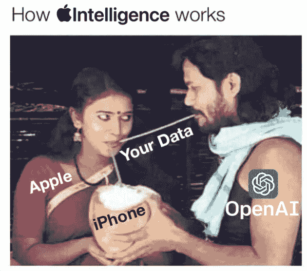

## 6月10日

# AI应用

## 1、Midjourney更新了Niji V6模型

+   **一句话评论：**

> 为这个专注东方动漫的模型，改善了日语和中文字符渲染。

+   **更多可看：**

> https://www.midjourney.com/home

## 2、腾讯推出Follow-Your-Pose-v2

+   **一句话评论：**

> 见多了一人视频动作的Demo吧，腾讯这个可以在推理耗时更少的情况下，支持多人视频动作生成

+   **更多可看：**

> https://arxiv.org/abs/2406.03035

# AI技术

## 1、密歇根博士用AI解码狗的声音

+   **一句话评论：**

> 可以区分不同含义的狗叫声，并识别狗的年龄、性别和品种。

+   **更多可看：**

> https://arxiv.org/pdf/2404.18739

## 2、谷歌开源TimesFM：**让时序模型实现「零样本」预测**

+   **一句话评论：**

> 时间序列预测指「基于过去预测未来」，TimesFM希望成为类似NLP领域的GPT。

+   **更多可看：**

> https://mp.weixin.qq.com/s/_9DYLbRkiXTU70nsXJLCDQ

## 6月9日

# AI应用

## 1、Hugging Face机器人项目Le Robot开源

+   **一句话评论：**

> 领军人物Remi Cadene来自特斯拉Optimus团队

+   **更多可看：**

> https://mp.weixin.qq.com/s/1OICpx-YIj7DJpna9M_aCQ

## 2、MotionFollower：动作置换

+   **一句话评论：**

> 将一个视频中的人物动作转移到另一个视频中的人物身上

+   **更多可看：**

> https://mp.weixin.qq.com/s/_ybeNoivN_v8HMxcD8Lo9Q

# AI技术

## 1、Bootstrap3D开源

+   **一句话评论：**

> 自动生成多视图图像数据来解决3D内容生成中高质量数据不足的问题。

+   **更多可看：**

> [https://mp.weixin.qq.com/s/m7](https://t.co/ExQJgHiGHN)f1myu0eSZqGvZ8mbJcLg

## 2、FineWeb：大模型数据集

+   **一句话评论：**

> 一个用于LLM预训练的新型大规模（15万亿个tokens，44TB磁盘空间）数据集。

+   **更多可看：**

> https://mp.weixin.qq.com/s/HnixBz0dE199N_jbZzY42Q

## 6月8日

# AI应用

## 1、Midjourney更新了Niji V6模型

+   **一句话评论：**

> 为这个专注东方动漫的模型，改善了日语和中文字符渲染。

+   **更多可看：**

> https://www.midjourney.com/home

# AI技术

## 1、UniAnimate：人类跳舞视频生成新框架

+   **一句话评论：**

> 优化了扩散模型生成视频长度短的问题

+   **更多可看：**

> [https://mp.weixin.qq.com/s/56](https://t.co/ExQJgHiGHN)2LGTopFHNp5hMqvqoE6g

## 2、Vision-LSTM出世

+   **一句话评论：**

> LSTM作者带队要跟ViT在视觉领域对抗

+   **更多可看：**

> https://mp.weixin.qq.com/s/_9DYLbRkiXTU70nsXJLCDQ

## 6月7日

# AI应用

## 1、阿里开源Qwen2-72B

+   **一句话评论：**

> 72B指令微调版模型，上下文128k，可和Llama-3-70B-Instruct相匹敌。

+   **更多可看：**

> https://mp.weixin.qq.com/s/H6BbNfBNhyJTWs4ML6K1CQ

# AI技术

## 1、StreamSpeech：语音模型

+   **一句话评论：**

> 一站式离线和同声语音识别、语音翻译和语音合成模型，提供低延迟通信体验

+   **更多可看：**

> [https://ictnlp.github.i](https://t.co/ExQJgHiGHN)[o](https://t.co/ExQJgHiGHN)/StreamSpeech-site/…

>

## 6月6日

# AI应用

## 1、快手版Sora「可灵」发布

+   **一句话评论：**

> 支持生成长达**2分钟**的超长视频，分辨率高达**1080p，**所以Sora啥时候发

+   **更多可看：**

> https://mp.weixin.qq.com/s/-knHZA4AU47EkkzIO7O18A

## 2、猿辅导 ：海豚AI学

+   **一句话评论：**

> 大模型加持的作业帮

+   **更多可看：**

> https://mp.weixin.qq.com/s/Qulr-N76GYbkpyvIfrxvkw

## 3、NPC-Playground：通过 AI 驱动 NPC

+   **一句话评论：**

> 大语言模型驱动的 NPC，感觉游戏助手越来越多了。

+   **更多可看：**

> [https://huggingface.co/](https://t.co/PjcB9KpXOG)spaces/cubzh/ai-npcs

# AI技术

## 1、Higgs-Llama-3-70B开源

+   **一句话评论：**

> AI大佬李沐的创业公司Boson AI，一个专门为复杂场景**角色扮演**设计的大模型

+   **更多可看：**

> [https://mp.weixin.qq.com/s/b2](https://t.co/uPmyrFamB6)mj5KsJUs8puQPClqC_1g

## 2、字节**：Seed-TTS**

+   **一句话评论：**

> 可合成几乎与人类语音无法区分的高质量语音

+   **更多可看：**

> https://bytedancespeech.github.io/seedtts_tech_report

## 3、Stable Audio Open：文本转语音模型

+   **一句话评论：**

> stability开源，可创作鼓点、旋律、音效等。

+   **更多可看：**

> [h](https://t.co/PjcB9KpXOG)ttps://stability.ai/news/introducing-stable-audio-open

## 6月5日

# AI应用

## 1、GLM-4开源版本来了

+   **一句话评论：**

> 9B，超越Llama3 8B，多模态比肩GPT4V，MaaS平台也大升级

+   **更多可看：**

> https://mp.weixin.qq.com/s/MqxiXeYs8dg_lynsUIR0Tg

## 2、Backseat AI ：英雄联盟游戏助手

+   **一句话评论：**

> 通过语音为玩家提供游戏实时的评论和建议，包括购买装备的建议和对线策略等。

+   **更多可看：**

> https://mp.weixin.qq.com/s/v3LuHzZLJJxhls8HtZmnLg

## 3、True Fit：推出新功能"Fit Hub"

+   **一句话评论：**

> 整合产品页面信息，利用AI帮助购物者快速了解商品并确定合适尺码

+   **更多可看：**

> https://x.com/home

# AI技术

## 1、DreamMat：根据文字描述生成高质量基于物理渲染的材质

+   **一句话评论：**

> 利用几何和光照感知的扩散模型生成高质量PBR材质，消除固定阴影效果，使渲染更真实。

+   **更多可看：**

> arxiv.org/abs/2405.17176

## 2、**CamCo：一种图生视频的框架**

+   **一句话评论：**

> 相机控制能力和三维一致性方面有显著改进，能够生成高质量、合理的对象运动视频

+   **更多可看：**

> https://mp.weixin.qq.com/s/bAf-5NzOD3fdTwYzdKsELw

## 3、面壁智能宣布MiniCPM 免费商用

+   **一句话评论：**

> OCR 能力 SOTA！图像编码快 150 倍

+   **更多可看：**

> [https://mp.weixin.qq.com/s/Nv](https://t.co/PjcB9KpXOG)M3eTvVBX4A8IUWsh3Y9w

+   **Mobile-Agent-v2移动**设备操作助手，通过多代理协作实现有效导航

1.  基于多Agent架构的纯视觉解决方案。

1.  更强的任务分解、跨应用操作、多语言能力。

Mobile-Agent-v2在任务完成率上比单代理架构的Mobile-Agent提高了30%以上。

+   论文：https://arxiv.org/abs/2406.01014

+   代码：https://github.com/X-PLUG/MobileAgent

+   Modelscope-agent：https://github.com/modelscope/modelscope-agent

## 6月4日

# AI应用

## 1、微软Aurora：天气预报模型

+   **一句话评论：**

> AI预测极端天气提速5000倍！借AI预测全球风暴

+   **更多可看：**

> https://mp.weixin.qq.com/s/x4gzUQBsiAkqeqaq2pfQLA

## 2、Adobe 发布 VideoGigaGAN 超分辨率视频模型

+   **一句话评论：**

> 解决了超分辨率视频模型的时间连贯性和细节丰富性问题

+   **更多可看：**

> https://mp.weixin.qq.com/s/9kkWGUojt_E0zVO8okk9rg

## 3、NEXA AI发布**Octopus-V4-3B**

+   **一句话评论：**

> 模型分发？整合了多个开源模型，可将用户查询引导至最合适的垂直模型，并重新格式化查询以实现最佳性能。

+   **更多可看：**

> [https://mp.weixin.qq.com/s/jC](https://t.co/PjcB9KpXOG)I0gwA4L6B-9WDlqE680Q

# AI技术

## 1、Google DeepMind发布 Imagen 3

+   **一句话评论：**

> 用于超现实 AI 图像生成。

+   **更多可看：**

> https://aitestkitchen.withgoogle.com/tools/image-fx

## 2、UC伯克利等高校最新提出的微调方法

+   **一句话评论：**

> 直接使用强化学习方法对多模态大模型进行微调。奖励信息直接来源于环境当中，摆脱了RLHF中对于人类反馈的需要

+   **更多可看：**

> https://mp.weixin.qq.com/s/bAf-5NzOD3fdTwYzdKsELw

>

## 3、字节&浙大推出：Coin3D

+   **一句话评论：**

> 可根据用户的粗糙模型+文本描述生成带纹理的3D模型

+   **更多可看：**

> https://arxiv.org/abs/2405.08054

## 6月3日

# AI应用

## 1、Stability AI宣布SD3 Medium将开源

+   **一句话评论：**

> 预计是6月12日

+   **更多可看：**

> [https://stability](https://t.co/PjcB9KpXOG).ai/stablediffusion3

## 2、英伟达推AI游戏助手G-Assist

+   **一句话评论：**

> 能回答游戏问题并优化PC设置、提出游戏性能建议

+   **更多可看：**

> https://www.nvidia.cn/

## 3、Google DeepMind的Veo模型：创新视频生成模型

+   **一句话评论：**

> 可根据单个参考图像生成视频，并通过文本提示调整视觉风格。

+   **更多可看：**

> [h](https://t.co/PjcB9KpXOG)ttps://blog.google/technology/ai/google-labs-video-fx-generative-ai/

# AI技术

## 1、NVIDIA发布全套数字人服务

+   **一句话评论：**

> 可根据音频自动生成数字人的身体、面部和姿势

+   **更多可看：**

> https://www.nvidia.cn/

## 2、Video-MME:首个多模态大模型视频分析综合评估基准

+   **一句话评论：**

> 涵盖多样化和高质量的视频数据集

+   **更多可看：**

> https://video-mme.github.io/home_page.html

## 3、StarShip CodeGen：超越Devin

+   **一句话评论：**

> 初创公司OpenCSG出品的编程 agent，以23.67%的成绩获SWEBench排行榜第二，创造了非GPT-4o基模的最高纪录（SOTA）。

+   **更多可看：**

> [https://mp.weixin.qq.com/s/Y9](https://huggingface.co/spaces/lllyasviel/Omost)uXxNMgliV9p-ne_bGpEw

+   **黄仁勋最新主题演讲：Blackwell** 芯片将打破摩尔定律，解决大模型耗电难题

https://mp.weixin.qq.com/s/2SdJhrzuP3mhSTpTQtqzTA

+   斯坦福AI团队“套壳”清华系开源大模型被实锤！被揭穿后全网删库跑路

https://mp.weixin.qq.com/s/EjFtgrjn6_9DXMGtY3YLEQ

## 6月2日

# AI应用

## 1、Pika 发布新的图像生成视频模型

+   **一句话评论：**

> 做了一些优化，生成视频质量有提升

+   **更多可看：**

> https://pika.art/

## 2、Saama AI Labs 发布 OpenBioLLM-70B

+   **一句话评论：**

> 从 Meta-Llama-3-70B-Inform 微调医疗大模型

+   **更多可看：**

> https://twitter.com/privateAIcom/status/1796783331897749653

## 3、PixVerse AI 推出“魔术画笔”

+   **一句话评论：**

> 可AI生成视频，暂时当Sora的代餐吧

+   **更多可看：**

> https://app.pixverse.ai/

# AI技术

## 1、Rodin Gen-1 发布

+   **一句话评论：**

> 几十秒可通过文本生成高质量的3D模型

+   **更多可看：**

> https://hyperhuman.deemos.com/rodin

## 2、Consistent Character：生成给定角色的不同姿势图像

+   **一句话评论：**

> 能保持角色在生成图片过程中的一致性。

+   **更多可看：**

> https://replicate.com/fofr/consistent-character

## 3、MVSGaussian：一种高效的、可泛化的高斯重建模型

+   **一句话评论：**

> 只需3张视图即可快速推理，45秒便可完成优化

+   **更多可看：**

> [https://mp.weixin.qq.com/s/Y9](https://huggingface.co/spaces/lllyasviel/Omost)uXxNMgliV9p-ne_bGpEw

## 6月1日

# AI应用

## 1、ElevenLabs推出新的AI音频模型

+   **一句话评论：**

> 根据文本提示生成各种音效，如乐器。

+   **更多可看：**

> https://elevenlabs.io

## 2、Midjourney将发布V6.5版本

+   **一句话评论：**

> 图像质量的大幅提升，网页版也将迎来重大更新。

+   **更多可看：**

> https://www.midjourney.com/home

>

## 3、Suno3.5版本模型已全量开放

+   **一句话评论：**

> 特性：可生成4分钟歌曲、2分钟歌曲扩展，可以将任何声音转化为音乐

+   **更多可看：**

> https://suno.com/

# AI技术

## 1、NPGA: 生成**高保真3D头像**

+   **一句话评论：**

> 技术创新点在于采用高斯点云生成3D人像形状，引入神经参数化头部模型捕捉细微表情变化，提高真实感。

+   **更多可看：**

> https://simongiebenhain.github.io/NPGA/

## 2、Claude 3 开放第三方 API

+   **一句话评论：**

> 开发者可调用结构化的 API 实现各种任务的自动化执行。

+   **更多可看：**

> https://www.anthropic.com/

## 3、Omost: 利用 LLM 编程能力文生图

+   **一句话评论：**

> 只需简短的提示词，agent自动帮你补充位置等全局i和局部参数，还支持文本提示局部重绘

+   **更多可看：**

> [https://mp.weixin.qq.com/s/18](https://huggingface.co/spaces/lllyasviel/Omost)XdJ4R6QcofH4b-9HV0qQ

+   快手上线自研文生图大模型产品“可图”

支持文生图和图生图

+   ** ****You.com****推自定义助手功能**

用户可利用GPT-4o、Llama3和Claude3创建个性化AI助手，旨在提高用户在复杂工作任务中的生产力。

https://you.com/

+   EasyAnimate：高分辨率长视频解决方案

阿里的基于类 SORA 结构与 DIT，使用 transformer 进行作为扩散器进行视频与图片生成的高分辨率长视频解决方案

https://easyanimate.github.io/

# 2025年5月

## 5月31日

# AI应用

## 1、Perplexity 推出Pages

+   **一句话评论：**

> 可以AI搜索的答案一键生成文章

+   **更多可看：**

> https://www.perplexity.ai/

## 2、Animate Anyone：基于姿势生成视频

+   **一句话评论：**

> 阿里搞的，输入图片即可生成对应动作的视频

+   **更多可看：**

> https://humanaigc.github.io/animate-anyone/

>

## 3、ChatGPT Edu:专门为大学设计的版本

+   **一句话评论：**

> 基于GPT-4o构建，奥特曼这是想要教育领域的流量了

+   **更多可看：**

> https://openai.com/index/introducing-chatgpt-edu/

# AI技术

## 1、解决Transformer缺陷，CoPE论文爆火

+   **一句话评论：**

> 一种新的用于 transformer 的位置编码方法 ，解决了标准 transformer 无法解决的计数和复制任务.

+   **更多可看：**

> https://mp.weixin.qq.com/s/JxB6JU6MxO3709mkg7penw

## 2、InstaDrag：拖拽控制构图和姿势

+   **一句话评论：**

> 通过拖拽控制照片中的角色姿势、照片构图、人物表情控制、角色朝向等等

+   **更多可看：**

> https://humanaigc.github.io/animate-anyone/

## 3、ToonCrafter: 动漫插帧技术

+   **一句话评论：**

> 只需提供一个起始帧和结束帧，即可生成 16 帧的视频

+   **更多可看：**

> [https://github.com/Too](https://github.com/ToonCrafter/ToonCrafter)nCrafter/ToonCrafter

+   MusePose: 基于姿势生成视频

腾讯的，和阿里这是要竞赛？

https://huggingface.co/TMElyralab/MusePose

## 5月30日

# AI应用

## 1、所有人都能免费用GPT-4o了！

+   **一句话评论：**

> OpenAI宣布「所有ChatGPT免费用户现在都可以使用浏览、视觉、数据分析、文件上传和GPTs。」

+   **更多可看：**

> https://chatgpt.com

## 2、腾讯大模型App元宝发布

+   **一句话评论：**

> 核心看点在于结合微信公众号生态，并且表示未来将继续链接、整合腾讯更多生态。

+   **更多可看：**

> [https://mp.weixin.qq.com/s/iG](https://t.co/4JX3eNbbso)4Fh4zZoTu90_zkJx_QzA

## 3、ViViD：基于视频的虚拟试穿

+   **一句话评论：**

> 阿里推出的视频虚拟试穿技术，输入视频和服装图片，就能将衣服穿到视频的角色身上。

+   **更多可看：**

> [https://becauseimbat](https://t.co/9HsmypAbBb)man0.github.io/ViViD

# AI技术

## 1、Mistral AI开放首个代码模型Codestral

+   **一句话评论：**

> 专为代码生成任务设计的开放式生成 AI 模型，参数规模为 22B，禁止商用。

+   **更多可看：**

> https://mp.weixin.qq.com/s/yPLyGyXSkliV2fVz1PxUhw

## 2、ReVP:可逆视觉处理技术

+   **一句话评论：**

> 可以通过这个技术对原图进行打码、模糊、涂抹等操作，然后还可以无损还原图片。

+   **更多可看：**

> https://revp2024.github.io/

## 3、a16z关于语音Agent的展望

+   **一句话评论：**

> 总结了语音to B和to C的优势与机会

+   **更多可看：**

> https://gamma.app/docs/a16z-Real-Time-Conversational-Voice-AI--m3v486p98gt7jol?mode=doc

+   **Udio推出新的功能**

Udio推出新的udio-130音乐生成模型，可以生成2分钟的音频，帮助创建更具连贯性和结构的曲目。

增加了新的高级控制功能:随机种子设置、提示词或歌词强度调节等。

+   See More Details: 超分辨率技术

把模糊的低分辨率图像变得清晰

https://huggingface.co/spaces/eduardzamfir/SeeMoreDetails

+   **Era3D: 单图转多视角**

输入一张图片即可从创建多视角 3D 图像

[h](https://huggingface.co/spaces/pengHTYX/Era3D_MV_demo)ttps://huggingface.co/spaces/pengHTYX/Era3D_MV_demo

+   Sonic发布：一个生成语音模型

一个速度超快（135ms 模型延迟）、栩栩如生的生成语音模型

https://t.co/rMnegk14Jl https://t.co/wU3mPnmNQqcartesia.ai/blog/sonicplay.cartesia.ai

## 5月29日

# AI应用

## 1、HuggingChat：新增 Tools 功能

+   **一句话评论：**

> 提供了网络搜索（Web RAG）、文档解析、图像编辑等功能。

+   **更多可看：**

> https://huggingface.co/chat/

## 2、Google ImageFX: 支持 Mask 局部重绘

+   **一句话评论：**

> 支持通过遮罩特定区域，然后使用新提示词局部重绘。

+   **更多可看：**

> [h](https://t.co/4JX3eNbbso)ttps://aitestkitchen.withgoogle.com/zh/tools/image-fx

## 3、Camera Settings as Tokens: 结合相机参数生图

+   **一句话评论：**

> 在文生图的基础上，可配置相机参数控制生图。

+   **更多可看：**

> [https://camera-settings-](https://t.co/9HsmypAbBb)as-tokens.github.io/

# AI技术

## 1、ChatTTS:专门为对话场景设计的文本

+   **一句话评论：**

> 超过10万小时训练，中文效果不错

+   **更多可看：**

> https://mp.weixin.qq.com/s/rfJhodvrz4RfvMU2jSBisQ

## 2、Part123：图转 3D 模型

+   **一句话评论：**

> 可以将生成模型分割为不同的组件

+   **更多可看：**

> https://liuar0512.github.io/part123_official_page/

>

## 3、Collaborative Video Diffusion：生成多运镜视频

+   **一句话评论：**

> 可以生成同一场景下不同运镜的视频，并保持内容一致性。

+   **更多可看：**

> [https://collaborativevideo](https://wangyuchi369.github.io/InstructAvatar/)diffusion.github.io/

+   基于产品需求文档生成 Figma 设计稿

https://docs.google.com/forms/d/e/1FAIpQLSeYXokiXa5yIhId6PsMc1e-VkkoQWgjAfhl3vMkAZl70CzQgA/viewform?pli=1

+   2VEdit: 使用图像编辑整个视频

实现编辑从单帧传播到整个视频，保持视觉和运动完整性

https://i2vedit.github.io/

+   腾讯智影AI绘画平台上线黏土风、琉璃玉石风新模型

+   商汤日日新大模型5.0粤语版发布

支持最大128K窗口，在语言对话质量、语料质量和信息密度方面实现了显著提升。

## 5月28日

# AI应用

## 1、Open-Sora 1.1发布（不是Open AI的）

+   **一句话评论：**

> 视频质量提升，生成时长延长至21秒

+   **更多可看：**

> https://huggingface.co/spaces/LanguageBind/Open-Sora-Plan-v1.1.0

## 2、数据自动化工具 Forloop.ai

+   **一句话评论：**

> 可以从任何网站提取数据，将其导入数据库

+   **更多可看：**

> https://www.forloop.ai/

## 3、**AI可以生成手语手势视频了！**

+   **一句话评论：**

> SignLLM：首个通过文字描述生成手语视频的多语言模型

+   **更多可看：**

> https://github.com/iyaja/llama-fs

# AI技术

## 1、**3DGen-Arena：**3D生成模型竞技场

+   **一句话评论：**

> 分**文生3D、图生3D**两个赛道，大家都可以投票

+   **更多可看：**

> https://mp.weixin.qq.com/s/VYdc4K-t9B7dYRGSoXWsLw

## 2、ComfyUI AnyNode：万能节点

+   **一句话评论：**

> 编写Python函数，文本总结、颜色通道调整等各种节点，与comfy其他节点兼容

+   **更多可看：**

> https://github.com/lks-ai/anynode

## 3、InstructAvatar: 文本生成表情

+   **一句话评论：**

> 允许用户通过自然语言来控制虚拟角色的表情和动作

+   **更多可看：**

> [https://wangyuchi369.githu](https://wangyuchi369.github.io/InstructAvatar/)b.io/InstructAvatar/

+   百度文心大模型学习机“小度学习机Z30”发布

采用文心大模型技术，逼真还原课文情景，帮助孩子更好地理解和掌握知识。

支持AI师生互动课和课后个性化练习，量身定制学习计划，实现全科全学段的随时答疑。

基于文心知识增强的大模型，为孩子提供权威且丰富的教育内容，支持多模态感知和拟人化呈现，让学习更加生动有趣。

+   **降噪黑科技Look Once to Hear！只需**看一眼说话的人 除了他以外的声音就消失了

一种先进的降噪耳机技术“Look Once to Hear”，通过用户的视觉输入来控制声音的放大或消除。这项技术在嘈杂环境中提供了专注和便利，让用户能够清晰听到目标说话者的声音。

+   苹果与 OpenAI 达成协议，iOS18 用上 ChatGPT：

彭博社消息，苹果公司预计将在下月举行的 WWDC 2024 上官宣与 OpenAI 达成伙伴协议，将为今年的 iOS 18 系统提供一系列生成式 AI 功能，但目前这项功能尚未成熟，苹果会以Beta版或预览版的名义发布。

据悉，iOS 18的AI功能包括语音备忘录转录、AI照片编辑、消息回复建议、Safari和Spotlight智能搜索等等。与此同时，iOS 18将会单独集成聊天机器人，由OpenAI的ChatGPT提供技术支持。苹果还在与谷歌进行一系列谈判，试图将 Gemini 作为另一种可选的方案内置在 iOS 系统中。

+   StreamV2V: 实时流式视频转绘模型

StreamV2V 能够实时的完成视频转绘，包括换脸、视频风格，因为是流式的，所以支持无限长视频，并且能实时提示词控制视频。

[https://jeff-liangf.github.io](https://jeff-liangf.github.io/projects/streamv2v/)/projects/streamv2v/

## 5月27日

# AI应用

## 1、Stable Assistant发布

+   **一句话评论：**

> 支持图、视频生成， 3 天免费试用

+   **更多可看：**

> [https://stability](https://stability.ai/stable-assistant).ai/stable-assistant

## 2、华尔街日报的AI 聊天机器人的测试

+   **一句话评论：**

> 综合项目perplexity竟然夺冠！！

+   **更多可看：**

> [https://mp.weixin.qq.com/s/lz](https://t.co/4JX3eNbbso)njuH9bT9bdRK1UKmBW3w

## 3、**LlamaFS帮你自动整理桌面**

+   **一句话评论：**

> 能自动重命名和分类文件。

+   **更多可看：**

> https://github.com/iyaja/llama-fs

>

# AI技术

## 1、CVPR2024线上分享日程公布

+   **一句话评论：**

> 不知道今年计算机视觉领域有没有惊艳的课题

+   **更多可看：**

> https://mp.weixin.qq.com/s/syFWYICchC2nlpvPKghf5A

## 2、CoT提出者Jason Wei：大模型评估基准的「七宗罪」

+   **一句话评论：**

> 列举了成功的评估基准和失败的常见原因

+   **更多可看：**

> https://mp.weixin.qq.com/s/N3GVp22ZF27z54JFEZo0Iw

## 3、Vidu4D: 视频转 4D

+   **一句话评论：**

> Vidu4D 可以从单个视频生成三维空间加上时间4D重建。

+   **更多可看：**

> https://vidu4d-dgs.github.io/

+   **中**国电信人工智能研究院（TeleAI）发布了业内首个支持 30 种方言自由混说的「星辰超多方言语音识别大模型」，

可同时识别理解粤语、上海话、四川话、温州话等各地方言，是国内支持最多方言的语音识别大模型。

https://mp.weixin.qq.com/s/JSEtiE8Sf8DY_jgtUEYRqg

+   港大字节提出多模态大模型新范式，模拟人类先感知后认知，精确定位图中物体

https://mp.weixin.qq.com/s/EM525U6mLQOQaOuZQlTNVg

## 5月26日

# AI应用

## 1、Suno发布v3.5型号更新，面向Pro和Premier会员。

+   **一句话评论：**

> 支持最大剪辑歌曲长度为 4 分钟，可下周体验。

+   **更多可看：**

> https://suno.com/

## 2、Canva Create 2024

+   **一句话评论：**

> 公布了19项高级 AI 设计功能更新

+   **更多可看：**

> [https://x.com/shushant_l/status](https://t.co/4JX3eNbbso)/1794216863498707253

## 3、Flawless:利用AI给电影配音

> 电影角色和配音可以完美唇形同步

+   **更多可看：**

> https://www.flawlessai.com/

# AI技术

## 1、SimPO：陈丹琦团队优化DPO的方法

+   **一句话评论：**

> 一种简单却有效的离线偏好优化算法。

+   **更多可看：**

> https://mp.weixin.qq.com/s/wJKiDU8t2RW2DpnqYR1h8w

## 2、WhisperKit-0.7.0 出来了！

+   **一句话评论：**

> 单文件推理速度快几倍！最快以 1 秒可转录 101 秒的音频。

+   **更多可看：**

> [https://youtube.com](https://t.co/qsFllpOEcP)[/](https://t.co/qsFllpOEcP)watch?v=wupToqz1e2g…

## 3、YOLO v10：清华目标检测开源模型

+   **一句话评论：**

> 毫秒级完成物体检测，高精度，大幅减少计算时间和资源。

+   **更多可看：**

> [https://huggingface.co/spa](https://huggingface.co/spaces/wyysf/CraftsMan)ces/kadirnar/Yolov10

+   **ICML 2024 | 脱离LoRA架**构，训练参数大幅减少，新型傅立叶微调来了

https://mp.weixin.qq.com/s/jaYeIfByJaWU5-4jBmnrzQ

## 5月25日

# AI应用

## 1、Leonardo.AI 推出V2版本

+   **一句话评论：**

> 可以在 5 月 30 日之前免费访问 V2中的大多数高级功能

+   **更多可看：**

> https://app.leonardo.ai

## 2、Mistral AI新推出的微调指南与7B模型

+   **一句话评论：**

> 如何使用 LoRA 微调 Mistral 开源模型的官方指南

+   **更多可看：**

> [https://github.com/mistra](https://t.co/4JX3eNbbso)[l](https://t.co/4JX3eNbbso)ai/mistral-finetune…

>

## 3、中国移动千亿多模态大模型发布

> 有1.5B、3B、7B、13.9B、100+B等不同参数版

+   **更多可看：**

> [https://mp.weixin.qq.com/s/Xr](https://t.co/9HsmypAbBb)smPeXMMpQuNh4jhIUi4Q

# AI技术

## 1、CameraCtrl: 控制视频生成中的镜头

+   **一句话评论：**

> 太赞了！AI生成电影刚需！可调整镜头的远近、角度等。

+   **更多可看：**

> [https://hehao13.github.io/](https://hehao13.github.io/projects-CameraCtrl/)projects-CameraCtrl/

## 2、GCD可使得单视角生多视角视频

+   **一句话评论：**

> 通过场景的一个视角想象并生成不同视角的样子

+   **更多可看：**

> https://gcd.cs.columbia.edu/

## 3、CraftsMan 匠心：高保真Mesh 生成

+   **一句话评论：**

> 文本或参考图像中快速生成网格，并允许用户交互式编辑

+   **更多可看：**

> [https://huggingface.co/sp](https://huggingface.co/spaces/wyysf/CraftsMan)aces/wyysf/CraftsMan

+   ComfyUI 3D pack：新功能更新

适配了 zero123plus：单图转 6 视图

适配了 InstantMesh：单图转 3D 模型

GitHub: https://github.com/MrForExample/ComfyUI-3D-Pack

https://github.com/SUDO-AI-3D/zero123plus

https://github.com/TencentARC/InstantMesh

## 5月24日

# AI应用

## 1、Arc Search推出全新功能CALL ARC

+   **一句话评论：**

> 模拟电话交互，体验超自然，是个小创新。

+   **更多可看：**

> https://mp.weixin.qq.com/s/882VLzA0eHZljmNsnaLDmg

## 2、Krea AI视频生成工具向所有人开放

+   **一句话评论：**

> 类比剪映，视频编辑工具加了一些AI能力。

+   **更多可看：**

> https://www.krea.ai

>

## 3、Cohere推出先进的多语言Aya 23模型

+   **一句话评论：**

> 一款最先进的多语言 8B 和 35B 版本

+   **更多可看：**

> http://cohere.com/research/aya

>

# AI技术

## 1、Anthropic发现AI模型“黑盒子”方法

+   **一句话评论：**

> 虽然只是开始，但为大模型的可解释性开了好头

+   **更多可看：**

> [https://mp.weixin.qq.com/s/Ft](https://jjihwan.github.io/projects/FIFO-Diffusion)0OpbkTek98nlauPvTb5g

## 2、Pandora: 通过自然语言生成视频

+   **一句话评论：**

> 通过文本指令生成和控制视频，还能学习在一个领域学到的动作，并将其应用到其他领域。

+   **更多可看：**

> https://mp.weixin.qq.com/s/Vj2W3BtKITV4mxwVhDJHzg

## 3、ReVideo:可局部修改视频内容和运动轨迹

+   **一句话评论：**

> 牛，就是你想编辑头不想动身体也可以实现

+   **更多可看：**

> https://github.com/redotvideo/

+   Semantic Gaussians: 一种全新的 3D 场景理解技术

一种通过多视图图像输入，将其投影到 3D 空间中生成 3D 高斯点，并映射生成语义高斯图像的新技术。

官网展示了几个实际应用案例：

+   时空跟踪 (Spatiotemporal Tracking) ：跟踪物体或人的运动

+   部件分割 (Part Segmentation) ：将物体分割成不同的部件，图中示例是一把吉他，被分割成不同颜色的部分

+   语言引导编辑 (Language-Guided Editing) ：用户可以通过自然语言指令（例如“删除玻璃瓶”）进行图像编辑

[https://semantic-](https://semantic-gaussians.github.io/)gaussians.github.io/

+   TRANSAGENTS: 超长文学作品的多智能体翻译框架

一个基于 LLM 的多智能体系统，旨在通过模拟传统的翻译出版流程，解决文学作品翻译中的复杂语言、修辞表达和文化差异等难题。

该系统由不同角色的智能体组成，包括高级编辑、初级编辑、翻译、本地化专家和校对员等。智能体协同工作，模拟真实翻译公司的流程，从而增强翻译质量。

尽管该系统的 d-BLEU 得分较低，但实际的翻译效果更受欢迎，并且在中文网络小说的翻译上比 GPT-4 和人工翻译更准确。

https://arxiv.org/pdf/2405.11804

+   Mac上的ChatGPT再次登台演讲

https://mp.weixin.qq.com/s/OMoHHvu5_XluCfszImyiQA

OpenAI开发者体验主管Romain Huet在现场给400多名观众演示ChatGPT最新功能

https://mp.weixin.qq.com/s/OMoHHvu5_XluCfszImyiQA

## 5月23日

# AI应用

## 1、OpenAI 与 News Corp 的合作

+   **一句话评论：**

> ChatGPT 以后的新闻来源会更真实全面，新闻质量会更高

+   **更多可看：**

> https://mp.weixin.qq.com/s/J68soZE3YJf70Of9sONpUg

>

## 2、字节Coze海外版支持GPT-4o

+   **一句话评论：**

> 可以在上面白嫖GPT4哦

+   **更多可看：**

> https://www.coze.com

>

## 3、Domo AI 上线唇形同步功能：提升面部对话视频转换效果

+   **一句话评论：**

> 将静态照片人物替换到动态视频中，增加唇形同步后更自然。

+   **更多可看：**https://www.chinaz.com/2024/0523/1618634.shtml

# AI技术

## 1、FIFO-Diffusion: 可以生成无限视频

+   **一句话评论：**

> 从文本描述生成无限长视频，看起来很牛。效果待评测

+   **更多可看：**

> [https://jjihwan.github.io/pro](https://jjihwan.github.io/projects/FIFO-Diffusion)jects/FIFO-Diffusion

## 2、ambientGPT：开源多模态MacOS基础模型操作界面

+   **一句话评论：**

> 能直接访问屏幕内容而不需要截图。它的本地模型是基于 Apple 的 MLX 库

+   **更多可看：**

> https://ishare.ifeng.com/c/s/v002VtomFbr9YL3yBxY--CZRTJt4uyNc8i-_zH0agXnrpc2RI__

## 3、TextureDreamer: 为3D 模型上照片纹理

+   **一句话评论：**

> 通过几张照片给3D 模型表面添加纹理。

+   **更多可看：**

> https://texturedreamer.github.io/

+   TikTok推出新的AI套件TikTok Symphony

AI视频生成器，为广告商提供定制化视频内容。帮助广告商生成脚本和提供建议，自动修复和优化现有视频

+   Dreamer XL: 高分辨率文生 3D 新方法

Dreamer XL 模型利用一种叫做“轨迹得分匹配”（TSM）的技术，解决了之前模型在生成 3D 图像时由于累积误差导致的图像不一致问题。它通过从同一个起点出发生成两条路径，减少了生成过程中的累积错误，使得最终生成的 3D 图像更加真实和准确。此外，为了处理高分辨率图像生成中的一些挑战，研究者们还提出了逐像素梯度剪切方法，有效提高了图像质量。

https://arxiv.org/html/2405.11252v1

## 5月22日

# AI应用

## 1、2024年的Microsoft Build大会炸场

+   **一句话评论：**

> 展示了一系列在AI工具具和技术方面的重大进展

+   **更多可看：**

> https://mp.weixin.qq.com/s/5AeSmaNZvGKea7QZjOJvxg

## 2、Perplexity与TakoViz合作推出高级知识搜索和可视化功能

+   **一句话评论：**

> 搜索结果文、图表展示更清晰，支持财务、经济、政治等多个领域的数据

+   **更多可看：**

> https://www.perplexity.ai/

## 3、Adobe Lightroom新增AI魔术橡皮擦功能

+   **一句话评论：**

> 可轻松删除照片中的不需要的物体或人物，

+   **更多可看：**https://mp.weixin.qq.com/s/PSCMO17scSJztqkvNdsQSA

# AI技术

## 1、微软发布Phi-3 Vision大模型

+   **一句话评论：**

> 小参数模型在算力有限场景下具有潜在应用价值，其7B性能超过了Mistral7B和Llama38B。

+   **更多可看：**

> https://mp.weixin.qq.com/s/m8MPmbQqQIUvDRYr5SMx_A

>

## 2、Slicedit: 文字操作视频编辑

+   **一句话评论：**

> 通过输入文字直接编辑视频主体

+   **更多可看：**

> https://matankleiner.github.io/slicedit/

>

## 3、通过文本生成播放音频的频谱图

+   **一句话评论：**

> 可以播放声音的图片，有点意思

+   **更多可看：**

> https://ificl.github.io/images-that-sound/

>

+   Windows 11 新增基于AI的复制和粘贴功能

微软在 Windows 11 中引入了新的高级粘贴功能，利用 AI 技术实现剪贴板内容的即时转换。这一功能让用户可以更快地转换剪贴内容为纯文本、Markdown、JSON 等格式，甚至进行摘要、翻译、生成代码等操作，提升工作效率。

+   **谷歌推出的“Say What You** See”游戏助力图像阅读和AI提示写作

谷歌推出的“Say What You See”游戏旨在帮助玩家提高图像阅读技能和AI提示写作能力。通过参与游戏，玩家可以锻炼创造力、观察力，体验AI技术在图像生成领域的应用。游戏不仅提供娱乐，还作为学习工具，帮助玩家理解和利用AI技术。总体而言，这款游戏为玩家提供了锻炼图像阅读和AI提示写作能力的平台，是一种寓教于乐的学习方式。

https://artsandculture.google.com/experiment/say-what-you-see/jwG3m7wQShZngw

+   百川智能发布Baichuan4模型及首款AI智能助手"百小应"

百川智能5月22日发布了最新一代基座大模型Baichuan4,并拍佳出了首款Al助手"百小应"。Baichuan4

在各项能力上较之前版本有显著提升,通用能力提升超过10%,数学和代码能力分别提升14%和9%。

+   **步骤指引 AI 化**

由 Ramp 首创的一种基于 GPT-4o 的步骤指引，与类似 driver.js 的预定义指引不同，其接受用户输入一个问题，然后 AI 就会在 UI 上一步步指引用户如何完成操作。

https://x.com/tryramp/status/1792659194996281478

+   科大讯飞：讯飞星火Lite API永久免费开放

https://mp.weixin.qq.com/s/bb64EC9PdJuF9ismLqEctQ

## 5月21日

# AI应用

## 1、微软颠覆PC形态，搭载GPT-4o发布真AI PC

+   **一句话评论：**

> 这下AI真能实时看到你的屏幕、听到系统内外的信息了，真惊艳！

+   **更多可看：**

> https://mp.weixin.qq.com/s/zzCWwgocTaHz7tgirkkOyQ

## 2、苹果和OpenAI 将在 WWDC 上宣布重要合作消息

+   **一句话评论：**

> 整合OpenAI技术到iOS 18，改进Siri和其他AI功能等。

+   **更多可看：**

> https://mp.weixin.qq.com/s/bb64EC9PdJuF9ismLqEctQ

## 3、大厂开始卷大模型价格，阿里降价，百度免费

+   **一句话评论：**

> 阿里的Qwen-Long API输入费用暴跌97%，随后百度宣布文心大模型ERNIE Speed、 Lite免费

+   **更多可看：**

> https://mp.weixin.qq.com/s/PSCMO17scSJztqkvNdsQSA

# AI技术

## 1、智谱开源新一代多模态大模型CogVLM2

+   **一句话评论：**

> 支持8K文本长度和1344*1344分辨率的图像。模型大小为19B，性能接近或超过GPT-4V水平。

+   **更多可看：**

> https://mp.weixin.qq.com/s/RuMhRPlYvG7qo3r9S15dHA

## 2、**面壁智能推出最新一代端侧多模态模型** MiniCPM-Llama3-V2.5

+   **一句话评论：**

> 在 OCR 方面表现不错，支持多种语言，可以端侧系统级多模态加速。

+   **更多可看：**

> https://mp.weixin.qq.com/s/lzp_zOsu1ne7evZ-RgZLJw

## 3、中国大模型头名易主：Yi-Large与GPT-4o中文并列第一

+   **一句话评论：**

> LMSYS 竞技场最新排名，李开复的千亿参数模型 Yi-Large 总榜排名世界第 7，中国第一。

+   **更多可看：**

> https://mp.weixin.qq.com/s/NIEjClwPT4BVF7_7U8n43w

## 5月20日

# AI应用

## 1、字节**Coze上线Web SDK **

+   **一句话评论：**

> 能将Coze的机器人快速嵌入网页

+   **更多可看：**

> https://www.coze.com/docs/developer_guides/web_sdk?_lang=en44

>

## 2、GPT-4o实时语音方案提供商Livekit开源voice agent

+   **一句话评论：**

> 有GPT-4o背书，让你轻松处理音视频流

+   **更多可看：**

> https://mp.weixin.qq.com/s/OUX0L4PLvnPsLAAXlBhM9g

## 3、苹果多模态Ferret-UI用自然语言操控手机

+   **一句话评论：**

> 针对手机屏幕的理解进行了优化，让大模型能看懂手机屏幕

+   **更多可看：**

> https://mp.weixin.qq.com/s/GPsnp51OaCO0MCRlXTDObQ

# AI技术

## 1、教你从零实现LLaMa3大模型

+   **一句话评论：**

> Karpathy称赞，一个开源教程，展示了如何从0手搓Llama3 模型。

+   **更多可看：**

> https://mp.weixin.qq.com/s/1poG0tEjmym1456mmR66nQ

## 2、MarkLLM: 清华发布AI生成内容溯源模型

+   **一句话评论：**

> 预期是让大模型自己去溯源大模型生成的内容，效果一般。

+   **更多可看：**

> https://colab.research.google.com/drive/169MS4dY6fKNPZ7-92ETz1bAm_xyNAs0B

## 3、谷歌发布了10门免费人工智能课程

+   **一句话评论：**

> 先学习大模型基础知识的朋友可以看看

+   **更多可看：**

> https://www.cloudskillsboost.google/course_templates/539

+   Grounding DINO 1.5：实时从视频图像检测想要的物体

https://deepdataspace.com/playground/grounding_dino

## 5月19日

# AI应用

## 1、Meta发布Chameleon模型挑战GPT-4o

+   **一句话评论：**

> 文本、图像和视频等多模态混合模型会在GPT-4o的引领下越来越多。

+   **更多可看：**

> https://mp.weixin.qq.com/s/HQC7F64ZIb-k-K_QLzFegg

## 2、ImagineArt：AI驱动的艺术创作平台

+   **一句话评论：**

> 利用文本和随意涂鸦就可以在平台上进行AI创造。

+   **更多可看：**

> https://t.co/HVCXMbkpFY

## 3、Anthropic公司推出新型LLMs“提示生成器”

+   **一句话评论：**

> 不知道怎么写Prompt的人可以看看，但是收费

+   **更多可看：**

> https://console.anthropic.com/dashboard

# AI技术

## 1、PSG4D: 4D 全景 场景图生成系统

+   **一句话评论：**

> 接收现实世界的4D信息（包括三维空间和时间），然后生成、推理、交互，利好具身智能。

+   **更多可看：**

> https://github.com/Jingkang50/PSG4D

## 2、Toon 3D：换个视角看动画

+   **一句话评论：**

> 让机器能够理解并重建卡通和动漫中的 3D 结构，使用户能够从前所未有的视角观察卡通世界。

+   **更多可看：**

> https://toon3d.studio/

## 3、T2V-NPR：文本可以生成矢量图

+   **一句话评论：**

> 一个好玩的小技术demo

+   **更多可看：**

> https://intchous.github.io/T2V-NPR/

## 5月18日

# AI应用

## 1、ElevenLabs推出Audio Native自动将你的内容转换为播客

+   **一句话评论：**

> 简单说就是将各类网页的文本转化成高质量的语音旁白，将内容自动变为播客。

+   **更多可看：**

> https://elevenlabs.io/blog/audio-native/

## 2、CAT3D：可以将图转3D场景

+   **一句话评论：**

> CAT3D 使用 multi-view latent diffusion model, 支持通过单图或多视角图转 3D 场景。

+   **更多可看：**

> https://cat3d.github.io/

>

## 3、DentalMonitoring 推出 AI 驱动的 ScanBox

+   **一句话评论：**利用人工智能，用户可自行拿扫描设备扫描自己的牙齿，医生可以远程进行牙科检查，不用去医院啦

+   **更多可看：**https://twitter.com/Rainmaker1973/status/1791338477763559715

>

# AI技术

## 1、多模态AI是医学的未来，谷歌Med-Gemini迎来大升级

+   **一句话评论：**

> Med-Gemini 在各种医学成像任务上超越 GPT-4 。本次新增多模态模型，用于处理放射学、皮肤科及CT 图像

+   **更多可看：**

> https://mp.weixin.qq.com/s/NeErcPfdpyBS8Q37mqXSWw

## 2、人物照片+文字 = 定制化视频，腾讯开源ID-Animator

+   **一句话评论：**

> 给定的一张参考图片，生成一致性的角色定制化视频。视频UGC内容又要爆发

+   **更多可看：**

> https://mp.weixin.qq.com/s/OVbQhR_bG8ZnNE8xMDrC4w

## 3、Video-LLaVA ：视频和图像的智能理解系统

+   **一句话评论：**Video-LLaVA 能够使 LLM 同时对图像和视频进行视觉推理。

+   **更多可看：**https://huggingface.co/spaces/LanguageBind/Video-LLaVA

## 5月17日

# AI应用

## 1、ChatGPT增强数据分析功能，实现与数据表格的实时交互

+   **一句话评论：**

> ChatGPT改进了数据分析功能，包括文件上传、实时表格交互、定制和下载演示图表。

+   **更多可看：**

> https://openai.com/index/improvements-to-data-analysis-in-chatgpt/

## 2、腾讯混元将发布大模型C端App腾讯元宝

+   **一句话评论：**

> 腾讯宣布推出新App“腾讯元宝”，背后搭载着超万亿参数的混元大模型。类比chatgpt和文心一言，AI能力演示应用。

+   **更多可看：**

> https://mp.weixin.qq.com/s/94ZFjEOaz2Te_cuSjscU1w

## 3、代码重写超越GPT-4o，来自OpenAI投资的代码神器Cursor团队

+   **一句话评论：**让你更快生成代码，程序员有福了，不过现在AI代码生成赛道也是真卷！

+   **更多可看：**https://mp.weixin.qq.com/s/rCplbpHfzCbPtc0tt7xwJg

# AI技术

## 1、谷歌发布开源视觉语言模型PaliGemma

+   **一句话评论：**

> 结合图像处理和语言理解能力，支持多种视觉语言任务。

+   **更多可看：**

> https://mp.weixin.qq.com/s/GtQ5q4inzi7P88Z-eCW-_g

## 2、Glyph-ByT5：微软推出视觉文本编码器

+   **一句话评论：**

> 已经实现了对 5,000 多个汉字的准确视觉文本渲染，意思是对AI生图的时候想在图上加几个字有帮助

+   **更多可看：**

> https://github.com/AIGText/Glyph-ByT5

## 3、全球140+模型考试出炉！超8万道考题国产模型分数亮眼，智源评测体系发布

+   **一句话评论：**就是给大模型出了套高考试卷，分别从主观、客观两个维度，考察了语言模型的七大能力

+   **更多可看：**https://mp.weixin.qq.com/s/j1fNL6NwqoeOzL0mgCUoOQ

+   **开源模型穷途末路？Stability** AI欠下1亿美元，四处找钱寻求「卖身」

https://mp.weixin.qq.com/s/TlupXbcWxvhoN2hpVLRQug

+   李彦宏：百度搜索已有11%结果由AI生成

在百度2024年第一季度财报电话会上，百度创始人李彦宏深入探讨了公司的业务表现和未来发展方向，公布百度一季度在线营销收入同比增长3%，11%搜索结果通过生成式人工智能技术计算，提供更准确、有条理的答案，拓展用户任务完成能力。百度在人工智能领域持续投入，尚未商业变现，但对长期前景充满信心。

+   OpenAI与Reddit合作，将用户生成独特内容整合至ChatGPT

OpenAI与Reddit宣布战略合作，合作旨在整合先进的AI功能和用户生成的独特内容，提升ChatGPT等AI工具的理解和展示能力。

Reddit向OpenAI开放Data API，使后者能够获取Reddit社区生成的丰富内容，推出个性化内容推荐等AI功能。

合作标志着社交媒体和人工智能融合的重要里程碑，为用户和版主带来全新的体验。

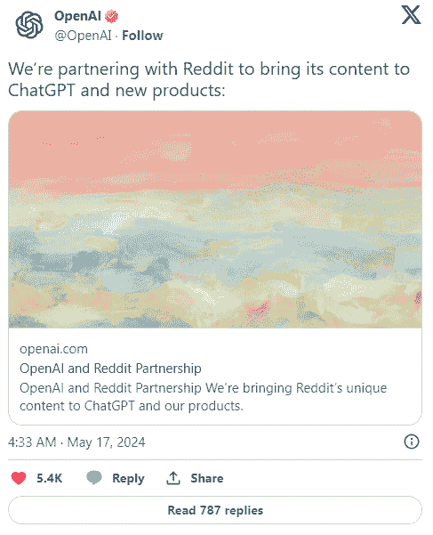

## 5月16日

# AI应用

## 1、Hume推出互动式AI播客Chatter

+   **一句话评论：**

> 亮点是让用户可以将搜索内容转换成语音播报，同时还能在社区和其他听众互换内容，其实就是给AI搜索加了语音。

+   **更多可看：**

> https://chatter.hume.ai/

## 2、**抖音电商正在试水AI购物助手**

+   **一句话评论：**

> 根据你的消费需求给你购物建议，图文搭配抖音的短视频，让你的选择信息更充分。淘宝京东之前也上线了类似产品。

+   **更多可看：**

> https://mp.weixin.qq.com/s/GhAPjBWsSCNkABZldsVDGQ

## 3、Deep Paint：一款可以直接在3D空间中绘画的插件

+   **一句话评论：**在3D空间内像在纸上绘画一样创作3D模型，有用到Blender的设计朋友可以试试

+   **更多可看：**https://gakutada.gumroad.com/l/DeepPaint

# AI技术

## 1、BlobGEN: 基于 blob 的文生图

+   **一句话评论：**

> 比mask 方式的图生图更加友好，简单易懂，就是一张图分为几个圈，哪个圈上想画啥可以通过文本描述，牛

+   **更多可看：**

> https://blobgen-2d.github.io/

## 2、ElevenLabs发布配音API

+   **一句话评论：**

> 用该API，大家可以将任意音频或视频翻译成29种语言，并且保留原始发言者声音的独特特征

+   **更多可看：**

> https://www.chinaz.com/2024/0515/1616605.shtml

## 3、The Chosen One: 文生图角色一致性

+   **一句话评论：**通过一些共同特征的图像群组，在里面提取出一个代表模型。利用这个模型，可以生成在新场景中仍然保持一致性的角色图像

+   **更多可看：**https://omriavrahami.com/the-chosen-one/

+    苹果宣布一系列新的辅助功能,包括眼动追踪、语音快捷方式等

苹果公司今天宣布将于今年晚些时候推出新的辅助功能,其中包括眼动追踪(EyeTracking)、音乐触感(MusicHaptics)和语音快捷方式(Vocal Shortcuts)。

https://mp.weixin.qq.com/s/iSw6LnXsjtmB-8RqRm-mlQ

+   传微软将中国AI精英团队全部打包到美国，可带家人、公司负责搞定签证

微软被曝将中国AI团队集体打包去美国，涉及数百人，内部人士：部分员工确实收到调动，不影响国内运营，官方最新回应

https://mp.weixin.qq.com/s/mjEIvDWEqpoSG2qY9_IOLw

+   中美举行人工智能政府间对话首次会议

5月14日，中美人工智能政府间对话首次会议在瑞士日内瓦举行。会议就人工智能科技风险、全球治理等问题进行了深入交流。中方强调人工智能技术应有益、安全、公平，支持加强人工智能全球治理的立场，并对美方在人工智能领域对华的限制及打压表示严正立场。

https://mp.weixin.qq.com/s/lzfIEXb5rUWiMcQg1UH9Jg

+   华为“天生会画”App 发布支持超多图层

华为推出全新自研专业绘画软件“天生会画”，融合专业智慧和易用性，满足创作者多样化需求。软件内置丰富笔刷选择，提供高度拟真画布，支持超多图层，融入智慧功能，提升用户创作效率。

https://consumer.huawei.com/cn/mobileservices/gopaint/

+   李飞飞解读创业方向「空间智能」，让AI真正理解世界

https://mp.weixin.qq.com/s/okhjWPp0is0ks3e_RvJO4g

+   小米AI大模型MiLM通过备案 将应用于手机、汽车产品中

北京市生成式人工智能服务新增已备案信息正式公布，19家企业新增备案，小米科技有限责任公司“小米”名列其中。

+   **Midjourney团队公布进展：视频**模型进展较慢 3D模型和实时生成效果显著

Midjourney团队在最近的工作时间透露了他们在视频模型、3D模型、实时生成效果以及网站和模型开发方面的最新进展。尽管视频模型进展较慢，但3D模型和实时生成效果显著。团队致力于精准控制、高图像质量的技术产品，并将进行网站更新和模型开发。

## 5月15日

# AI应用

## 1、Google I/O 2024开发者大会正面硬刚Open AI

+   **一句话评论：**

> 发布了Astra多模态、Veo视频等模型、更新了gemini，大而全，但少了惊喜感，全是在追赶Open AI。

+   **更多可看：**

> [AI日日新（更新中）](https://vx8e8325ai4.feishu.cn/wiki/SswEwb5AwiBP0bk5RUzcAdBwnbd?fromScene=spaceOverview)

>

## 2、字节跳动火山引擎大会发布豆包大模型系列，

+   **一句话评论：****字节跳动9个大模型全员亮相，出**乎意外的是没有参数规模和榜单分数，最低0.0008元/千tokens

+   **更多可看：**

> https://mp.weixin.qq.com/s/_mycwh_cJ5mS2bKuATW8cg

## 3、阿里国际推出AI虚拟试衣工具，1分钟内搞定

+   **一句话评论：**短时间内生成专业棚拍效果的商品图，平均成本控制在0.2-0.3元人民币以内，淘宝商家有福了

+   **更多可看：**https://mp.weixin.qq.com/s/Hzw2cLOAzlgilHK3FSPklQ

# AI技术

## 1、首个中文原生DiT架构！腾讯混元文生图大模型全面开源

+   **一句话评论：**

> 与 Sora 同架构，支持中英文双语输入及理解，参数量 15 亿。可以多轮生图和对话，擅长细粒度文本提示生成

+   **更多可看：**

> https://mp.weixin.qq.com/s/6J4Vc1faazRGXbDNG_RdPw

## 2、OpenAI首席科学家Ilya官宣离职，OpenAI还是走散了

+   **一句话评论：**

> 据说Ilya接下来会做一个对个人非常有意义的项目，难道也要下海去创业？

+   **更多可看：**

> https://mp.weixin.qq.com/s/D6WxVBFj_ERzgurA1fP8qA

>

## 3、最新的快速零样本语音合成模型 FlashSpeech ！

+   **一句话评论：**又快又好，语音合成速度在质量不变的情况下提升20倍

+   **更多可看：**https://mp.weixin.qq.com/s/qIpmKgL3Uwq-CD7Pkm5xfA

+    微软宣布 GPT-4o 模型在 Azure OpenAI 上使用

微软宣布最新的多模态模型GPT-4o现已可以在Azure OpenAI上使用，该模型支持跨文本、视频、音频多模态推理，具有强大的多模态解读和输出能力。GPT-4o在教育、语言学习、形象评价等领域有广泛应用前景。

+   MiniMax推出人生搭子「海螺 AI」

MiniMax推出了一款名为「海螺 AI」的人生搭子产品，为学生、职场新人、自由工作者、创作者等各类人群提供外挂大脑和人生搭子，帮助化解信息过载和高速运转带来的压力。小海螺具备智能高效的特点，支持处理长篇内容，理解情感并耐心倾听用户，支持多种交互方式。已被广泛使用，24*7在线解决用户问题，希望陪伴用户在人生不同阶段。

## 【号外】5.15 Google I/O 2024开发者大会

# **给Goog**le的 I/O 2024 大会主题演讲部分做个小总结

###### 两个小时的主题演讲里，AI被提及了121次

### 1、谷歌版《Her》——Project Astra。

> **多模态助手**，能几乎没有延迟地和人类流畅交流，但延迟似乎还是比GPT-4o长，演示中也没有体现是否能打断助手说话

### **2、对**标Sora——一分钟长视频的视频生成模型Veo

> **1080p**的高质量视频，最长**超过1分钟**，**画面一致性出色****，并且可以hold**住各种风格。比如“延时拍摄”和“航拍”

### 3、Gemini 1.5 Pro上下文窗口从100万token直接增加到200万，面向所有人开放。

> **还最新推出了Gemin**i 1.5 F**lash这一轻量级**模型，并开源了27B的Gemma 2和视觉语言模型PailGemma。

### **4、图片生成模型**Imagen迎来更新——Imagen 3发布。

> **与此前的模型**相比，Imagen 3的视觉伪影更少，生成的图像细节拉满，并且在生成文字方面效果也很好。

### 5、推出了音乐生成模型**Lyria**。

### 6、第六代TPU Trillium将在今年发布

> **与TPU** v5e，峰值计算性**能提****高4****.7倍**，HBM和带宽增加了1倍，芯片间互联（ICI）带宽也增加了1倍。另外，Trillium的能效比TPU v5e高出了67%以上。

### 7、Gemini塞进了全线产品中，包括谷歌搜索、Android，以及谷歌邮箱、谷歌Photos等

> 谷歌搜索推出AI概述（AI Overview**）新功****能，Android内**置的Circle to Search功能，手势“圈”一下内容就能搜索。谷歌Photos推出——Ask Photos，一键从图库中帮你找到想要的照片和视频。

### 一句话评论：发布了很多意料之内的产品，诚意拉满，惊喜度不足

Google 最新图像模型 Imagen 3 和视频模型 Veo 的 waitlist 申请地址：https://aitestkitchen.withgoogle.com/tools/video-fx

**详细内容：**

+   **Project Astra：**

基于Gemini系列模型打造，谷歌表示，研究人员们希望这样的智能助手，能真正在人们的日常生活中提供帮助。

比如，Project Astra的延迟似乎还是比GPT-4o长，谷歌的演示中也没有体现是否能打断智能助手说话

[20240515061321_rec_.mp4](https://internal-api-drive-stream.feishu.cn/space/api/box/stream/download/all/ZSUKbW1xeohDSyxCafucxDbmn1b)

还能完成帮忙找眼镜这样的基础工作。

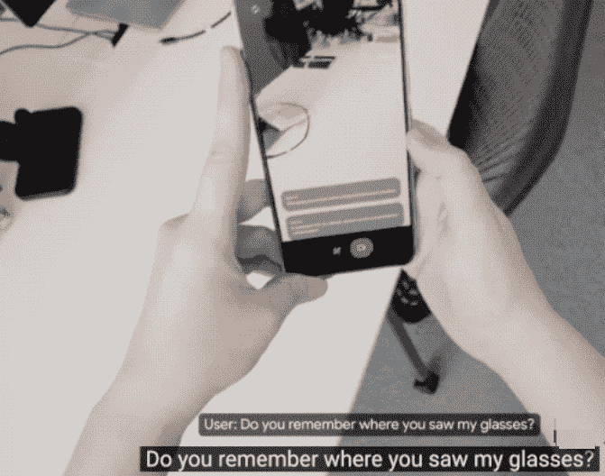

+   **Gemini 1.5 Pro：**

上下文窗口来到了惊人的200万token。

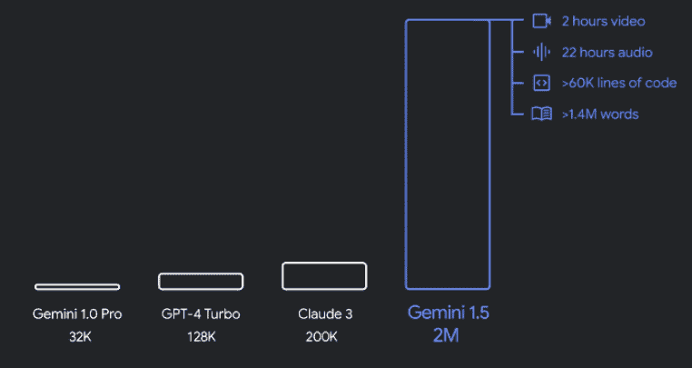

+   **Veo：**

可以生成**1080p****的高质**量视频，生成视频的长度也看齐Sora：最长超过1分钟。

谷歌还强调，Veo生成的画面一致性出色，并且可以hold住各种风格。比如“延时拍摄”和“航拍”这种术语，直接写在提示词里，Veo都能get。

目前，谷歌已经和电影制作者展开了合作，在电影项目中探索Veo的应用。

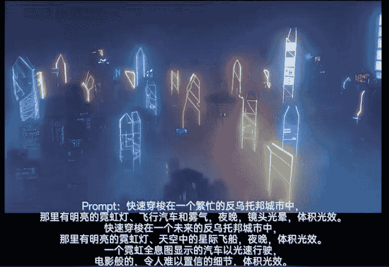

[20240515063811_rec_.mp4](https://internal-api-drive-stream.feishu.cn/space/api/box/stream/download/all/USBHbj0f8ofsOixrDsGc0RUDnad)

+   **Imagen 3**

官方提到，与此前的模型相比，Imagen 3的视觉伪影更少，生成的图像细节拉满，并且在生成文字方面效果也很好。

+   **谷歌搜索**

基于Gemini，谷歌搜索推出AI概述（AI Overview）新功能，彻底化身AI搜索。

用户在搜索框输入问题，马上就能得到一个AI总结的答案，包括相关链接。

而且是超长问题都能处理的那种，比如：

> 查找波士顿最好的瑜伽或普拉提工作室，并提供他们的入门优惠详情以及从灯塔山步行所需时间。

AI Overview秒秒钟就会列出五星好评且距离灯塔山近的店，并附带课程标价，连店在地图上的位置都标记了出来：

对于这种复杂问题的搜索，谷歌表示采用了多步推理技术，可以将复杂问题拆解成一个个小问题，然后自动对问题进行排序回答。

多步推理加持下，AI Overview已经脱离了纯粹的搜索——把制定计划一并搬进了搜索引擎里。

此外，谷歌搜索还**支持视频搜索**了。

演示中，唱片机出故障，只需一边录制视频一边说出疑问，谷歌AI Overview就会立刻分析故障原因，并给出处理建议。

+   **Android 15**

谷歌把Gemini也带到**了安卓**系统中。凭借直接内置的Circle to Search功能，用户使用简单的手势“圈”一下手机上看到的任何内容，就能进行搜索。比如圈出练习题，就能一键获取答案

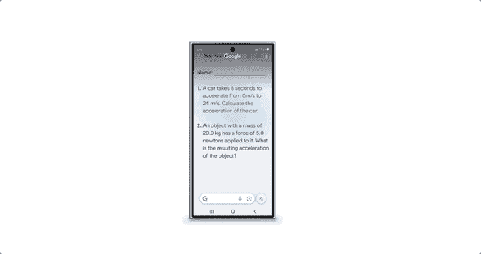

此外，还可以在一个应用之上随时调出Gemini助手层，随时使用。你还可以将Gemini生成的图片直接拖到Gmail等应用中，直接询问某个视频中的具体信息，不用滑动翻文档询问某个PDF中的信息……

+   **谷歌Photos**

**谷歌Photos基于**Gemini也推出了新功能——Ask Photos，可以一键从图库中帮你找到想要的照片和视频。

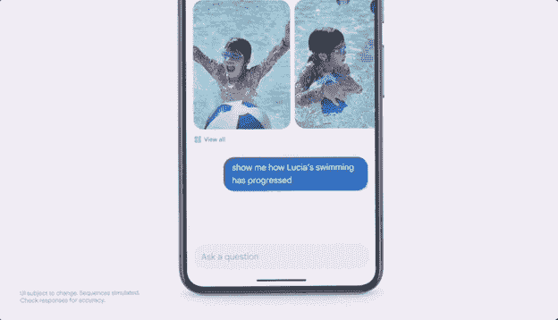

比如你想知道自己的baby是什么时候学会游泳的，Ask Photos会从你在谷歌Photos中存储的成百上千张照片中查找出含游泳、游泳证书等相关图片，最后总结给出回复：

+   **NotebookLM**

谷**歌AI笔**记应用NotebookLM也大升级。当你提出一个问题后，背后的Gemini模型就会结合NotebookLM中的笔记内容，进行多模态的语音对话式回答。

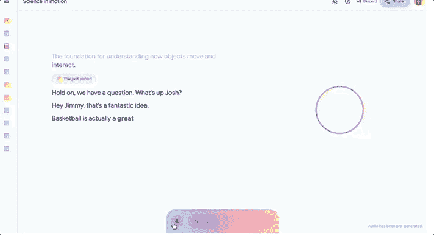

更多细节内容可查看：

https://blog.google/technology/developers/google-io-2024-collection/

## 5月14日

# AI应用

## 1、OpenAI发布GPT-4o，实时可打断交互炸场

+   **一句话评论：**

> 【Her】来了！我愿称GPT-4o的发布为AI情感陪伴的iPhone时刻

+   **更多可看：**

> [AI日日新（更新中）](https://vx8e8325ai4.feishu.cn/wiki/SswEwb5AwiBP0bk5RUzcAdBwnbd?fromScene=spaceOverview)

>

## 2、FunClip: 阿里发布自动视频剪辑工具

+   **一句话评论：**通过视频的语音识别，用户自由选择识别结果中的文本片段或说话人，点击按钮即可获取对应片段的视频

+   **更多可看：**https://mp.weixin.qq.com/s/V_2pGoAtOjRUvtlSdHYMEA

## 3、vivo自研蓝心大模型升级

+   **一句话评论：**vivo 蓝心大模型升级为 AI 多模态大模型，AGI的发展方向大家看来还是共识的。

+   **更多可看：**https://mp.weixin.qq.com/s/X0A868dcNuyLMyG7EnpWOQ

>

# AI技术

## 1、CuMo: 多模态大模型的新架构

+   **一句话评论：**

> 通过在视觉编码器和多层感知机中使用“Co-upcycled Mixture-of-Experts”技术，提升了模型在处理图像和文本时的性能，同时保持了较低的计算成本。

+   **更多可看：**

> https://chrisjuniorli.github.io/project/CuMo/

>

## 2、零一万物Yi-1.5，国产开源大模型排行榜再次刷新

+   **一句话评论：**李开复的双轨战略目前看走得还是不错的

+   **更多可看：**

> https://mp.weixin.qq.com/s/lwHfocVcoJnTddIi9nvvsg

>

## 3、RAFT：一种适应特定领域RAG的大模型训练新方法！

+   **一句话评论：**结合了检索增强生成(RAG)和领域特定微调(DSF)的优势，提高特定领域的问答能力

+   **更多可看：**https://mp.weixin.qq.com/s/lCUFx8XGTBqvR4kKvNDnXg

OpenGlass：将普通眼镜变为智能眼镜

一个不到150元的 DIY 项目，让你的普通眼镜变身为能够进行人脸识别、物体识别、文本翻译等功能的智能眼镜。

https://github.com/BasedHardware/openglass

## 【号外】5.14  Open AI春节发布会（短短25分钟讲完！）

### Open AI的春节发布会做个小总结

###### 1.新增桌面应用程序&web UI更新

######

###### 2.发布GPT-4o，且免费使用，text、Voice、Video、Image 集成于一体

###### GPT-4o（“o”代表“全能”），O is OmniModel

######  它可以接受任意组合的文本、音频和图像作为输入，并生成任意组合的文本、音频和图像输出。

######  它可以在 232 毫秒内响应音频输入，平均为 320 毫秒，这与人类在对话中的响应时间相似。

######  在英文和代码文本方面，它与 GPT-4 Turbo 的性能相当，对非英语文本的文本有显著改进。

>

###### 3.GPT-4o，API速度提高 2 倍，便宜 50%，与 GPT-4 Turbo 相比，速率限制提高 5 倍

> GPT-4o 的最高速率限制将增加到 GPT-4 Turbo 的 5 倍——每分钟最多 1000 万个。

######

###### 4.语音助手多人实时演示：

>

> 主要演示了与ChatGPT实时对话，不仅能“听”，还能“看”，当然能“思考”和“回复”

>

> 多模态识别可以让ChatGPT和你一起解数学题

>

> ChatGPT Desktop App，可以“看到”电脑屏幕，辅助代码生成、分析图表

>

> 充当翻译助手，实时翻译，快速准确

>

> 还能识别真人的表情

> **5.何时可用？**

> GPT-4o 的文本和图像功能今天开始在 ChatGPT 中推出。

> （有人已经更新显示GPT-4o了）

> 将在免费版中提供 GPT-4o，并为 Plus 用户提供高达 5 倍的消息限制。

> 

> 将在未来几周内在 ChatGPT Plus 中推出带有 GPT-4o 的 Voice Mode 的新版本。

> 

> 开发者现在也可以通过 API 访问 GPT-4o 作为文本和视觉模型。

>

> 最后我用Open AI的使命结尾，他们真的是有推动全人类前进！

>

> Our mission：To ensure that artificial general intelligence benefits all of humanity.

> 我们的使命：确保通用人工智能造福全人类。

**GPT-4o截图：**

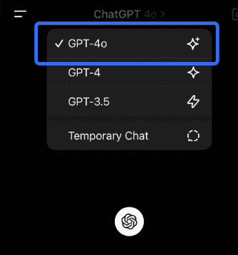

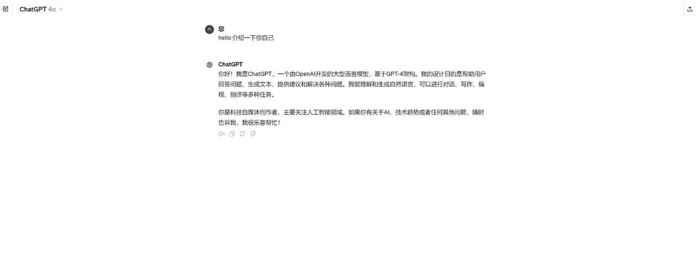

**GPT-4o实测：**

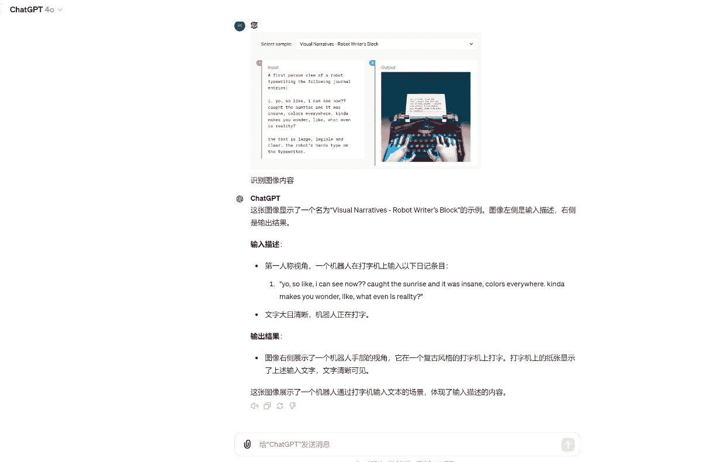

**演示视频：**

[20240514-025713.mp4](https://internal-api-drive-stream.feishu.cn/space/api/box/stream/download/all/JnYnbx1GuoRtzlxIjpNcFCd8neh)

## 5月13日

# AI应用

## **1、GPT搜索**引擎原型曝光！新模型GPT4-Lite驱动，代码已上传ChatGPT

+   **一句话评论：**

> 首页目前还很简洁，像谷歌一样只有一个居中的搜索框。

+   **更多可看：**

> https://mp.weixin.qq.com/s/1eFWHa8hcP8E_eUy7-Dh1A

>

## 2、宇树科技发布Unitree G1机器人，9.9 万人民币起步

+   **一句话评论：全身**23~34个关节非常灵巧，对比马斯克的optimus的手部11个dof，G1仅有7个，还有进步空间

+   **更多可看：**

> https://mp.weixin.qq.com/s/RGNVRazZqDn3y_Ijemc5Kw

>

## 3、零一万物发布千亿参数模型、海外产品收入将超1亿

+   **一句话评论：**李开复要实行“开源 + 闭源”的双轨模型策略：以开源模型构建生态、以闭源模型展开 AI-First 商业探索。

+   **更多可看：**https://mp.weixin.qq.com/s/I0piwAf88WARXmwdk6_gIA

# AI技术

## 1、Diffusion2GAN: 单步图像生成

+   **一句话评论：**

> 将复杂的多步骤扩散模型简化为单步骤条件生成对抗网络（GAN）的方法，提高推理速度，同时保持图像质量。

+   **更多可看：**

> https://mingukkang.github.io/Diffusion2GAN/

>

## 2、Sora是世界模拟器吗？全球首篇综述全面解析通用世界模型

+   **一句话评论：**

> 260 余篇文献，详尽分析世界模型在视频生成、自动驾驶、智能体、通用机器人等领域的研究和应用

+   **更多可看：**

> https://mp.weixin.qq.com/s/rkq7NXGvB0O1Kstd_mTNJQ

>

## 3、给文字动画注入语义灵魂！港科大开源「文字跳动」技术

+   **一句话评论：**让文字活起来，象形文字很有优势啊

+   **更多可看：**https://mp.weixin.qq.com/s/OKB0oYNQMmEfgbC5q57S4Q

>

解读全国首例“AI视听作品侵权案”：AI生成视频，版权到底归谁？

https://mp.weixin.qq.com/s/Z4WkHji4U-2GiBbyzq5N6w

**O**penAI否认加入的AI搜索已是一片红海！Stack Overflow 数据用于 AI 训练再次引发争议！

https://mp.weixin.qq.com/s/ebU96QfQFwPYkRTomXY61Q

**大**神Karpathy强推，分词领域必读：自动钓鱼让大模型“发疯”的token，来自Transformer作者创业公司

https://mp.weixin.qq.com/s/UpkgRhZkK45gAPWOOmEwYQ

## 5月12日

# AI应用

## 1、苹果押宝生成式AI，将在新一代设备上基于大模型大改 Siri

+   **一句话评论：**

> 期待6月10日的WWDC看苹果如何展示新的、多功能的Siri。

+   **更多可看：**

> https://www.nytimes.com/2024/05/10/business/apple-siri-ai-chatgpt.html

>

## 2、**GeoSpy：根据**照片定位你在哪里，精确到经纬度

+   **一句话评论：**根据照片的**光线、植物、建筑风格、天气**，并将它们与大量街景/地理照片进行对比，据说也用到了地理空间视觉大语言模型的技术。

+   **更多可看：**

> https://mp.weixin.qq.com/s/MIECFiew16Eeox_1Mki2IQ

>

## 3、AniTalker 肖像生成谈话动画

+   **一句话评论：**将静态肖像和输入音频转换成自然流畅的谈话视频动画，同时能产生不同的面部表情和姿势。

+   **更多可看：** https://x-lance.github.io/AniTalker/

>

# AI技术

## 1、智谱GLM3-turbo百万tokens低至1元！

+   **一句话评论：**

> 创作**一万条****小红书文案（以350字**计）将仅需约1元钱，还要啥自行车？

+   **更多可看：**

> https://mp.weixin.qq.com/s/42hA4Ggzu_p4Iqk8yr4VAQ

>

## 2、DiT架构大一统：一个框架集成图像、视频、音频和3D生成

+   **一句话评论：**

> 基于 Diffusion Transformer（**DiT）的「Flag-D**iT」，这次要将图像、视频、音频和 3D「一网打尽」。

+   **更多可看：**

> https://mp.weixin.qq.com/s/NwwbaeRujh-02V6LRs5zMg

## 3、Vidur：LLM推理模拟器

+   **一句话评论：**结合实验分析和预测建模来模拟 LLM 操作的性能，通过估计延迟和吞吐量等关键指标，评估不同工作负载的端到端推理性能。

+   **更多可看：**https://arxiv.org/pdf/2405.05465v1

>

Google开发了一种名为TimesFM的时间序列预测模型 可预测未来

时间序列预测就是根据过去发生的一系列事件(比如每天的气温或或股票价格)来预测未来事件的技

术。TimesFM利用了大量历史数据来"学习"这些事件的模式和趋势,从而能在没有额外信息的情况

下,对新的、未见过的数据做出准确的预测。

Anthropic Claude 提示生成器

Anthropic Claude 使用链式思考推理等先进的提示工程技术，帮助用户生成有效、精确、可靠的提示，提高工作效率和输出质量。Anthropic 提示生成器支持动态变量插入，便于用户在不同情境下测试提示。

https://console.anthropic.com/login

**Llama3 中文综合资源库：**

Llama3中文聊天项目综合资源库，集合了与Llama3模型相关的各种中文资料,包括微调版本、有趣

的权重、训练、推理、评测和部署的教程视频与文档。

https://github.com/CrazyBoyM/llama3-Chinese-chat/wiki/%E7%BD%91%E9%A1%B5%E7%89%88%E6%8E%A8%E7%90%86%E6%95%99%E7%A8%8B#%E7%BD%91%E9%A1%B5%E6%8E%A8%E7%90%86

## 5月11日

# AI应用

## 1、iPhone或将用上ChatGPT！传苹果与OpenAI接近达成协议

+   **一句话评论：**

> 国外用GPT4，国内用百度，这对比。。。

+   **更多可看：**

> https://mp.weixin.qq.com/s/qWkkO7SfNJC_1eLxnvU_XA

>

## 2、SndHound AI 和 Perplexity 合作汽车智能语音助手

+   **一句话评论：** 类比各位手机或者汽车的语音助手就行，功能还没大家的全

> **更多可看：**https://www.soundhound.com/newsroom/press-releases/soundhound-ai-and-perplexity-partner-to-bring-online-llms-to-its-next-gen-voice-assistants-across-cars-and-iot-devices/

>

## 3、Stylar自称最可控的AI图像和设计工具

+   **一句话评论：图像工具的**去除背景啥的都有，可以通过文字控制图像进行修改

+   **更多可看：**https://mp.weixin.qq.com/s/7TqWFY0kxGz-3_rkCBJkMw

>

# AI技术

## 1、OpenAI重磅更新定档下周一

+   **一句话评论：**

> 不是GPT5，不是搜索，是类似【Her】的语音助手及一些更牛的模型

+   **更多可看：**

> https://mp.weixin.qq.com/s/3k8CvKl20bzbTMWp6KI73w

>

## 2、谷歌震撼发布纳米级人脑图谱！

+   **一句话评论：**

> 纳米级分辨率建模人类大脑皮层，有新的细胞和连接方式发现

+   **更多可看：**

> https://mp.weixin.qq.com/s/mbcd1A-y5T82n06ZMTypzw

>

## 3、Gemma 2B扩展至1000万上下文窗口

+   一句话评论：低内存、低计算成本下通过Infini-Attention实现1000万长度的序列

+   **更多可看：**https://mp.weixin.qq.com/s/GeBekYH-I8n0B5vIIeBtgw

>

OpenAI的Assistants API更新：

现在支持视觉功能，涵盖png、jpg、gif和webp格式。

组织限制100GB，用户限制10GB。

https://openai.com/

Pocket Computer：

Pocket内测一款便携式语音助理

https://pocket.computer

AniTalker可通过照片加音频生成说话视频

开源版EMO

https://x-lance.github.io/AniTalker/?ref=top.aibase.com

微信读书上线AI问书功能 长按正文可检索分析文章

基于电子书内容整理和分析，提供准确答案和出处链接

百度已有10%的大搜流量通过文心一言模型生成

李彦宏在内部颁奖活动中强调了百度对技术的信仰和未来展望，肯定了文心一言的发展。百度已重构所有产品线，10%流量通过文心一言生成，AI应用广泛。

Autodesk展示AI生成3D功能Project Bernini

Autodesk最新展示了名为Project Bernini的AI生成模型，可以将文本或图像转化为3D模型。该模型可以从多种输入类型生成3D图像，包括文本提示、2D图像、多个图像和点云。

## 5月10日

# AI应用

### 1、ElevenLabs 搞AI音乐生成了

+   **一句话评论：**文本生成音乐，对标Suno、Udio

+   **更多可看：**https://mp.weixin.qq.com/s/9DFoCz6gDXvVx44w61y8aQ

>

### 2、**S**tability AI加入Discord，Stable Artisan用户可在线使用SD3、SVD功能

+   **一句话评论：**降低了普通人的使用门槛

+   **更多可看：**https://k.sina.com.cn/article_6105753431_m16bee67570330162c8.html

>

### 3、Perplexity将重磅推出"Pages"功能

+   **一句话评论：**以前只能搜索，现在也能生成内容了，然后让内容再被消费，闭环了

+   **更多可看：**https://mp.weixin.qq.com/s/bzem3JMtGICHi9gscR_J1A

# AI技术

### 1、阿里云发布“通义千问” 2.5

+   **一句话评论：**开源模型，他中文能力最强

+   **更多可看：**https://mp.weixin.qq.com/s/Lhpg7q_qibvqqdzefBMDLg

>

### 2、OpenAI发布"模型规范指南"：Model Spec

+   **一句话评论：**给大模型立法，让AI模型更安全可靠，符合人类道德、伦理。

+   **更多可看：**https://mp.weixin.qq.com/s/7WKAet7ndv9ODDFwhho4og

>

### 3、国产视频生成模型 Vidu发布

+   **一句话评论：**据说媲美Sora（让子弹飞一会）

+   **更多可看：：**https://mp.weixin.qq.com/s/qgbrWmha7qJUIm_Cv7bGQA

>