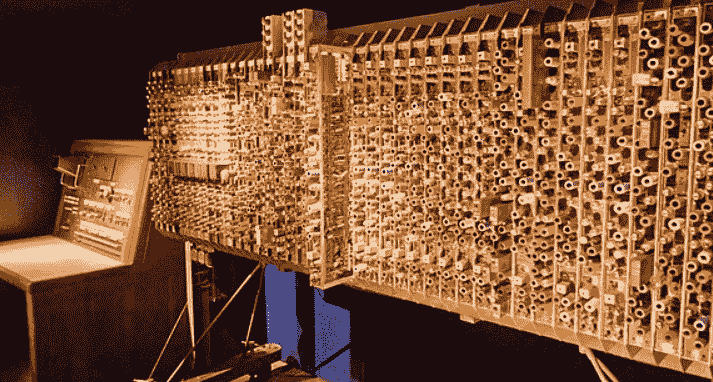
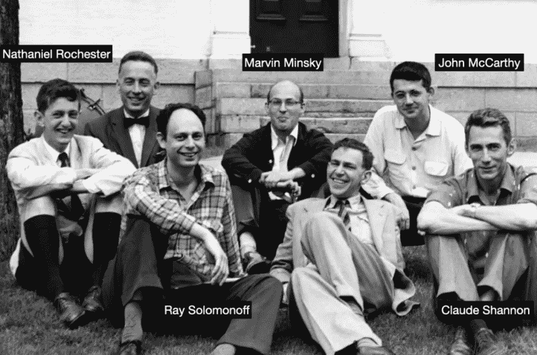
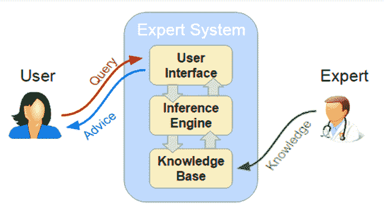
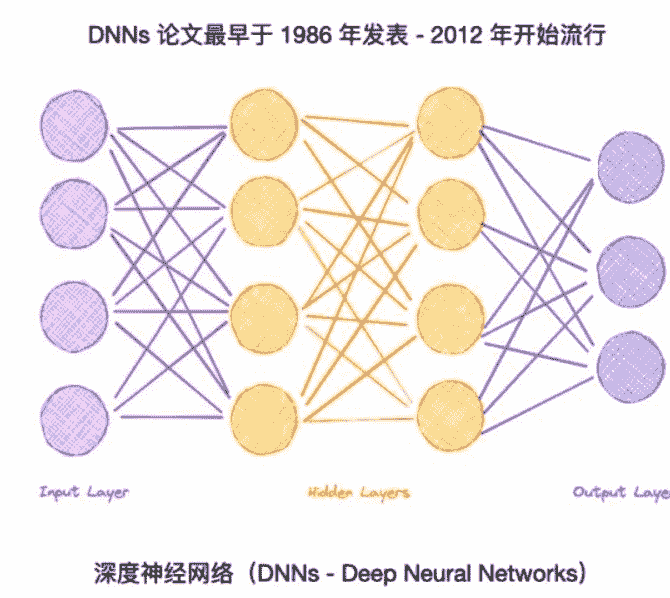
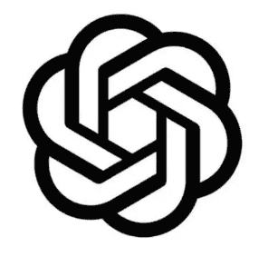

# AI  is All you Need

> 来源：[https://docs.feishu.cn/docx/ODXudxALAoUIGxxhPYuc8wZUnpf](https://docs.feishu.cn/docx/ODXudxALAoUIGxxhPYuc8wZUnpf)

> 面对AI焦虑，你没必要跟汽车赛跑，而是应该考个驾照！

# 人工智能概述：

## 人工智能概念

人工智能，通常简称为AI，是计算机科学的分支，指的是使计算机系统能够模拟并且拥有人类智能，最终达到AGI（通用人工智能）。这包括学习（获取信息和规则）、推理（运用规则到实践具体实例）、自我修正、感知（从环境中收集信息）和理解语言等方面。

## 人工智能的发展

人工智能（AI）的发展历程可以追溯到上世纪，从最早的理论构想到今天的实际应用，它已经走过了一段漫长并充满变革的历史。以下是人工智能领域发展的几个关键阶段：

+   早期理论和探索（1940s-1950s）：
人工智能这个概念最初源自对于模拟和理解人类智能的兴趣。在这个阶段，科学家们开始探索能够模仿人类智能功能的机器。例如，Alan Turing在1945年提出了“图灵测试”来评判机器是否能够显示出与人类相似的智能。

+   AI的诞生和早期成功（1950s-1970s）：
1956年，举行了现在被认为是AI历史上的关键事件——达特茅斯会议，这一会议推动了AI作为一个正式研究领域的诞生。Marvin Minsky(明斯基)，JohnMcCarthy(麦卡锡)，Claude Shannon(香农)，Nathaniel Rochester(罗切斯特)，他们后来被称为AI的"奠基人"。

+   **第一次AI寒冬（1969s）**

1969年，Marvin Minsky(明斯基)为了证明罗森布拉特发明的感知机和神经网络的价值有限，与另一位麻省理工学院的教授Seymour Papert（西摩·派普特）合作，在《感知器:计算几何学导论》书中阐述了因为硬件的限制，只有几层的神经网络仅能执行最基本的计算，从数学和逻辑上证明罗森布拉特的理论和感知机具有重大的局限性，没有什么发展前途。AI领域迎来了第一次寒冬。

+   专家系统和第一次AI热潮（1980s）：

1980年代见证了基于规则的专家系统的兴起。此时研究主要集中在符号主义，以逻辑推理为中心。这些所谓的专家系统能够在特定领域内模拟人类专家的决策过程。虽然它们在商业上取得了一定的成功，但最终由于性能不足和计算限制，这一波热潮逐渐消退。

+   第二次AI寒冬（1980s末至1990s）：
资金的枯竭和一些高调项目的失败导致了AI领域的一段低潮。不过在这个时期，仍然有一些关键的技术（如神经网络的回归、支持向量机等）在继续发展。

+   **神经网络的回归（1980s）**

当基于规则的系统专家的弊端日益明显，受仿生学启发：生物智能是由神经网络产生的，可以通过人工方式构造神经网络，人工智能研究开始关注机器学习，采用统计方法让计算机从数据中学习、训练神经网络产生智能。

+   互联网时代的机器学习兴起（2000s）：
随着互联网数据量的爆炸性增长，AI领域迎来了新机遇。大数据提供了AI算法训练的资源，特别是机器学习和模式识别受到了重视。

+   深度学习的突破（2010s-2021s）：
2012年以来，AI研究取得了显著进展，尤其是在深度学习领域，使用多层神经网络科和反向传播技术来训练神经网络。该领域是由Geoffrey Hinton（杰弗里·辛顿）开创的，早在1986年，Hinton与他的同事一起发表了关于深度神经网络(DNNs-Deep Neural Networks)的开创性论文,这篇文章引入了反向传播的概念。这是一种调整权重的算法。每当你改变权重时。神经网络就会比以前更快接近正确的输出。可以轻松的实现多层的神经网络，突破了1966年Minsky写的感知器局限的魔咒。

随着计算资源（尤其是GPU计算能力）的提升及大规模数据集的可用性，深度学习革命化了视觉和语言处理任务。比如2012年，AlexNet赢得ImageNet（深度学习最重要的数据集之一）挑战赛，2016年，AlphaGO战胜围棋世界冠军引起热潮。

+   **AGI元年（2022s-至今）**

暂时称之为AGI元年吧，因为这一年ChatGPT横空出世，这个模型基于GPT3框架,其能力在于生成和理解自然语言。ChatGPT的问世是人工智能在自然语言处理领域的一大里程碑,它开启了人工智能的新纪元。通过深度学习和大规模数据训练，ChatGPT能理解复杂的人类语言，并生成具有连贯性和创造性的回应。

## 人工智能的分类

通常根据其功能、复杂性和实现方式进行分类。以下是一些常见的人工智能技术分类：

### **按能力分**

+   **弱人工智能**：设计对应程序来处理特定任务，例如语音识别、图像识别。

+   **强人工智能（AGI）**：理论上具有理解、学习和应用知识的一般智能，就像人类智能一样，可以广泛地解决问题。

### 按领域分

+   **计算机视觉**（CV），使计算机能够“看”并理解图像和视频中的内容。

+   **自然语言处理**（NLP），使计算机能够理解、解释和生成人类语言。

+   **语音处理**，包括语音识别（ASR）、语音生成（TTS）

+   **机器学习****（ML），让计算机通过学**习大量数据自动改进性能，机器学习是人工智能的核心，现在最前沿的AI技术的主流算法都是基于神经网络和强化学习。

+   **知识图谱**（KG）等 。

### 按学派分

+   **符号主义：**起源于数理逻辑：基于统计方法，通过建模预测让机器通过计算来模拟人的智能，实现识别、预测等任务，代表算法：朴素贝叶斯，逻辑回归，决策树，支持向量机。

+   **连结主义：**受仿生学启发：生物智能是由神经网络产生的，可以通过人工方式构造神经网络，训练神经网络产生智能。代表算法：神经网络

+   **行为主义：**生物的智能来自对外界的复杂环境进行感知和适应，通过与环境和其他生物之间的相互作用，产生更强的智能。代表算法：强化学习

## 人工智能的应用

人工智能应用广泛，从日常生活中的智能语音助手、推荐系统（如网购和视频平台的推荐）、自动翻译，到专业领域，如医疗诊断、股市交易、复杂系统的自动控制和机器人技术等，AI的影响已渗透到社会各个层面。以下是一些主要的AI应用领域和实例：

+   **日常生活**：

+   **虚拟助手**：如Apple的Siri、小米小爱同学，OPPO的小布等。这些助手能够理解语音命令，提供信息、执行任务和控制智能家居设备。

+   **推荐系统**：如抖音的短视频推荐、淘宝的商品推荐，通过分析用户的历史行为和偏好来提供个性化内容。

+   **医疗**：

+   **医学影像分析**：使用深度学习算法分析X光、CT、MRI影像，辅助医生进行疾病诊断。

+   **药物发现**：通过机器学习模型加速新药物的研发，预测药物的化学性质和潜在效果。

+   **个性化治疗**：根据病人的健康数据，提供个性化的治疗方案和预防措施。

+   **金融**：

+   **算法交易**：利用AI分析金融市场数据，自动执行高频交易，提高投资回报。

+   **信用评分与风险评估**：通过机器学习模型评估个人或企业的信用风险，改进贷款审批流程。

+   **零售**：

+   **客户服务**：使用聊天机器人解答客户问题，提高客户体验和服务效率。

+   **库存管理**：通过AI预测产品需求，优化库存管理以减少浪费和提高供应链效率。

+   **交通与物流**：

+   **自动驾驶汽车**：如特斯拉、Waymo，使用计算机视觉和深度学习技术实现车辆自动驾驶。

+   **物流优化**：利用AI优化运输路线、预测需求和提高配送效率。

+   **制造业**：

+   **预测性维护**：通过机器学习分析设备数据，预测设备故障并提前进行维护，减少停机时间。

+   **质量控制**：使用计算机视觉技术实时检测生产线上产品的质量问题。

+   **安防：**

+   **视频监控分析**：利用计算机视觉智能分析视频监控画面，自动检测异常行为和事件。

+   **身份验证**：通过面部识别、指纹识别等生物特征技术进行身份验证，提高安全性。

+   **教育**：

+   **个性化学习**：基于学生的学习数据评估学生的学习进度，提供个性化的学习内容和建议。

+   **智能辅导系统**：如Khan Academy的AI助手，为学生提供实时的学习帮助和解析。

+   **娱乐与创意**：

+   **智能创作**：利用AI进行音乐、诗歌、绘画等创作，如OpenAI的GPT-3在写作和编程方面的应用。

+   **游戏**：通过AI打造智能对手和复杂的游戏环境，为玩家提供更丰富的互动体验。

这些只是人工智能应用的一部分例子。随着技术的不断进步，AI在各行各业的潜力还将进一步被挖掘和应用。

# 具体领域材料汇总

## 大模型

| [大佬 Ilya Sutskever 的神级论文清单](https://vx8e8325ai4.feishu.cn/wiki/JpCywkaiwiaqBok1AuRcBb5gngd) |
| --- |
| [一个关于围绕LLMs构建成功产品的实用指南](https://vx8e8325ai4.feishu.cn/wiki/E5d3wSjWViKSFMkW3lzc95Qonzg) |
| 深度解读|苹果眼中的AIOS应该是怎么样的? |
| 大模型的下一站：AI Agent |

## 机器学习

| [机器学习概述](https://mp.weixin.qq.com/s/Yo3xKLK54fN3HL85FEoZuA) |
| --- |
|  |
|  |

## 语音

|  |
| --- |
|  |
|  |

## 语义

|  |
| --- |
|  |
|  |

## 计算机视觉

|  |
| --- |
|  |
|  |

## 数字人

|  |
| --- |
|  |
|  |

## 知识图谱

|  |
| --- |
|  |
|  |