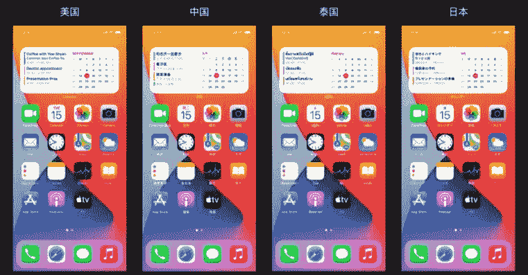
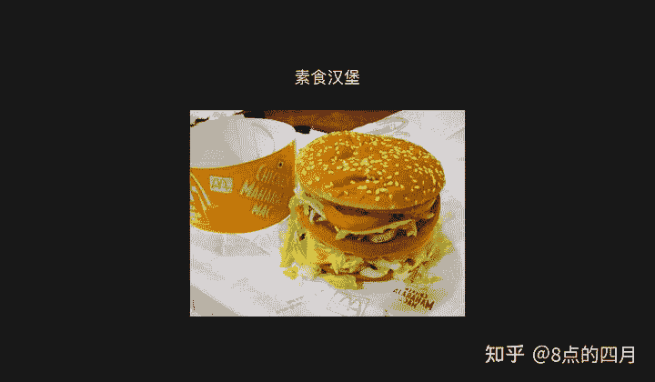
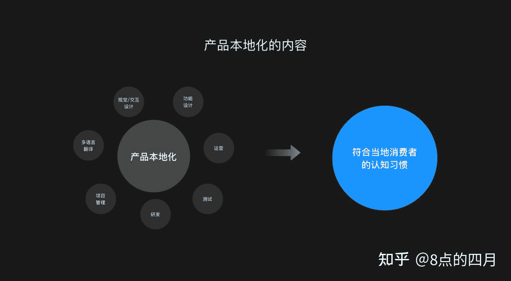
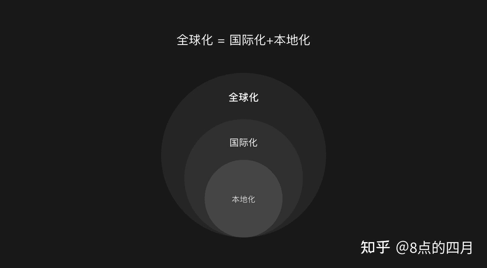

# 全球化、国际化&本地化分别是什么？

> 来源：[https://docs.feishu.cn/docx/DxpRdDHHmocqpQxQ2pYcweDsn0b](https://docs.feishu.cn/docx/DxpRdDHHmocqpQxQ2pYcweDsn0b)

先来聊聊，大家口中一直在说的本地化，是指的什么？它和全球化、国际化又有什么差异呢？

# **全球化**

**先说下全球化的概念，全球化对**应的英**文是Gl**obalization，缩写为G11N。G是首字母，N是尾字母。11代表在首字母G和尾字母N之间省略了11个字母。

“全球化”通常**是指在各个国家/地区的市场**运作和开展的相关活动，从产品设计到市**场营销等**等。在商业领域，也可以理解为是“走向世界”。

比如Apple的设计，他们采用了一种统一的方式将“全球化”的概念提升到纯粹的水平，在所有地区都采用标准化设计，在所有国家/地区提供相同范围的产品。

# **国际化**

国际化的英文是Inter**nati**onalization, 缩写为I18N, 其中I是首字母，N是尾字母。18代表在首字母的I和尾字母N之间省略了18个字母。

**国际化只专注于某些国家和地区**，用一种相同的设计方案去满足这些国家的需求。

比如名字格式的表单设计：在东南亚，各个国家的名字书写格式都不一致。

+   新加坡华文名格式和中国的名字格式一样，都是是先姓后名。

+   马来的名字格式是名字+父名（父亲的名字，而不是姓氏）。

+   印尼的名字格式有些是名字+父名；有些则是1到3个词的名字，例如Yovan Gunardio Darmawan，这些都是名字，而不是姓。因为印尼并没有姓氏、名字、中间名的概念。

+   越南人的名字格式是先姓后名，但有些越南人写名字也会先名后姓。

**所以为了满足不同国家文化**的多样性，在姓名的表单设计中不需要分开储存名字和姓氏，给一个足够空间的full name输入框即可，降低开发和维护的成本。

# **本地化**

本地化的英文是**Localization**, 缩写为**L10N，**其中L为首字母，N是尾字母，10表示在首字母的L和尾字母的N之间省略了10个字母。

本地化是在完成国际化之后，对特定的目标市场去定制服务和功能，使产品和企业能够得到本地人的认同和喜爱。

比如麦当劳的一些本地化，印度多数人都喜欢吃素，为了迎合当地的饮食习惯，在印度开设了素食餐厅。

再比如，JD的logo是一只小狗，但是在印尼站，logo改成了白色的小马，JD为了尊重当地的文化，改了自己的LOGO。

有些人对于产品本地化有个误区，认为只是将某种语言翻译成当地的语言。

但实际上本地化并不等于翻译，翻译只是本地化其中一项工作。除了多语言的翻译，还有视觉/交互设计、功能设计、运营、测试、研发等多项内容，每项内容在进行本地化时都需要考虑到多个因素。

# 全球化、国际化、本地化设计三者之间的差异

在概念上，可以理解为是**全**球化=国际化+本地化。国际化是本地化的前提和基础，本地化是国际化的要求和结果，全球化需要通过国际化和本地化来实现。

在设计上，全球化和国际化通常是寻找目标国家之间的共性，对产品进行综合性设计。

例如要注意以下几点：

+   基础设置，如数字、时间和日期、货币、单位的设计；

+   个人表单信息，如地址、姓名、号码、邮政编码等，特别要考虑到不同国家之间表单的兼容性；

+   文案的表述，例如避免使用口语化的文案，且要简短明了；

+   图标、插画以及配色要迎合大部分人的喜好；

+   避免出现宗教与文化禁忌，不要使用带有宗教性质的设计。

而做本地化设计，则是为特定的国家定制设计和功能，强调于定制化。了解“目标用户群体”，了解他们国家的文化和消费习惯。

# **总结**

**总结一**下就是，在做本地化设计时，我们需要把文化差异列入研究重点，对本地市场充分了解并尊重，定制不同的服务和功能，以提高产品的核心竞争力。如果是在做国际化或者全球化设计，就需要思考如何用最适合的方式去兼容不同的国家不同的文化，对产品进行综合性设计, 以满足不同文化群体的需求。