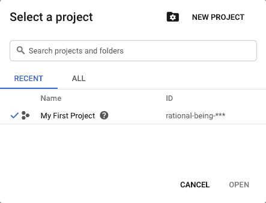
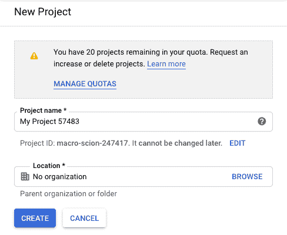
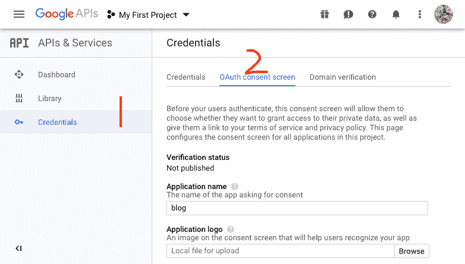
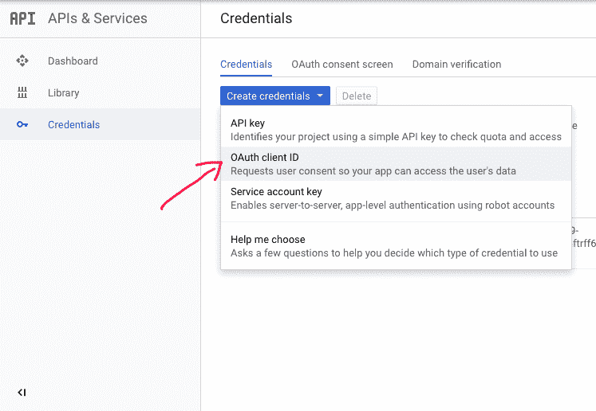
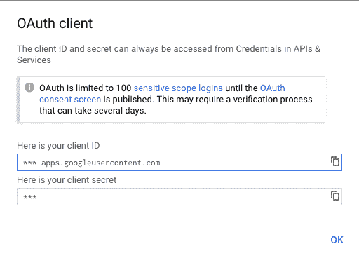

# 出海产品账号体系：Google 账号接入

> 来源：[https://docs.feishu.cn/docx/S4sMdNSoroS2tkxDnpwc5H9Zn1N](https://docs.feishu.cn/docx/S4sMdNSoroS2tkxDnpwc5H9Zn1N)

出海产品一般会选择Google 账号或者邮箱作为用户登录方式，这篇文章主要介绍如何接入Google账号！

不久前，我们自己的新产品Bleaf也接入了谷歌账号，最近正好有另一个产品也要接入谷歌登录，所以今天写一篇文章简要介绍一下接入方式。

谷歌登录（Google Sign-In）官方的介绍在这里：Add Google Sign-In to Your Web App。 接入谷歌登录不需要什么审核，也不需要提交任何资源，相对于国内来说，这个流程足够简单省事儿不少。

## **接入谷歌登录的几个步骤**

### **创建 ClientID**

谷歌登录使用 OAuth 2.0 进行认证，所以需要先创建 ClientID。

首先进入到 [https://console.d](https://console.developers.google.com/)evelopers.google.com，在左上角选择一个自己的项目，没有的话，在弹出的窗口中新建一个。

然后进入到**OAuth 用户同意屏幕**填写在要求用户登录时展示的相关信息。

在这里，可以填写你的应用的名字、图标等信息。

最重要的是“Authorized domains”这个字段，谷歌只会允许在这个列表内的域名使用指定的ClientID。所以，这里填写你的网站域名。回车添加，然后保存。

然后回到左侧第一栏的“Credentials”，选择“Create Credentials”创建一个“OAuth Client ID”

应用类型选择“Web Application”，然后填写名字，其它的可以不用填。点击创建，ClientID就创建好了。

### **指定你的ClientID**

### **加载谷歌平台库**

### **添加谷歌登录按钮**

### **登录回调处理**

注意到上面的按钮中一个特别的data-onsuccess="onSignIn"，在登录成功后，这个函数会被回调。

前端就可以通过上面的代码拿到登录用户的相关信息，profile.getId()是用户的唯一ID。

### **登出用户**

增加一个可点击的按钮/链接，调用 signOut() 即可：

### **完整可用的代码**

当完成上面的步骤后，就可以得到官方首页展示的代码，可以相应修改后直接使用：

## **安全地与后端API接口通信**

上面在代码中通过profile.getId()**能拿到用户的唯一ID号，可以用它来唯一标识用户。但是：不要直接**把它传递给后端接口，因为后端程序无法确定这个ID是用户真正通过登录得到的，还是其他某人的ID。

取面代之，使用上面的 ID Token：

[这个 Token ](https://jwt.io/)是一个使用谷歌私钥签名的 JWT Token。 JWT Token 就是一个字符串，它由 3 部分组成：头部，数据，签名。 头部是一个JSON对象，用于描述签名算法。数据也是一个JSON对象，保存公共数据和用户数据。签名是前两部分的校验和，用于确保该 Token 未被修改。 3 个部分通过 Base64 + HMAC(常用的算法之一) 算法合并产生出一个字符串。

然后通过发送一个请求，发送此 Token 给后端。一般是在请求头部中设置Authorization: Bearer id_token的方式把此Token传递给后端。

## 后端解析 ID Token 中的用户数据

在收到前端发送过来的 Token 后，首先需要校验此 Token 是否合法，然后后端解析此Token，取得相关数据，查找相关的用户，创建自己的会话信息。

### **校验有以下几个步骤**

+   使用签发方（这里的谷歌登录）的公钥验证此 JWT 是否由签发方签发

+   判断 aud 字段是否是你的 ClientID

+   验证 iss 字段是否是accounts.google.com、https://accounts.google.com

+   验证 exp 字段确保此 Token 尚未过期

+   如果是企业用户/G Suite Domain用户，还需求验证 hd 是否为公司域名

### **取用户数据**

如果上面所有的条件都满足，那么，这是一个合法的 Token，可以完全地取相关的数据了。

+   sub 是用户的唯一ID。即上面的profile.getId()

+   email 是用户的 Email

+   name 是用户的名字

+   picture 是用户的头像

### **创建自己的会话**

如果这个sub对应的用户已经存在，则创建此用户的会话。如果不存在，则可以创建一个新的用户，关联此sub。

## **解析 JWT Token 的库**

谷歌官方提供了库来解析：Google API Client Library。 但是这个库包含了太多我用不到的内容，所以我自己写了一个：Google IDToken Verifier。实现了所有谷歌登录要求的过程。

2021-04-23 更新：经评论用户“7”的推[荐，官方也有一个非常类似的库，建议](https://google.golang.org/api/idtoken)使用：https://google.golang.org/api/idtoken。

使用方式极其简单：

注意：代码会在内部获取谷歌的公钥，所以，请确保这段代码在你的服务器上是“可行的”。

## **参考资源**

+   Google Sign-In for Websites

+   [Google Sign-In JavaScr](https://developers.google.com/identity/sign-in/web/reference)ipt client reference

+   Google Sign-In Token Verifier

+   GoogleIdTokenVerifier

+   google-auth-id-token-verifier

+   [Y](https://www.youtube.com/watch?v=Oy5F9h5JqEU)outube - Introduction to Google Sign-In for Websites