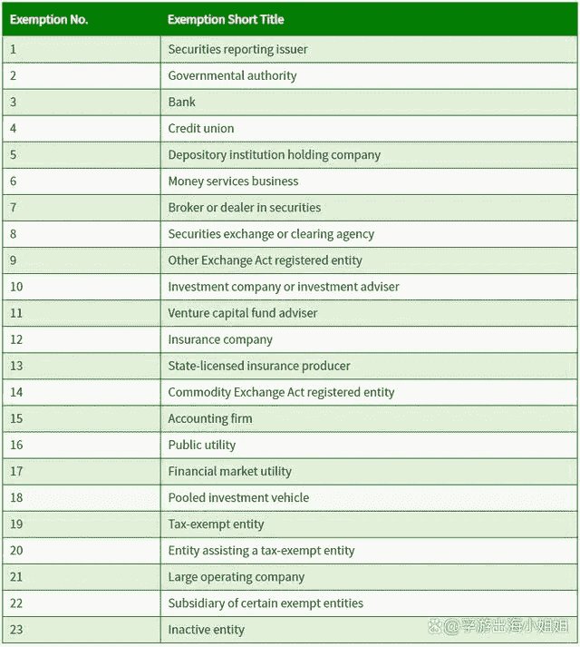

# 美国公司如何高效进行BOI申报？

> 来源：[https://docs.feishu.cn/docx/QLUAd5qKgoM7iuxzqSTchA6Lnif](https://docs.feishu.cn/docx/QLUAd5qKgoM7iuxzqSTchA6Lnif)

2021年，美国国会通过了《企业透明法案》（Corporate Transparency Act，C**T**A），旨在约束通过空壳公司或其他不透明所有权结构来隐藏收益及从事其他非法活动的行为。该法案设立了新的公司信息报告要求，要求公司向美国财政犯罪执法网络（FinCEN）申报Beneficial Ownership Information（BOI），以便美国政府了解公司的最终控制权人信息。

在本篇文章，我们将以Q&A的形式，探讨美国BOI申报的具体内容和要求，以及对公司运营的影响等方面，帮助相关投资者更好地理解这一新法规，持续优化企业的战略规划和日常运营。

**什么是BOI申报？**

答：美国《企业透明法案》已于2024年1月1日生效，美国公司需要提交一份BOI（Beneficial Ownership Information）报告，提供有关实体“实际受益人”的特定信息。公司所有者可前往FinCEN BOI通道申报。

**谁是公司的“实际受益人”？**

答：1）拥有或控制申报实体至少25%份额的个人。“份额”的定义除了股份比例外，还包括分红比例等形式。

1.  对申报公司行使实质性控制。“实质性控制”的方式包括但不限于担任高管及重要决策者、有权任命或罢免高管、控制高管收入、选择运营方向、签订或终止重要合同等。

**注**意：受益所有权人必须是自然人。若某申报实体由公司控股，则进行BOI申报时需逐步审查控股结构，直至能确定到自然人为止。

**BOI申报的期限和要求如何？**

答：**已经成立的公司：**

在2024年1月1日之前成立或注册业务的公司，只需提交受益人信息，申报期限为一年，截止到2025年1月1日，为所有持股比例高于25%(含)的股东进行申报。

**新成立的公司：**

1.在2024年成立或注册的公司，需要提交受益人信息和公司申请人信息，申报期限为公司注册后90天内，为所有持股比例高于25%(含)的股东进行申报。

2.在2025年1月1日之后成立或注册的公司，申报期限为公司注册后30天内，为所有持股比例高于25%(含)的股东进行申报。

**哪些公司需要办理BOI申报？**

答：申报对象是所有在美国成立和运营的公司，除非特别豁免，而绝大多数亚洲公司都不在豁免范围内。以下公司需按时办理BOI申报：

1）美国注册的公司，包括Corporations、LLCs、LPs及任何在州SecretaryofState注册的公司实体；

2）根据外国法律注册成立，在美国任一州注册运营的海外公司。

**BOI需要申报哪些信息？**

答：若某在美经营实体根据前文被确定为申报实体且不存在豁免情形，则该实体在进行BOI申报时，需要申报以下信息：

（1）申报实体的法定名称和任何商业名称；

（2）申报实体当下在美国的地址（POBOX不可）；

（3）其成立或首次注册时的司法管辖区；

（4）其纳税人识别号（TIN）（包括雇主识别号（EIN）），对于未获得税号的外国公司，需要申报外国公司的国外税收识别号码。

申报实体还需提供其所有的受益所有权人信息，包括个人姓名、出生日期、住宅地址和有效身份证明文件等。

**哪些企业可以豁免申报BOI？**

答：豁免企业需符合以下条件：

1.每年营收超过5百万美元；

2.在美国境内拥有20名以上员工；

3.在美国境内设有办事处（不包括共享办公空间）。

以下23类公司可以豁免，即可以不申报BOI，具体如下：

**BOI是否需要每年申报？**

答：不需要，只需申报一次。但如果有任何更新，比如受益所有人身份变更或25%以上股份所有权变动，需要在30天内更新信息给FINCEN。此外申报无需支付任何费用。

**未及时办理BOI申报有何后果？**

答：如未在规定时间内及时办理BOI申报，可能面临民事和刑事处罚：

1）违规行为持续每天最高500美元的民事处罚；

2）刑事处罚，包括两年以下监禁和/或10000美元以下罚款。

**注意：对于那些认为自己不在美国，不需要申报的人而言，如果未来需要进入美国或**申请美国签证，FINCEN可能会将违规信息透露给相关方，可能带来潜在的法律风险。

Q9BOI信息是否会对公众公开？

答：BOI申报信息不对公众公开，只有以下六类实体基于法定目的并经法定程序，方可获取特定的BOI申报信息：

（1）美国联邦执法机构、情报机构、国家安全机构；

（2）美国州执法机构；

（3）外国执法、司法、中央等机构；

（4）金融机构；

（5）美国监管机构；

（6）美国财政部官员与工作人员

经许可泄露从FinCEN处获取的BOI申报信息则会构成刑事犯罪。

美国BOI申报不仅有助于打击金融犯罪和提高企业的信誉度，还为投资者和监管机构提供了必要的信息，以评估和管理与公司相关的风险，为公司提供了展示其承诺合法性和透明度的机会。