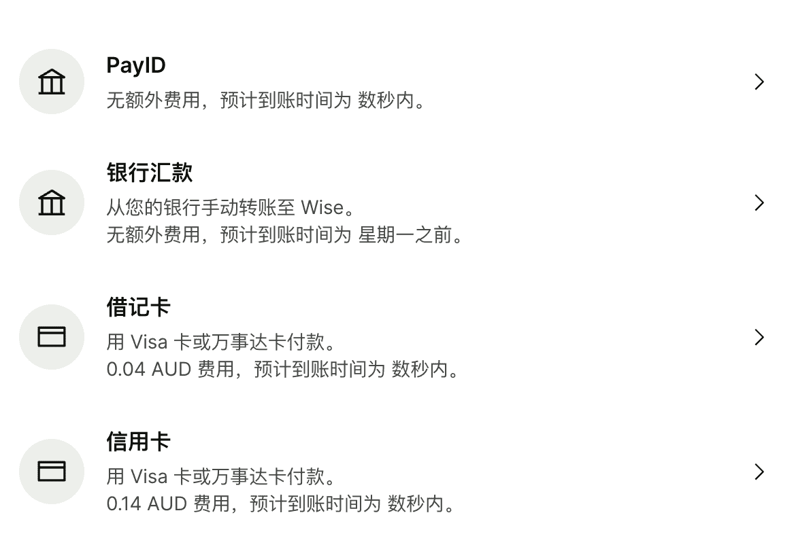
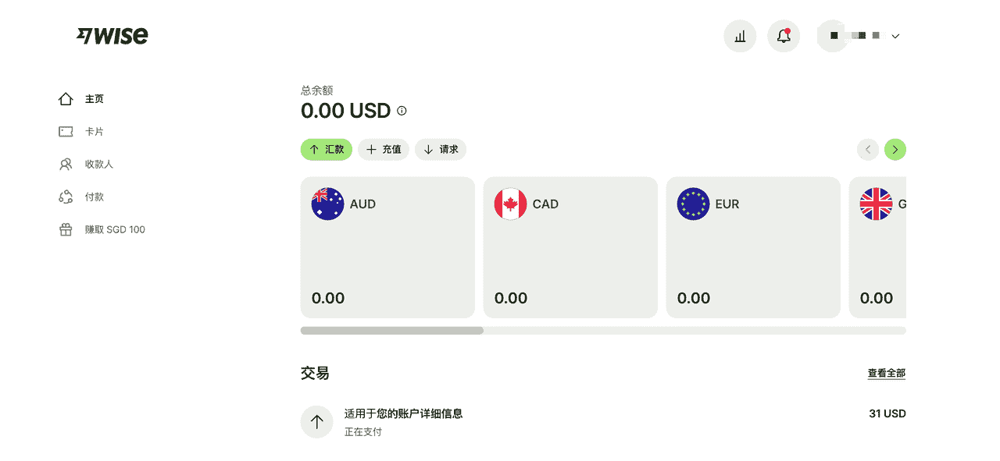

# 申请 wise 账户指南

> 来源：[https://docs.feishu.cn/docx/FSIXdYYuvoVSKmxNsbIcSFwRnWh](https://docs.feishu.cn/docx/FSIXdYYuvoVSKmxNsbIcSFwRnWh)

# 为什么要申请wise

Wise（原名TransferWise）是一家提供国际货币转账和跨境支付服务的金融科技公司。于2011年在伦敦成立，旨在为个人和企业提供一种更便宜、更快捷的方式来进行跨国货币转换和汇款。

相较于其他工具，Wise的优势主要方面：

1.低成本：Wise以真实的汇率进行货币兑换，通常比传统银行和其他汇款服务提供商的成本要低。

2.速度：Wise的转账速度通常比传统银行快很多，大多数转账可以在一天内完成，甚至有些转账可以实时到账。

3.全球覆盖：Wise支持多种货币的转账，可以接受所有地区的汇款和收款(准备在Affiliate分销付款使用)

企业账户需要有 $31 的开户费

https://wise.com/

# 准备材料

1.美国公司 + EIN

2.国内地址

3.国内护照

4.关联的美国银行，好处是转到账户内不需要手续费

相关开通账户官方教程： [https://wise.com/zh-cn/bl](https://wise.com/zh-cn/blog/open-wise-account)og/open-wise-account

费率: [https://wise.com/zh-cn/blog/pay](https://wise.com/zh-cn/blog/paypal-business-account)pal-business-account

支付完成 + 认证完成后的账户界面

