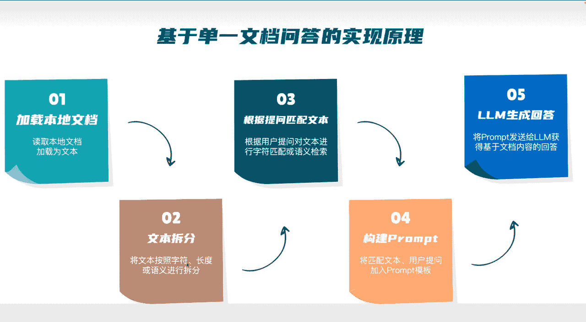
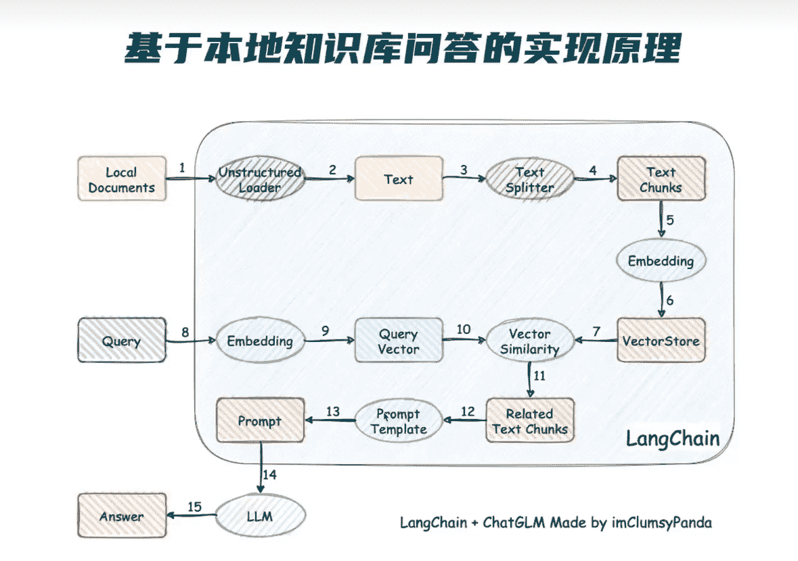

# Langchain是什么？

> 来源：[https://docs.feishu.cn/docx/OiUXdBUceo7LPJx4hXjcDkVHnxe](https://docs.feishu.cn/docx/OiUXdBUceo7LPJx4hXjcDkVHnxe)

# Langchain：

开源框架，大模型和应用之间的一个中介，调用语言模型，链接外部数据，可以简化应用开发。

三个核心组件

+   首先是Compents"**组件**"，为**LLMs提供****接口封装、模板提示****和信息检索索引**;

+   其次是Chains"**链**"，它将不同的组件组合起来解决特定的任务,比如在大量文本中查找信息;

+   最后是Agents"**代理**"，它们使得LLMs能够与外部环境进行交互，例如通过API请求执行操作。

> Embedding嵌入与向量存储VectorStore是数据表示和检索的手段，为模型提供必要的语言理解

> 基础。

**功能:**

模型支持:这些包装器允许你连接到大型语言模型，如GPT-4或HuggingFace提供的模型。

Prompt Templates:这些模板动态地将用户输入插入到模板中,并发送给语言模型。管理提示词模版。

Indexes：**索引，**当语言模型与特定应用程序的数据结合时会更强大，这个模块用于加载，更新，查询外部数据。

# 实践：

1.  爬虫程序，让大模型爬取链接的内容，并进行总结。

> 用户可以一次性输入N个链接

> 程序可以对这N个链接，分别获取网页HTML源代码，然后解析HTML并爬取正文内容

要实现这个功能，你可以使用Python的requests库来获取网页的HTML源代码，并使用BeautifulSoup库来解析HTML并提取正文内容。以下是一个示例程序：

先在电脑的命令提示符里面：pip install requests beautifulsoup4（先激活虚拟环境）

pip install openai

deepseek的api文档:https://api-docs.deepseek.com/zh-cn/#%E8%B0%83%E7%94%A8%EF%BF%BD%E5%AF%B9%E8%AF%9D-api

# 参考教程：

https://mp.weixin.qq.com/s/coFo41GTsgznKNW9Kc_sJQ

[h](https://blog.csdn.net/EnjoyEDU/article/details/139204648)ttps://blog.csdn.net/EnjoyEDU/article/details/139204648

[htt](https://www.bilibili.com/video/BV13M4y1e7cN/?spm_id_from=333.337.search-card.all.click&vd_source=390875fa901ff2bc2178a9d8b58b5bf9)ps://www.bilibili.com/video/BV13M4y1e7cN/?spm_id_from=333.337.search-card.all.click&vd_source=390875fa901ff2bc2178a9d8b58b5bf9

