# 如何搭建一个博客

> 来源：[https://docs.feishu.cn/docx/Z4WTdSiNIol7ljx39lPcy13onvd](https://docs.feishu.cn/docx/Z4WTdSiNIol7ljx39lPcy13onvd)

记得一个脑筋急转弯，把一头大象装进冰箱需要几步？三步，打开冰箱，然后把大象装进去，关闭冰箱。

我对于个人博客的搭建步骤也可以用三步来概括，注册域名、购买服务器、搭建博客，但当我们实际操作起来步骤远比想象的要多。

今天写一篇从0到1的博客搭建教程，希望影响更多想写博客的人。

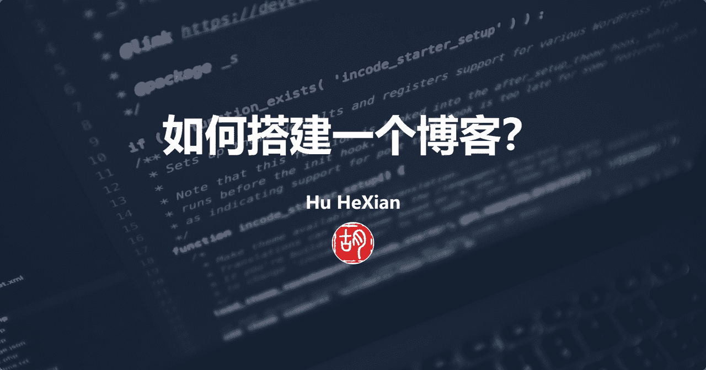

**防杠说明**：我只以我的经验为基础，推荐和介绍我所用的服务器、程序，更好的方案有很多，不喜勿喷。

并不是因为没有内容可写才出一篇搭建博客的教程，相反，我希望用这篇教程，让想写博客的人，可以写。

## 基本概念

[在介绍](https://www.himiku.com/archives/build-a-personal-blog.html?from=yinji.org)博客如何搭建之前，有必要解释相关的概念。这里我采用初之音博客的解释，加以修改。

访问我的博客，需要在浏览器里输入域名 yinji.org，浏览器通过域名解析服务查询到上述网址指向的 IP 地址为 64.88.88.xx，IP 地址与服务器绑定，访问IP就是访问服务器。服务器查询到 yinji.org 指向的位置是 WordPress 博客程序所在的目录，因此返回该目录下所有可以展示的文件。最后，由博客程序将内容返回给访客，显示在浏览器上。

因此，我们需要有域名、服务器、域名解析服务、IP、博客程序、运行环境。

## 域名

一个完整的域名有前缀和后缀，比如 yinji.org，yinji 是前缀，org 是后缀，中间用符号.链接。所以我们在注册域名时，预先想好前缀，然后在可供选择的后缀中选择合适或者喜欢的。

常见的后缀有 .com、.net、.org、.me、.top，不推荐国别域名后缀 .cn。如果用作个人博客，我推荐使用 .com、.net、.me、.im。

在国内服务商注册域名，好处是价格较便宜，支付方便，但需要实名认证，我建议使用国外的域名商，看个人选择。

国内域名服务商推荐腾讯云、阿里云，如果想注册非主流域名后[缀，可以](https://name.com/?from=yinji.org)使[用趣域网。国外域名](https://namecheap.com/?from=yinji.org)服[务商推荐 Nam](https://namesilo.com/?from=yinji.org)e[、NameCh](https://porkbun.com/?from=yinji.org)e[ap、Na](https://gandi.net/?from=yinji.org)meSilo、Porkbun、Gandi，使用之[前可以](https://www.nazhumi.com/?from=yinji.org)参[考比价网站，对比](https://tld-list.com/?from=yinji.org)不[同域名后缀在不同](https://namebeta.com/zh?from=yinji.org)域名服务商的注册、续费、转入价格，比如哪煮米、TLD-List、NameBeta，尽可能选择知名度较高的大厂。

## 服务器

云服务器和 VPS 有区别，也有联系，为了容易理解，下面都以 VPS 为介绍对象。

[使用国](https://cloud.tencent.com/?from=yinji.org)内[的 V](https://www.huaweicloud.com/?from=yinji.org)PS[，域名](https://aliyun.com/?from=yinji.org)必须备案，所以你如果打算购买腾讯云、华为云或者阿里云等国内云服务商的 VPS，最好是在同一个服务商注册域名，方便管理和备案。

如果使用大陆以外的 VPS，比如香港、台湾、日本、美国的服务器，不用备案。

相对来说，国内 VPS 带宽小、价格便宜，其他地区的 VPS 带宽大、价格稍贵，但也有性价比不错的商家，下面会有介绍。

腾讯云、阿里云、华为云都有相应的学生认证服务，通过学生认证可以以优惠价购买配置还不错的 VPS，如果你符合该条件，可以试试。

[国外的](https://aws.amazon.com/cn/?from=yinji.org)云[服务商选择](https://www.vultr.com/?from=yinji.org)很[多，知名的有](https://www.linode.com/?from=yinji.org) [AWS](https://bandwagonhost.com/?from=yinji.org)、[Vultr、Lin](https://yinji.org/cloudcone.html)ode、[搬瓦工，他们所提](https://yinji.org/racknerd.html)供的服务器质量好、售后好，但也很贵，不建议新手玩家购买。如果你每年只有300元以内的预算，推荐 CloudCone 或者 RackNerd。

我目前使用的 VPS 来自 [CloudCone](https://yinji.org/cloudcone.html)，在2023年4月复活节期间购买，配置为 CPU&内存：2核（vCPU）&2GB，存储：60GB硬盘，带宽：1Gbps，每个月3TB流量，25.5美元/年，续费同价。至于使用体验，可以查看我以前的文章《使用 CloudCone 的第 7 个月》。

[或者考虑使用同一](https://yinji.org/racknerd.html)机房，但配置稍微低一点的 RackNerd。

对了，国外云服务商还有一个更重要的优点，续费同价，不像国内的套路云，往往只有新人和第一年才有优惠价。

购买 VPS 和注册域名一样，选择知名度高的厂商，虽然我推荐的这两家没有 AWS、Vultr 这些大厂名气大，但在圈内也比较知名，性价比高。

## 搭建博客

### 购买服务器

以上面提到的 CloudCone 为例，介绍从购买服务器到搭建博客的过程。

[**目前 Cloud**](https://yinji.org/racknerd.html)Cone 已无库存，可以考虑购买 RackNerd 的 VPS，也有洛杉矶 DC2 机房。

首先在 [CloudCone](https://app.cloudcone.com/?ref=9587&from=yinji.org) 注册账号，该服务商需要提前充值金额，所以先看好想买的 VPS 价格，充值好对应的金额。点击头像，然后进入 Billing 页面。

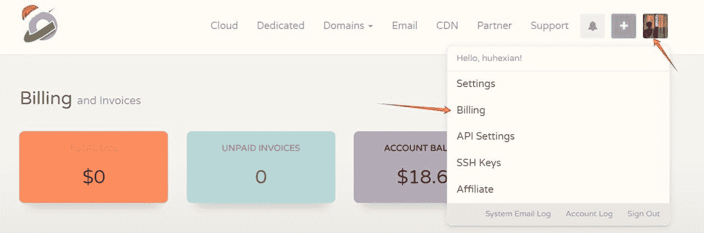

下方有一个 Add funds 按钮，支持支付宝支付。

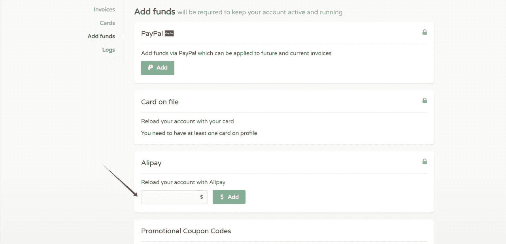

充值好金额之后，以圣诞节特惠 VPS 26美元款为例，然后进入购买页面，选择合适的系统，设置好 Hostname，即可下单。

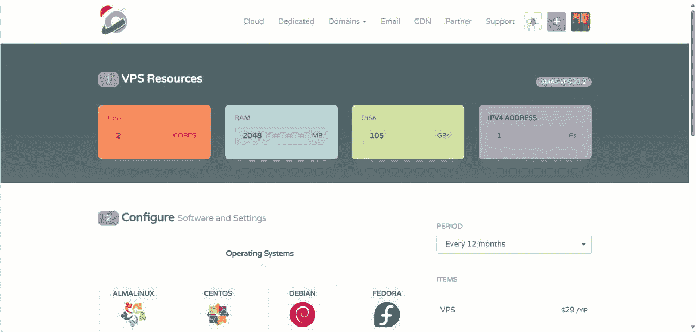

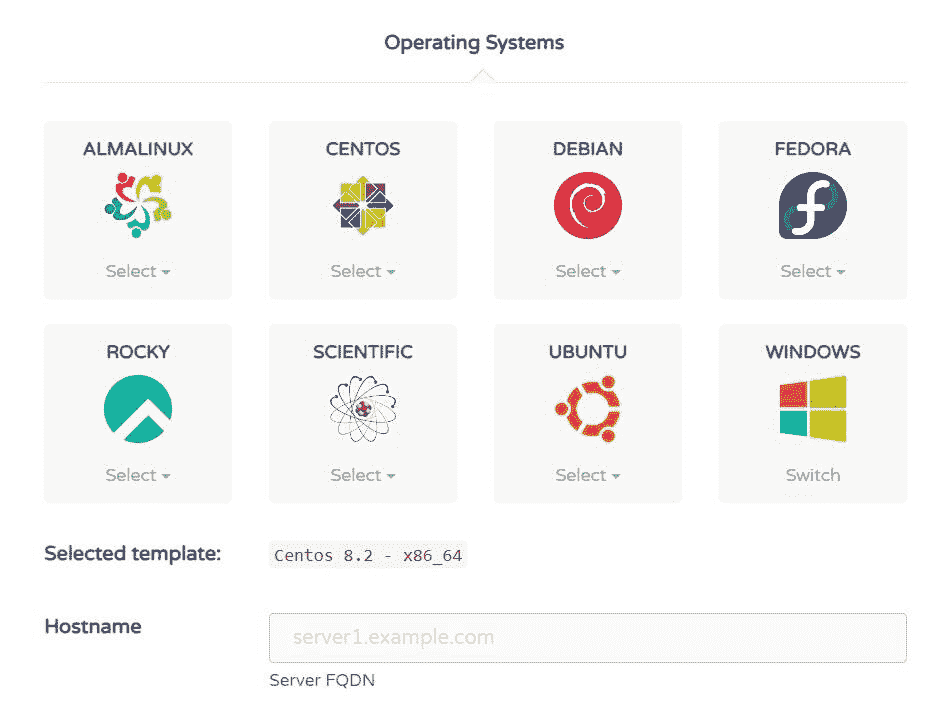

推荐使用 Debian 或者 Ubuntu 系统，版本选择最新即可，Hostname 没有太多限值要求，英文+数字组合即可。然后等待 VPS 开通成功，之后会收到来自 CloudCone 邮件通知，包含 VPS 的 IP 地址和 SSH 登录账号和密码。

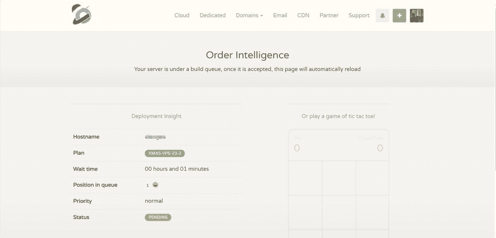

### 解析域名

一般域名注册商会提供免费的域名解析服务，或者使用其他服务商提供的域名解析，例如 Cloudflare。

这里以 [Cloudflare](https://www.cloudflare.com/zh-cn/?from=yinji.org) 为例进行介绍。首先需要注册 Cloudflare 账号并登录，点击添加站点。

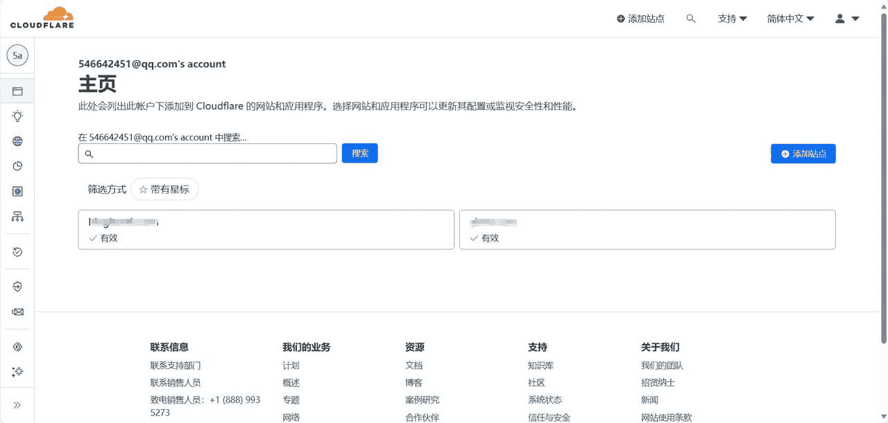

输入需要添加的域名之后，选择最下方的 Free 方案，点击继续，会提示你修改域名的 DNS 服务器。然后只需要回到域名注册商后台，修改 DNS 服务器即可。

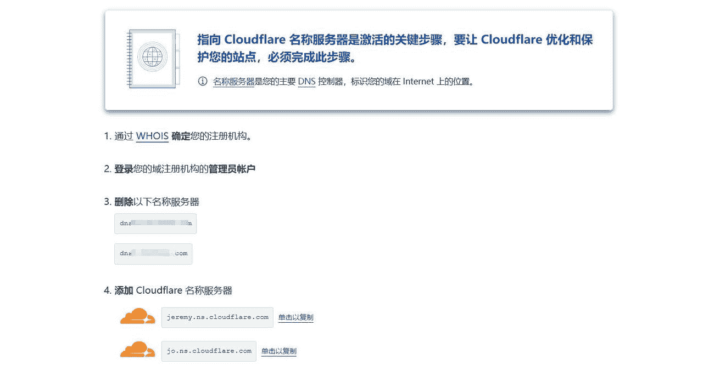

等待 DNS 服务器更新完成，回到 Cloudflare 后台，为域名添加解析。类型选择 A，名称填写 @ 或者 www，IPv4 地址就填写上面购买的 VPS 的 IP 地址，代理状态不建议使用 Cloudflare 代理，一般用不上，建议取消，最后点击保存即可。

关于名称，多说两句。以我的域名 yinji.org 为例，如果填写 @，则解析后的域名就是 yinji.org；如果填写 www，则解析后的域名就是 www.yinji.org 。建议两种都解析，将 yinji.org 作为主域名，设置 www.yinji.org 跳转至 yinji.org。

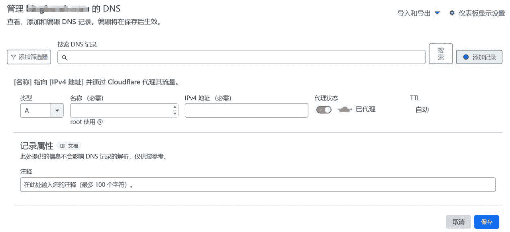

### 安装环境

使用 WordPress 程序安装博客，我的常用做法是安装宝塔面板，一键配置 lnmp 环境，Linux+Nginx+MySQL+PHP。

首先需要使用任意一个 SSH 客户端登录服务器，输入账号 root 和登录密码，端口一般为22。如果你的电脑是 Windows 系统，可以直接在 Terminal 上输入命令ssh root@142.1xx.2xx.xx -p 22登录服务器。

下图是堡塔远程工具的截图，输入对应的内容登录即可。

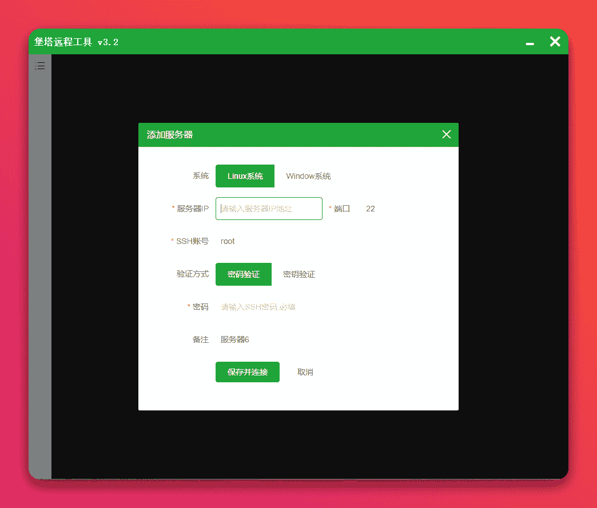

[不同](https://bt.cn/?from=yinji.org)的系统安装宝塔面板所用的命令也不一样，以宝塔官网提供的为准。

CentOS 系统：

```
yum install -y wget &amp;&amp; wget -O install.sh https://download.bt.cn/install/install_6.0.sh &amp;&amp; sh install.sh ed8484bec
```

Copy

Ubuntu 系统：

```
wget -O install.sh https://download.bt.cn/install/install-ubuntu_6.0.sh &amp;&amp; sudo bash install.sh ed8484bec
```

Copy

Debian 系统：

```
wget -O install.sh https://download.bt.cn/install/install-ubuntu_6.0.sh &amp;&amp; bash install.sh ed8484bec
```

Copy

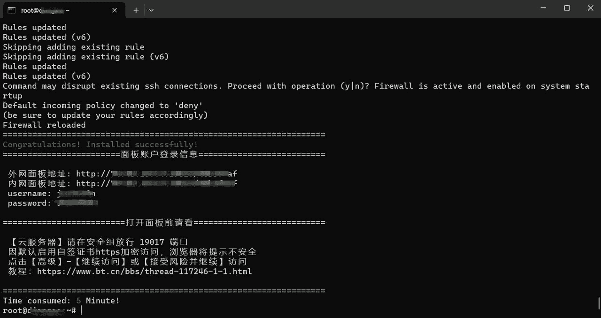

只需要输入一行命令，整个过程基本上自动完成，安装成功之后，会显示面板登录地址及其账号密码，保存即可退出。

按照提供的地址和账号密码，登录宝塔面板，会弹出环境安装的选择，一般选择 LNMP，极速安装。

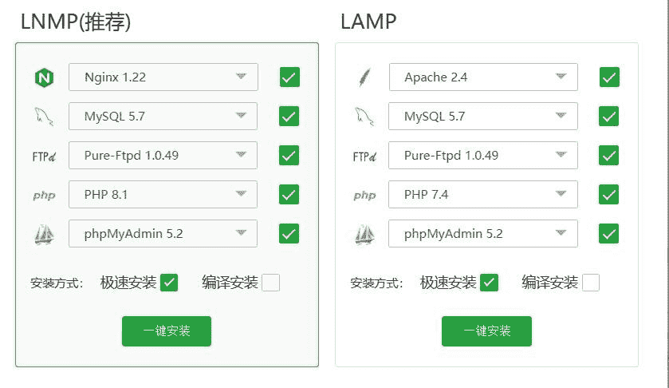

上述步骤完成，搭建 WordPress 博客所需的环境也就安装成功了。

### 创建网站

博[客程序种类丰富，常](https://cn.wordpress.org/?from=yinji.org)见的 WordPress、Typecho 等，这里以 WordPress 为例。首先需要前往 WordPress 官网下载程序包，一个包含中文语言的压缩包。

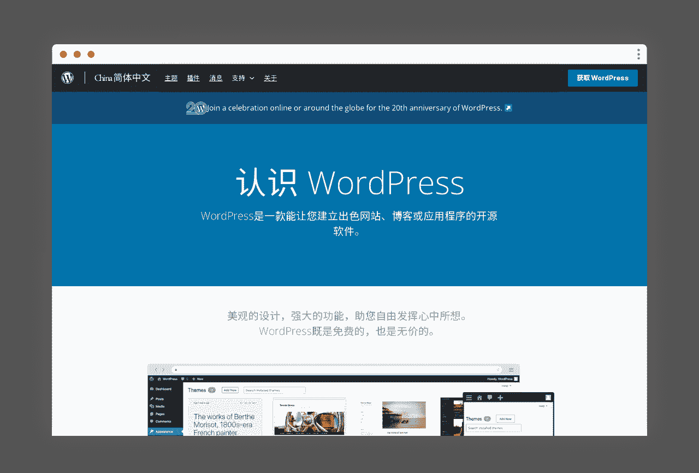

紧接着回到宝塔面板，在左侧找到“网站”一栏，添加站点→创建站点→输入域名（例如 yinji.org）→数据库（选择 MySQL，设置账号和密码）→PHP 版本（选择 PHP-81），最后点击提交。

注意：这一步既创建了网站目录，也创建了数据库，所以后面无须再次创建数据库，记住这一步骤下的数据库名、数据库账号和密码即可。

新建一个站点之后，点击左侧“文件”，便会看到系统自动创建了一个以域名为文件名的文件夹，我们称之为网站根目录。


站点创建之后，进入该站点所在目录，删除目录内所有文件，一般只剩下一个 .user.ini 文件，删不掉也没关系。

上传下载好的 WordPress 压缩包，并解压，得到一个名为 WordPress 的文件夹，将文件夹里面的文件全部移动到网站根目录。

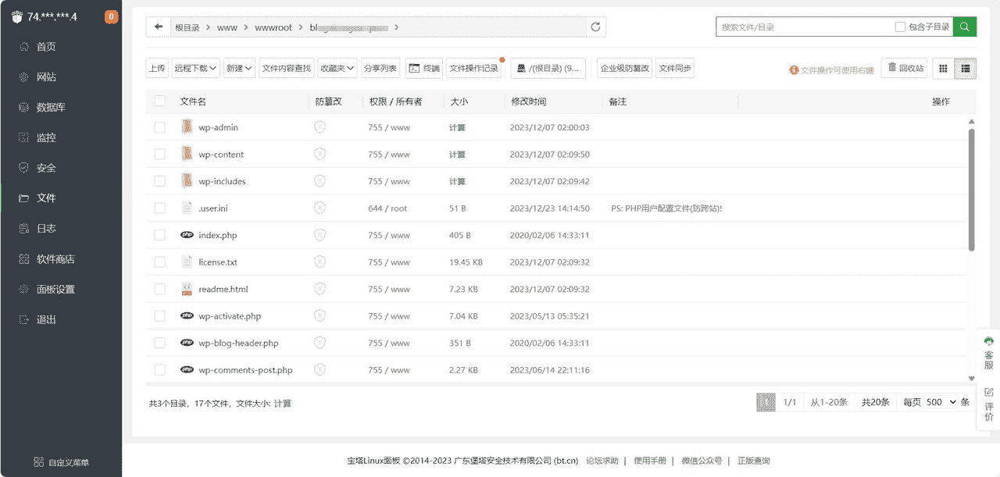

上述步骤完成，一般就可以在浏览器里输入域名进行程序安装，但为了减少后面的麻烦，可以先将 SSL 和伪静态提前设置好。

点击刚刚创建好的网站，选择左侧的 SSL，然后选择 Let\'s Encrypt，选择需要配置 SSL 证书的域名，点击申请即可。

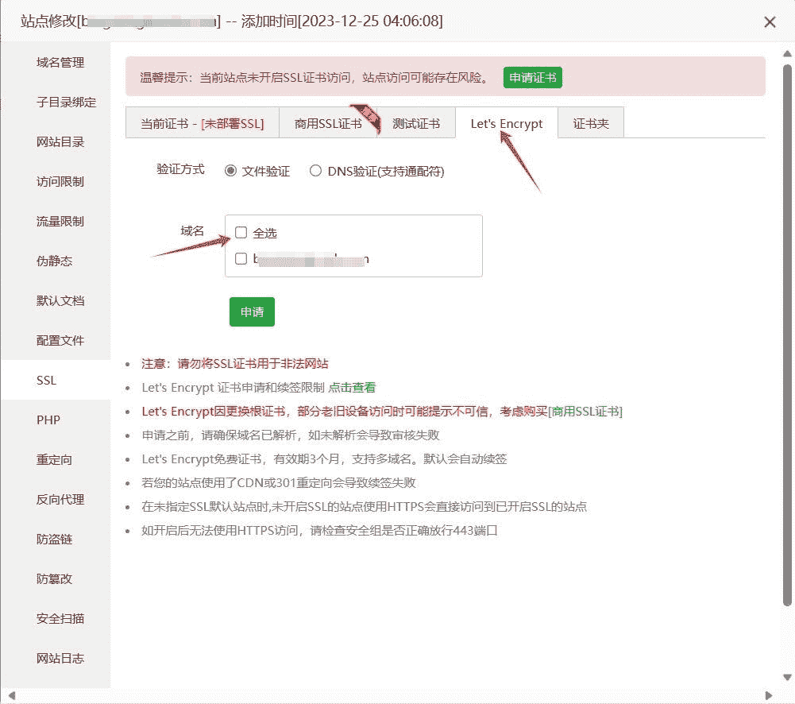

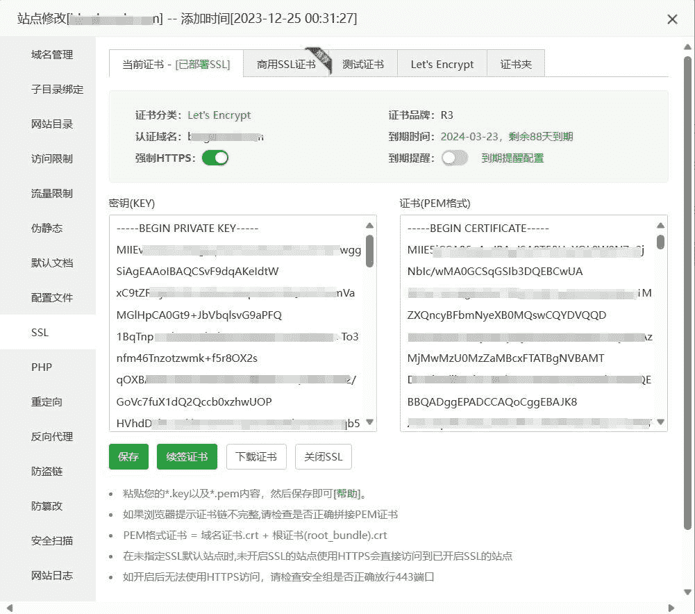

最后开启强制 HTTPS，点击保存。

关于伪静态设置也很简单，打开左侧的“伪静态”，下拉找到 WordPress，点击保存就可以了。


设置好 SSL 和伪静态之后，便可以在浏览器里输入绑定好的域名，进入 WordPress 程序安装环节。

### 安装 WordPress 程序

在浏览器里输入域名，进入程序安装界面。


这一步需要用到数据库名、数据库账号、数据库密码，这些都可以在宝塔面板里找到，数据库主机和表前缀保持默认即可，不用修改。

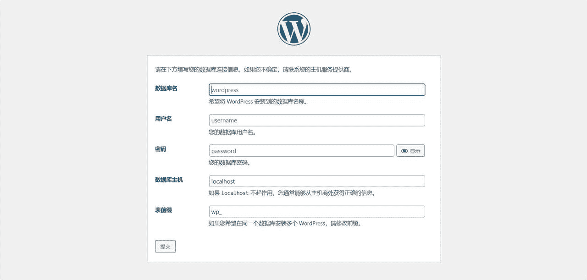

填写正确之后提交，下一个页面是设置站点标题、后台用户名和密码等内容。

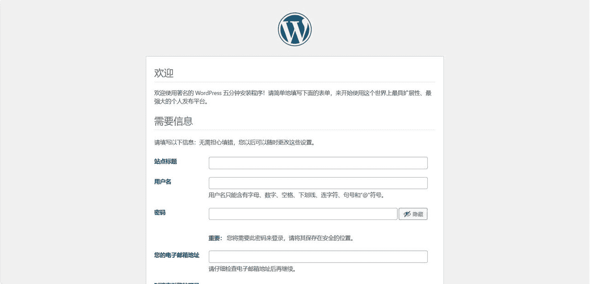

全部内容填写完毕之后，通过 域名/wp-admin 路径进入博客后台，即可看到如下图所示的界面，即博客搭建大功告成。

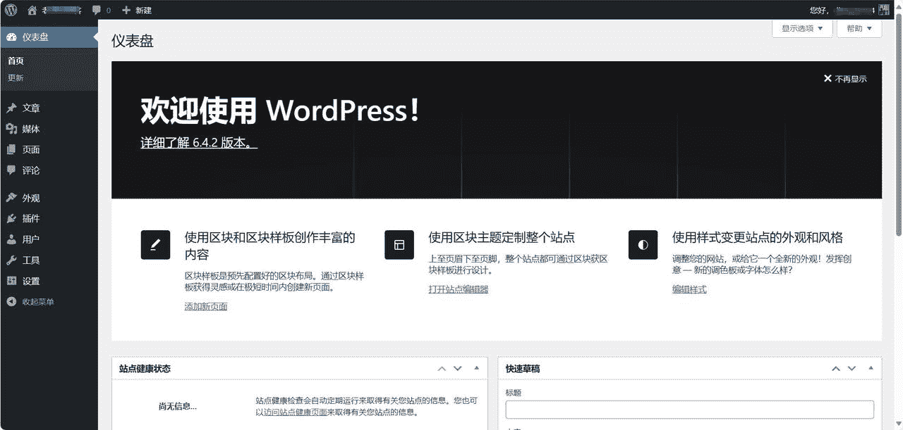

后面你所需要做的事情就是熟悉 WordPress，在后台摸索文章、媒体、页面、评论，以及如何上传/更换主题、安装插件等功能。

# 网站开发用什么语言？

开发一个网站，就好比做一道美食，网站的代码语言是“食材”，而网站的界面设计就是“调味剂”。这里我们先来聊聊“食材”需要准备哪些吧！

• HTML

超文本标记语言，定义网站页面的逻辑结构。

• CSS

层叠样式表，定义网站页面的样式规格。

• JavaScript

函数编程语言，定义网站页面的交互功能。

• PHP

服务器端脚本语言，定义网站页面的数据库。