# SD本地部署教程

> 来源：[https://docs.feishu.cn/docx/EEYcdaIKsokHk7xhgoockjUanPh](https://docs.feishu.cn/docx/EEYcdaIKsokHk7xhgoockjUanPh)

# 前言

新的一套专题来了，【AI绘画】专题，教你从0基础学会AI绘画，这次的教程主要是用SD，不是智商税，如果你电脑显卡在3060以上，那么五分钟之后你就可以使用SD了，如何看自己的系统配置。可以看这篇文章：

[AI绘画需要什么电脑配置？](https://m0pnt42rkm.feishu.cn/wiki/Jt1qwQPbCi2k4OkMYcHcSDnOnQg)果想要确认自己是属于上面两种情况的哪一种，可以看下这个文章：

# 本地部署

### 下载安装包：

> 链接：https://pan.baidu.com/s/1_0ndhH4z5E_Us0h8wRJnSA

> 提取码：6666

大家自行去百度网盘这里去下载做这个安装包，不用的担心下载的是不是最新版，因为安装好之后你可以应用内升级；

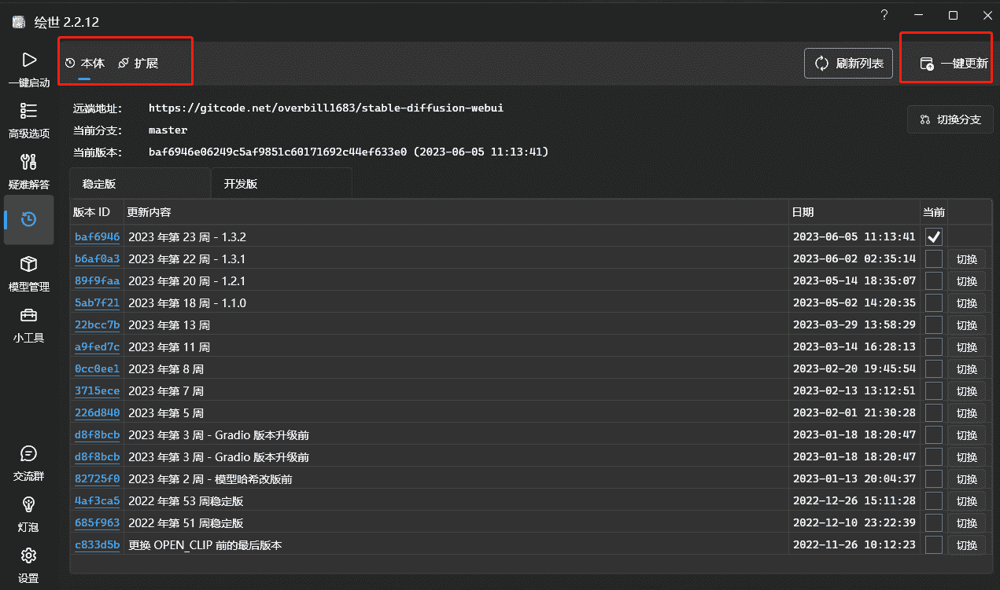

下载完成之后，你会得到这样的一个文件夹

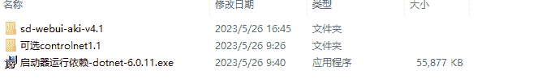

这里我一一做下解释：

+   sd-webui-aki-v4.1：就是我们的软件主入口

+   可选controlnet1.1：这个使我们后续要使用的进阶功能，因为大家都知道AI绘画比较偏向于抽卡，而controlnet的出现能减少抽卡的情况，控制出图的稳定性

+   启动器运行依赖-dotnet-6.0.11.exe：这是一个微软的安装依赖，使用它能够解决电脑打不开某些软件的问题

接下来开始实操：

### 开始之前的一些操作：

#### 第一步：

首先我们先双击运行启动器运行依赖-dotnet-6.0.11.exe；

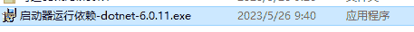

#### 第二步：

将这个路径下的所有文件复制一下（当然你也可以选择剪切）

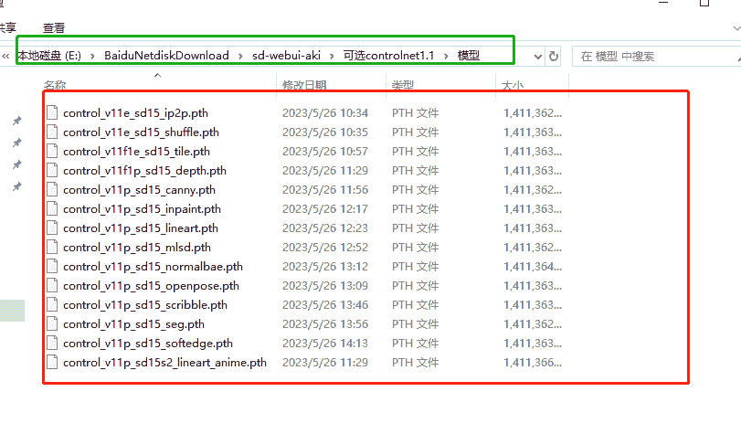

然后粘贴到这里

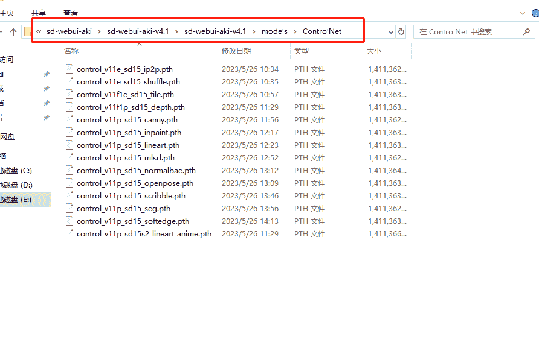

#### 第三步：

将这个路径下的所有文件复制一下（当然你也可以选择剪切）

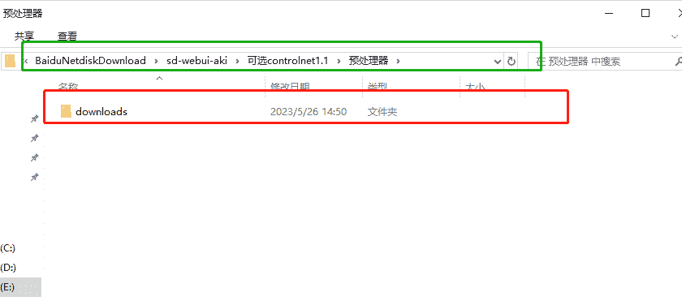

然后粘贴到这里

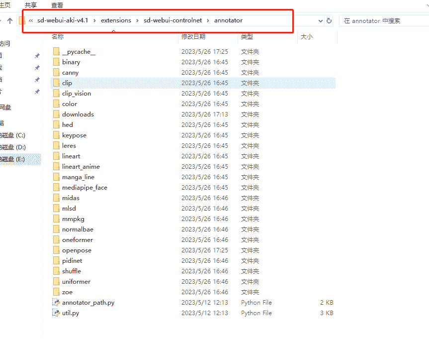

#### 搞定启动：

到这里本地的部署，就搞定了，下面就可以跑图了；我们进入这里找到这个图标，进行双击启动

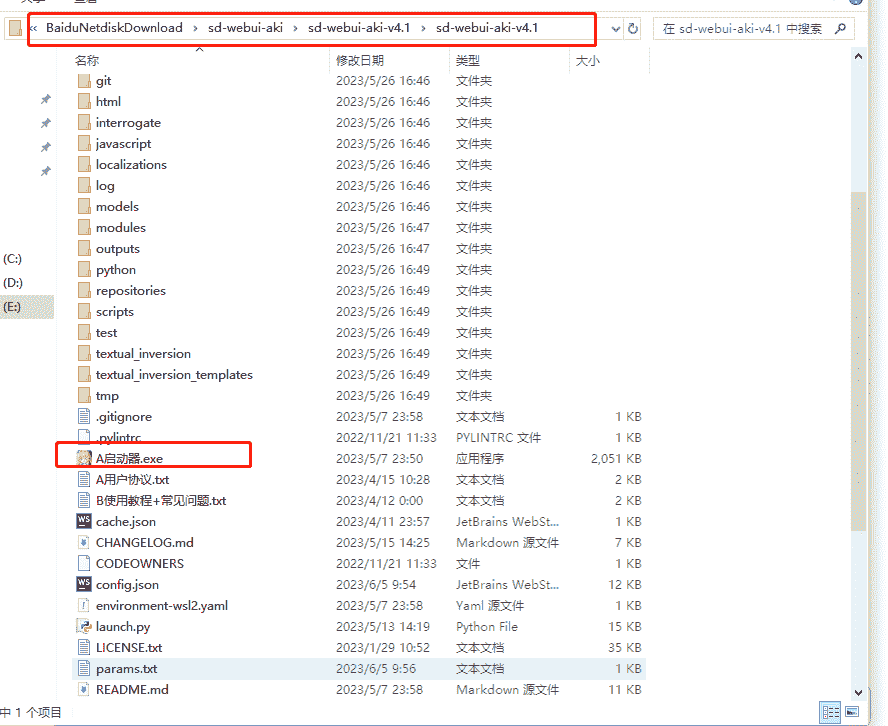

双击之后，你就能看到这个界面了，点击一键启动：

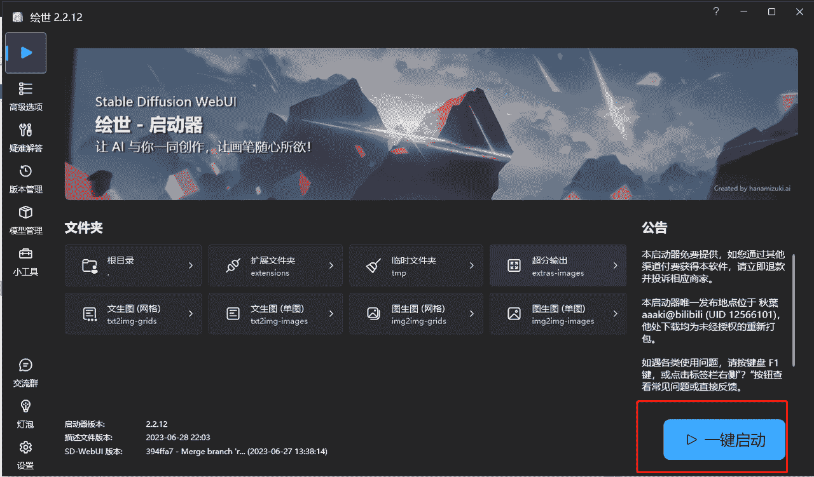

当然你也可能看到这样的界面，没关系，他是在自己更新，等一会就好了：

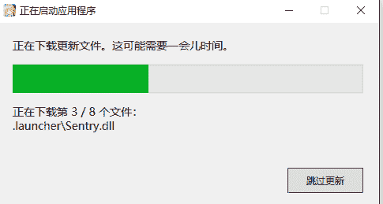

一键启动之后，你就看到这样的界面了

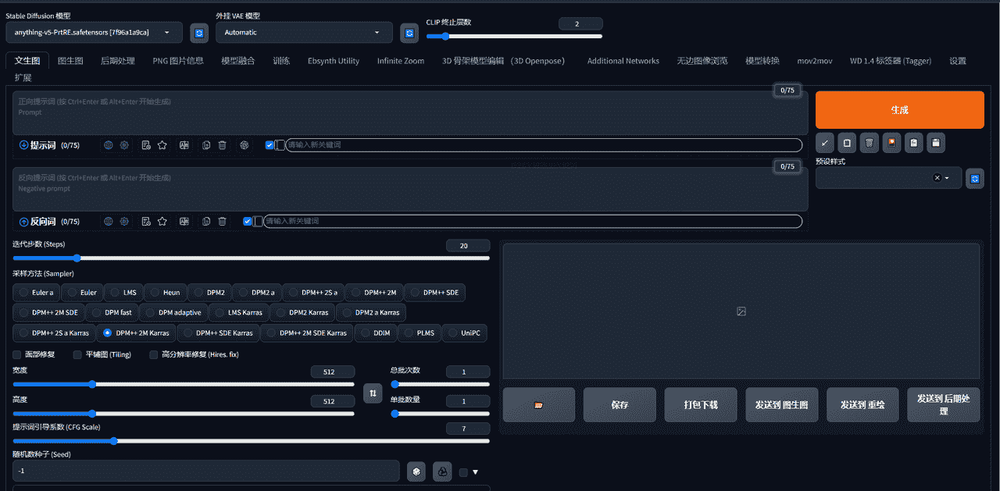

后续可以安装很多插件，大家不用着急后面我会--教大家如何安装这些插件，以及这些插件的用处；

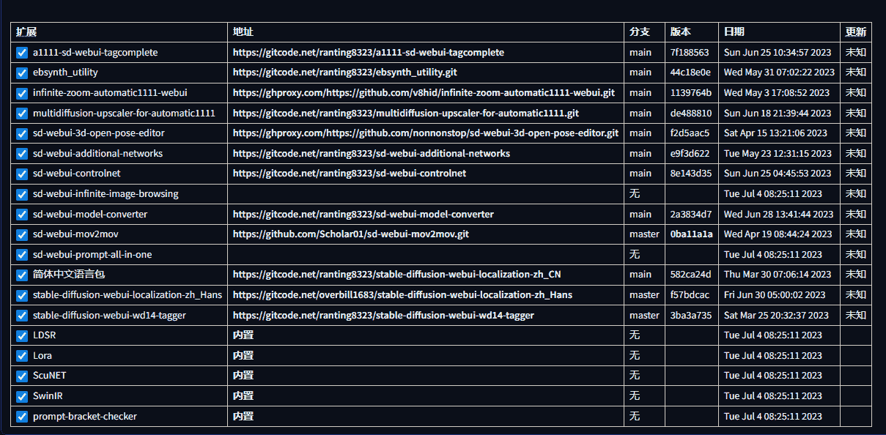