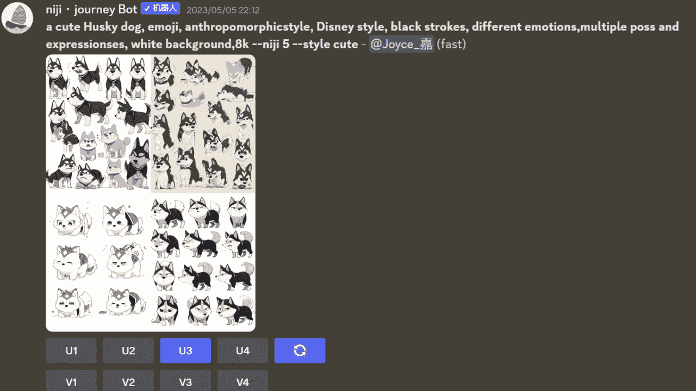
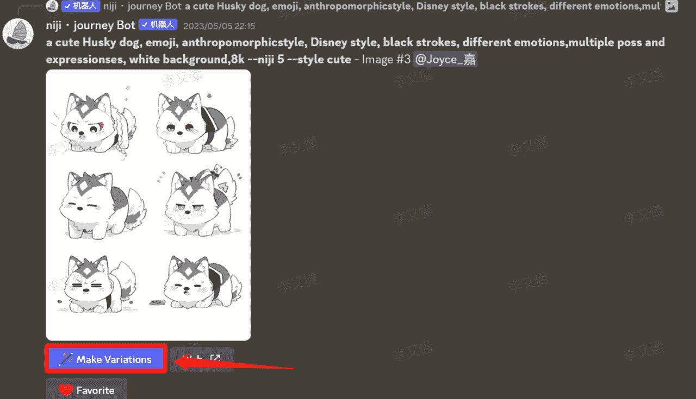
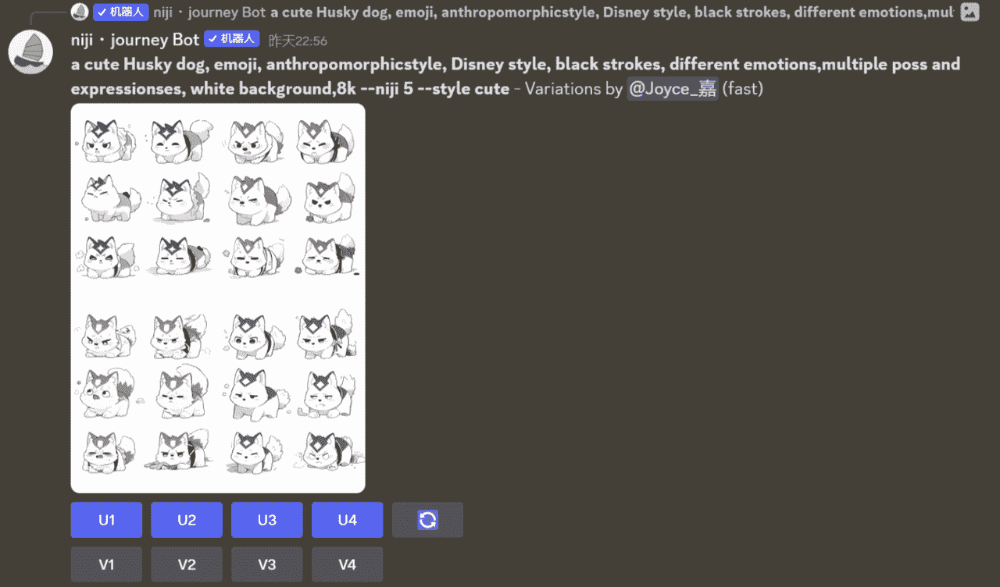
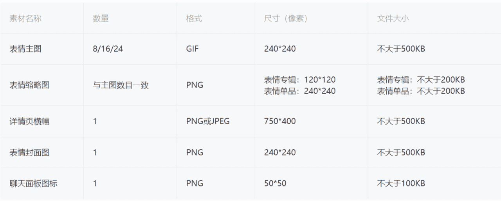
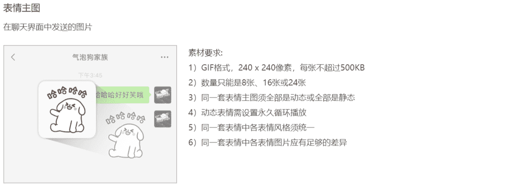
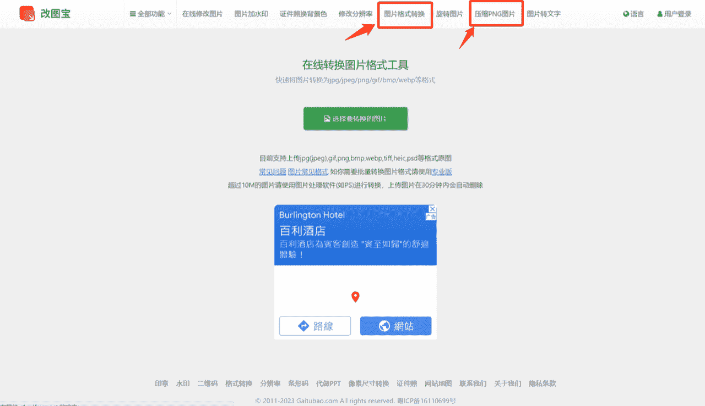
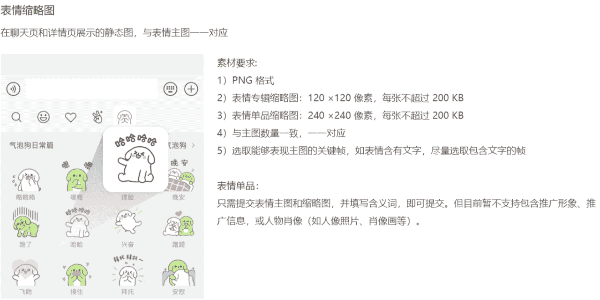
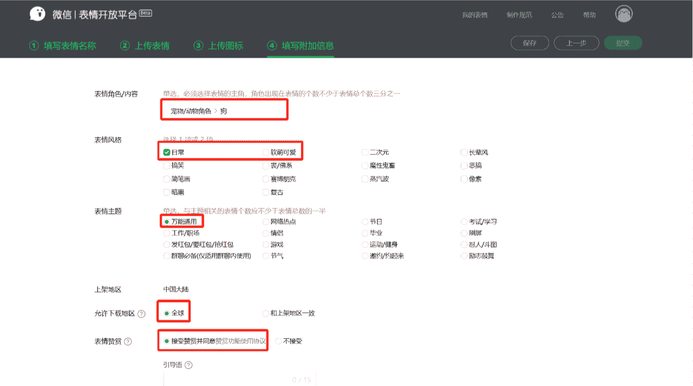
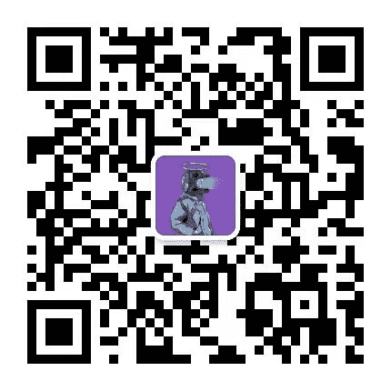
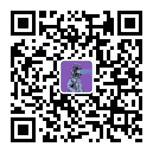

# 通过批量生成表情包实现小红书引流变现

> 来源：[https://docs.feishu.cn/docx/JVdxdbmHcob2WExTKPCcMAlbnne](https://docs.feishu.cn/docx/JVdxdbmHcob2WExTKPCcMAlbnne)

近期用AI批量生成表情包赚钱的选题在小红书非常火爆，今天主要跟大家分享下如何用AI批量生成表情包，快速涨粉起号，并且上传微信表情开放平台赚取收益~

### 变现形式

1.  利用AI批量制作微信表情包，上传至微信表情平台躺赚赞赏收益

1.  私人定制表情包进行收费（客户宠物、宝宝等表情包）

1.  各平台输出AI绘画批量生成表情包选题，吸引人群点赞互动，涨粉起号

1.  制作AI表情包变现资料包引流至私域，卖资料包或者AI绘画课程变现

### 具体操作步骤

#### 第一步：

利用Midjourney批量生成表情包输入正确的关键词，就可以批量生成自己想要的不同形态和动作表情包

通过"U"按钮升档获取觉得不错的表情包图片

再通过"Make Variations"按钮获得更多同种类型，但是不同形态和动作的表情包

**关键词拆解举例：**

1.主体角色：a cute Husky dog（一只可爱的哈士奇狗）描述直接更换成自己想要的动物/其他角色

2.核心关键词：emoji，anthropomorphicstyle，Disney style，black strokes，differentemotions，multiple poss and expressionses，white background，8k（表情符号，拟人化风格，迪士尼风格，黑色笔画，不同的情绪，多种姿势和表情，白色背景，8K）

3.版本参数：--niji 5--style cute

**完整描述：**

a cute Husky dog，emoji，anthropomorphic style，Disney style，black strokes，different emotions，multiple poss and expressionses，white background，8k--niji 5--style cute

#### 第二步：抠图+配字制作表情包

推荐一个抠图神器：https://www.remove.bg/zh/upload

01.将表情包图片抠出PNG图片

点击"上传图片"，将MJ生成的所有表情包.jpg图片上传进行抠图为.PNG，然后点击下载即可

02.抠图+配字制作表情包

我是利用【稿定设计】平台进行表情包的配字

稿定设计网站：https://www.gaoding.com

这一步有很多方法，但我最终选择【稿定设计】，是因为改图片尺寸和内存大小非常方便！

后面上传微信表情开放平台有很多图片尺寸大小和格式需要注意，后面会一起介绍。

先将画布尺寸改为240*240px，然后配上自己喜欢的字体，批量操作生成一张张表情包！

#### 第三步：上传微信表情开放平台

微信表情开放平台网站：https://sticker.weixin.qq.com/cgi-bin/mmemoticon-bin/readtemplate？

t=home/index

重要：微信制作规范概览！！！

##### 01填写表情名称

表情类型：可以选真人拍摄表情、截图表情、卡通表情或其他

详情页横幅：JPEG或PNG格式，宽750*高400像素，不超过500KB

表情名称：哈士奇表情（可以自己随便取）

表情介绍：一只可爱又肥胖的哈士奇（可以自己随便取）

Copyright：填自己设计师名字

##### 02.上传表情

这一步我以为很简单，但其实是最麻烦的，因为表情主图和缩略图格式和大小问题弄了很久！！

表情主图类型：动态图、静态图（我们选静态图就行）

在这里我们需要把PNG格式的图片转为GIF格式

推荐一个网站非常方便，而且是免费的，叫改图宝：https://www.gaitubao.com/

不管是图片格式转换还是压缩PNG图片都用这个网站，无敌！

##### 03.上传图标

点击创建形象，上传"表情封面图"，"简介"，""聊天图标""等，注意格式尺寸要求：

表情封面图（PNG格式，240*240px，不超过500KB）

聊天图标（PNG格式，50*50 像素，不超过 500KB）

##### 04.填写附加信息

表情角色/内容：宠物/动物角色/狗

表情风格：可以选日常和软萌可爱

表情主题：选万能通用就行

允许下载地区：全球

表情赞赏：选接收才有收益（这里会弹出需要艺术家认证，按要求完成即可）

##### 05.艺术家认证

为了开启表情赞赏，一定要认证才行

信息提交后会跟提交的表情一起审核

#### 第四步：关注表情开放平台，等待审核

这个审核速度非常快，我是第二天就有审核

### 最后

最后，我是科技狂魔李又懂，搞技术是为了搞钱~

擅长项目数据分析，实战拆解项目，带小白从0到1，希望每个人都能真正在互联网盈利，收获一份收入可观的副业实操项目。

我的微信是：4314991。如果文章对您有价值，记得一个点赞、分享，是对原创作者的最大支持。

公众号：李又懂，分享更多创业副业技术知识。

