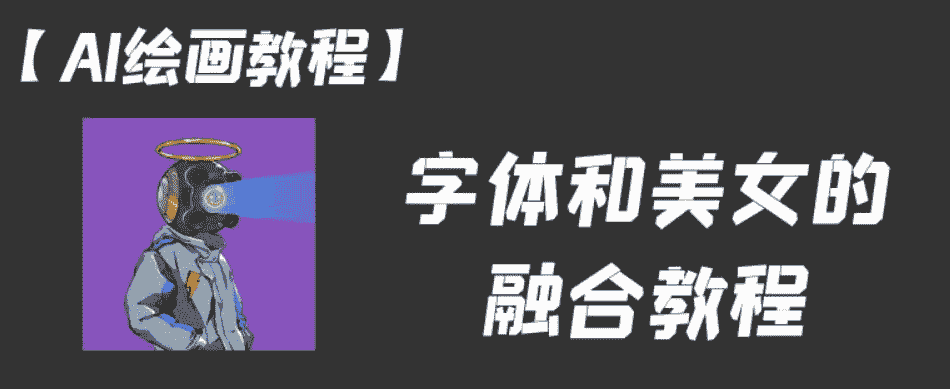
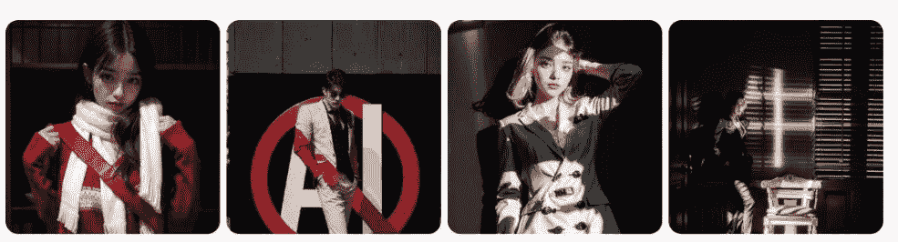
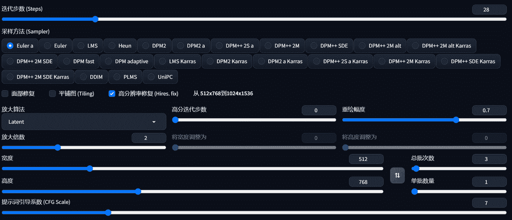
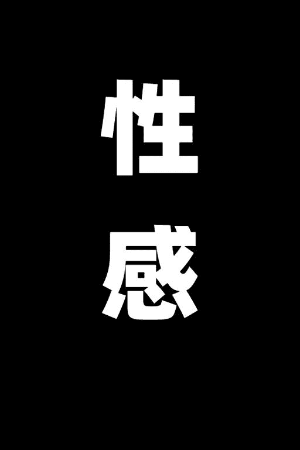
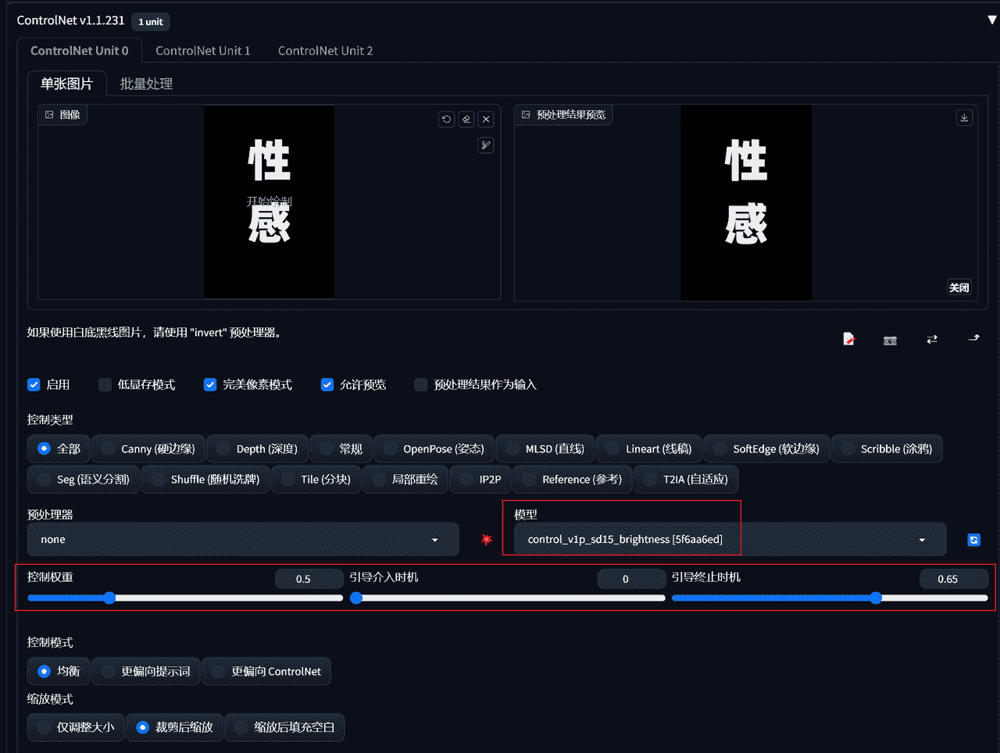
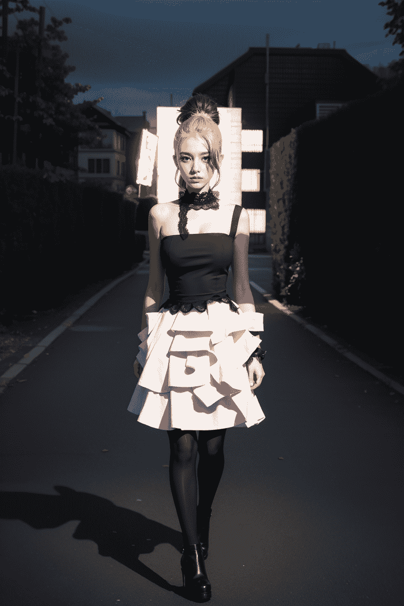

# 字体和美女的融合教程

> 来源：[https://docs.feishu.cn/docx/Dj57dDinDorNURxX6mOcvruvnWg](https://docs.feishu.cn/docx/Dj57dDinDorNURxX6mOcvruvnWg)

# 前言

最近特别火的技能，就是利用AI让字体和图片的融合，如下面的图所示，

一开始看似乎只是一张美女图片，但仔细观察，你会发现图片内部还隐藏了一段文字。

这个做出来，创意十足，既可以在朋友圈秀一秀，又可以用在我们的引流系统，进行营销推广。

如果我们把我们的二维码融入了图片里，那不是又一引流新方法。

下面是教程，直接干起来~！

# 效果示意图

# 开始前的准备

用的是stable diffusion这个绘图工具

用到Controlnet的2个模型，效果都可以，任选一个都行。

分别是：

+   control_v1p_sd15_brightness

+   lightingBasedPicture_v10 
下载地址：https://civitai.com/models/80536/lighting-based-picture-control-controlnet

# 步骤

大模型：majicmixRealistic_v6.safetensors

模型都可以，我这里弄的是真人效果，所以选择这个。

正面词：

> masterpiece,best quality,highres,a beautiful girl walking in the park at night,

反面词：

> NSFW, (worst quality:2), (low quality:2), (normal quality:2), lowres, normal quality, ((monochrome0),((grayscale)), skin spots, acnes, skin blemishes, age spot, (ugly:1.331), (duplicate:1.331), (morbic d:1.21),(mutilated:1.21),(tranny:1.331),mutated hands,(poorly drawn hands:1.5), blurry, (bad anatomy:1.21), (bad proportions:1.331), extra limbs,(disfigured:1.331),(missingarms:1.331),(extra legs:1.331),(fused fingers:1.61051),(toe omany fingers:1.61051),(uncleareyes:1.331),lowers, bad hands,missingfingers, extra digit,bad ha ands, missing fingers, ((extra arms and legs))),

其他参数如下图：

然后就是关键的Controlnet

图片自己去制作一张黑底白字的，我这里制作了一张512*768分辨率的，和上面作图分辨率一样，用的搞定设计就行

模型选择 control_v1p_sd15_brightness

权重不用太高，0.5即可，后面效果不理想在细调即可，终止时机选择0.65就行。

然后就可以执行看看效果：

