# 一、如何使用 Midjourney？

> 来源：[https://docs.feishu.cn/docx/NCIxdCnrqoWKXOxAklmcVvaNncc](https://docs.feishu.cn/docx/NCIxdCnrqoWKXOxAklmcVvaNncc)

## 注册

首先，你需要注册一个 [Discord ](https://discord.com/)[账号，然后加入 Midj](https://discord.com/invite/midjourney)ourney 的 Discord 服务器 。或者去 Midjourney 的官网点击右下角的 Join the Beta：

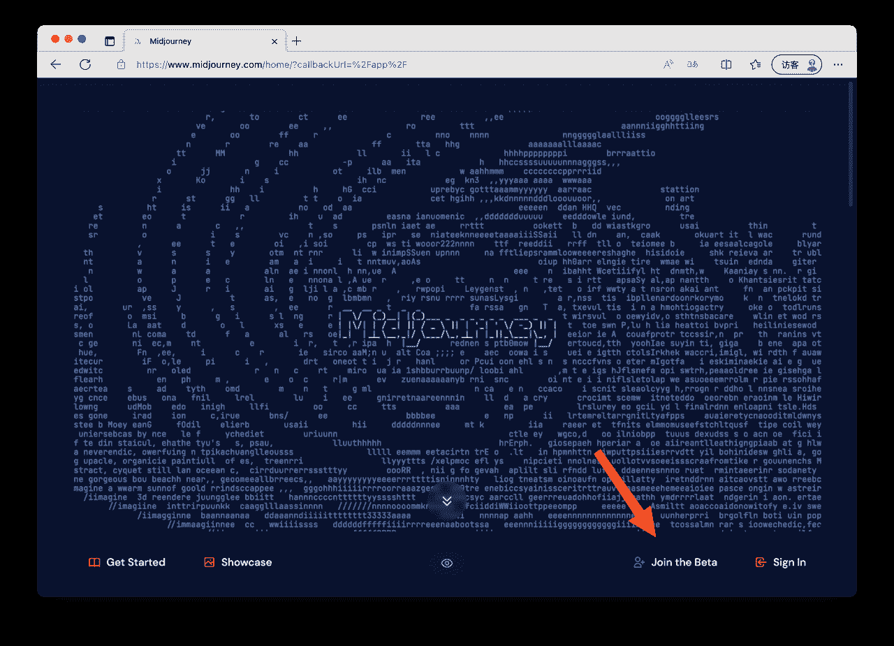

## 在 Discord 公共服务器里使用

注册并进入到 Midjourney 的服务器后，有可能需要完成各种任务（这个取决于 Midjourney 的运营策略，后续可能会变），如果有，则按照引导完成即可。

接着你就能在 Midjourney 的 Discord 的左侧栏，看到 newbies-XXX 的频道，随便点击一个，进入该频道，这个频道就是给免费用户测试使用的：

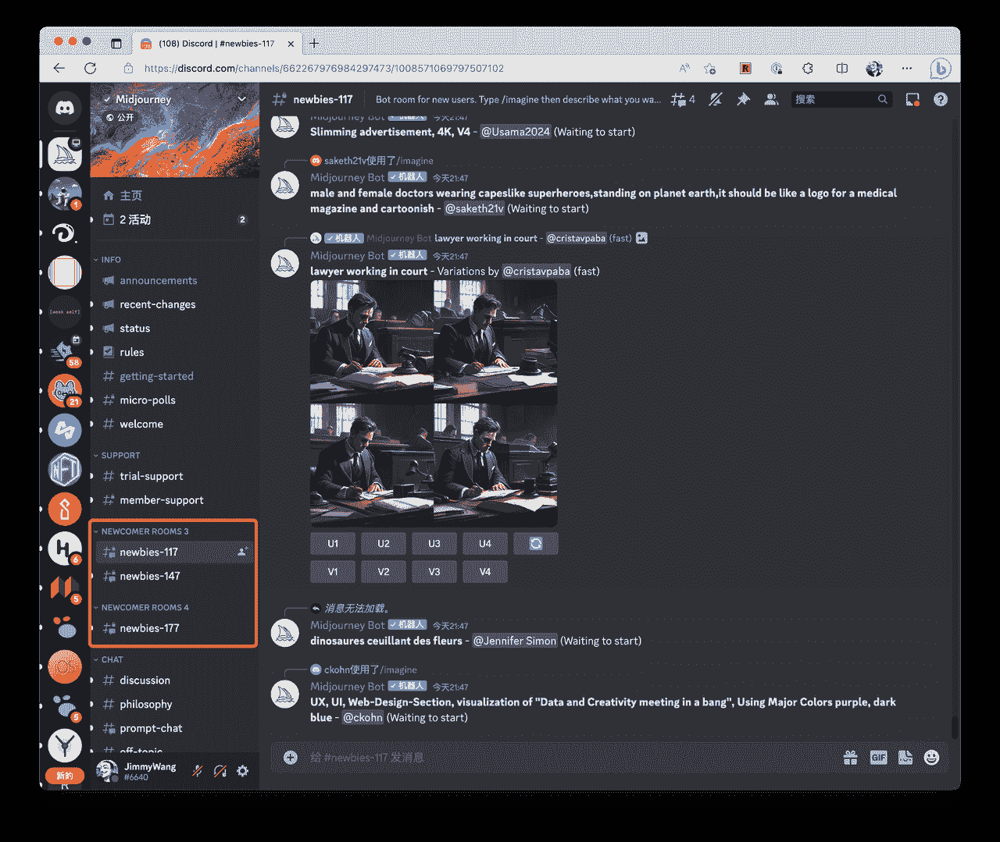

然后在输入框里输入 / 然后你能看到输入框上出现一个菜单，一般最顶部就是 /imagine，点击该菜单（如果没有出现该菜单，就输入完 / 后继续输 imagine），就能在 prompt 框里输入图片 prompt 了：

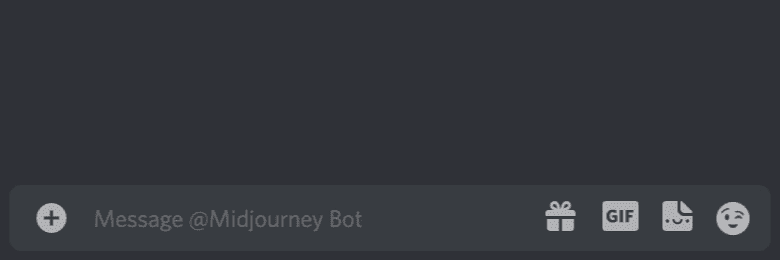

接着你就会看到一个叫 Midjourney 的机器人复述了你的话，在这句话的最后，有一句 Waiting to start，这就意味着你的 prompt ，机器人已经接收到了，正在为你生成图片：

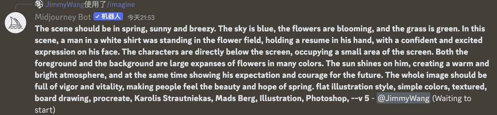

然后过一阵你会看到一张模糊的图，然后段落最后显示 0% 意味着程序正在生成图片：

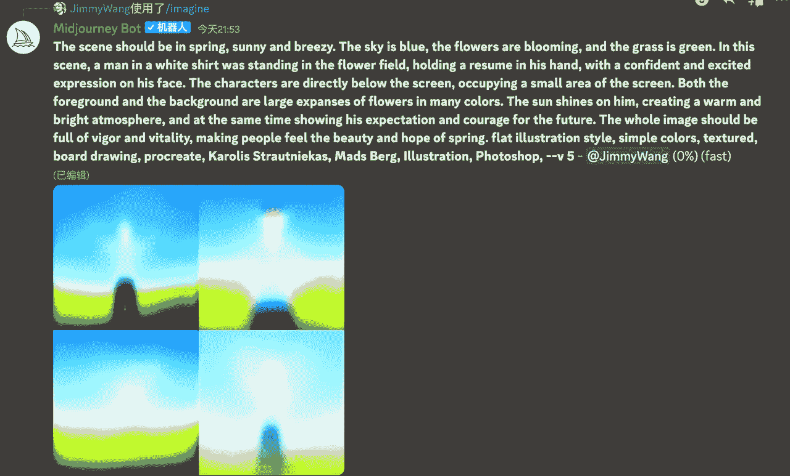

当你看到图片下方有几个 U1、V1 的按钮，这就意味着图片生成完成了 🎉

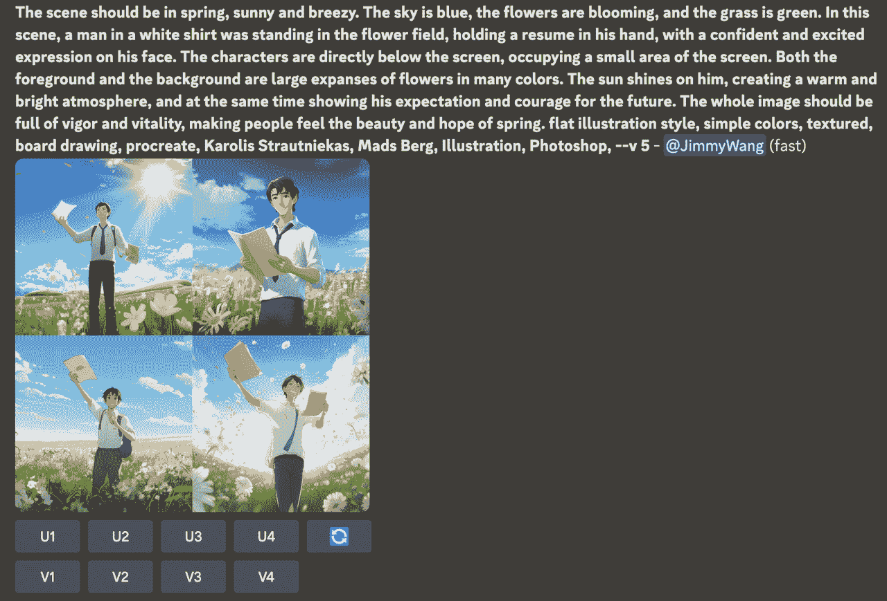

### Upscale

生成的四格图，单格图片的分辨率是 512 512（如果你是 V5 版本，则是 1024 1024），如果你想要生成一个更清晰的图片，则可以点击四宫格图片下的 U 按钮，U1 代表左上角第一张图，U2 是右上角，U3 是左下角，U4 是右下角。点击后，你需要等待一会，就会生成高清图。需要注意，V5 版本，U 按钮已经不会影响分辨率了，只是做为一个裁切图片的功能。换句话说就是将第一次生成的四格图，裁成一张。

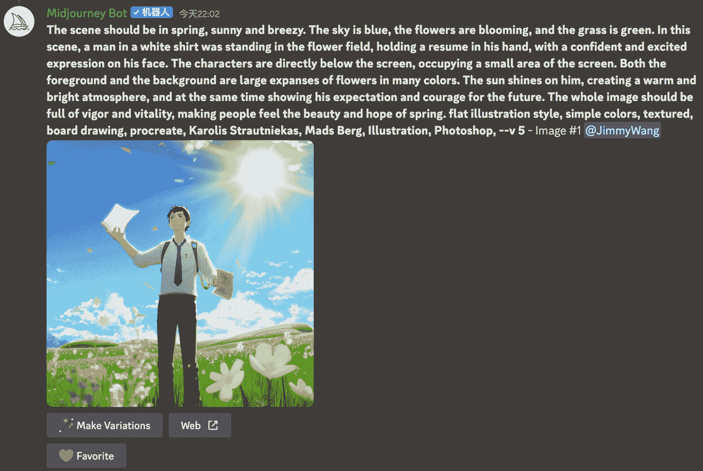

### Variation

说完 U 按钮，说下，V 按钮，这个按钮代表 variation ，点击该按钮后，程序会用你选择的那张图片，再生成新的 4 张图，不过这 4 张图的整体会跟你选择的那张图比较像：

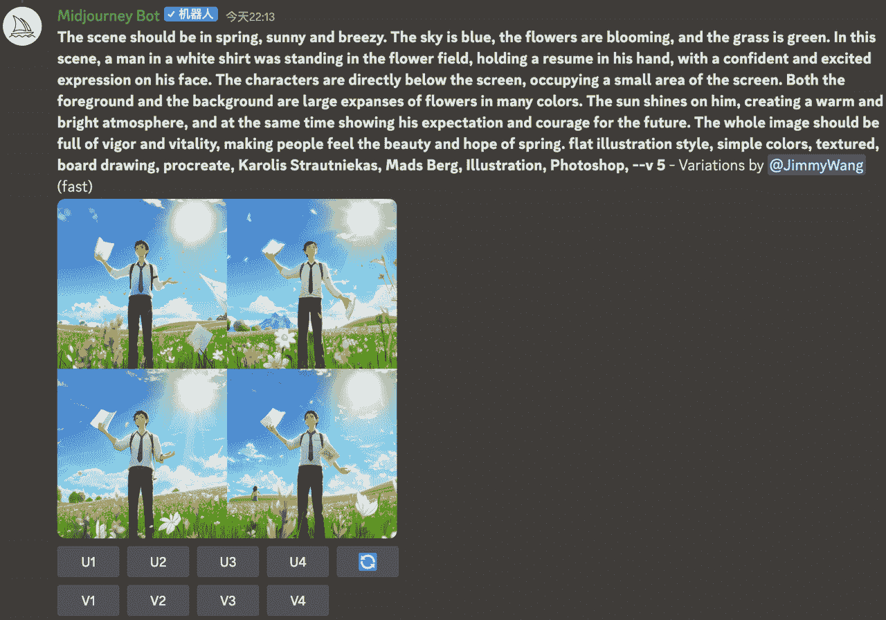

### 🔄

最后一个按钮 🔄 则是 re-roll 重新生成，点击后程序会按照你的 prompt 重新生成 4 张图片。

## 通过 Midjourney Bot 使用

因为在公共频道上使用，你发的图片会被频道里的人看到，所以如果你不想让自己的图被大量的人看到，可以使用 Midjourney Bot 的方式。

但需要注意，这种方式并不代表「仅有你可见」，你发的图片仍然会在 Midjourney 的会员 Gallery 上显示，目前仅有 Midjourney 的付费 Pro 会员能设置为隐私模式。

使用 Midjourney Bot 也很简单，跟在 Discord 的单聊比较类似，你只需要在 Midjourney 的 newbies-XXX 频道里找到 Midjourney Bot，然后点击它的头像，在弹出的菜单的下方有个「私信 @Midjourney Bot」的输入框，在这个输入框里，随便输入点内容，然后按回车发送。

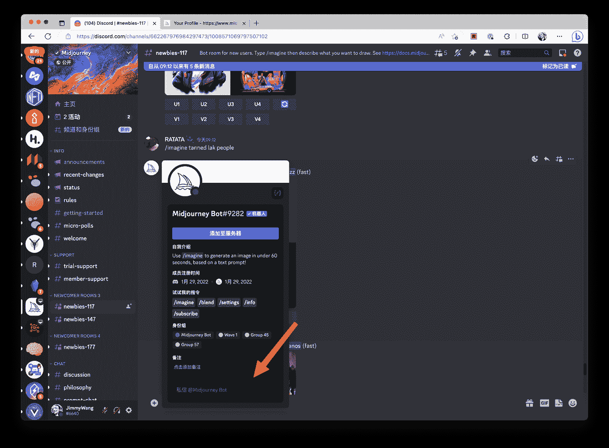

然后你就会在你的私信列表里看到这个 Midjourney Bot，使用方法就跟上面介绍的方法一样，无任何差别。

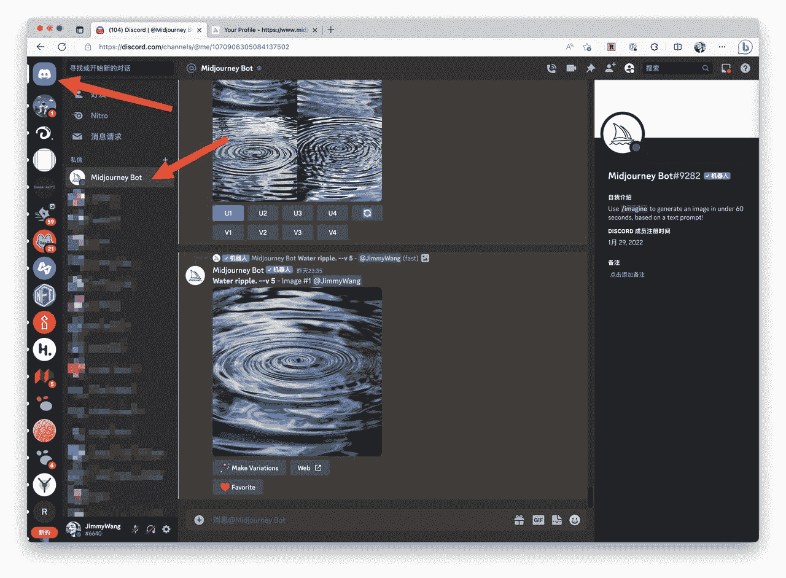

## 保存 & 删除图片

保存图片跟使用很多聊天工具一样，点击图片会看到放到的图片，然后右键点击图片可以选择「图像另存为」并保存图片（如果你用的是 Discord 的客户端，右键样式可能与我不一样，但操作基本是一样的）：

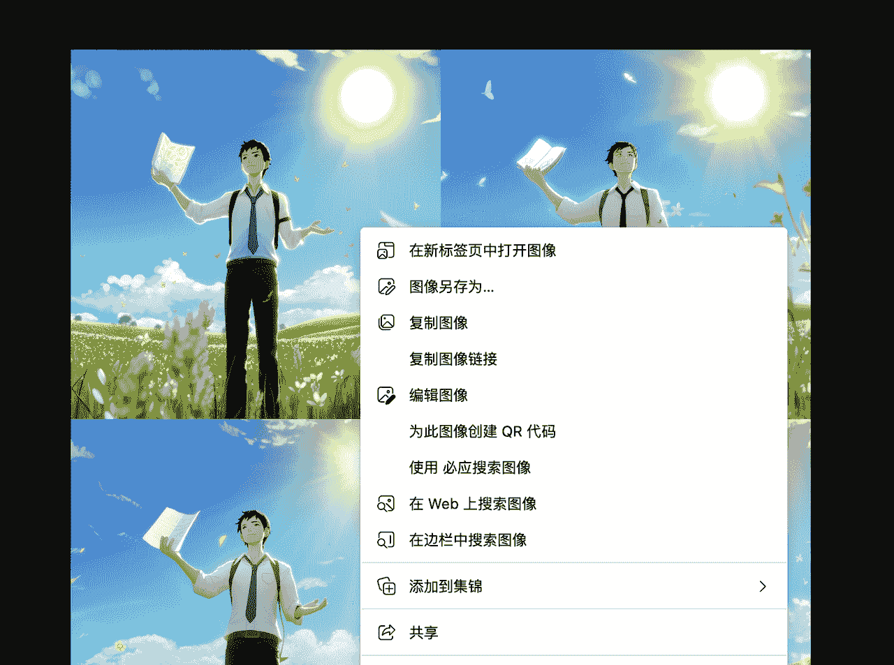

如果生成的图片你不喜欢，其实你可以不用管它 😂

如果你一定要删，也有一个删除的渠道，但操作跟你日常使用的聊天工具的方式不太一样，在你想要删除的图片消息右上角有个 emoji 按钮（下图标注为 1 的按钮），点击后会 出现一个 emoji 菜单，然后在 emoji 菜单里输入 x （下图标注为 2 的输入框），最后点击 ❌ emoji 即可删除该图片。注意这个删除并不仅仅只是删除聊天信息里的图片，还会将图片从 Midjourney 的会员 Gallery 里删除。

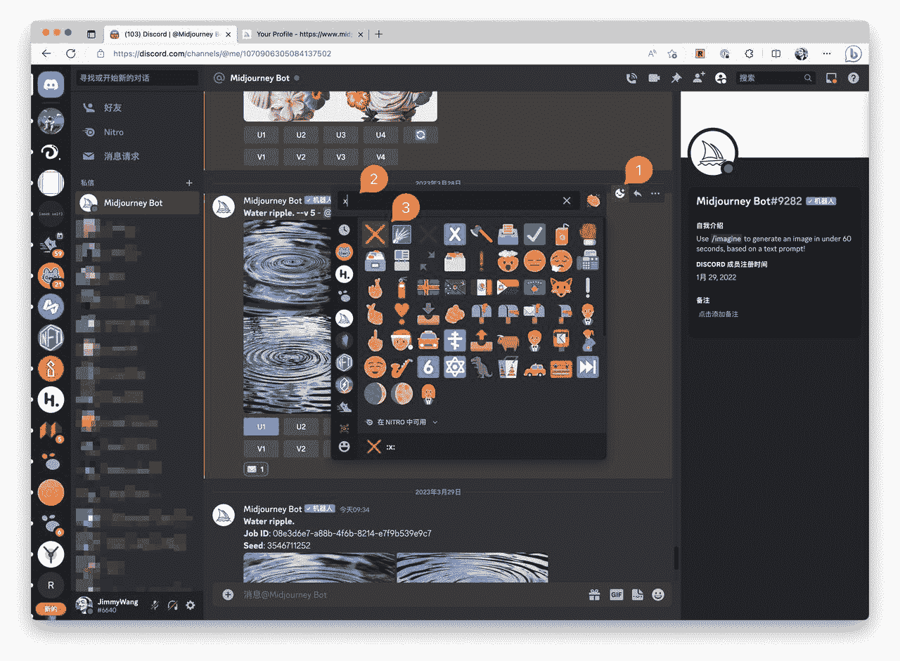