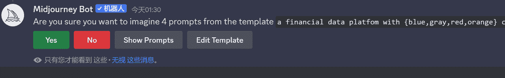
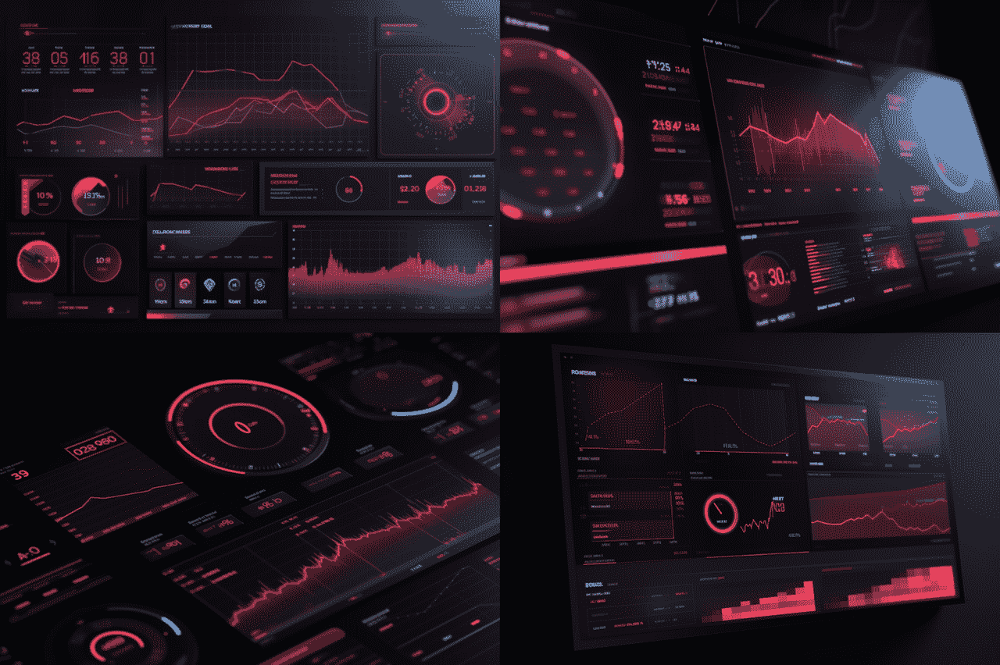

# Prompt中巧用{ }，让Midjourney批量生成多组图片

> 来源：[https://docs.feishu.cn/docx/KfpNdHf7YorVnrxpI7ycbom0nhc](https://docs.feishu.cn/docx/KfpNdHf7YorVnrxpI7ycbom0nhc)

如果你想生成几组图片，其中的Prompt的主体都类似，只有一个性质关键字是不同的，那么我们可以在Prompt中利用{ }将几个关键字都放进来，系统会自动对{ }中的关键字排列组合，同时生成不同关键字的图片。

以生成不同颜色的UI页面效果为例，基本Prompt是：

a financial data platfom with blue color, ui,ux,8k --ar 3:2 --v 5

这个Prompt是颜色关键字是蓝色，如果我们还想生成灰色、红色、橙色等几个不同的颜色，分别看看哪个效果最合适，我们不需要写四个prompt，只需要用一个Prompt将这几个颜色用{ }括起来，颜色之间用逗号分隔（见下面绿色字体）：

a financial data platfom with {blue,gray,red,orange} color, ui,ux,8k --ar 3:2 --v 5

因为{ }有4个关键字，实际上这一个Prompt会生成4组照片，也就是会消耗平时的4倍GPU额度，所以系统会提示你是否确定要生成4组：

点击“Yes”，你就会看到4组图片在同时生成中。

仔细观察每一组的Prompt，你会发现每一组Prompt的颜色都是不同的：

**a fin**ancial data platfom with blue color, ui,ux,8k --ar 3:2 --v 5

**a fin**ancial data platfom with gray color, ui,ux,8k --ar 3:2 --v 5

**a fi**nancial data platfom with red color, ui,ux,8k --ar 3:2 --v 5

**a finan**cial data platfom with orange color, ui,ux,8k --ar 3:2 --v 5

**这**就是{ }的特点，系统会自动将大括号中的关键字分解组合，实际上相当于分别写多个不同关键字的Prompt。

这样写一个Prompt，我们就得到了4种不同颜色的效果：

是不是非常快捷呢？

当你有类似的需求场景时，可以尝试在Prompt中用 { }来提升效率~