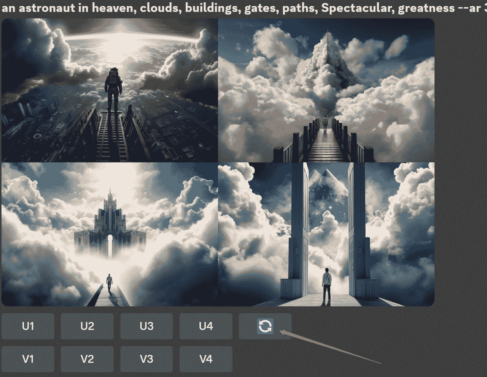
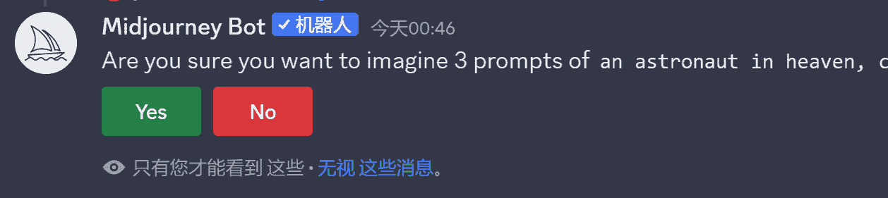
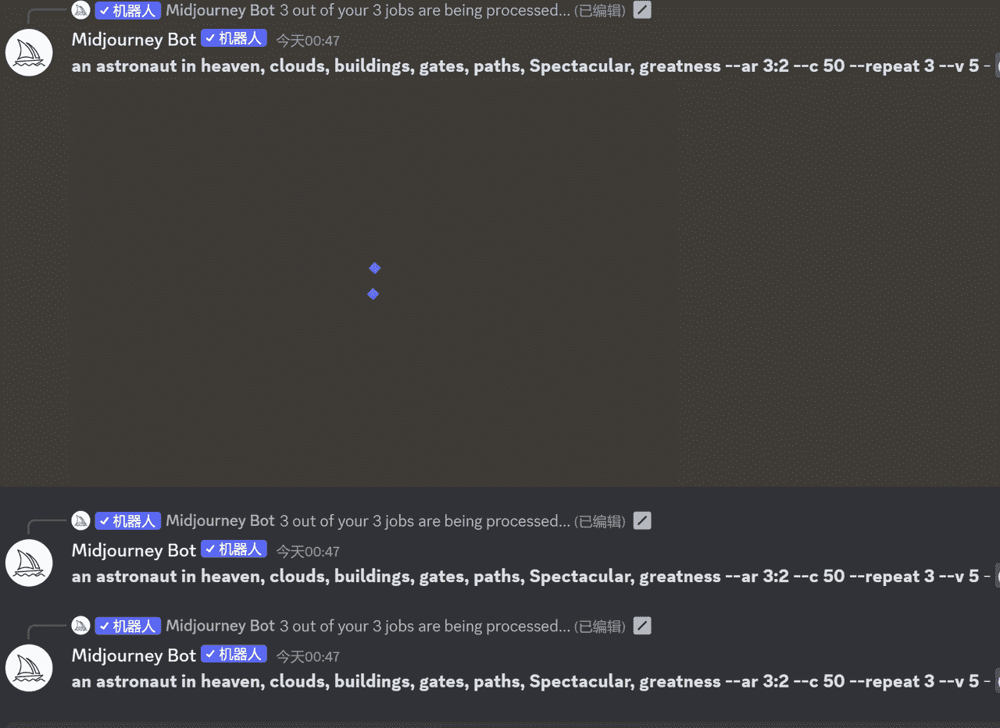
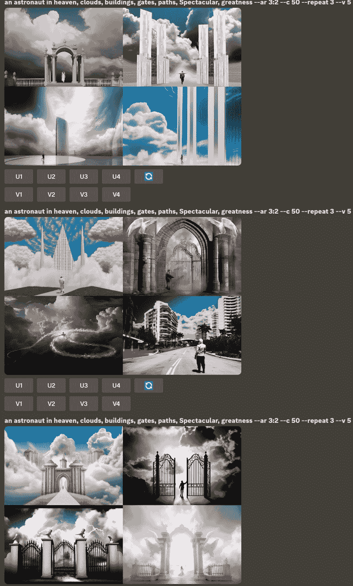

# 利用repeat参数，Midjourney批量生成多组图片

> 来源：[https://docs.feishu.cn/docx/AgxXdokHroeqQVxOK2LcQAtUnwf](https://docs.feishu.cn/docx/AgxXdokHroeqQVxOK2LcQAtUnwf)

使用Midjourney绘画时，输入Prompt，很难一次四宫格就得到满意的图片，大概率是需要尝试多次可能才能挑到一张满意的，如果我们要利用同一个prompt生成多个四宫格图片，你会想到怎么做呢？

大多数人很可能是复制Prompt，然后多次利用/imagine指令来实现，这种方法操作步骤太多了，首先应该排除掉。

其实还可以生成一次四宫格后，直接点击UV按钮旁边的刷新按钮：

点击一次，就会生成一组四宫格，这种方法相对前一种就方便多了。

不过这里介绍一种更快速的批量生成方法，那就是利用repeat参数。

这个参数的用法是在文本提示语后面加上参数：

--repeat n

你想生成几组四宫格图片，n就改为几。

比如你想生成三组，以下面这合格prompt为例，可以在/imagine命名中输入：

an** astronaut **in heaven, clouds, buildings, gates, paths, Spectacular, greatness --ar 3:2 --c 50 --repeat 3 --v 5

因为使用repeat后，会一次生成多组，也意味着一次会消耗更多的GPU额度，所以系统会提示你是否继续：

点击“yes”，然后就会看到多组四宫格几乎同时在生成图片：

利用这个方法，连点击刷新按钮的步骤都省了。

使用repeat参数时，你也可以同时搭配 c参数、s参数使用，这样就可以同时得到很多创意和风格迥异的图片，更容易获得意外的惊喜。

不过最好是先确定好基本Prompt，如果它与你想要的效果出入比较大，repeat生成的图片可能都不是你想要的，这样会白白浪费更多的GPU额度。