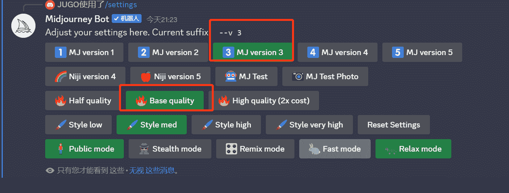
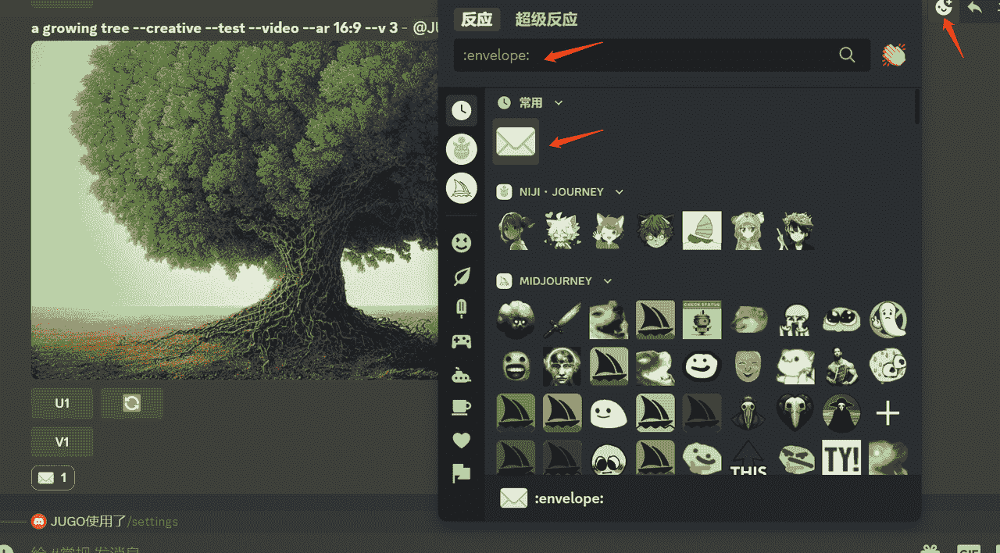
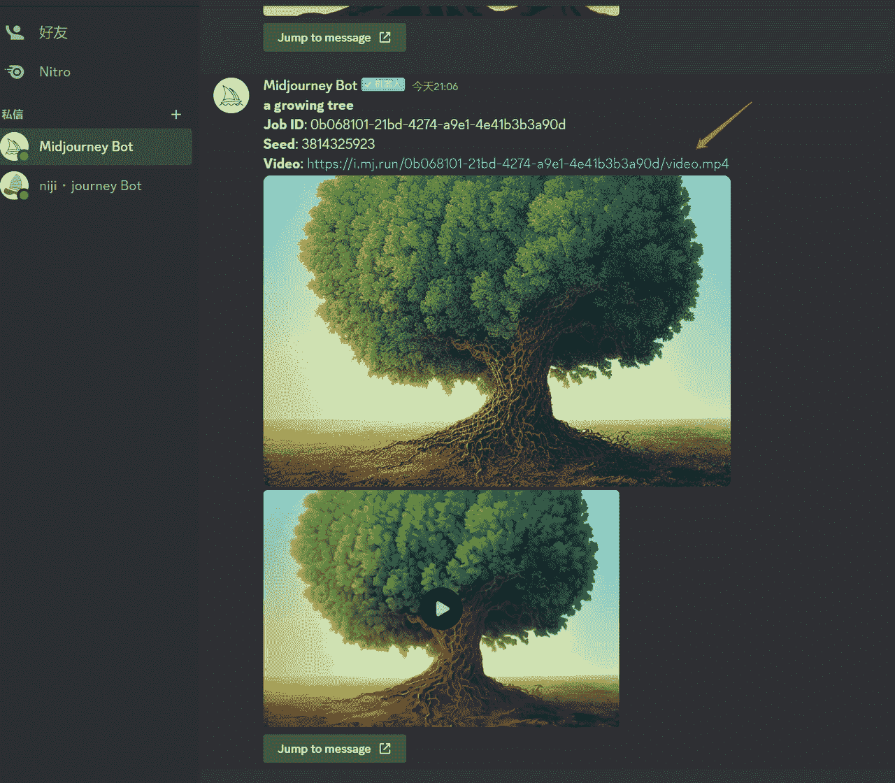

# 关于midjouney制作15秒视频的方法

> 来源：[https://docs.feishu.cn/docx/FVpodL7maoRJaXx8rKcc5jfJnvU](https://docs.feishu.cn/docx/FVpodL7maoRJaXx8rKcc5jfJnvU)

先看下，midjouney配置

可以开fast模式

然后布置咒语

a growing tree --creative --test --video --ar 16:9 --v 3

有这么几个问题，第一，这个顺序最好不要更改，我尝试过，出的图很烂 其次，这个prompt，没有用到英文“,”，如果有英文“,”会报错，为啥报错，我没理解

最后，prompt的主体，一定要是一个过程，成长着的树，成长中的女孩

好，这会应该好了

点击反应，找不到信封的，就输入envelope：

然后点击发送

https://i.mj.run/0b068101-21bd-4274-a9e1-4e41b3b3a90d/video.mp4

参考链接在这，感兴趣的可以看看