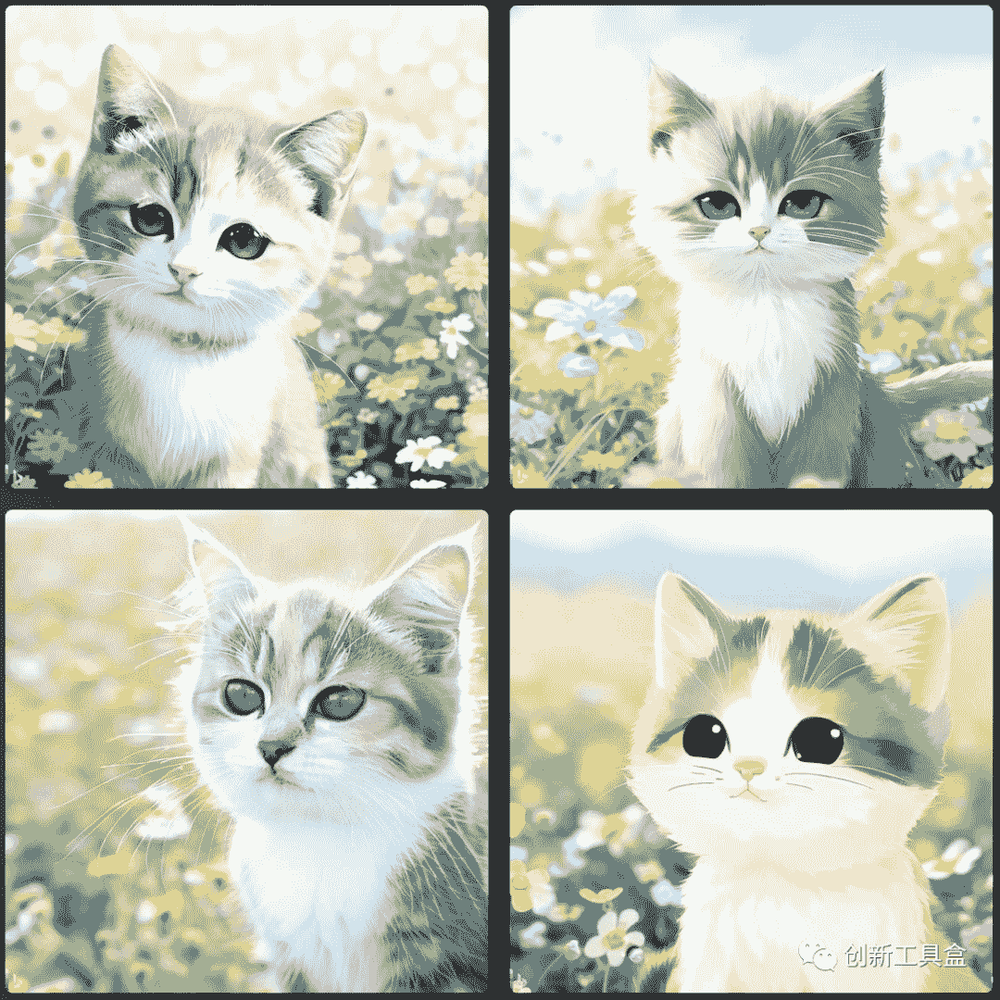
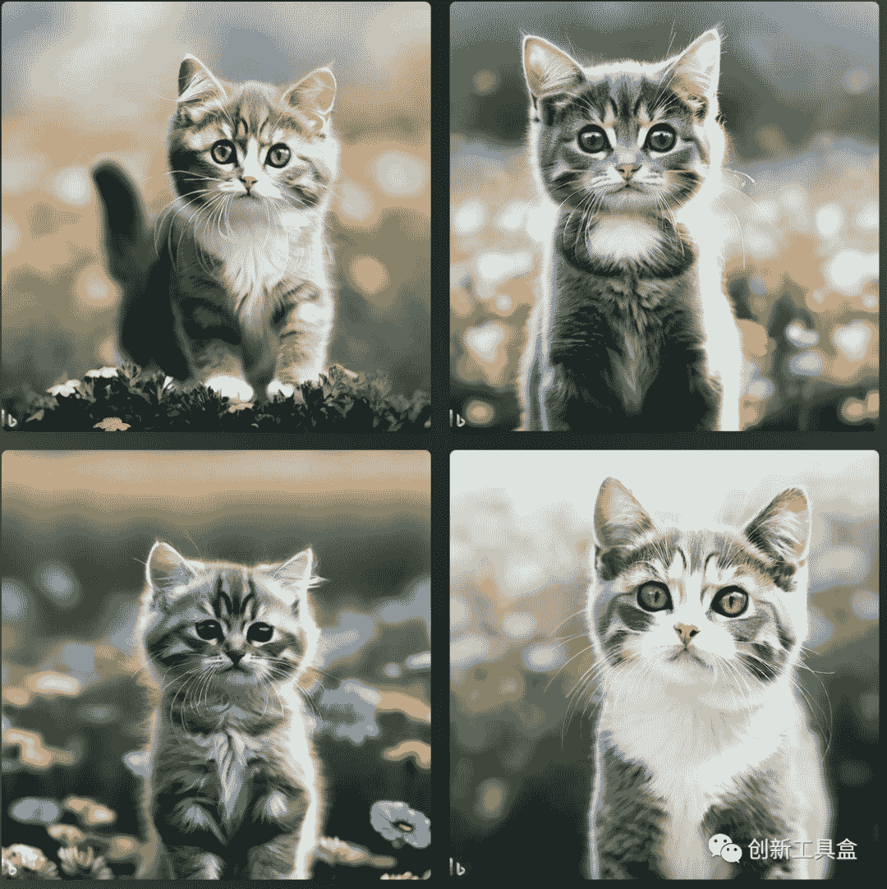
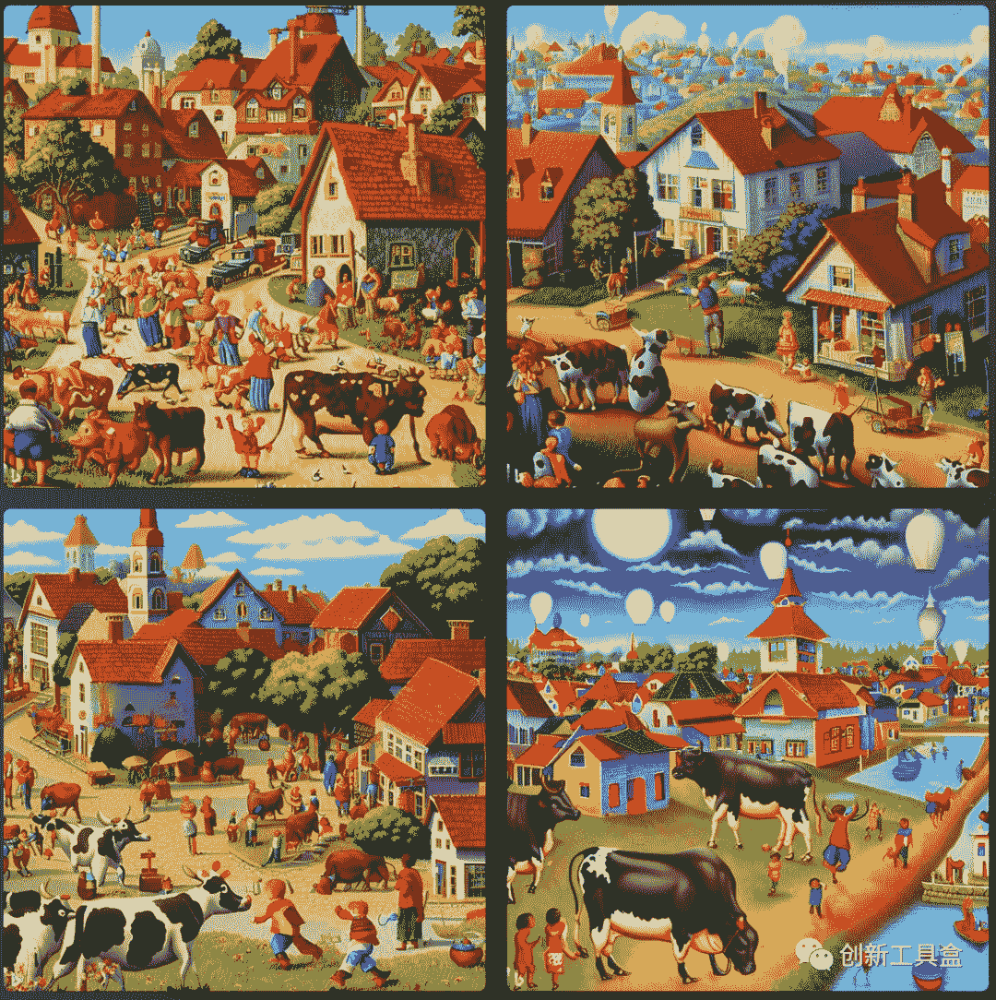
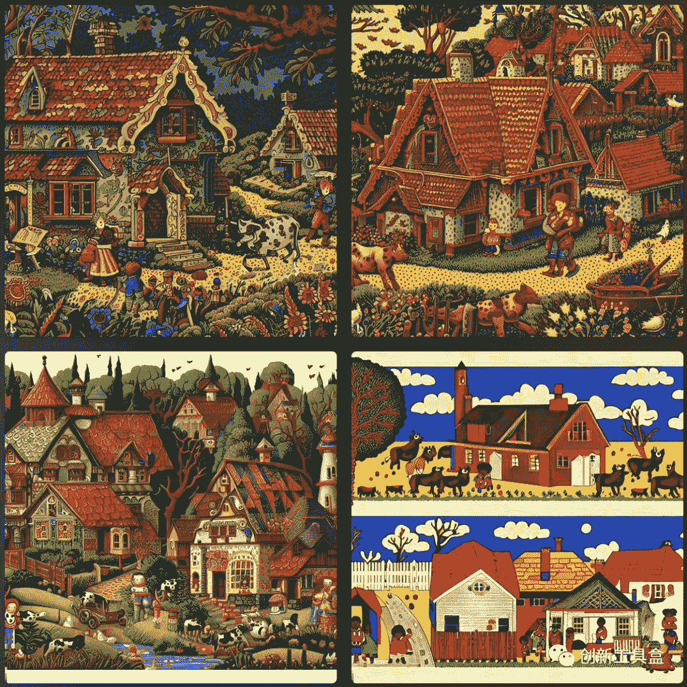
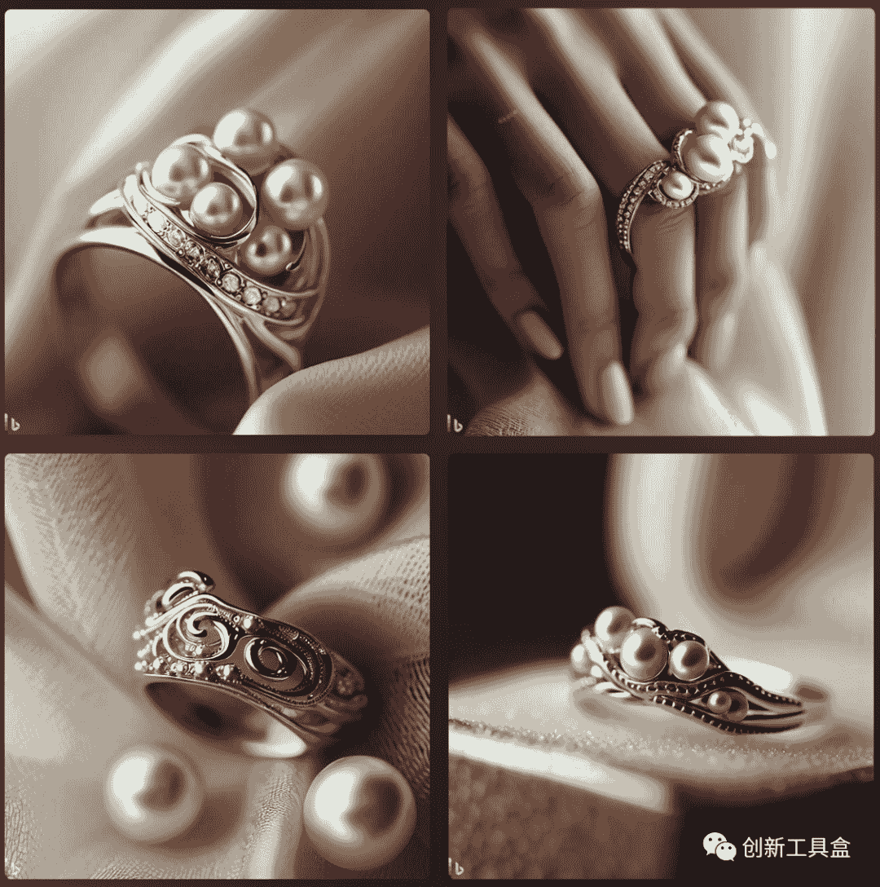
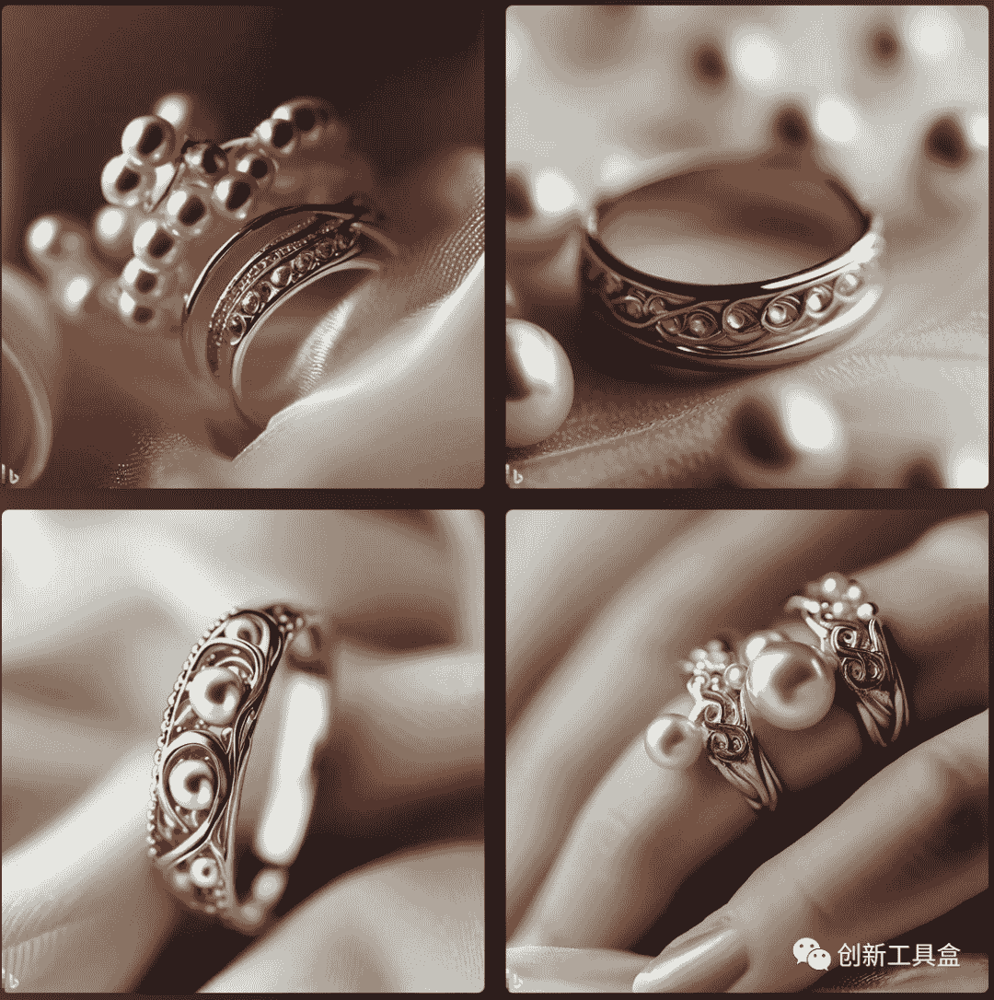
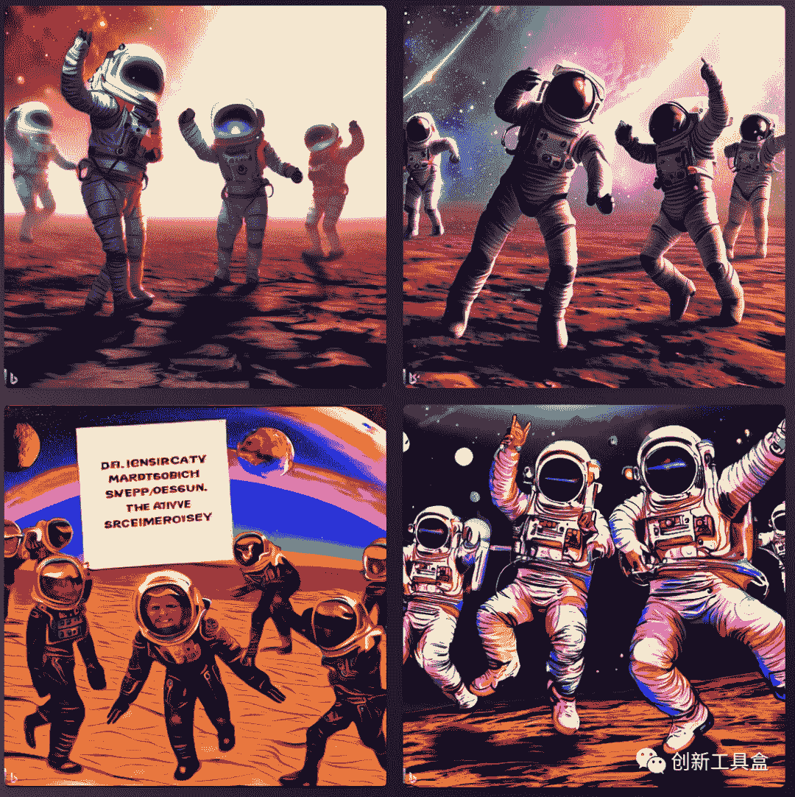

# AI作图新尝试，Bing Image Creator，支持中文输入，完全免费！

> 来源：[https://docs.feishu.cn/docx/QHx6dsq8moRvS3xuat4cNG6YnBc](https://docs.feishu.cn/docx/QHx6dsq8moRvS3xuat4cNG6YnBc)

> 🔗 原文链接： h[ttps://mp.weixin.q](https://mp.weixin.qq.com/s?__biz=Mzg4MTk3MTI4OA==&mid=2247483698&idx=1&sn=49e4741d48346cc10f961dfdd4340bd7&chksm=cf5c9805f82b11135c0e5c65b1482942b6410de3b169064be8cafa99d15e6f9b242ef92a197d#rd)q.com/s?__biz=Mz...

[Midjourney ](http://mp.weixin.qq.com/s?__biz=Mzg4MTk3MTI4OA==&mid=2247483677&idx=1&sn=94890e0524508b422592764a810486ba&chksm=cf5c982af82b113c0464cae996567177b05d6b7f19b8060a1ed04c40eef669d32818502559dd&scene=21#wechat_redirect)作图如火如荼，微软也不甘示弱，迅速推出Bing Image Creator。

必应图像创建者(Bing Image Creator)，这个工具基于 OpenAI 的 DALL-E 图片生成技术，用户可以输入提示词来生成对应的图片，目前已全面支持中文输入。

下面我们来试试效果：

-可爱的小猫(英)

a cute cat, flower field background

-可爱的小猫 (中）

一只可爱的猫，站在花田的背景下

-乡村(英）

painting of a town with cows, a house and children, in the style of folk-inspired illustrations, hyper-detailed, paul corfield, richard scarry, detailed crowd scenes, i can't believe how beautiful this is, ultrafine detail

-乡村(中）

一栋房子、几头奶牛和几个孩子，以民间启发的插图风格绘制出了一个城镇的画作，细节丰富，画风极尽细腻，类似于Paul Corfield和Richard Scarry的插画作品，场景人物描写细致入微，让人难以相信其美丽程度如此之高。

-珍珠戒指(英)

wedding ring design with pearls

-珍珠戒指(中)

带有珍珠的婚戒设计

-点击“让我惊喜吧”

an astronaut dance party on the surface of mars, digital illustration

如何使用Bing Image Creator

超级简单，只需要一个微软账号

1.  在浏览器里访问网站 https://www.bing.com/images/create

1.  点击 “ **加入与创造 **”按钮，登录微软账号

1.  输入prompt，或者点击“ **给我惊喜吧 **”

1.  输入完成后，点击“ **创建 **”按钮

Midjourney和Bing Image Creator对比

- Midjourney生成的画面更精致，选项更多，可控性更好。大部分时候需要付费才能作图，偶尔才会放开免费使用次数。

- Bing Image Creator生成图片更方便，不需要upscale，一次性就生成大图； 不需要翻译成英文，原生支持中文输入 ；完全免费。