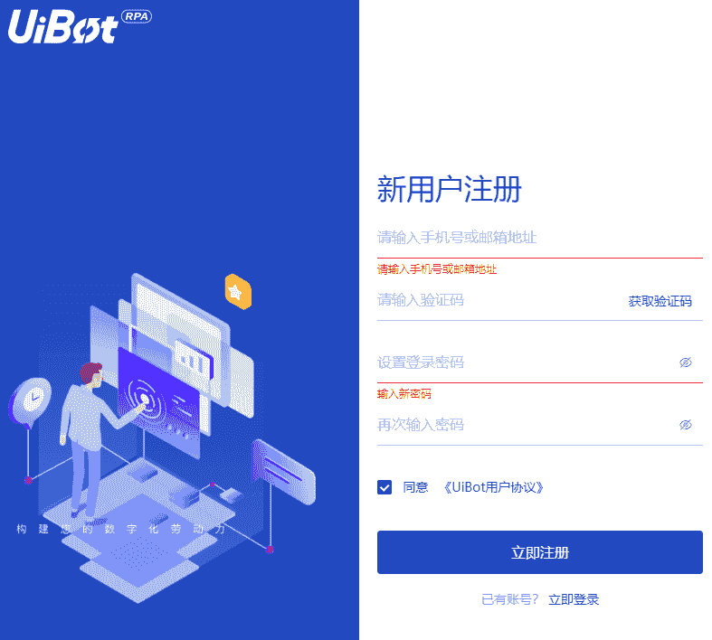
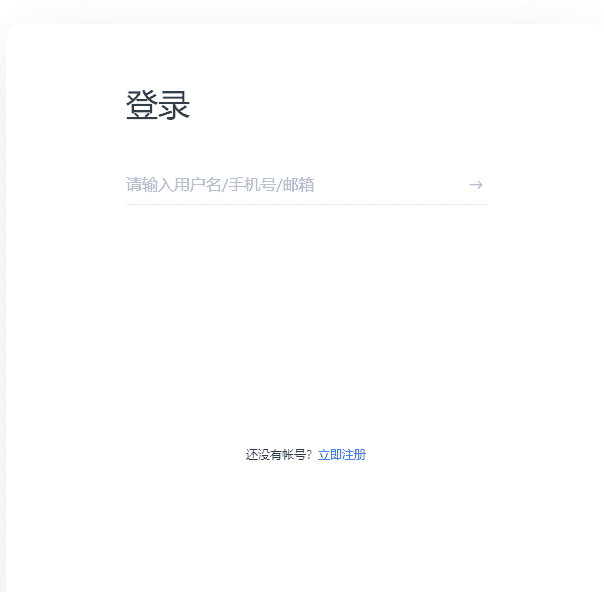
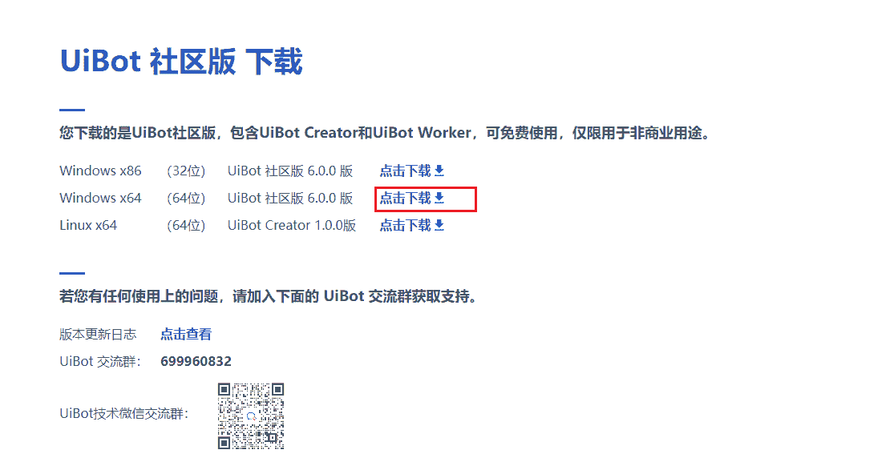
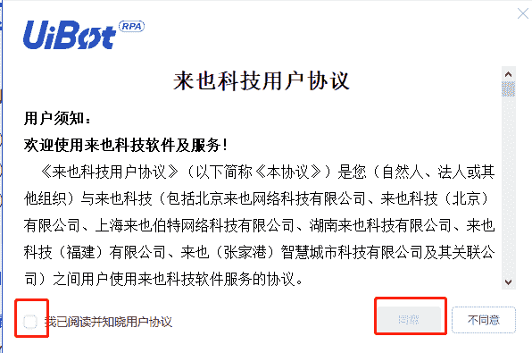
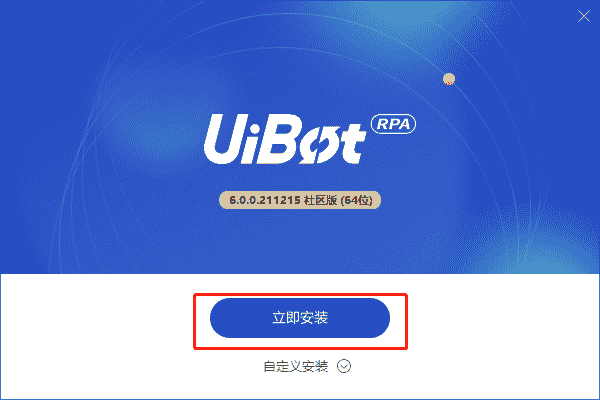
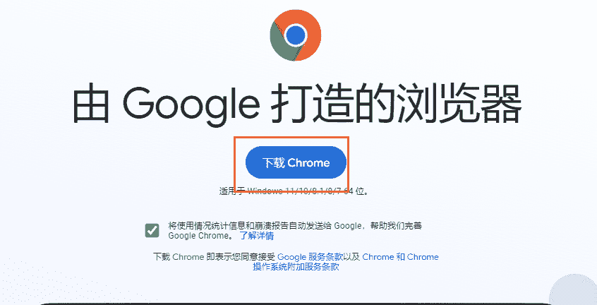
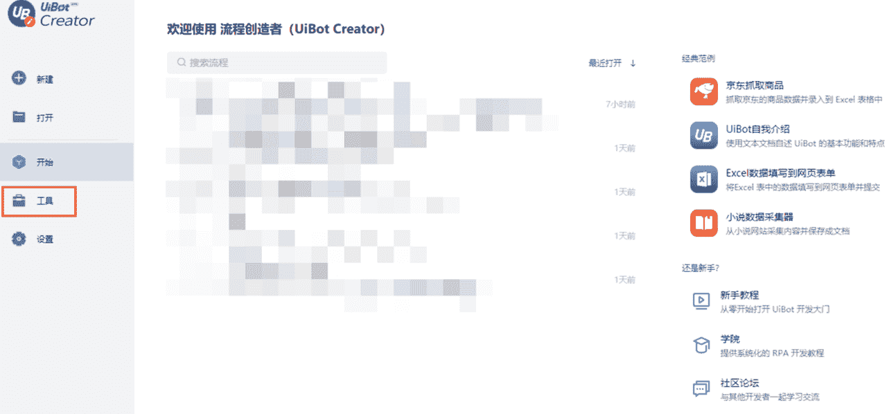
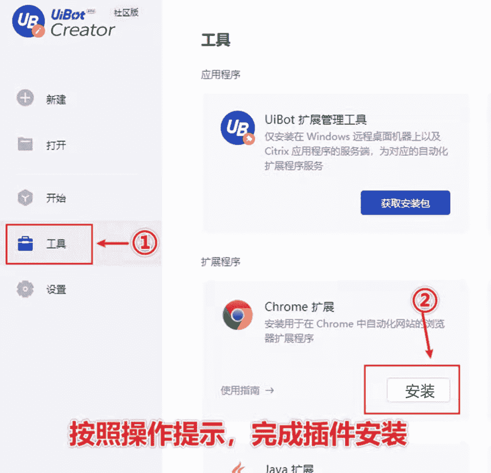
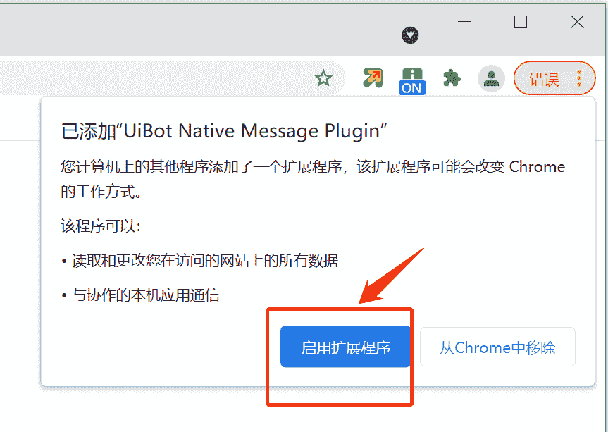

# RPA必备软件安装

> 来源：[https://docs.feishu.cn/docx/BLGBd07jaoA5CMxXDM8chTqfnUc](https://docs.feishu.cn/docx/BLGBd07jaoA5CMxXDM8chTqfnUc)

### 一、UiBot 注册下载

1.  注册地址：[https://account.uibot.c](https://account.uibot.com.cn/view/register/)om.cn/view/register/

1.  注册后完成登录：[ ](https://login.laiye.com/identity/view/#/login?ReturnUrl=%2Fconnect%2Fauthorize%2Fcallback%3Fclient_id%3Duibot.website%26redirect_uri%3Dhttps%253A%252F%252Fwww.uibot.com.cn%252Fsignin-oidc%26response_type%3Did_token%26scope%3Dopenid%2520profile%26response_mode%3Dform_post%26nonce%3D637927851880508760.YjM2YjYyYWUtZDNmMS00MTQzLWEyNjUtZWU1NTlkOGFkNjMxYTRkOGNkYWEtOWRmZi00N2I1LTliZjEtNjhmZGI5NzE0Mzhj%26source%3Dportal-creator%26state%3DCfDJ8FesD6kscMhKgWmhmqmQeSGIXHXZrieXesiYu_YR8jH2mtj9BqETjGAZXa-4v66O3fX6qdjo_-0SP_YM00qgkJw03SJGmwIBzorVr-QdCc89Ob45am1XkUdyX9KSWv_8lMmL2_k7kQV4zWJLH5i5oOAWFRlX-e4BhrKMOGruvtof3r7rJ-c7pf3o8IQmCd8NC4SO3quFRdFhOJxaXMIHDBJywuq0MIlbsJ3wT2izAUnEI_r3tDuxzm9ckACEWAAjp_kL6GhDf1bjTADsZymsK19YaE5Ru1m_eYT4UI5MNWrHE-atB8bYXTLxuMRQhHK44Q%26x-client-SKU%3DID_NETSTANDARD2_0%26x-client-ver%3D5.6.0.0)[laiye.com](https://login.laiye.com/identity/view/#/login?ReturnUrl=%2Fconnect%2Fauthorize%2Fcallback%3Fclient_id%3Duibot.website%26redirect_uri%3Dhttps%253A%252F%252Fwww.uibot.com.cn%252Fsignin-oidc%26response_type%3Did_token%26scope%3Dopenid%2520profile%26response_mode%3Dform_post%26nonce%3D637927851880508760.YjM2YjYyYWUtZDNmMS00MTQzLWEyNjUtZWU1NTlkOGFkNjMxYTRkOGNkYWEtOWRmZi00N2I1LTliZjEtNjhmZGI5NzE0Mzhj%26source%3Dportal-creator%26state%3DCfDJ8FesD6kscMhKgWmhmqmQeSGIXHXZrieXesiYu_YR8jH2mtj9BqETjGAZXa-4v66O3fX6qdjo_-0SP_YM00qgkJw03SJGmwIBzorVr-QdCc89Ob45am1XkUdyX9KSWv_8lMmL2_k7kQV4zWJLH5i5oOAWFRlX-e4BhrKMOGruvtof3r7rJ-c7pf3o8IQmCd8NC4SO3quFRdFhOJxaXMIHDBJywuq0MIlbsJ3wT2izAUnEI_r3tDuxzm9ckACEWAAjp_kL6GhDf1bjTADsZymsK19YaE5Ru1m_eYT4UI5MNWrHE-atB8bYXTLxuMRQhHK44Q%26x-client-SKU%3DID_NETSTANDARD2_0%26x-client-ver%3D5.6.0.0)

1.  根据自己的电脑版本进行对应版本下载安装UiBot 下载地址：https://www.uibot.com.cn/download

### 二、下载Chrome浏览器并且安装专属的Uibot插件

1.  Chrome下载地址：Google Chrome 网络浏览器

1.  安装UiBot的Chrome浏览器插件 https://www.google.com/intl/zh-CN/chrome/

第一步、双击打开以下图标，登陆后进入uibot界面后点击工具

第二步、点击工具--点击Chrome拓展安装（此时请关闭chrome浏览器）

第三步、打开Chrome浏览器-点击启用扩展程序（可能需要等待几分钟才会出现插件）

我是李又懂，欢迎和我交流~4314991