# Claude注册教程

> 来源：[https://docs.feishu.cn/docx/M0XedoKOhovPsSxugytcD1Aonwc](https://docs.feishu.cn/docx/M0XedoKOhovPsSxugytcD1Aonwc)

> 提示：Claude使用不需要科学上网，但是注册账号过程中可能出现403报错

> 可以通过科学上网更换节点的方式解决，建议注册过程中保持科学上网环境注册

> 目前Claude已经集成在slack中，我们可以注册slack去添加claude免费不限次数使用。

> Claude使用的是Constitutional Al模型；ChatGPT使用的是GPT模型。

> 两个模型的区别和对应使用场景的：

> 1.训练方法不同：Constitutional Al使用模型自我监督和反馈来学习约束本身的行为。GPT模型仅使用大量文本数据来训练语言模型。

> 2.目的不同：Constitutional Al专注于训练出安全可靠的AI系统。GPT模型主要用于生成文本。

> 3.得到的模型不同：Constitutional AI 可以产出像我这样的Al助手，理解自然语言但会遵守安全限制。GPT模型主要用于文本生成，较难把握其回答的安全性和可靠性。

> 4.回答方式不同：我会考虑每条回答是否符合我的约束规则。GPT模型会根据训练数据给出最可能的回答，较难判断回答质量。

> 5，适用领域不同：Constitutional Al更适用于需要考虑AI安全的应用，如虚拟助手、舆论监测等。GPT模型主要用于生成新闻文章、小说、代码等。

### 注册claude具体流程

#### 第一步 需要先安装Slack

1.1 打开Slack官网进行注册

官网地址：https://slack.com/get-started#/createnew

1.2 使用谷歌账号直接登录：建议不要使用国内邮箱，可能注册会不成功

1.3 创建一个工作区

1.4 工作区命名，并点击下一步

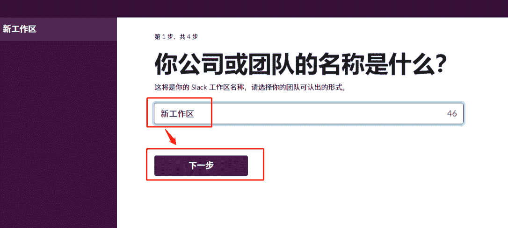

1.5 设置姓名，然后下一步

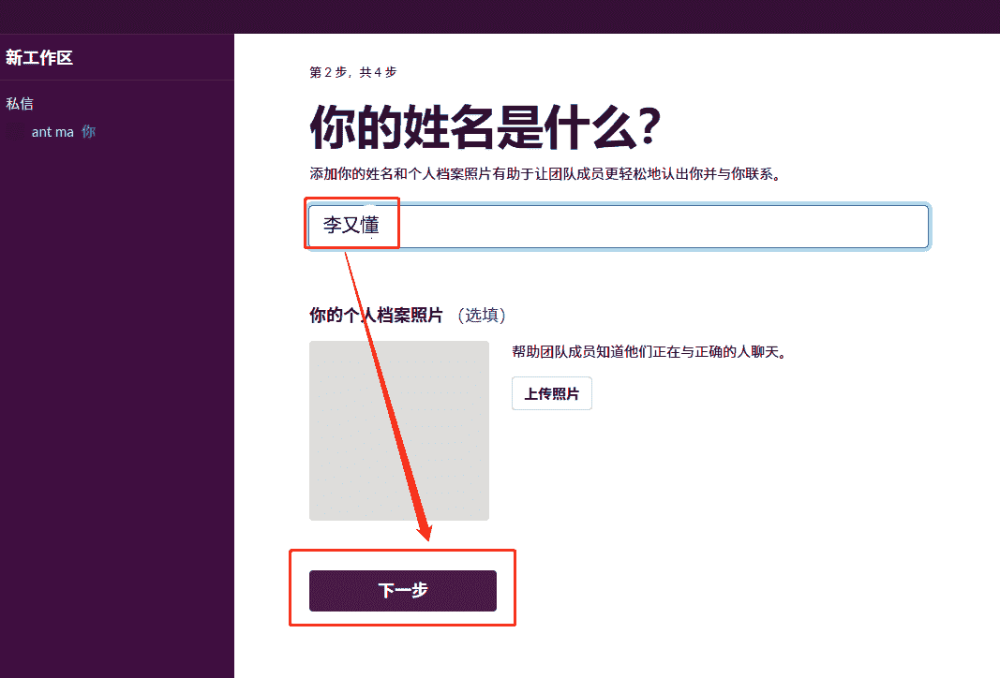

1.6添加团队成员，可以直接点跳过这一步

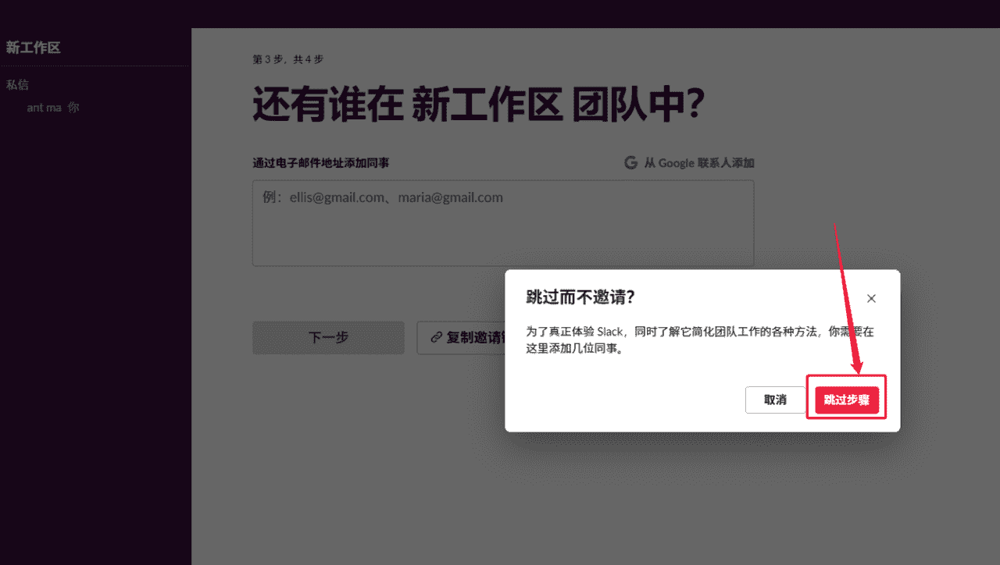

1.7团队活动内容，可以随便填，然后下一步

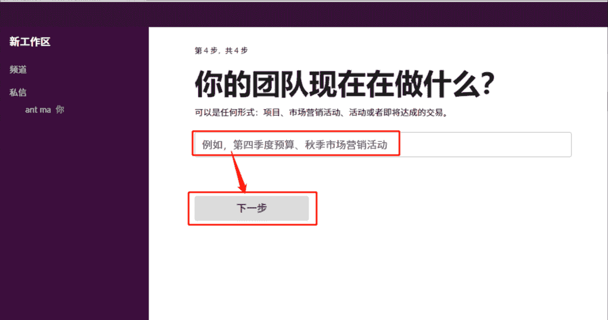

1.8 完成slack的安装

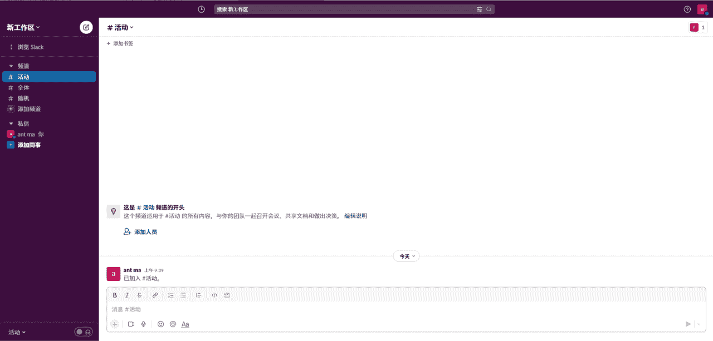

#### 第二步 接入Claude

打开这个网址https://www.anthropic.com/claude-in-slack 点击Add to Slack

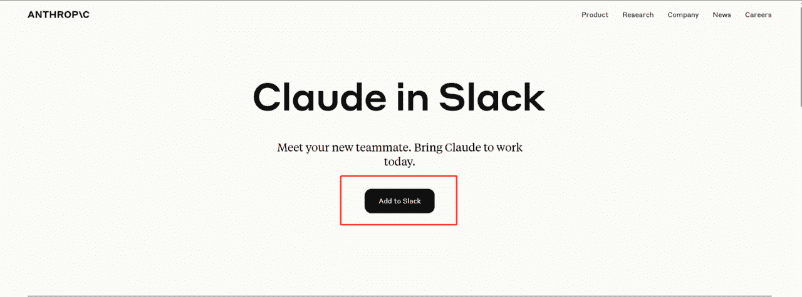

点击允许

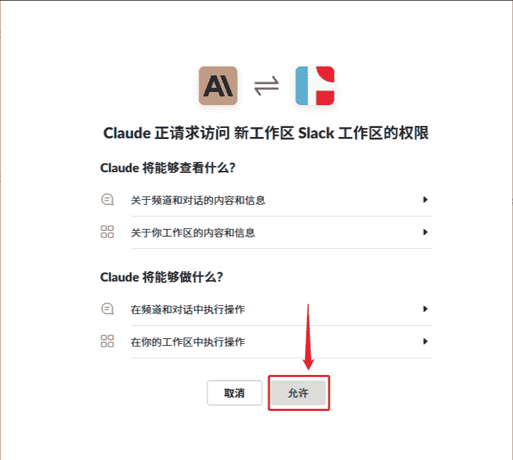

完成接入

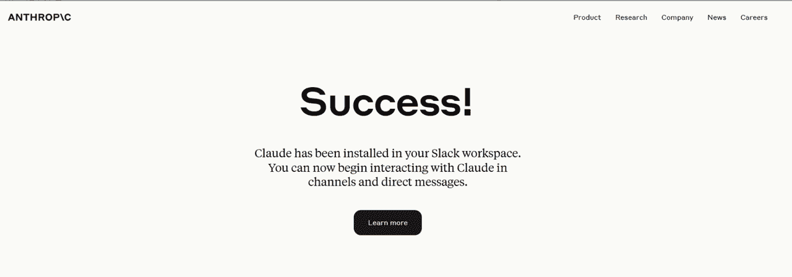

#### 第三步 在返回第一步完成安装的界面

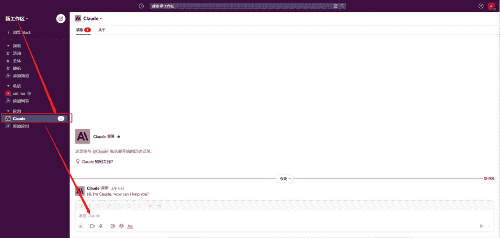

> 如果第一步的工作空间不小心关掉了，可以通过这个网址找到刚才创建的空间https://app.slack.com/

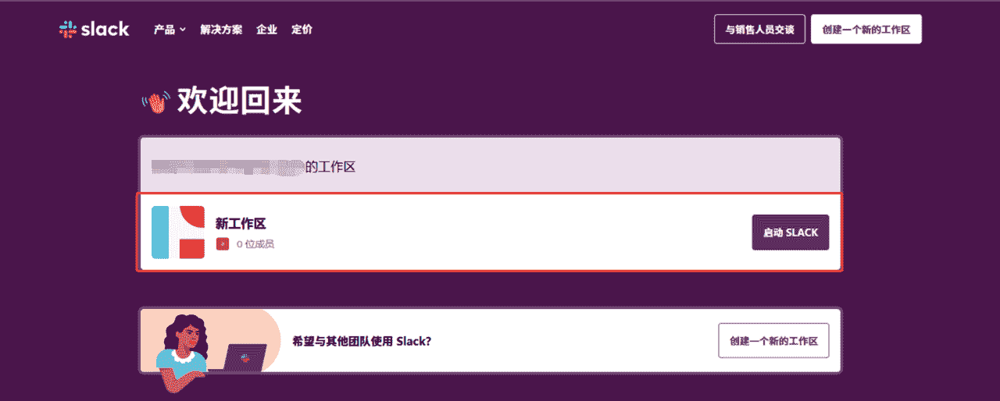

点击在浏览器中使用Slack，即可进入

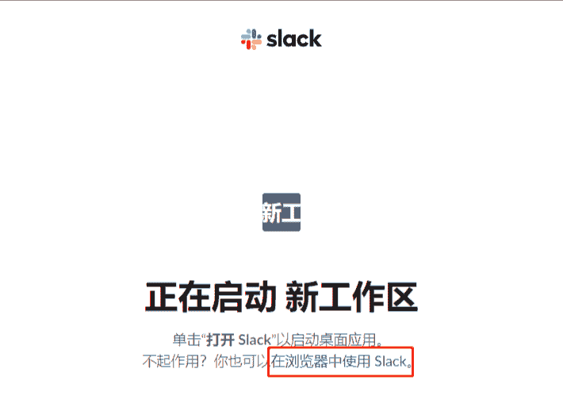

### 常见报错

#### 403 Forbidden报错

解决思路

1、使用外企环境上网注册，更换节点或开全局模式尝试（科学上网方法本文不提供）

2、更换浏览器尝试

3、通过这个链接进入添加Claude：https://slack.com/apps/A04KGS7N9A8-claude?tab=more_info

4、更换谷歌账号，用新的账号注册

5、重启电脑，重试一遍