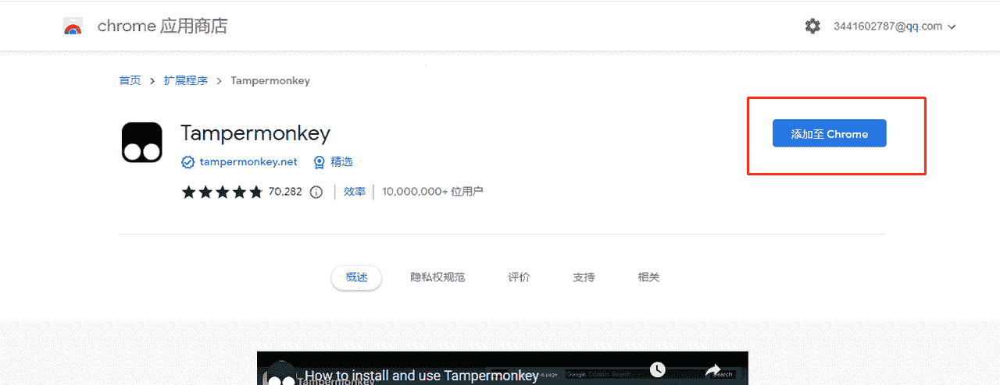
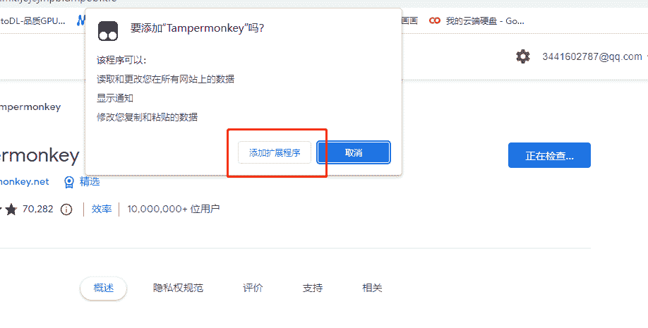
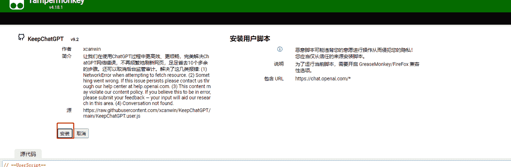
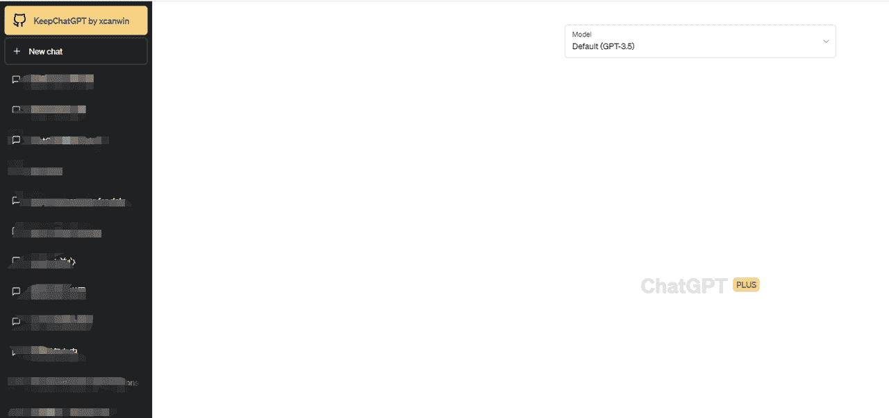

# chatGPT 掉线解决方案

> 来源：[https://docs.feishu.cn/docx/E5d9d6ssOowYJYxBTK6cFXq9nUh](https://docs.feishu.cn/docx/E5d9d6ssOowYJYxBTK6cFXq9nUh)

项目地址（可跳过）

https://github.com/xcanwin/KeepChatGPT

# 第一部，安装插件

电脑

谷歌浏览器地址：

https://chrome.google.com/webstore/detail/tampermonkey/dhdgffkkebhmkfjojejmpbldmpobfkfo

微软浏览器地址：https://microsoftedge.microsoft.com/addons/detail/tampermonkey/iikmkjmpaadaobahmlepeloendndfphd

### 第二步 安装第二个插件

https://raw.githubusercontent.com/xcanwin/KeepChatGPT/main/KeepChatGPT.user.js

### 第三步 打开chatGPT 如下图即成功

###