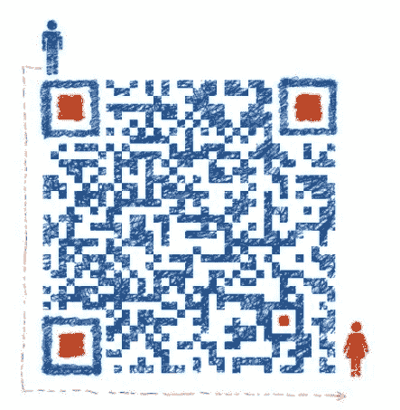

# 李又懂的百宝箱

# 李又懂的自我介绍

> 来源：[https://docs.feishu.cn/docx/OJQcd46M2oRZXRxVFLTcdNF9nNd](https://docs.feishu.cn/docx/OJQcd46M2oRZXRxVFLTcdNF9nNd)

> 大家好，我是科技狂魔李又懂，热爱搞技术。搞技术的过程顺便搞钱。我深知技术创新的重要性，也明白个体的力量有限。我想带领一个小团体一起搞钱！搞钱！搞钱 ！成为未来的超级团体！

> 目前的工作是大厂员工。头像是我的一个NFT，是web3科学家，非常具有科技感。

> 随着AIGC的出现。我坚信未来的公司必须以超级团体的形式出现，让我们一起迎接未来的到来！

# ⛳️  李又懂的简介

我是李又懂，这里是我的自我介绍

我是谁？

1、目前是在北漂，**互联网大厂**的一颗螺丝钉。每日钻研技术、副业、搞钱，项目。擅长从零到一的拆解互联网项目。

2、一人企业，没错，目前还是主业为主，其他的是工作之余，基于兴趣，热情，做这些事。爱好折腾，能折腾点名堂出来也不错。

3、**女生，女生，女生**，重点的话说三次，因为很多人一谈到副业、技术，就默认是男生。当然很多人一来就叫我“哥”，我也不会浪费时间反驳哈哈。因为性别也不是那么重要。

4、之前有一个ip，教小白从零基础搭建网站搞技术、搞钱，拆解一些互联网的小项目，带大家搞点小钱。后面ip的名字被人抢注了，考虑到本身名字也不好记，我就换了一个“李又懂”的名字，重新开始。

如果对我以前的课程感兴趣，可以看看我之前的公众号文章。

比如搭建一个美女图站、全网影视APP、知识付费网课系统的搭建，等等，现在有的还有些搞头。

5、有公众号、微信号、知乎、小红书、知识星球、个人网站（www.liyoudong.top），全网同名，想直接联系我就加vx 4314991。我还是想以教副业拆解为主，贩卖一些知识、一些技能，做1v1的会员，能让一部分人能在互联网搞点钱，至少也不会在互联网被割韭菜。暂无社群的想法。

**6、关于怎么赚钱这事，我涉猎****非常****广泛**，高大上的有区块**链、人工智能（敏感词）、A**I绘**画这块****，小技术的有搭建网站、小程**序、各种系统**，因**为有的朋友刚接触互联网，尤其不懂一些技术的想搞副业，先交钱买各种一件分销，一些提高效率的系统。我就直接教你怎么搭建，让你成为最顶层的搭建者。避免被割一刀。还有其他提升效率的工具教程，比如教教你RPA，自动机器人，帮你省时省力。还分享一些IP的玩法，公域流量的获取，私域流量的运营。我都会分享给我的会员。

努力让小白用户，感受到超价值的回报。

每天都有大量的人加我的微信，被一些朋友询问，怎么加入你的会员？

那么为了针对对同样的问题反复询问，我就专门写了这篇文章来介绍一下。

# **⛳️  ****李又懂的会员交付**

1、以前的课，网上其实已经有很多了，但是因为ip更换，正在考虑重新录制。在这期间，老会员还是可以领取全套最新的课程。之前的永久会员，以下的交付都可以免费、折扣获取。

2、【AI三端系统搭建（网页、小程序、公众号系统）】 是搭建ChatGPT、ai绘画的系统。

3、正努力完成交付的，具体出了会单独写在上面：

（1）线下商户引流系统、ai直播系统等等系统

（2）对标库（小红书）：适合不知道做什么的，直接对标就行

（3）RPA自动化机器人

# 💡  联系作者

> 本库包括所有和AIGC相关的内容，包括不限于相关科普、最新咨询、前端技术，以及实战用AIGC搞钱教程

> 有任何问题可以联系我4314991~

> 公众号内也可以领取资料和不走失~

