# 全栈产品经理知识库

> 来源：[https://qqs7y1hozd1.feishu.cn/docx/Hd1Vd5kv3oYrgsxcci0cnAFGnOf](https://qqs7y1hozd1.feishu.cn/docx/Hd1Vd5kv3oYrgsxcci0cnAFGnOf)

# ✅ **转行入门必备**

> 这个模块主要对**产品经理、互联网**建立基本的认知，同时也会以串讲、知识地图的形式进行全局科普

> **需要用PC浏览器打开，手机****端****有些文件表格无法显示**

## 需求分析及PRD撰写

[PRD脱敏文档「模板1」](https://qqs7y1hozd1.feishu.cn/wiki/JRVZwWll9i1dx8kHjDzcMGVJngg)

[PRD脱敏文档「模板2」](https://qqs7y1hozd1.feishu.cn/wiki/WUKpwN8EwiV3xHkf8TWclH1Wn7e)

[PRD文档合集「大厂案例」](https://qqs7y1hozd1.feishu.cn/wiki/ZYhOwhExii0wJ2kdKPrcRsLUnfe)

[PRD撰写案例（大厂）模板](https://qqs7y1hozd1.feishu.cn/wiki/YyXIwIrYfi1pvxki9SrcaAJRn9g)

[产品需求文档（阿里PRD模板）](https://qqs7y1hozd1.feishu.cn/wiki/Z85Fwm57SiyKjNkGURMceNsUnHb)

[产品经理需求自查表](https://qqs7y1hozd1.feishu.cn/wiki/YTQzwLLftixxgvkJ9K1cOqD7nDb)

[产品经理需求分析方法论](https://qqs7y1hozd1.feishu.cn/wiki/Zvo6wt2LVi0maNkDFOHcSo7dnnd)

[产品需求文档-案例（全流程）](https://qqs7y1hozd1.feishu.cn/wiki/C0hMwdSkJiboYYkRfbocTyXjn7e)

[用Gemini 3 生成PRD产品需求文档](https://qqs7y1hozd1.feishu.cn/wiki/WAqIw2Xusi63rwkrrJecElpBnBe)

[用 Gemini 3 做产品设计](https://qqs7y1hozd1.feishu.cn/wiki/DZxtwEomVivOWXkRRYQcnsS4nK3)

## 需求分析全流程SOP

[需求辩伪](https://qqs7y1hozd1.feishu.cn/wiki/RRfMwCLRLiGfvTkA5idc0Lh4nwb)

[Y模型思维](https://qqs7y1hozd1.feishu.cn/wiki/TFkTwAqqjixIuPkwb5wcbYVLnNg)

[需求文档规范](https://qqs7y1hozd1.feishu.cn/wiki/KaITw2vfei6gbVk8Fd9chgHVnNd)

[KANO模型](https://qqs7y1hozd1.feishu.cn/wiki/B3CGwz82ViFplskrJCKc9Fklnof)

[需求文档撰写要点](https://qqs7y1hozd1.feishu.cn/wiki/H9Q1wNLsyis9D1k6uSSccVTSnPb)

[用Axure写需求分析](https://qqs7y1hozd1.feishu.cn/wiki/TG1owpWPfiBEMtkz5dZcgqucn8f)

[产品经理【工具网站合集】](https://qqs7y1hozd1.feishu.cn/wiki/CkZywO9lwiRoz8ky1BLcnC0pnsf)

[产品经理讲需求分析](https://qqs7y1hozd1.feishu.cn/wiki/VP6ywevXtiq7RYkkIRecYW8En8d)

[产品需求评审](https://qqs7y1hozd1.feishu.cn/wiki/M6Tgw9MMWigJFvkJwxmcr2rfnfN)

[Axure原型库](https://qqs7y1hozd1.feishu.cn/wiki/Rk5pwkUU6iC2QMkdVYlc1zdQnWc)

[需求管理全过程详解](https://qqs7y1hozd1.feishu.cn/wiki/LYJ3w5O5EiJNurk76qAcZUa6nPc)

[AI产品经理必备的产品信息架构图（图谱）](https://qqs7y1hozd1.feishu.cn/wiki/Ax5mw1aYRiwPKYkjf0tcPXWpnZc)

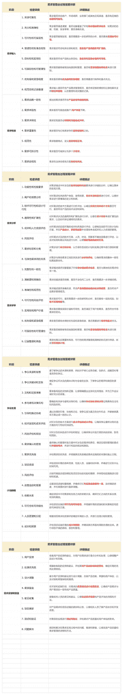

[需求管理全过程详解.pdf](https://internal-api-drive-stream.feishu.cn/space/api/box/stream/download/all/Syf1bZd0koHrAixrH3HcOM5Jngh)

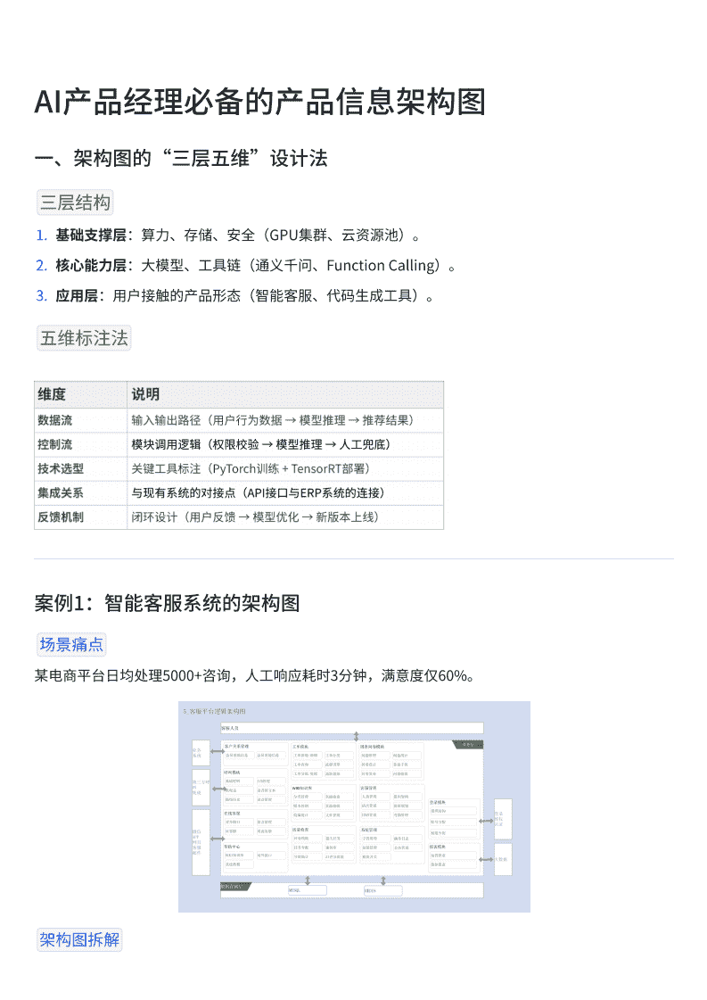

[AI产品经理必备的产品信息架构图.pdf](https://internal-api-drive-stream.feishu.cn/space/api/box/stream/download/all/CiIDbgMltoFiGixQ0M6c8sKMnJb)

## 数据埋点

[数据埋点方法](https://qqs7y1hozd1.feishu.cn/wiki/HR8Fws17MirjWvkBbi7cty6bnDc)

[埋点设计逻辑8个要点](https://qqs7y1hozd1.feishu.cn/wiki/PY02wdzYqizS4Mk5Pgzcvq2uniI)

[数据埋点管理](https://qqs7y1hozd1.feishu.cn/wiki/GRYywvtoxiQIgJklnz2cip4VnCb)

[数据埋点流程](https://qqs7y1hozd1.feishu.cn/wiki/RR6GwPrXRivNeNkcT5tc6mpSnLg)

[埋点文档撰写](https://qqs7y1hozd1.feishu.cn/wiki/ZuS7wrpAVi5oHFkB4mmc77lsnTr)

[埋点数据指标](https://qqs7y1hozd1.feishu.cn/wiki/QegawlAg1iBbzskyzBPc9DvIn9g)

[大厂数据埋点实践](https://qqs7y1hozd1.feishu.cn/wiki/SzvTwhY7qiJbI7kIpVqcuS5vn2Z)

[数据产品指标](https://qqs7y1hozd1.feishu.cn/wiki/Mo7ewBa4oicDBWk2eygcVD3kn5c)

[滴滴指标体系搭建](https://qqs7y1hozd1.feishu.cn/wiki/S1xswdkeui8Ns7kIYPtcQmA0ngc)

[J东埋点方案的设置及质量保障](https://qqs7y1hozd1.feishu.cn/wiki/ZBQHw1xVRivhqwkUEkscggJinr6)

[数据埋点-常用版](https://qqs7y1hozd1.feishu.cn/wiki/TFGrw5PmBiZ7U0kH0Boclq5fnrg)

[埋点文档模板](https://qqs7y1hozd1.feishu.cn/wiki/IZXTwDmSNinUd8kq53hcJPddnJd)

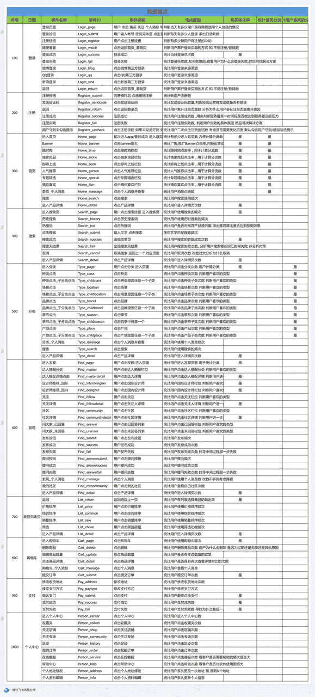

[数据埋点-常用版.pdf](https://internal-api-drive-stream.feishu.cn/space/api/box/stream/download/all/JkObb3xIRoPwWUxoxSrcEOb8nhf)

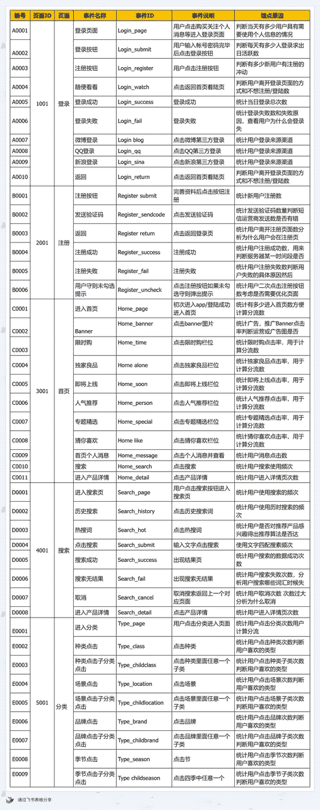

[埋点文档模板.pdf](https://internal-api-drive-stream.feishu.cn/space/api/box/stream/download/all/XN62bJwfioPI3Kx01YicgBfZnPf)

---

# ✅ 竞品分析

> **互联网人、产品经理最常用**的基础技能，竞品分析，做好竞品分析才能抄的明白

> 需要用PC浏览器打开，手机有些文件表格无法显示

多维表格（OC1kbEF9HayAzXsxhczcBExvn3c_tbluGzI2iApbdvAt）

多维表格（OC1kbEF9HayAzXsxhczcBExvn3c_tblu2g4y7rb3TvLe）

多维表格（OC1kbEF9HayAzXsxhczcBExvn3c_tblJS0ZI0VaRSnIZ）

---

# ✅ 用户调研

> **知用户所想，能站在用户的角度**思考，用户说的和想要的往往是两回事，这就比较考验用户调研的基本功了

> 需要用PC浏览器打开，手机有些文件表格无法显示

---

# ✅ 产品设计

> **工具技能，大家都会，**但产品设计拼的是解决方案能不能拿结果，不是谁的流程图原型画的完善漂亮

> 需要用PC浏览器打开，手机有些文件表格无法显示

多维表格（OC1kbEF9HayAzXsxhczcBExvn3c_tblyNgAmMpSONNWT）

---

# ✅ **Axure原型库**

## 原型库行业概览

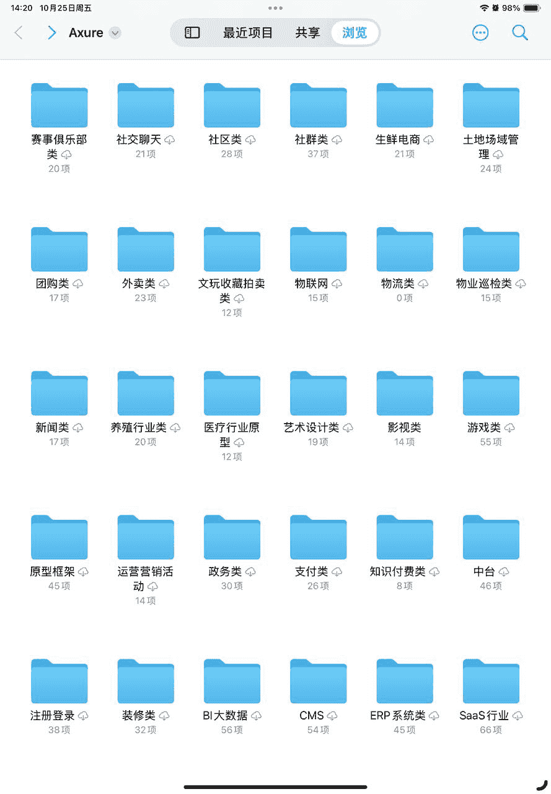

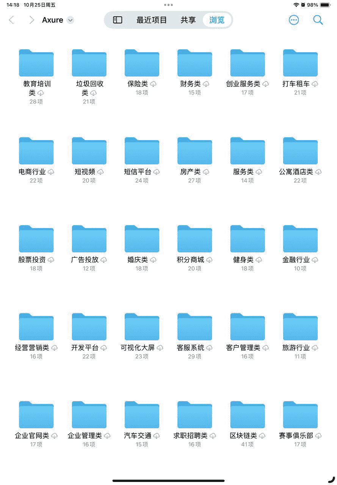

## **购买全套原型库说明**

> 说明：整套原型库总共是600+份，包含全行业的原型库（为防止倒卖，我们设置一点点门槛，谢谢您)

> **价****格****：****29元**，可解锁并下载600+份全部原型库

## **解锁并下载链接：**[全行业600+份原型库](https://v11enp9ok1h.feishu.cn/wiki/Hu6FwzWwliWUn1kqfpOcw1GqnIh?from=from_copylink)

## 600+份原型库详细列表（**可下载**）

[0049 Saas经销商管理系统.rp](https://internal-api-drive-stream.feishu.cn/space/api/box/stream/download/all/QTPdbhx0Fovc32xnB8mc7jv1n4c)

[0497电商APP高保真(交互+UI).rp](https://internal-api-drive-stream.feishu.cn/space/api/box/stream/download/all/Kf4wbeqPYoZdy0xL4Adc8ot1n8d)

[0087 天天领红包营销活动.rp](https://internal-api-drive-stream.feishu.cn/space/api/box/stream/download/all/DtH7bMW2KoJhlzxHf2pcX025nXb)

[0385 游戏棋牌大厅.rp](https://internal-api-drive-stream.feishu.cn/space/api/box/stream/download/all/Q0iFbk5ssooqAex9l0WcVxXAnpf)

[13 分期商城前端APP原型.rp](https://internal-api-drive-stream.feishu.cn/space/api/box/stream/download/all/I4d5bcXIto0d05xPkORcI6v3nhh)

[0474积分商城后台管理原型.rp](https://internal-api-drive-stream.feishu.cn/space/api/box/stream/download/all/TukvbCVIWojiEbxSDLWc3Zg3nxe)

[0034社区社交app原型及后台.rp](https://internal-api-drive-stream.feishu.cn/space/api/box/stream/download/all/RuVVbLqnqoSlHHxPnzHcZUOCnAu)

---

# ✅ 项目管理

> 工作中掉链子的除了自己，那就是其他协作部门了，管理好跟自己没汇报关系的同事进度，这就是项目管理

> 需要用PC浏览器打开，手机有些文件表格无法显示

# ✅ AI产品经理面经

多维表格（OC1kbEF9HayAzXsxhczcBExvn3c_tblAtOg0ew3OV1sj）

# ✅ 简历模板

> 搞清楚了招聘方眼中的优秀候选人，给自己简历润色的时候，才能不断贴近这个标准

> 需要用PC浏览器打开，手机有些文件表格无法显示

---

# ✅ 产品经理面试题汇总

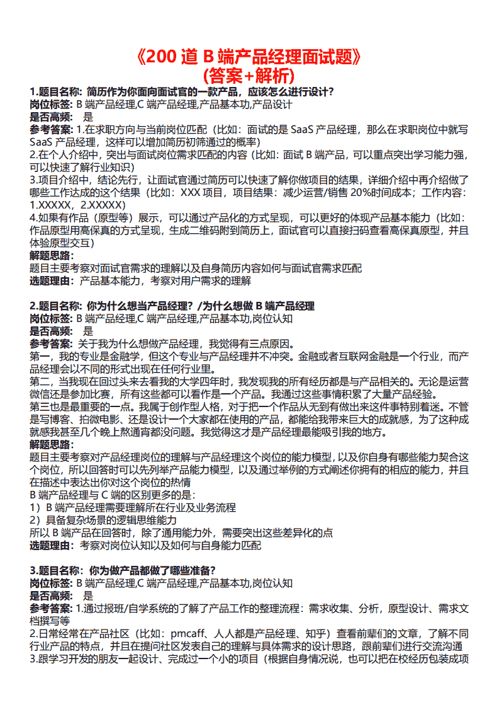

[200道B端产品经理面试题.pdf](https://internal-api-drive-stream.feishu.cn/space/api/box/stream/download/all/JqT3bd6KxoZGHtx6tKUcbCv3nMf)

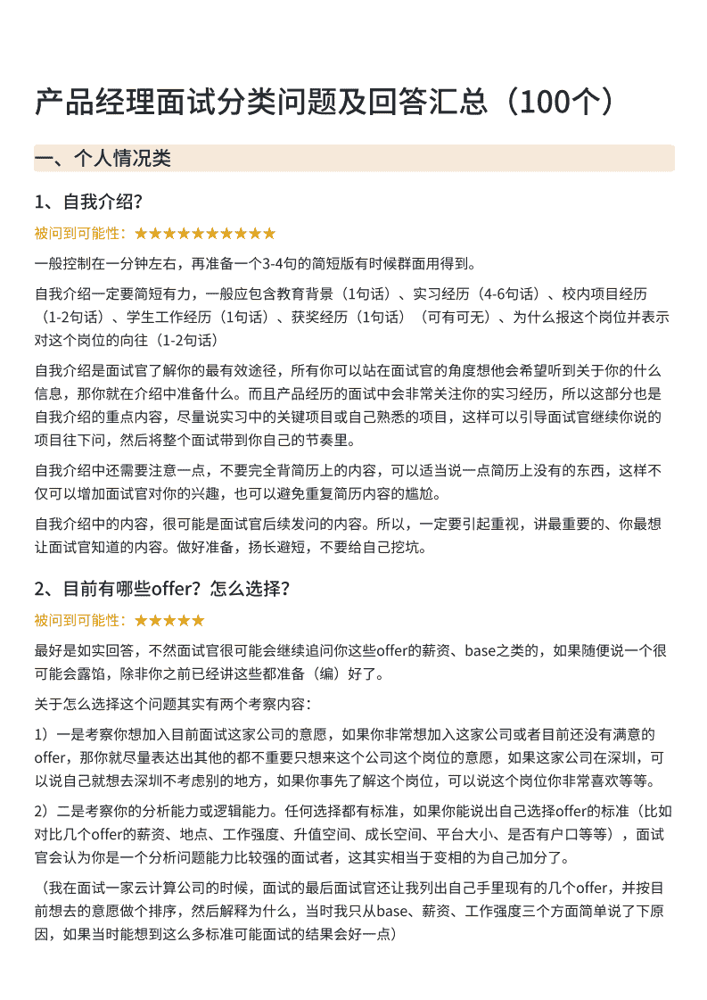

[产品经理面试分类问题及回答汇总（100个）.pdf](https://internal-api-drive-stream.feishu.cn/space/api/box/stream/download/all/XNPgb1I5qouEW5xl8gEcxUysnKb)

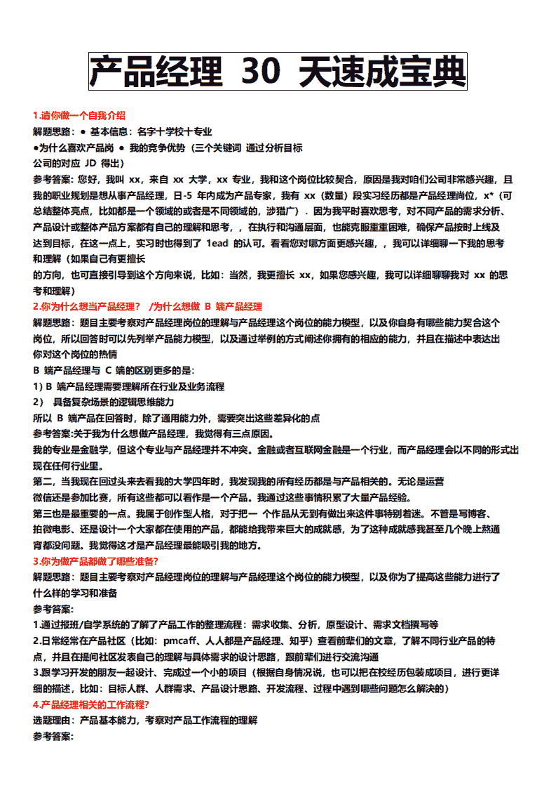

[产品经理 30 天速成宝典.pdf](https://internal-api-drive-stream.feishu.cn/space/api/box/stream/download/all/EehvbSngxoED6Gx14YFclItSnsh)

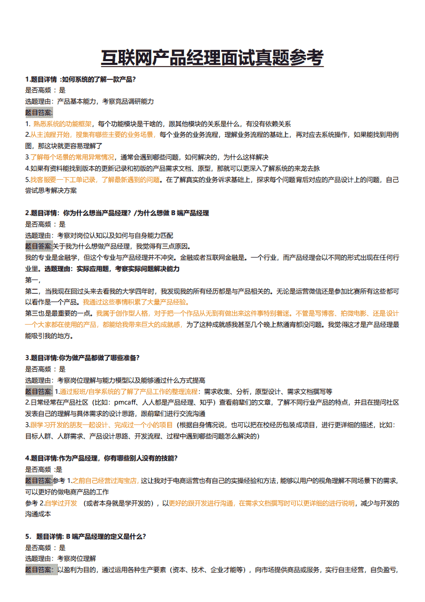

[互联网产品经理面试真题参考.pdf](https://internal-api-drive-stream.feishu.cn/space/api/box/stream/download/all/G2BGbVzmZoCOJvxnrzyc8VgmnGb)

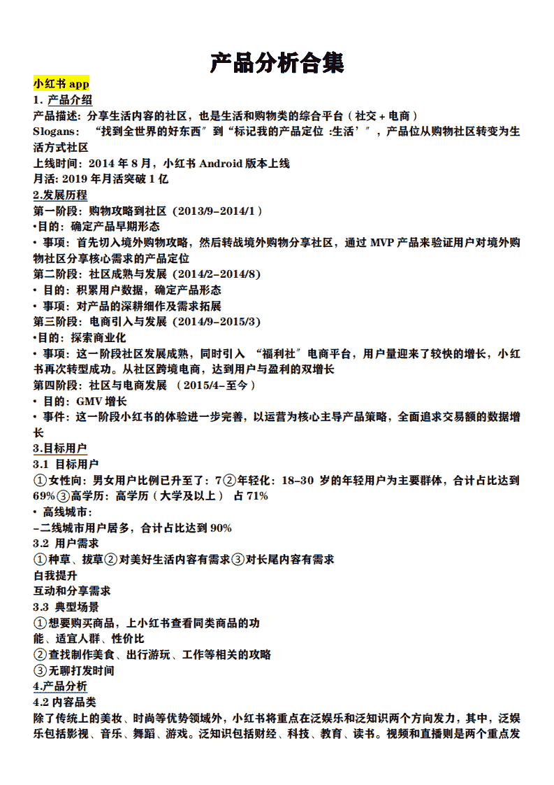

[产品分析合集.pdf](https://internal-api-drive-stream.feishu.cn/space/api/box/stream/download/all/WNXgbf6fZouYJAxaOPNcgmkunNb)

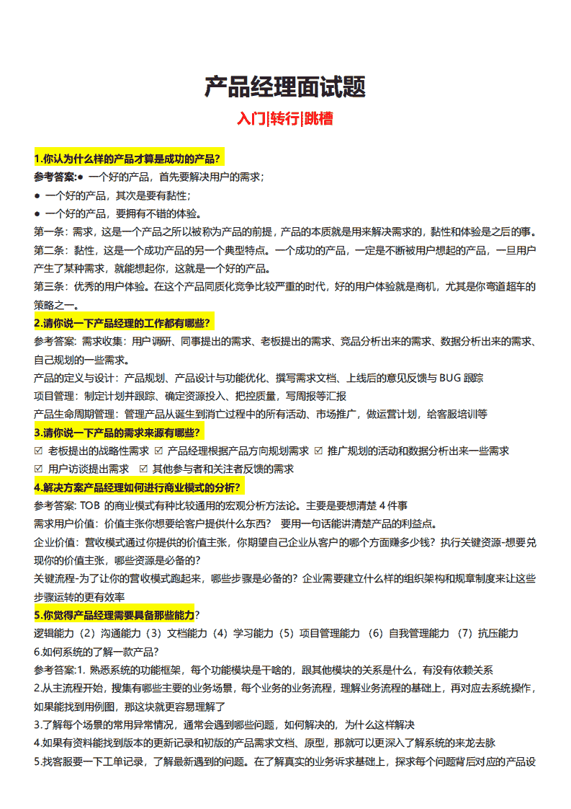

[产品经理面试题.pdf](https://internal-api-drive-stream.feishu.cn/space/api/box/stream/download/all/SnTfbFOVqop0Hhx2vAicj2VTnTh)

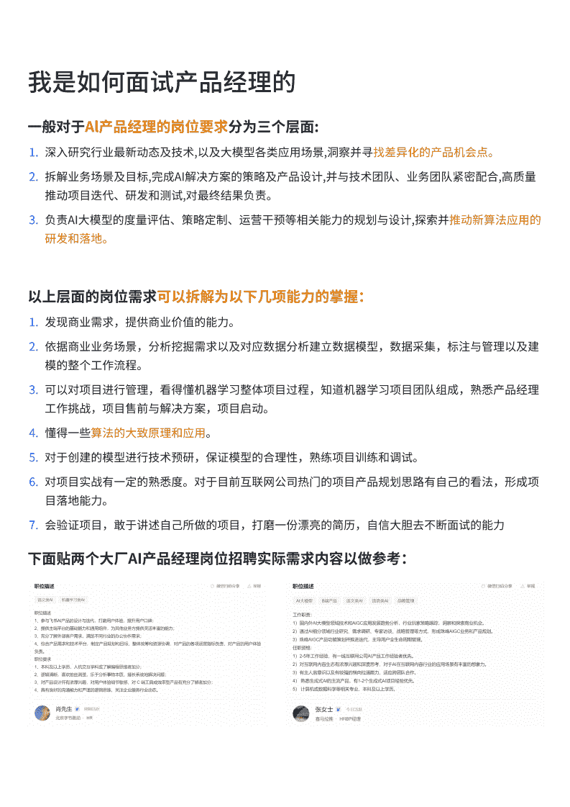

[我是如何面试产品经理的.pdf](https://internal-api-drive-stream.feishu.cn/space/api/box/stream/download/all/Djbgb8q8to3NPJxU3YkcjNeWnLx)

---

☎️   联 系 我 们

**课程学习：**[AI产品经理特训班-学习大纲（148课时）](https://v11enp9ok1h.feishu.cn/wiki/OgZ2wWPpHiSfhBk2aGMcissNnbc?from=from_copylink)

**小红书：**[Alexe的AI产品进阶](https://www.xiaohongshu.com/user/profile/6563f42a000000001000b314?xhsshare=CopyLink&appuid=6563f42a000000001000b314&apptime=1732951637&share_id=193bce27e5a64838b57d1cd994010c7f)

