# 宇宙厂| PRD脱敏文档「模板1」

> 来源：[https://qqs7y1hozd1.feishu.cn/docx/V0NedVWG8oLKEqxMRepcAsZJnvc](https://qqs7y1hozd1.feishu.cn/docx/V0NedVWG8oLKEqxMRepcAsZJnvc)

## 变更记录

> 记录每次修订的内容，方便追溯

多维表格（ToAcb6DrWaAQNqsPDZoc5G5Gnpb_tblJsYO7caeJ2hH9）

# PRD产品经理需求文档「模板」

### 1.1 业务背景

对本次项目的背景以及目标进行描述，让产研团队了解本需求的价值和收益。

### 1.2 业务场景

解释业务的服务场景和商业价值。

1.  产品概述

### 2.1 产品定位

在XX场景下，提供**能力，服务**对象的一款产品。（后续做效果说明）

### 2.2 服务对象

企业中的决策者、BI 分析师、业务运营、数据研发。

### 2.3 产品逻辑

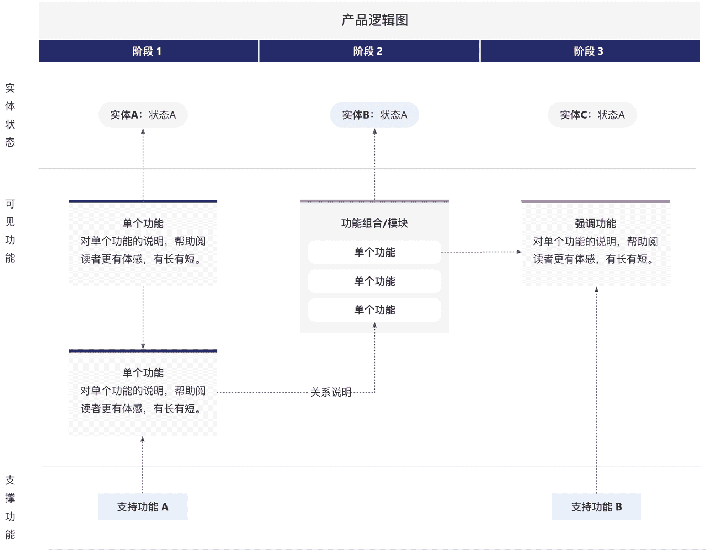

### 2.4 信息架构

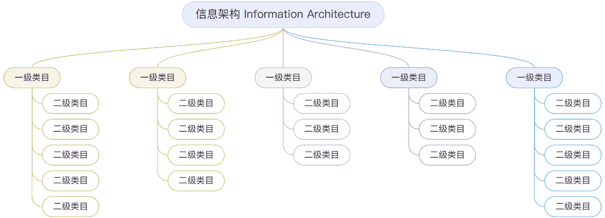

### 2.5 角色术语

在需求文档中的专业业务术语，可以在此进行解释

1.  需求说明

### 3.1 需求列表

列出本次需求的明细列表

多维表格（ToAcb6DrWaAQNqsPDZoc5G5Gnpb_tblCez9yPyS5WvDh）

使用 “画板-流程图”，绘制该需求的的使用流程

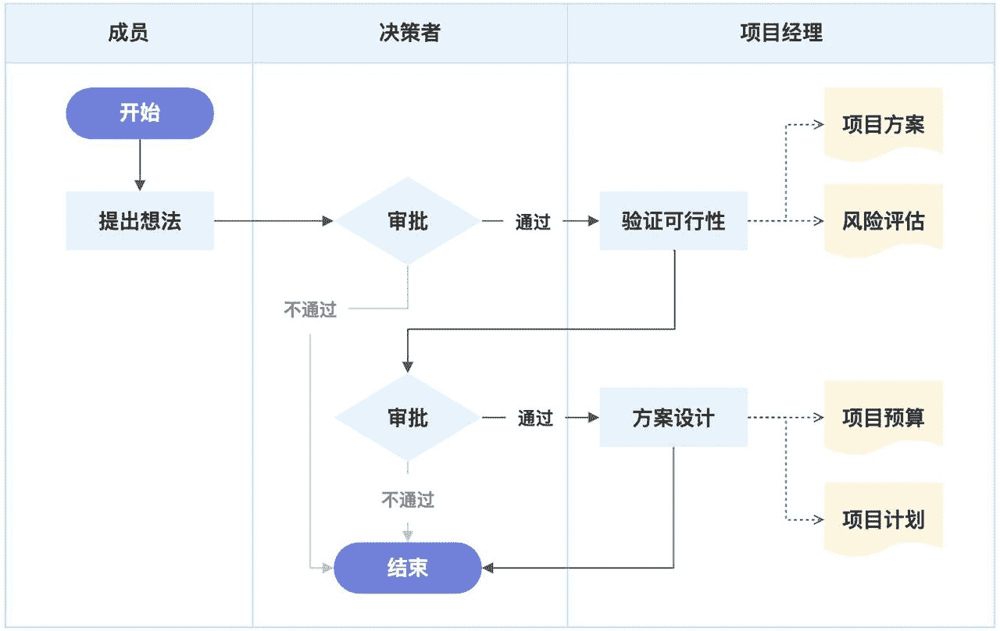

### 3.2 需求明细

#### 1.1 支持 SQL 语法p0

对该需求进行详细描述，并贴上该需求的原型示意

+   要点1...

+   要点2...

+   要点3...

#### 1.2 支持本地 Excel 上传 p0

+   要点一

+   解释一

+   解释二

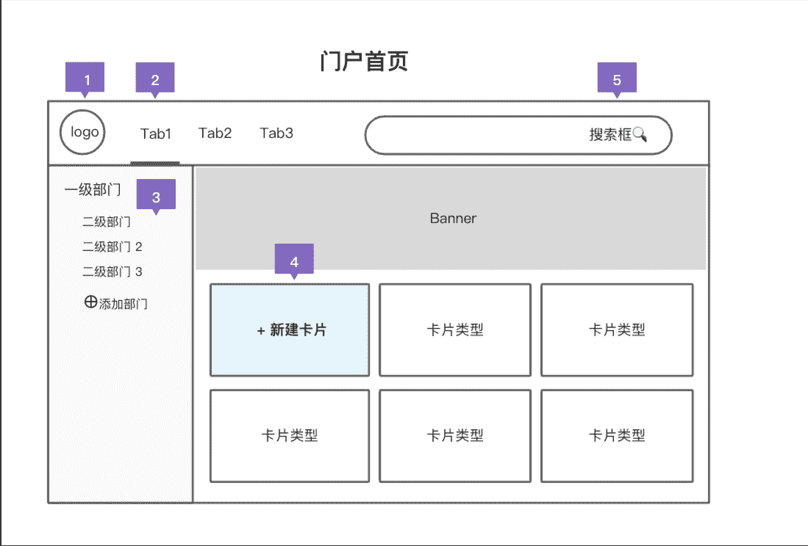

+   要点二

#### 1.3 需求名称 p1

对该需求进行详细描述，并贴上该需求的原型示意

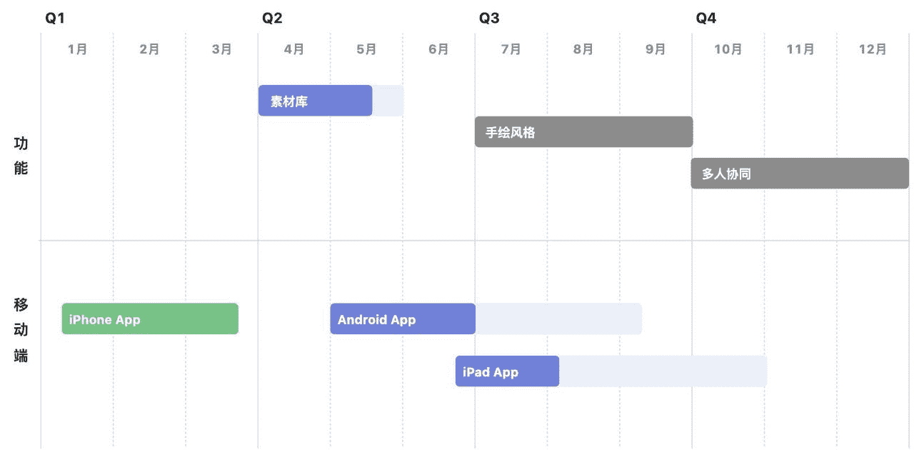

+   需求描述1...

+   需求描述2...

### 3.3 非功能需求

可以列举性能需求、系统需求、运营需求、安全需求、数据埋点需求等...

1.  人员&排期

## 一、什么是产品需求文档？

**产品需求文档**（简称PRD）是产品项目由“概念化”阶段进入到“图纸化”阶段的一个最主要的文档，是对需求进行规划、定义、描述和展示的工具。

通俗点来说，产品需求文档就是产品经理在获得一个产品需求后，对需求进行理解、梳理和定义描述后的产物。它传达了产品经理对这个功能需求的构想与预期，是产品研发工作流程中至关重要的依据。

## 二、产品需求文档的作用

产品需求文档有什么它必须有的理由吗？在讲它之前，我们先了解一下产品开发的流程中几个关键节点：接收需求→需求分析→需求确认→功能拆解→流程绘制→原型绘制→PRD书写→PRD讲解→产品开发→测试验收…

> **接收需求**：产品接收业务需求

> **需求分析：**产品分析需求合理性和需求价值点

> **需求确认：**产品和运营确认需求

> **功能拆解：**产品基于业务需求，拆解产品需求

> **流程绘制**：产品绘制流程图，明确功能实现流程

> **原型绘制：**产品绘制原型图做demo演示

> **PRD书写：**产品撰写PRD并写清楚需求的背景、来源、价值以及功能范围、功能说明等

> **PRD评审：**产品和运营、研发、UI等相关部门基于PRD文档进行需求评审

> **产品开发：**研发基于PRD开发代码；UI基于PRD设计页面；测试基于PRD写测试用例；产品配合各个部门推进需求开发

需求从开始到结束，PRD贯穿全过程，开发根据PRD获知整个产品的逻辑；测试根据PRD建用例；项目经理根据PRD拆分工作包，并分配开发人员；交互设计师通过PRD来设计交互细节。所以，要确保开发出来的需求满足提出者的诉求，所求即所得，避免各部门在传达中出现遗漏、偏差等问题，减少沟通成本，同时它有助于新成员快速熟悉项目，还有利于产品迭代管理中回溯、复盘，总之，PRD不可或缺。

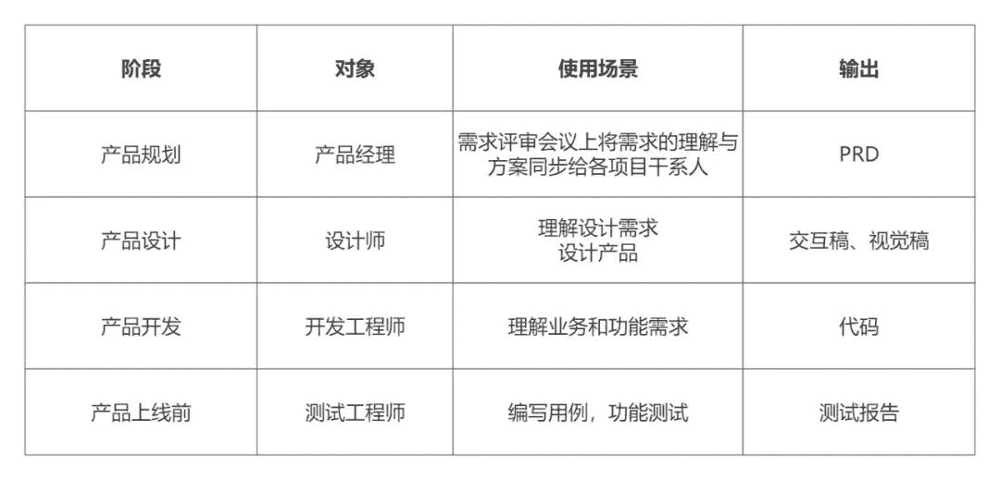

由上表可见，每一个阶段、每个成员，都需要以产品需求文档为依归。

## 三、如何写产品需求文档？

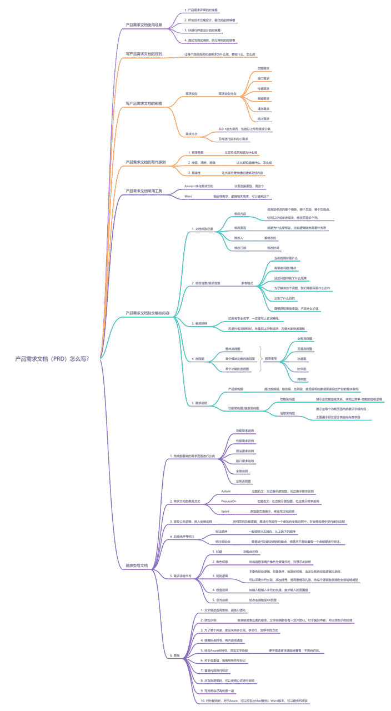

产品需求文档主要包含产品文档的使用场景、使用目的、前提条件、写作原则、常用工具、主要内容和画原型写文档的相关规则等。

知道需求文档如何写后，怎样才能写出一份让每个项目成员都能清晰明了得到所需信息的PRD文档呢？分享5张产品需求文档中常用到的案例给你~

#### 1、文档说明

一个标准的文档说明包含了版本信息、名词解释、修改记录、背景介绍、需求清单、业务流程图和功能流程图、信息架构、产品原型图、人员排期、数据等信息。分享过如何写产品文档后，小编分享两张文档说明的模板，希望能帮到大家。

##### 1）标准文档说明

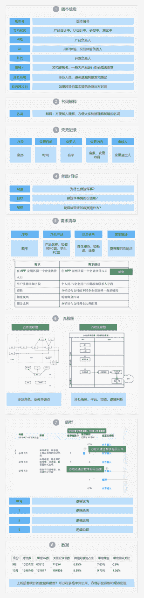

##### 2）产品需求文档模板

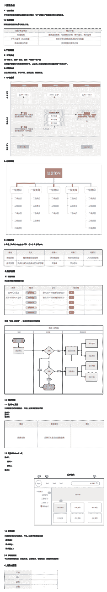

#### 2、需求背景文档

以B端产品需求背景分析文档为例，跟大家分享一下需求背景文档的写作格式。

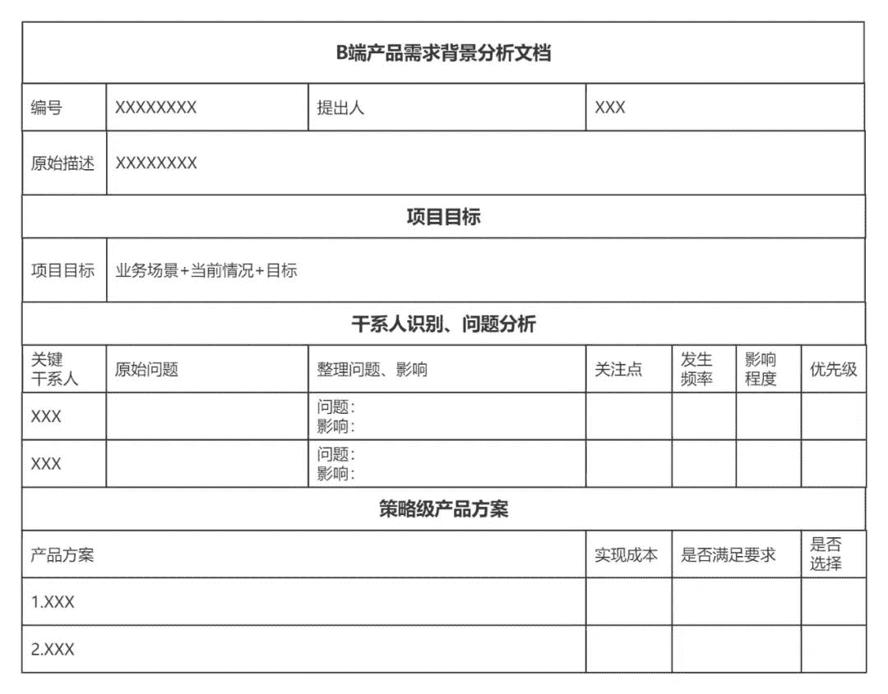

B端产品需求背景是指需求产品的原因及想达到的目标，也就是需要分析谁(who)需要通过怎样的途径(how)去达到什么目标(what)，提炼为what、who、how3个核心元素。

> **what：**需求的目标，在明确目目标的前提下，可更清晰的确定需求的边界;

> **Who：**需求的干系人，我们可以通过用户访谈，确定干系人目前的问题、关注点和需求的重要程度，进行后期的功能设计；

> **How：**通过对需求进行背景分析，确定需求的实施方案，并根据干系人关注点、项目目标、项目资源确定当前最优解决方案。

#### 3、产品需求分析

收集好需求好，如何对需求进行分析？分享3个需求管理方法和需求来源真伪判断的技巧。

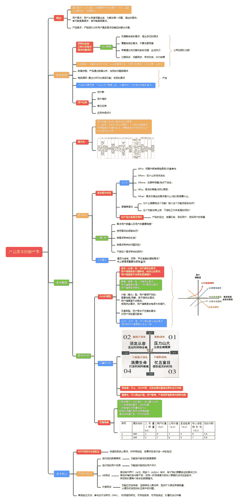

**需求来源：**需求来源来自多个渠道，可以是来自老板和领导的行政需求、业务需求、数据挖掘和分析后的需求、竞品调研后的需求、产品的观察和思考的需求，也可以是用户反馈的需求。

**需求管理：**需求管理首先是把需求收集之后放进需求池进行管理，然后通过需求真伪判断、价值分析和主观意志（老板、领导、甲方）进行需求筛选，最后进行需求优先级的划分，一般可以通过KANO模型、四象限法则和权重衡量去做判断。

**需求验证：**MVP最小化可实行产品可以低成本快速验证需求，也可以通过产品迭代验证，根据迭代后的数据表现和用户反馈等来验证，或者通过其他你熟悉的方式都可以。

一个伪需求带给产品的伤害是灾难级别的，不仅做出来没人用，还浪费了公司资源，所以希望这些方法可以避免你走太多弯路。

#### 4、需求管理模板

产品经理没有需求池，等于狙击手没有8倍镜。需求池必不可少，因为它不是只给自己看，是为项目设计到的每个成员看的。

为什么要做需求管理？需求多，容易遗忘，如果不及时记录，很快就忘了；形成规划，便于整理复盘；方便对外展示，产品规划和进度一目了然。

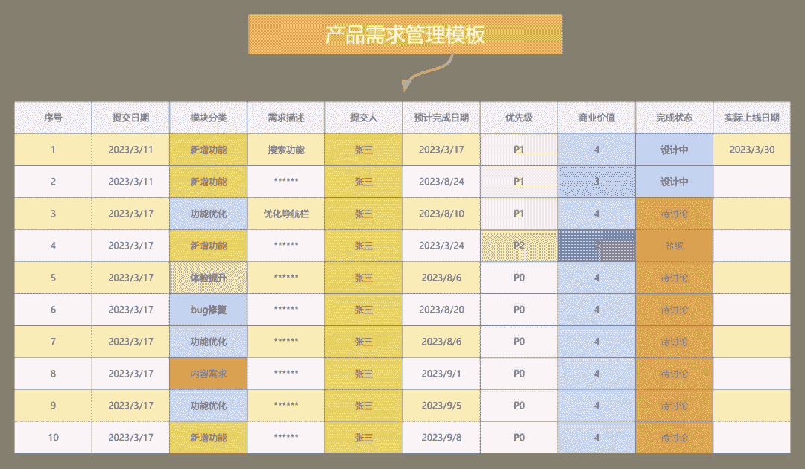

管理需求需要确定需求优先级，高价值的需求先做。同时，也要定期动态调整需求池，重新评估和安排整体资源的投入情况，让进度分配不合理的情况调整过来。