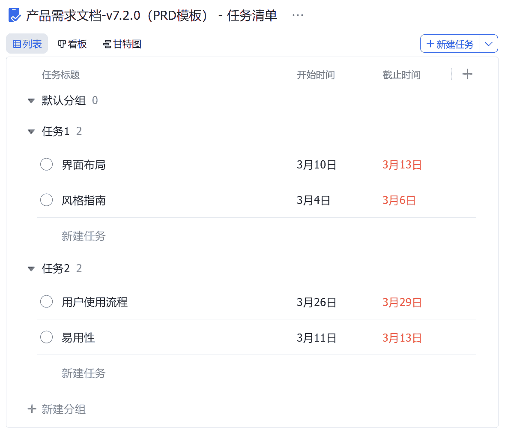

# 产品需求文档（PRD模板）

> 来源：[https://qqs7y1hozd1.feishu.cn/docx/YBeEdwm5CoDgssxwCWQcC5BpnZg](https://qqs7y1hozd1.feishu.cn/docx/YBeEdwm5CoDgssxwCWQcC5BpnZg)

**PRD文档包括但不限于以下内容****：**

#### 版本信息

| **版本号** | **时间** | **修订人** | **修订内容简述** |
| --- | --- | --- | --- |
| v7.6.0 | 2025-04 | c | 会员体系架构及需求逻辑 |

#### 修订记录

多维表格（BIuCb0IMIaWr4GsbGnEckHYqnJg_tblMRdiD7Y6bVerN）

## 一、简介

> 简明扼要的介绍清楚背景情况

### 1.目标

> 用户通过____的操作(产品功能)，可以得到价值，从而提升____(用户行为)，进而提升____（业务指标）

本文档用于说明xxxx市场的现状、趋势、问题和壁垒。

> 同时对xxxx市场的目标用户群体及竞品进行分析，研究公司是否要进入xxxx市场以及如何切入xxxx市场，确定产品核心功能，并完成产品路线和产品结构规划。

### 2.适用范围

> 产品经理、UI、UE、研发团队、测试、业务用户

xxxx数据包含用户的xxxx数据、xxxx数据、xxxx数据、xxxx数据、xxxx数据。

> 现阶段对平台来讲较为真实、有效的数据为xxxx数据和xxxx数据。

> xxxx数据最为重要也最为真实、可靠，但是需要平台与xxxx系统深度对接才能获得。

### 3.术语和定义

> 对于文档内的各个名词术语进行解释，包括词汇名、对应的别名、具体的说明。

| **词汇名** | **别名** | **说明** |
| --- | --- | --- |
| CMS | 内容管理系统 | xxx系统的简称 |
|  |  |  |

## 二、需求背景与截止分析

### 1.需求目标

> 简单的描述需求要解决的问题，让文档读者能够快速抓住重点

本需求要提升什么指标，提升多少。所有对业务指标没有提升的需求都不应该做。

目标需要是可衡量的，能帮助我们事后判断是否实现了目标。衡量的方式可以是定量的或是定性的。

**需求目标: **例如在文档内支持流程图能力，能让用户在文档内直接绘制、修改、查看、评论流程图。

问题1：

问题2：

### 2.解决方案

> 尽量简单描述设计方案，需要有明确的对象、施行的范围和领域.

xxxx不能单纯地展示xxxx数据，这样对用户毫无吸引力。多数xxxx会对xxxx数据进行xxxx统计分析，分析的维度有历次数据的对比及趋势预测、平均值、极值等。

### 3.竞品分析&结论

> 列出竞品相关能力的主要信息和关键结论。

重点推演背后设计的动机与目标，再与要解决的问题对比。竞争对手都是如何解决这个问题的，当前比竞品好的地方在哪里。

| **竞品** | **主要功能** | **截图或视频** | **样本描述** | **关键结论** |
| --- | --- | --- | --- | --- |
| **竞品1** |  | 注意要横向排布，精简文档篇幅 |  |  |
| **竞品2** |  |  |  |  |

### 4.数据定义与推导公式

> 对关键数据定义及推导做说明

### 5.需求效果评估

> 需要有明确的数据指标来评估效果，并说明思考逻辑。

**衡量标准: **功能上线1个月后，功能使用率 (XX功能UV/XX产品UV) 达到 X%

### 6.价值分析

##### **用户价值:**

##### **产品价值:**

##### **公司价值:**

### 7.计划框架

| **功能模块** | **功能界面** | **主要功能点** | **功能特性描述** | **上线规划** |
| --- | --- | --- | --- | --- |
| **互动模块** | 互动任务弹窗 | 选择去评论 | 拉起输入框，可输入评论并发送 | 2025-05 |
|  | 直播入口 | 直播加入推荐页信息流 | 可点击进入直播间 | 2025-05 |
| **检索模块** | 功能搜索 | 搜索框 | 输入搜索关键词，点击搜索按钮进行搜索 | 2025-03 |
|  |  | 提交结果 | 进入搜索结果页面 | 2025-03 |
| ... | ... | ... | ... | ... |

## 三、需求详情

### 1.业务流程图

### 2.全局说明

> 简要描述主线需求中的功能点和每个功能的优先级。

| **需求** | **简要说明** | **涉及范围** | **优先级** |
| --- | --- | --- | --- |
| **企业积分分配** | 企业会员积分增加admin管理功能 | PC端前后台 | p0 |
| **个人会员管理后台** | 个人会员信息后台基本信息管理 | PC端后台 | p2 |
| **积分过期机制** | 企业和个人会员增加会员积分到期提醒 | PC端前后台 | p1 |
| **会员中心** | 小程序个人中心嵌入会员中心，加会员等级、积分功能 | 移动端前台 | p0 |
| **积分商城** | 个人中心加入积分商城，实现积分消耗的应用场景 | 移动端前台 | p1 |
|  | ... |  |  |

### 3.范围定义

##### **项目范围：**

##### **界定标准：**

（详细说明...）

### 4.功能需求

##### **功能一：**

##### **功能二：**

| **功能模块** | **界面** | **数据埋点** | **埋点说明** | **目标数据结果** |
| --- | --- | --- | --- | --- |
| **直播间互动** | 直播间 | 直播累积观看人数 | 日观看人数、周观看人数、累计观看人数 | 直播间观看情况 |
|  |  | 关注按钮点击数 | 日点击数、周点击数、累计点击数 | 直播间互动情况 |
|  | 每日任务 | 参与每日任务的用户数 | 日参与数、周参与数、累计参与数 | 直播间互动参与率及每日任务用户流失率 |
| **检索与收藏** | 收藏夹 | 搜索框点击数 | 日点击数、周点击数、累计点击数 | 分子:收藏按钮点击数分母:我页面点击数 |
|  |  | 输入内容并搜索次数 | 日点击数、周点击数、累计点击数 | 分子:输入内容并搜索次数 |
| ... | ... | ... | ... | ... |

### 5.非功能需求

+   **性能要求**：系统的响应时间、处理能力等。

+   **可靠性和稳定性**：系统的故障率、恢复机制等。

+   更多...

| **需求名称** | **运营支持需求** |
| --- | --- |
| **直播互动及奖励** | App导流页制作直播间互动及抽奖活动宣传kv，并向用户推送该功能亮点及上线信息 |
| **笔记收藏搜索** | 用户是否知晓新上线的收藏夹搜索功能 |
| ... | ... |

### 6.用户界面和用户体验

+   **界面要求**：界面布局、风格指南等。

+   **用户体验目标**：用户使用流程、易用性等。

### 7.数据管理

+   **数据需求**：数据类型、存储需求、数据迁移等。

+   **数据库设计**（如果适用）。

### 8.主线需求概述

> 事件说明

+   当前在直播页面上一级页面时，网络不佳，直播页面设计点击屏幕/按钮来进行页面刷新，进行接口重调。

+   已加载框架状态下，在直播页面以图像占位符/预设图的形式展示直播页面的框架。

+   网络异常提示下方增加“重新加载”按钮 / toast提示“服务器异常，请重试”

### 9.交互原型图

> 在原型图上对需求逻辑做标注和说明

+   任务1观看时长大于10分钟:点击右边“去观看”显示直播页面。此时任务窗口隐藏。

+   任务2发表评论:点击右边“点击右边“去评论”。输入文字完毕可点击发送。

+   任务3分享直播:点击右边“去分享”，调起分享选项栏，层级在任务窗口之上。

+   任务4购买商品:点击右边“去下单”。显示直播页面，并调起直播间商品链接清单。

## 四、功能详细说明

### 1.企业积分分配

> 对企业积分分配做详细说明

+   任务栏已完成的任务每日上限显示1/1次。按钮切换为“已完成”

+   发表评论、分享直播，蜜值增加5分

+   点击右边“去分享”，调起分享选项栏，层级在任务窗口之上。

| **用户场景** | 描述此需求的使用场景 |
| --- | --- |
| **功能描述** | 简要描述此需求要实现的功能 |
| **输入条件** | 简要描述此需求要通过什么方式或者操作触发 |
| **需求流程** | 原型图/UI设计稿图片 |
| **输出条件** | 流程关联下一步功能或者输出内容 |
| **数据埋点** | 此功能需要的埋点 |
| **补充说明** | 特别或者需要补充说明的地方 |

## 五、项目里程碑和交付物

+   定义项目的主要里程碑。

+   列出每个阶段的交付物。

## 六、业务规则和逻辑

> 描述业务流程和决策逻辑。

## 七、安全性需求

+   识别潜在风险及其影响。

+   提出风险缓解措施。

## 附录

> 包括任何相关的文档、图表或参考资料

**数据分析报告**

**用户调研报告**

**设计分析报告**

+   此处插入数据分析报告

+   此处插入用户调研报告

+   此处插入设计分析报告