# 产品需求文档-案例（全流程）

> 来源：[https://qqs7y1hozd1.feishu.cn/docx/Vz5Sd5eZioLMCCx9Pzcc3eTUn9c](https://qqs7y1hozd1.feishu.cn/docx/Vz5Sd5eZioLMCCx9Pzcc3eTUn9c)

## 一、文档属性

+   文档名称：产品需求文档；

+   版本号：1.0；

+   创建日期：9.4；

## 二、产品介绍

### 产品定位

**本产品面向互联网行业求职者，笔者针****对应届生求职期间忙、乱、杂、慌这****一**痛点，设计一款管理用户求职全生命周期的APP，为求职者们搭建一个精准交流的平台。

+   使用此APP，用户可随时学习、突击训练、获取前辈经验、规划求职路线。

+   APP主打UGC模式，鼓励用户积极发帖发问积攒经验，为大家创造一个更公开活跃的互联网求职环境。

### 产品综述

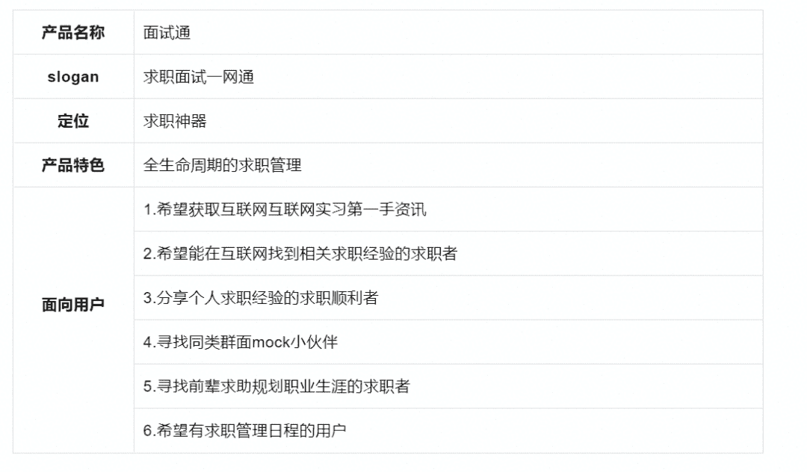

### 需求分析

**1）互联网求职人数众多**

**从年龄分布来看，18-25岁的年轻人更偏好**选择信息技术服务业、文化娱乐业和金融业。

这届年轻人伴随互联网的发展而成长，见证高科技技术带来的创新产品改变人们的生活，也在中国文化产业迅速发展的时代吸收更多的精神内涵。

行业对年轻人的影响力十分显著，对年轻人有足够的吸引力。

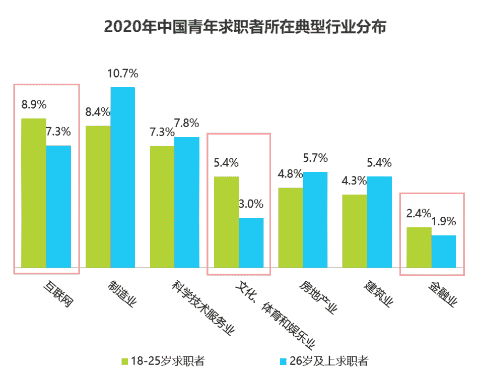

数据来源《艾瑞：年轻人求职目标朝多元化发展—“超职季”观察·年轻人篇》

**2）用户调研**

笔者之前负责一个公众号的模拟群面活动，并已举办八期，参与人数200+，积累不少用户数据。

接下来和大家分享一下透过这200人的模拟群面反馈及问卷调查，我观察到的互联网求职应届生的用户画像。

+   付费用户：大厂实习，求职意识超前；

+   付费意识高，复报名率高，易成为重度用户；

+   群体效应较强；

+   注重朋友圈质量，难做私域裂变。

**3）需求汇总**

针对调研过程中遇到问题，我将求职者需求总结归纳如下。

**从**实现难度和对求职者的重要程度两个维度考虑，将产品需求划分为P0，P1，P2，P3四个级别，P0和P1的需求是本次产品的初步产品规划基础。

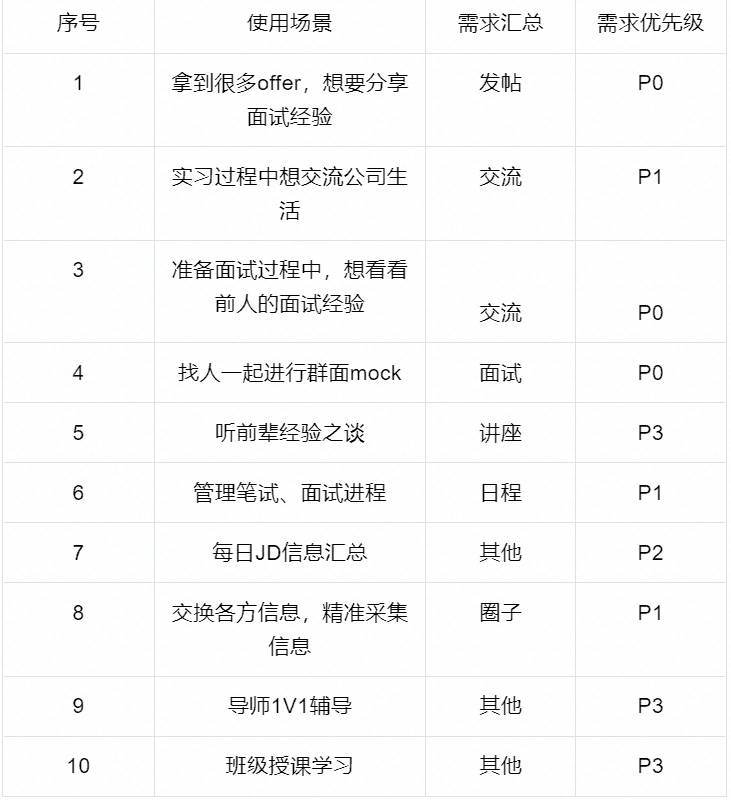

## 三、文档说明

信息结构图：

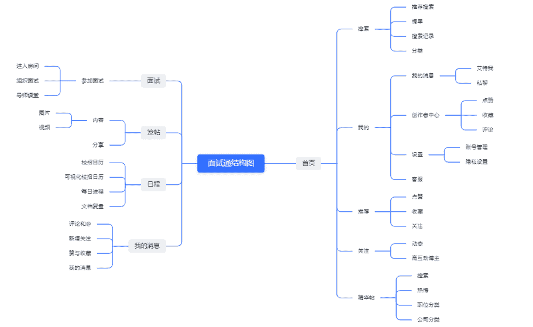

## 四、全局说明

### 功能权限

+   未登录/登录；

+   已登录状态可执行所有操作；

+   未登录状态下，仅供用户浏览首页浏览、模拟面试信息浏览、圈子查看模块内容信息，用户无法进行其他APP操作；

+   当进行除浏览外的其他操作后将直接跳转至登录页面。

### 登录/注册页面

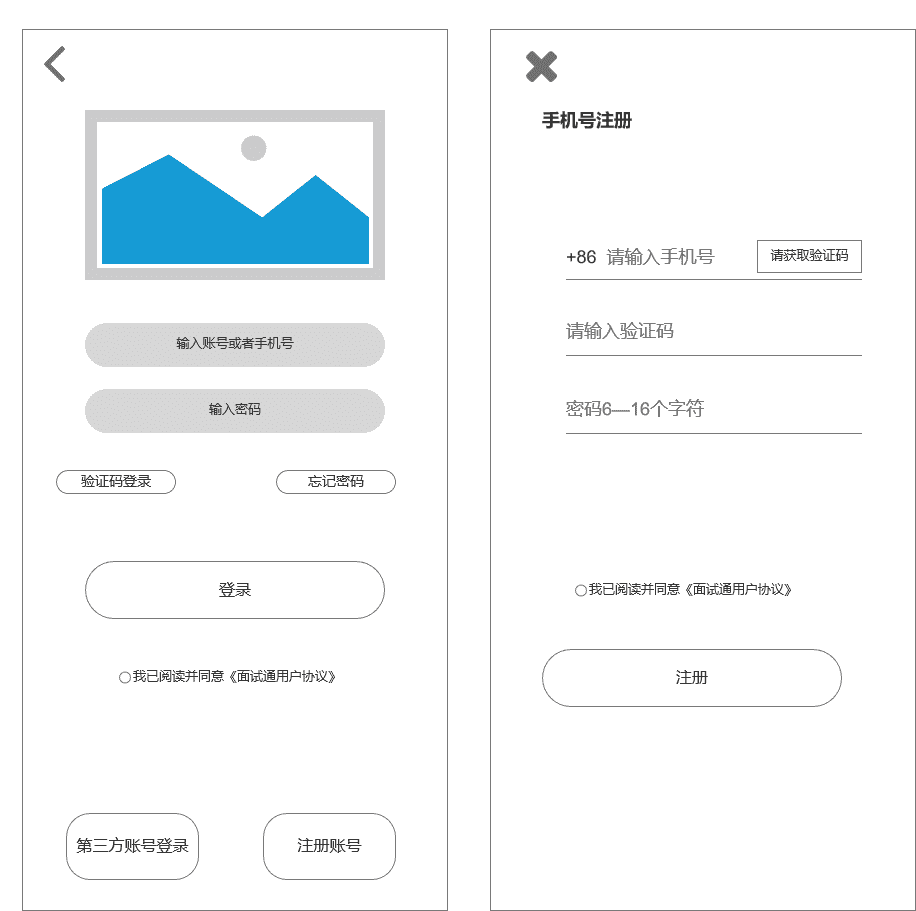

**1）页面名称**

登录/注册页面。

**2）页面入口**

+   未登录状态下，不能点赞、评论、分享、收藏，私信；不能发布动态；

+   不能组织群面单面、报名别的房间面试，无法参与圈子讨论，添加面试、笔试日程；

+   当进行以上操作时，自动跳转至登录界面。

**3）页面功能**

> ① 三种方式登录——

1.  账号/手机号+密码登录；

1.  手机号+验证码登录；

1.  第三方授权登录。

> ② 注册账号。

4）页面逻辑内容及交互详细说明：

**① 账号/手机号+密码登录**

1.  初始界面下，呈现账号/手机号码输入栏、密码输入栏、忘记密码按钮、登录按钮、注册按钮；

1.  账号/手机号码输入栏默认+86，账号/手机号码和密码输入框均没有字符类别限制，字数限制为6~16个字符；

1.  密码输入框输入密码后，可点击右侧可视图标，切换密码显示状态；

1.  输入完成后，点击登录，验证正确完成登录，跳转至进入登录前界面；

1.  点击“忘记密码”按钮跳转到找回密码页面，输入手机号获取验证码，并输入新密码进行密码重置。

**② 第三方授权登录**

1.  初始界面下，在登录按钮下方，呈现”第三方账号登录“按钮；

1.  点击按钮，提供微信、QQ平台按钮，选择后点击，进入此社交平台授权登录界面；

1.  授权完成后，完成登录，跳转至进入登录前页面。

**③ 手机号+验证码登录**

1.  初始页面下，在密码输入栏左下方，呈现”验证码登录“按钮；

1.  点击按钮，进入验证码登录页面；

1.  在验证码页面输入完成后，点击登录，验证正确完成登录，跳转至进入登录前界面。

**④ 注册账号**

1.  点击“注册账号”，进入“账号注册”页面，通过手机号验证码注册账号；

1.  当前界面下，呈现手机号码输入栏、验证码获取按钮、验证码输入栏、密码输入栏、注册按钮；

1.  手机号码默认+86，输入限制11位数字。当输入非数字内容时，输入界面不显示任何内容；当输入大于11位数字时，超过部分不显示；

1.  密码输入框无字符类别限制，指数限制为6~16个字符。

### 键盘说明

点击手机号码输入框时弹出数字键盘。

点击其他输入框弹出字母键盘在页面内。

### 部分常用交互说明

**1）页面间交互**

点击底部标签导航内“首页”、“面试”、“发布”、“日程”、“圈子”五个标签，切换至对应页面。

在页面内下拉时，刷新页面；上拉时，加载内容。

除底部导航栏的五个一级页面，其余页面在返回上一页面时，页面向右滑出。

从“搜索”页面返回上一页面时，页面从底端向上滑出。

不同页面之间，无手势切换。

**2）打断后重新打开 APP**

当用户返回桌面或者临时接入电话后重新打开APP，将直接进入退出前的页面。

当APP出现异常关闭、闪退、崩溃情况时，用户重新打开将进入APP启动页。

当APP页面临时出现短信或者其他信息通知时，APP页面无影响。

**3）其余通用形式**

如APP当前页面有软键盘时，点击页面内空白区域，软键盘向下滑动隐藏。

无网络情况时，每次打开APP时页面均会弹出Toast，内容为“网络出错了，请检查网络后重试”，点击其他区域弹窗消失；用户可以在无网络情况下浏览APP，但页面内无内容加载；当用户进行除页面切换之外的操作时，提示弹窗将再次出现。

## 四、部分业务流程图

### 登录注册流程图

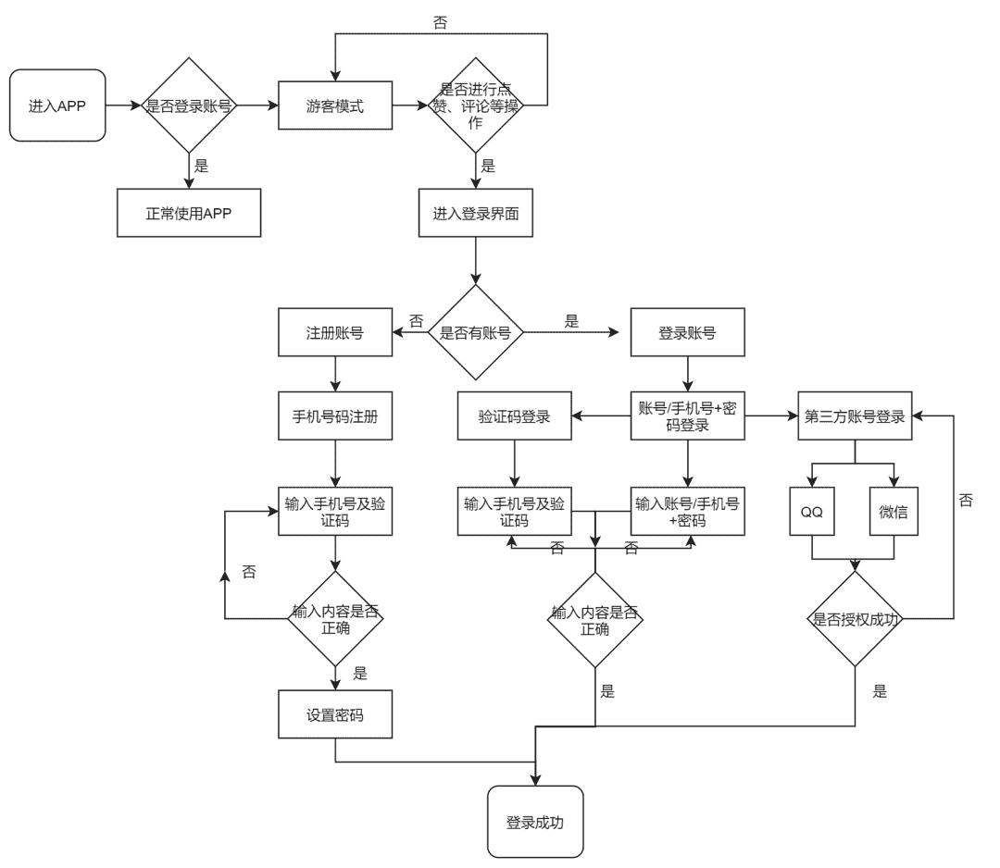

### 寻找mock队友流程图

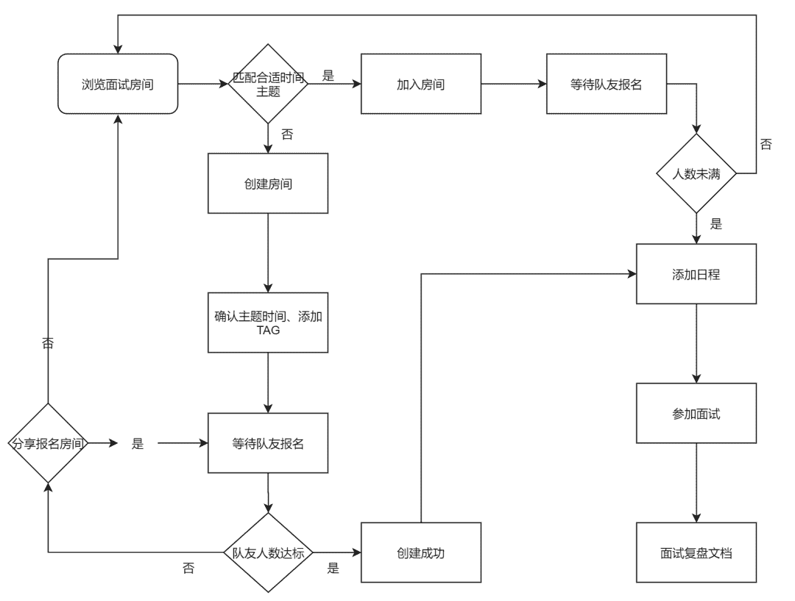

## 五、产品界面流程图

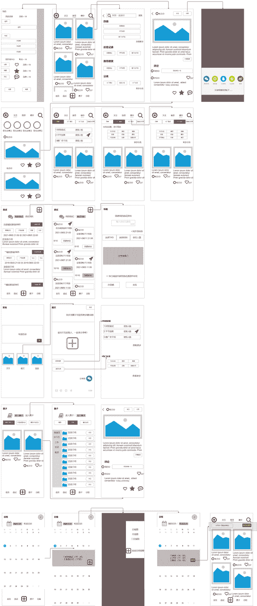

## 六、页面功能详细说明

### 首页

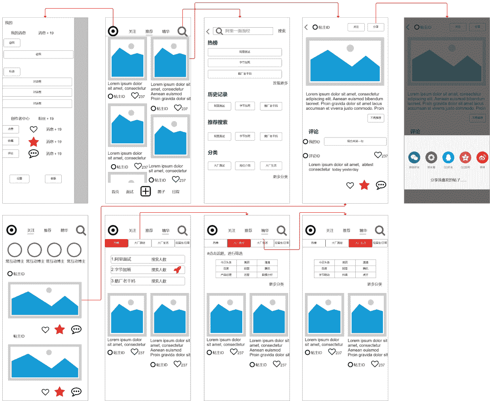

**1）页面名称：**首页。

**2）页面入口：**启动面试通APP即显示首页内容，点击底部tab栏的“首页”按钮可快速进入首页。

**3）页面构成：**顶部工具栏、动态内容展示、底部tab栏。

4）页面逻辑内容及交互详细说明：

① 顶部工具栏

**a. 推荐**

进入APP之后即推荐页面，页面布局采取双列展示的feed流形式，页面展示帖子图文、前两行文字介绍、博主头像及ID、喜欢值。

**b. 精华**

+   进入精华栏，顶部会出现一个二级TAG分类，如热榜、大厂面试、大厂生活等，点击后即可浏览相应分类的精华帖子；

+   点击热榜时候，相应的会有排行榜在下方显示，并有推荐的精选热榜贴，同样采取双feed流形式；

+   点击排行榜单内容即可进入时事热点帖子；其他二级分类TAG中，可以选择合适的分类精准筛选精华帖。

> **c. 关注**

关注页面主页分为我常见博主及动态内容，常见博主通过展示头像，并成一排的形式，展示更多关注博主信息，关注动态采用单feed形式，单个帖子详细展示，吸引粉丝点击。

**d. 我的**

+   左上方圆形按钮即我的消息；我的包含内容主要分为三个部分，聊天，创作者中心，设置；

+   聊天又包含@我以及私聊我两种情况，在此界面会相应展示部分聊天界面；

+   创作者中心的数据指标主要是点赞、收藏、评论，进入后即可看到点赞收藏评论的粉丝；

+   设置框点击设置后可以对账户登陆，显示，私信等权限进行把控，点击客服框直接通往客服小助手，采取智能对话，并留下人工客服电话。

**e. 搜索**

搜索页面由热榜、推荐、历史记录、分类的形式展开，并展示部分信息，搜索框获取焦点后，引导语“阿里一面面经”消失，点击搜索即可展开搜索内容，左上角返回上级页面。

**f. 动态内容展示**

+   帖子包括主流几大部分。顶部引导关注、分享、左上角可直接返回上级界面；

+   往下浏览是帖子的图片；

+   评论区预览本人评论，展示真实评论者头像、ID、评论语，限制前４条展示，更多评论需要点击“浏览更多”；

+   底部有点赞、收藏、评论及对应人数显示。

**g. 底部tab 栏**

分为首页、面试、发帖（＋号）、圈子、日程五个tab ，点击后就会进入对应的页面。

点击对应的tab ，该tab 就会字体变大一号，并且变粗，其他Tab保持灰暗状态。

### 面试

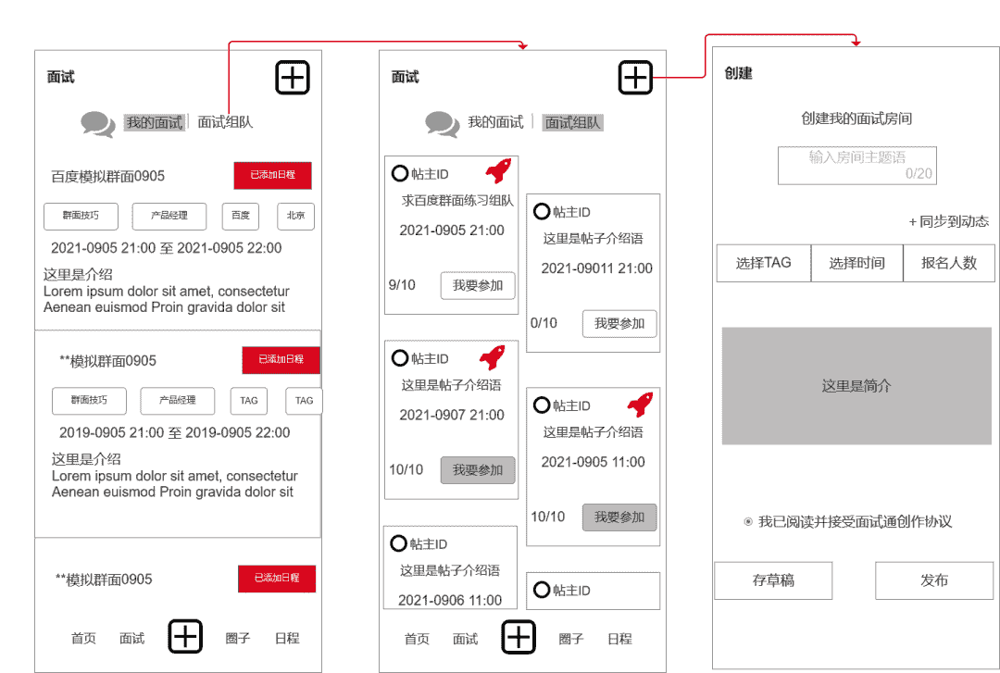

**1）页面名称：**面试。

**2）页面入口：**点击底部tab栏的“面试”按钮可快速进入面试界面。

**3）页面构成：**顶部Tab键、面试信息、创建房间提示键。

4）页面逻辑内容及交互详细说明：

**① 顶部tab键**

包含我的面试、面试组队、点击其中即可进入对应界面，选中文字加粗变黑，并蒙上一层浅灰色，另外键不变。

**② 我的面试**

单列形式、时间顺序展示面试信息；面试详情包括标题，TAG（群面技巧、产品经理、百度、北京）、时间、介绍、已添加日程，如过期添加日程则会变灰色。

**③ 面试组队**

浏览房间信息（主题、时间、推荐语、博主头像ID），快速匹配时间主题，如想参加可点击我要参加并自动添加日程；如果有红色火箭则代表帖子火爆，如果我要参加变灰色即表示面试已取消或过期或满人。

**④ 创建房间**

浏览房间后没有匹配上合适的房间可以创建，创作包括推荐语、Tag、时间、限制报名人数、简介；编辑好后可以存草稿或者点击发布即可发布到面试组队的广场上面去。

### 发帖

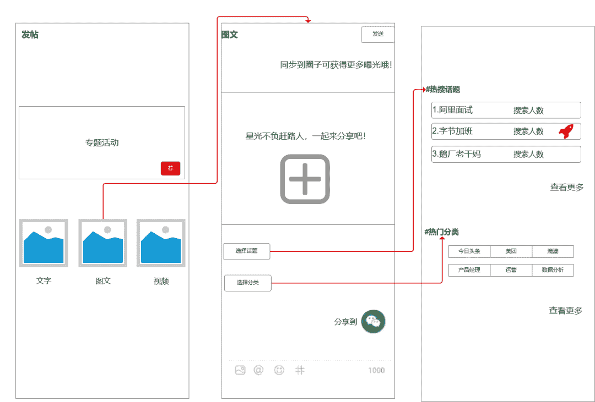

**1）页面名称：**发帖。

**2）页面入口：**点击底部tab栏的“+”按钮可快速发帖。

**3）页面构成：**发帖分类、发帖详情、推荐标签。

4）页面逻辑内容及交互详细说明：

**① 发帖分类**

点击tab 栏进入发帖提示页后，可以看到帖子分为文字，图文，视频三个通道，在必要时候，会通过banner广告页和红色的“荐”展示活动信息，并引导博主参与话题发帖。

**② 发帖详情**

中间部位会有引导语“星光不负赶路人，一起来分享吧”并配上加号，点击后，即可选择图片编辑文字，并@相关人员。

发帖前，可以点击话题和分类，查看热门话题和推荐分类，同时在发帖前可以对帖子进行同步，同步至圈子。

### 圈子

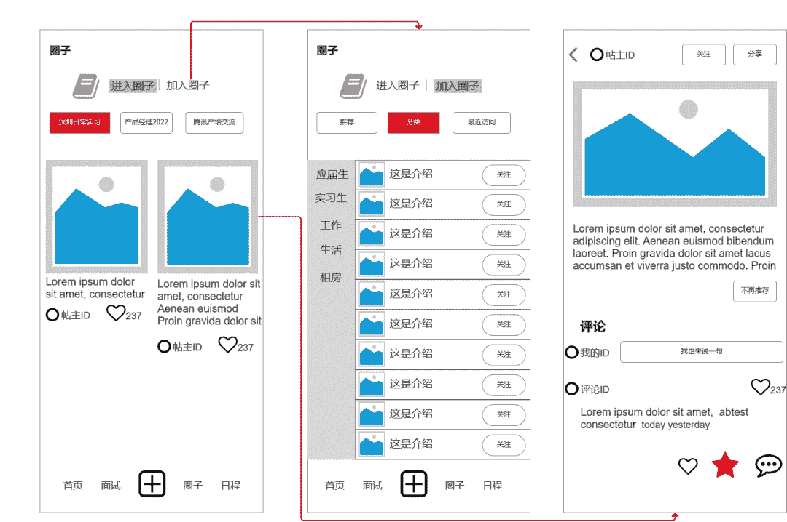

**1）页面名称：**圈子。

**2）页面入口：**点击底部tab栏的“圈子”按钮可快速进入圈子页面。

**3）页面构成：**顶部工具栏、动态内容展示、底部tab栏。

4）页面逻辑内容及交互详细说明：

**① 顶部工具栏**

有两级分类。

+   一级分类是进入圈子、加入圈子，点击其中即可进入对应界面，选中文字加粗变黑，并蒙上一层浅灰色，另外键不变；

+   二级分类是常用标签如深圳日常实习、产品经理2022、腾讯产培交流，选中分类后，该分类蒙上一层浅红色，其他键不变。

**② 进入圈子**

二级分类页面下是帖子详情页展示，包括图文详情、博主信息、评论、点赞、收藏、分享、不再推荐等按钮。

**③ 加入圈子**

左侧有快速查找的分类栏，点击分类即可出现圈子介绍，圈子介绍单列展示，信息包括圈子头像，推荐语，关注界面。

### 日程

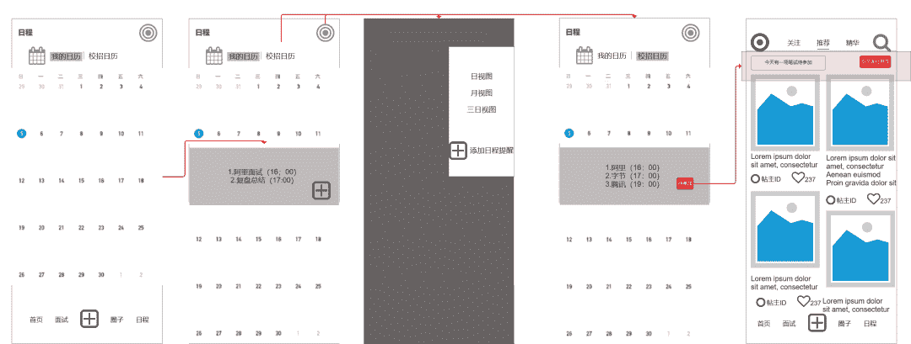

**1）页面名称：**日程。

**2）页面入口：**点击底部tab栏的“日程”按钮可快速进入日程界面。

**3）页面构成：**顶部工具栏、日历信息、底部tab栏。

4）页面逻辑内容及交互详细说明：

**① 顶部工具栏**

+   顶部信息栏包括我的日历和校招日历，点击其中即可进入对应界面，选中文字加粗变黑，并蒙上一层浅灰色，另外键不变；

+   右上角圆圈代表设置，二级子菜单有日视图、月视图、三日视图、添加日程；可更换试图展现形式和添加我的日程。

**② 日历信息**

默认状态显示月视图、点击某日后，选中数字变蓝，下方浮现灰色解释框——显示选中日目前已有进程规划，灰色框右边有加号，可直接添加提醒。

**③ 校招信息**

+   默认状态显示月视图、点击某日后，选中数字变蓝，下方浮现灰色解释框——显示目前已有的笔试时间、集中群面时间；

+   如果相关笔试面试已添加日程，会有红色提醒；对应当天，首页顶部会有对应提示——今天有一场笔试代参加，并推荐相关搜索。