# 产品PRD需求文档—在线教育CRM系统

> 来源：[https://qqs7y1hozd1.feishu.cn/docx/IffwdPbdGo3lfqx1RaLcd7zbngd](https://qqs7y1hozd1.feishu.cn/docx/IffwdPbdGo3lfqx1RaLcd7zbngd)

## 一、产品介绍

### 产品定位

> 作为一家在线教育公司，**随着业务的不断扩大和业务数据量的**增长，数字化转型已成为公司内部的迫切需求。为了提高各部门之间的信息流转效率，公司迫切需要一款定制化的CRM产品。

> 本CRM产品旨在为客户提供**完整的销售数字化管理解决方案。它涵盖了****从营销到成单的全流程数据追踪，为公司的销售团队**提供高效的工具和流程支持。通过强大的BI分析功能，该产品能够提供可视化的数据展示，让管理层能够直观地进行经营决策。

### 产品综述

## 二、文档修订记录

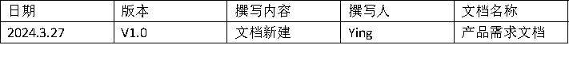

## 三、产品结构

### 部门结构

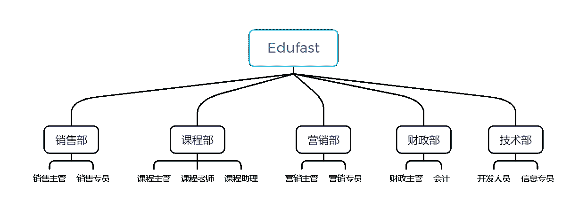

### 产品功能结构图

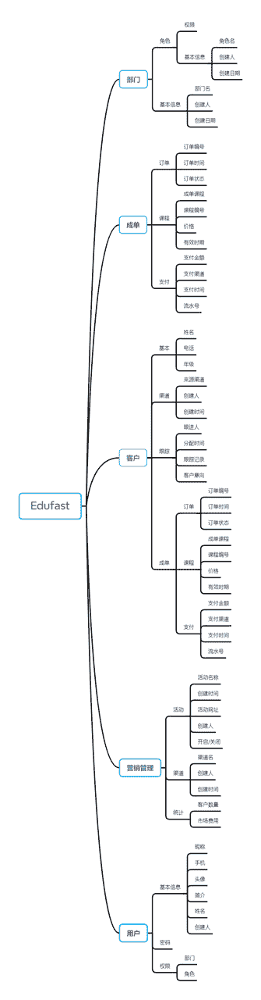

### 产品功能列表

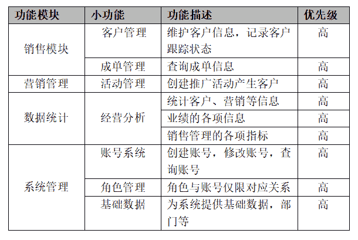

## 四、界面功能详细说明

### 登录界面

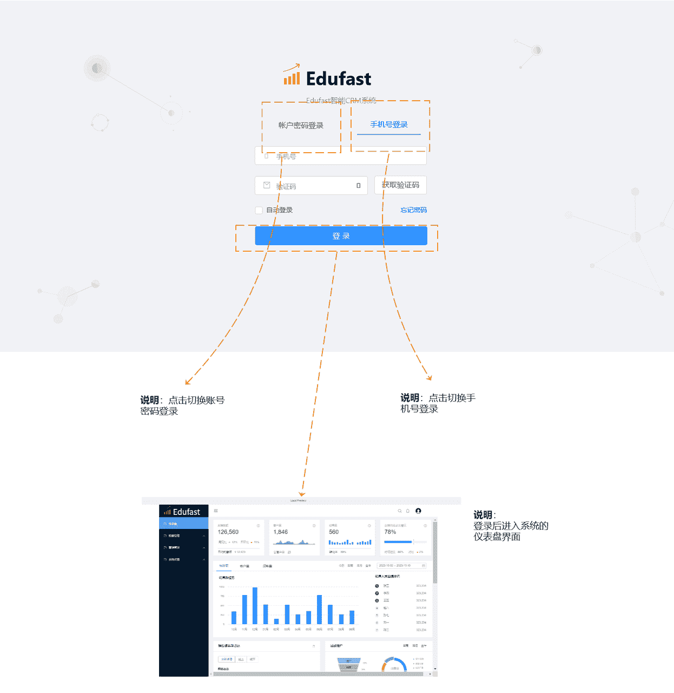

> **功能：**账号密码登录、手机验证码登录。

> **用户场景：**用户进入系统登录网站后，需要输入账号密码或者手机验证码才能进入网站。

> **优先级：**高。

> **前置条件：**访问系统网址，即可进入登录页面。

**界面逻辑：**

+   用户输入手机号码，点击“获取验证码”按钮。若用户在60秒内未收到手机验证码，点击“获取验证码”按钮重新获取验证码；

+   户也可以点击账号密码登录，输入正确的账号密码。

+   用户点击登录，进入系统。

### 仪表盘界面

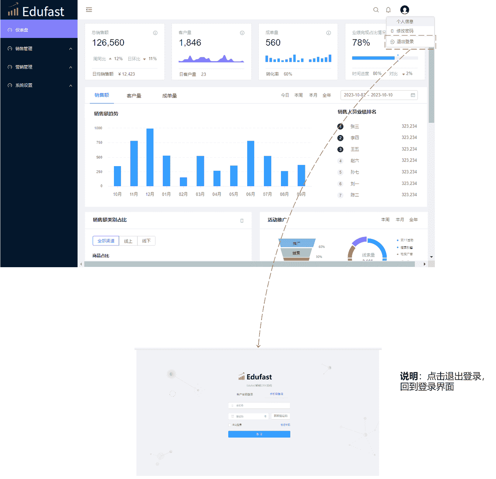

**功能：**数据可视化，展示销售额、客户量、成单量，退出登录。

**用户场景：**用户成功登录系统后，即进入仪表盘界面。

**优先级：**高。

**前置条件：**用户成功登录。

**界面逻辑：**

+   仪表盘展示全年销售额、客户量和成单量等信息。通过点击销售额、客户量和成单量按钮，可以切换展示的信息。

+   界面同时展示单日信息，并提供销售员业绩、活动推广等额外信息的展示。

+   用户可以点击右上角的头像，然后选择“退出登录”，以便安全退出系统并返回登录界面。

### 活动管理界面

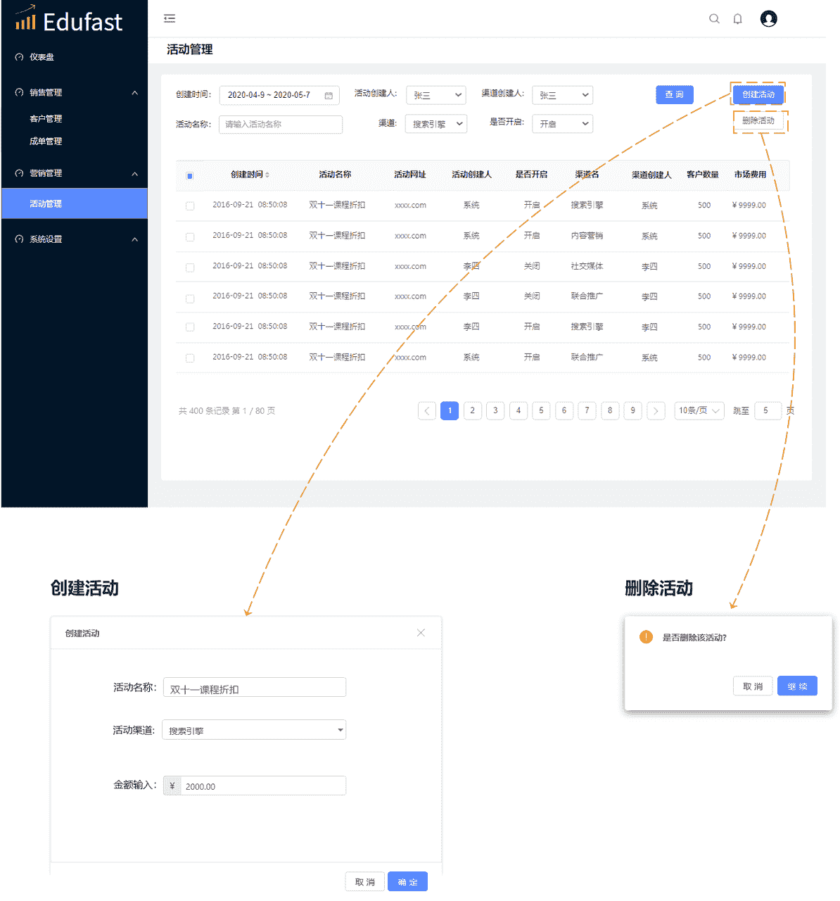

**功能：****创建活动，修改活动。**

**用户场景：**当用户需要发布活动，可在此创建活动。

**优先级：**高。

**前置条件：**用户拥有创建活动的权限。

**界面逻辑：**

+   活动相关信息以表格形式展示在界面上。

+   用户点击“创建活动”按钮，可以指定活动名称、活动渠道和金额，以创建新的活动。

+   用户可以通过选中表格中的单选框，然后点击“删除活动”按钮来删除选中的活动。

+   用户可以点击“查询”按钮来搜索相关的活动信息。

### 客户管理

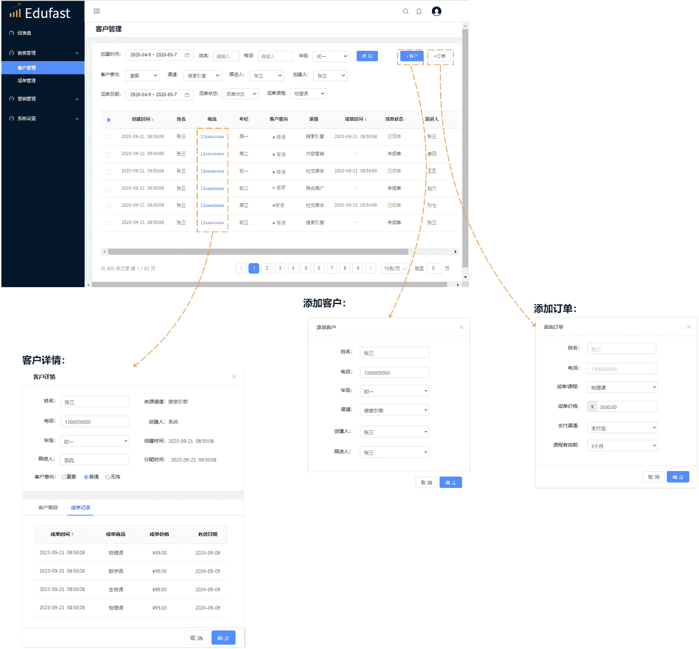

**功能：**管理客户，添加订单。

**用户场景：**用户需要添加客户，或查询客户信息，或生成订单。

**优先级：**高。

**前置条件：**用户拥有客户管理的权限。

> **界面逻辑：**

+   用户点击表格中的电话一栏时，可以查看客户的详细信息，其中包含客户信息以及成单信息，并且可以进行修改。

+   用户可以通过点击“+客户”按钮来添加新的客户。

+   用户可以通过点击“+订单”按钮来生成新的订单，并且该订单的信息将显示在成单管理中。

### 成单管理

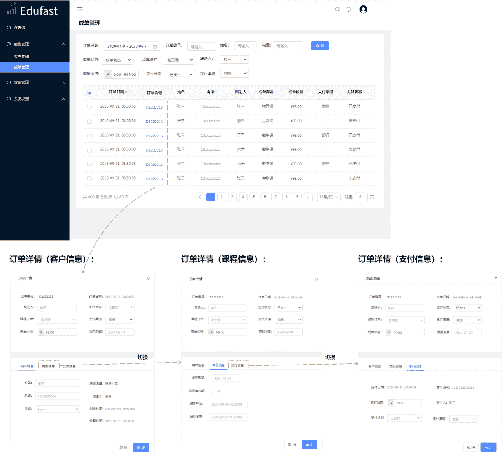

**功能：**查看、修改订单信息。

**用户场景：**用户需要查看、修改订单。

**优先级：**高。

**前置条件：**用户拥有成单管理的权限。

**界面逻辑：**

+   通过点击订单编号一栏，用户可以查看订单的详细信息。

+   在订单信息页面，用户可以通过点击“客户信息”、“课程信息”和“支付信息”按钮来切换展示不同的信息。

### 个人信息管理

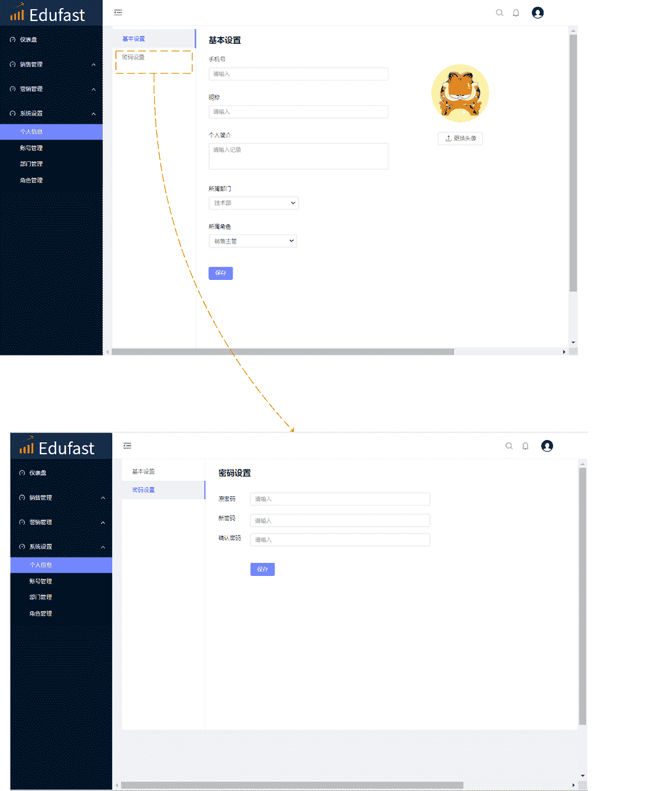

**功能：****修改个人信息，修改密码。**

**用户场景：**用户需要修改自己的信息。

**优先级：**高。

**前置条件：**用户拥有个人信息修改的权限。

> **界面逻辑：**

+   用户可以点击“基本设置”来修改手机号、昵称、个人简介等信息。修改所属部门和所属角色需要相应的修改权限。用户在完成修改后，可以点击“保存”按钮将修改保存到系统中。

+   用户可以点击“密码设置”，然后填入原密码、新密码和确认密码，并点击“保存”按钮来成功修改密码。

### 账号管理

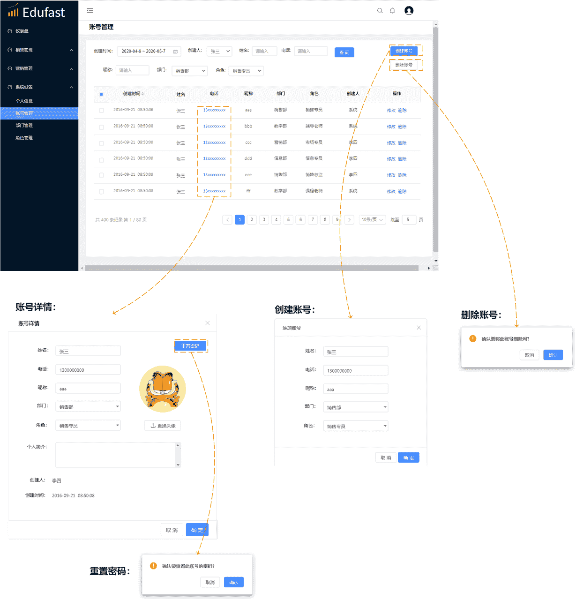

**功能：****查询账号、创建账号、删除账号**。

**用户场景：**用户需要查询账号。

**优先级：**高。

**前置条件：**用户拥有账号管理的权限。

**界面逻辑：**

+   用户可以点击表格中的电话一栏，以查看账号的详细信息。如果用户希望重置密码，他们可以点击“重置密码”按钮，在确认窗口中点击“确认”按钮后，将进入修改密码界面。

+   用户可以点击“创建账号”按钮，填写姓名、电话、昵称等信息来创建新的账号。

+   用户可以选中表格中的单选框，然后点击“删除账号”按钮，再点击“确认”按钮即可删除账号。

### 部门管理

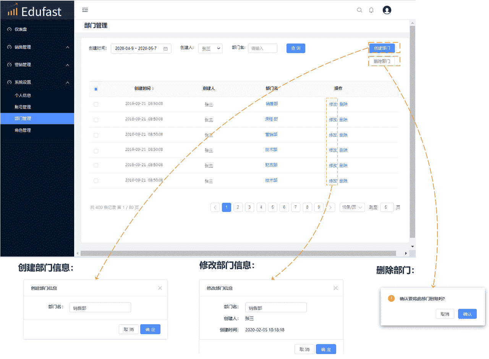

**功能：**创建部门、修改部门、删除部门。

**用户场景：**用户需要查询部门相关信息。

**优先级：**高。

**前置条件：**用户拥有账部门管理的权限。

> **界面逻辑：**

+   用户可以点击“创建部门”按钮，填入部门名称来创建一个新部门。

+   用户可以点击表格中的“修改”按钮来修改部门的信息。

+   用户可以选中表格中的单选框，然后点击“删除部门”按钮。确认删除后，部门将被删除。

### 角色管理

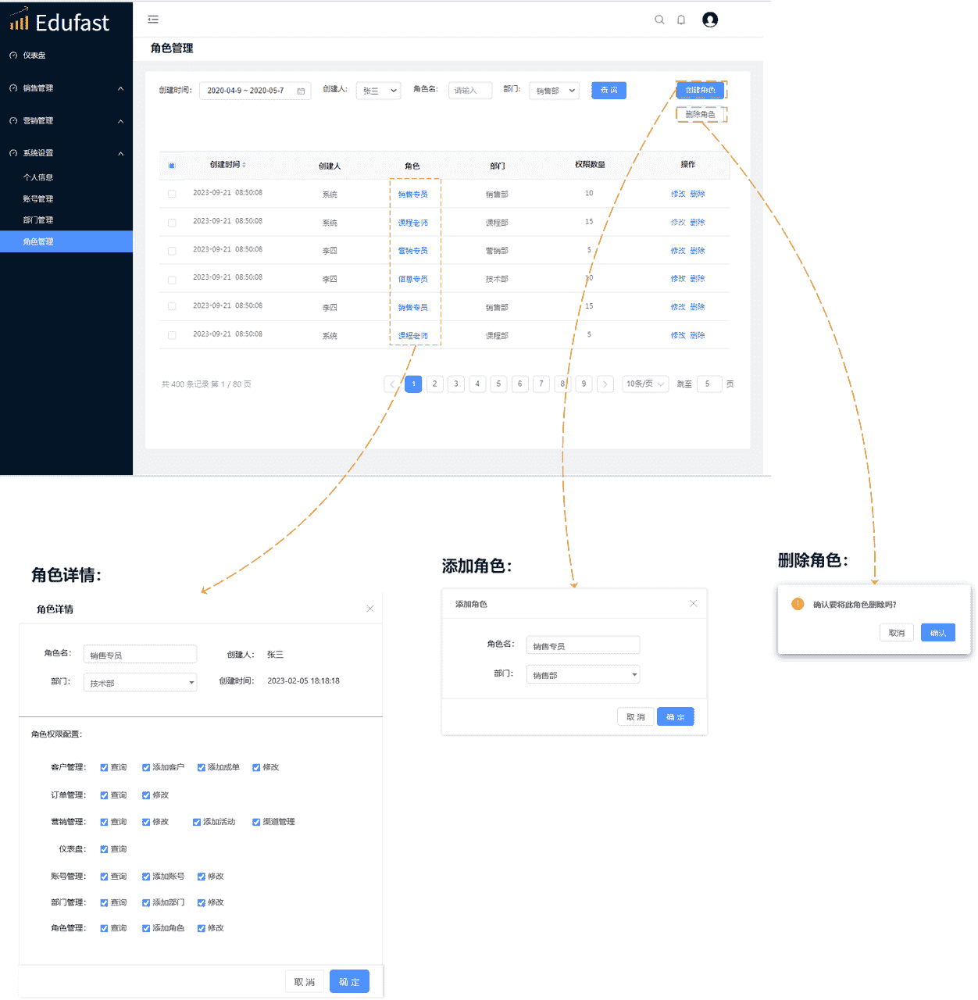

**功能：**创建角色、修改角色、删除角色。

**用户场景：**用户需要查询角色相关信息。

**优先级：**高。

**前置条件：**用户拥有角色管理的权限。

**界面逻辑：**

+   用户可以点击“创建角色”按钮，填入角色名称，并指定对应的部门。

+   用户可以点击表格角色一栏，即可显示角色的详细信息，通过勾选单选框来授予角色权限。

+   用户可以选中表格中的单选框，然后点击“删除角色”按钮。确认删除后，角色将被删除。