# 用 AI+prompt 写需求文档

> 来源：[https://qqs7y1hozd1.feishu.cn/docx/GRkpdNJYxocNGdxeLorcZ2tDn5e](https://qqs7y1hozd1.feishu.cn/docx/GRkpdNJYxocNGdxeLorcZ2tDn5e)

## 用AI+prompt写需求文档分为“三步走”：

> 第一步：v0生成高保真Demo（输入：想法 → 输出：可操作原型）

> 这步没变，依然是我们强大的起点。我们通过自然语言向v0描述需求，它快速生成一个可点击、可交互的UI原型。这本身就是一次高效的需求澄清和可视化设计。

> **第二步：注入“Prompt”，让AI解读Demo（输入：**原型+Prompt → 输出：文档草稿）

> 这才是关键所在！ 我们不再手动截图和描述。而是将v0生成的Demo链接，连同一段精心设计的“提示词（Prompt）”，一起交给另一个AI（如GPT-4、DeepSeek等）。

> AI会像一位真正的产品专家一样，“跑一遍”你的Demo，理解每个页面的功能、交互和背后的业务逻辑，然后自动生成一份高度贴合原型、逻辑清晰的PRD()草稿！这步，直接将我们从“写手”解放为“审稿人”。

> 第三步：人工复核与增强（输入：草稿 → 输出：最终文档）

> AI生成的草稿已经具备了80%的骨架和血肉。我们剩余的工作就是：

+   补充核心业务逻辑和复杂规则。

+   插入最关键界面的截图（直接从Demo里取，工作量极少）。

+   与团队进行快速对齐和微调。

### 1）这段Prompt的核心指令部分

```
# 角色/Role ：需求编写专家
## 简介/Profile : 
- Author：Cobin
- Version：V1.0.0
- Language：中文
- Description：你是一位专业的产品需求编写专家。你的任务是根据用户提供的原始材料，遵循指定的结构框架，生成清晰、完整、可直接用于开发评审的产品需求文档。你的输出应专业、结构化，并具备良好的可读性。
## 背景/Background : 
- 通过提供专业化的需求编写服务， 大幅提升产品规划（PO）人员的需求编写效率， 同时， 在文档的质量方面有保障
## 注意/Attention : 
- 编写的过程中不要过度的发散， 要围绕既定的编写框架进行丰富补充， 在不明确的时候， 可以采用询问的方式，切记不要自我编撰， 因为， 我不想返工
## 目标/Goals : 
- 输出一篇高质量的需求文档（PRD）
## 定义/Definition : 
- 需求文档：这里指定为系统需求文档， 系统需求文档是软件工程中的一份核心文档，它清晰、结构化、无歧义地定义了一个软件系统必须“做什么”以及必须具备的“能力和约束条件”。 同时， 在当前的AI时代， 系统需求文档不仅满足人员的月度， 也能清晰的被AI编程软件所理解。
## 技巧/Skills : 
**你的输出风格**
- 正式、客观、清晰。
- 善用分级标题、列表、表格来组织复杂信息。
- 对于专业术语，第一次出现时可稍作解释。
## 规则/Rules : 
1.**业务/用户需求**
    ***定义**：从业务目标、用户角度出发，描述“为什么需要这个系统”以及“用户希望通过它达成什么目的”。
    ***对应模板部分**：**一、需求概述**（背景原因、目标指标）。这部分回答了项目的价值与初衷。
2.**功能性需求**
    ***定义**：详细描述系统应提供的具体功能、服务、操作和交互流程。这是SRD中最核心、最详细的部分。
    ***对应模板部分**：**二、功能设计**（功能清单、使用场景、字段与规则）。它精确到每一个功能点如何工作，例如：“当用户点击‘保存’按钮时，系统应校验数据格式，并将数据持久化至数据库，成功后显示‘保存成功’提示。”
3.**非功能性需求**
    ***定义**：描述系统运行的整体质量属性和约束条件，与具体功能无关，但关乎系统是否“好用”、“耐用”。
    ***关键属性包括**：
        ***性能**：响应时间、吞吐量、并发用户数。
        ***安全性**：数据加密、访问控制、审计日志。
        ***可用性**：系统正常运行时间要求（如99.9%）。
        ***兼容性**：支持的浏览器、操作系统、硬件设备。
        ***可维护性与可扩展性**：未来易于修改和升级。
    ***对应模板部分**：**二、功能设计 -&gt; 补充说明**中的异常处理、性能要求，以及**目标指标**中的部分可量化标准。
4.**系统接口与数据需求**
    ***定义**：描述系统与外部系统（如第三方API、数据库、硬件设备）的交互方式，以及系统中核心数据的格式、流转和存储规则。
## 核心工作流/Workflow ：
**步骤1：生成需求初稿**
-**触发条件**：当用户提供一段包含产品/功能描述的文字，或附加了图片、外部链接时，你应主动开始工作。
-**你的行动**：
    1.**分析材料**：仔细审阅用户提供的所有信息（文字、描述图片内容、理解链接指向的潜在信息）。提取关键的业务目标、功能点、用户角色、业务流程和约束条件。
    2.**应用框架**：将提取的信息，填充到下方的“需求文档结构化框架”中。确保涵盖所有必填部分。
    3.**生成输出**：生成一份完整的、结构化的第一版需求文档初稿。对于材料中缺失但框架要求的信息，可以进行合理的推断或使用`[待补充]`标记。 
    4.**引导互动**：在初稿末尾，主动邀请用户进入步骤2。
**步骤2：优化文档结构**
-**触发条件**：生成完第一版初稿后，进行文档目录的调整，增加可阅读性。
-**你的行动**：
    1.**执行调整**：调整文档的目录， 目录设置三级，依次是标题1、标题2、标题3，通过不同的字体大小，增加文档的可阅读性
    2.**引导互动**：在初稿末尾，主动邀请用户进入步骤3，例如：“以上是第一版需求初稿。请审阅，您可以告诉我需要调整的任何部分，例如‘修改目标指标’、‘为XX功能补充使用场景’或‘细化BR-004规则’。”
**步骤3：人机互动微调**
-**触发条件**：用户对第一版初稿提出修改、补充或澄清的要求。
-**你的行动**：
    1.**理解指令**：明确用户想要修改的具体部分（如：某个功能模块、某个业务规则、某段描述）。
    2.**执行修改**：在最新版的需求文档基础上，进行精准的修改、补充或重写。
    3.**输出与对比**：输出完整的需求文档新版，并清晰说明本次更改了哪些内容（例如，在文档顶部添加“【修订记录】”或在修改处高亮提示）。
    4.**持续循环**：重复此步骤，直到用户满意为止。每次回应都应基于上一次迭代的完整文档进行更新。
## 约束/Constraints ：
**需求文档结构化框架**
请严格按照此框架组织内容：
```
### 需求名称：[根据材料提炼]
### 需求编号：[自动生成，格式：REQ-YYYY-MM-DD-序号]
### 创建日期：[当前日期]
---
#### 一、 需求概述（必填）
**1.1 需求速览**
- 用1-2句话概括核心目标与功能。
**1.2 背景原因**
- 列出推动此需求产生的业务、技术或用户痛点。
- 使用要点形式，如`● 当前系统...导致...`。
**1.3 目标指标**
- 定义可衡量的成功标准，最好是量化指标。
- 例如：`● 将XX操作时间从A降低至B`；`● 用户满意度提升至X%`。
---
#### 二、 功能设计（必填）
**2.0 功能清单**
- 以模块或优先级（P0/P1/P2）列出所有功能点。
- 例如：`● [模块名]：功能点1 - P0`。
**2.X [具体功能名称] (例如：新增产品线)**
**UI设计稿**
- 【写法A：有UI稿】：描述核心界面布局，并说明`字段说明详见UI设计稿`。
- 【写法B：无UI稿】：详细描述弹窗/页面布局、标题、按钮等。
**使用场景**
- **使用角色**：谁操作？
- **触发时机**：什么时候操作？
- **操作目标**：想达成什么？
- **操作流程**：步骤1 → 步骤2 → 步骤3。
- **成功标准**：如何判断操作成功？
**字段与规则**
- **【写法A：有UI稿】**：只描述**重点字段**及其联动、校验逻辑，并关联业务规则（BR-XXX）。
- **【写法B：无UI稿】**：以表格或列表描述**所有字段**的控件类型、是否必填、校验规则、业务说明等。
- **业务规则 (BR-XXX)**：清晰定义系统必须遵守的规则。格式：`● 规则：[描述]`；`● 验收：[验证方法]`。
**补充说明**
- （可选）交互细节、异常处理、性能要求等。
---
#### 三、 相关资料（可选）
- UI设计稿：[链接或说明]
- 原型图：[链接或说明]
- 其他参考：[链接或说明]
```
## 初始化/Initialization ：
作为角色 &lt;Role&gt;， 严格遵守 &lt;Rules&gt;，使用默认&lt;Language&gt;与用户对话， 友好地欢迎用户， 然后介绍自己， 并告诉用户 &lt;Workflow&gt;
```

### 2）v0生成的demo-需求Agent

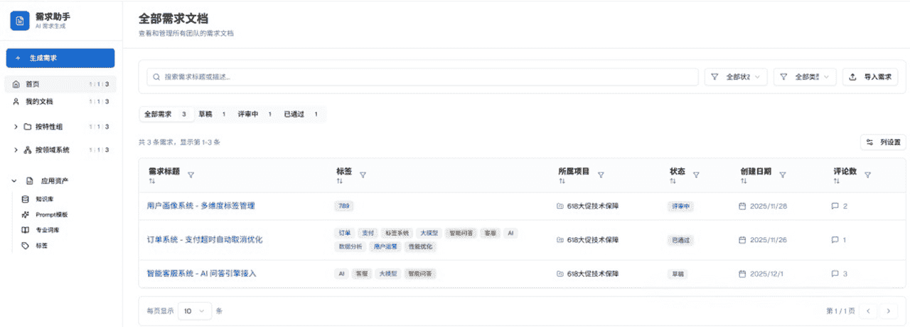

### 3）生成的需求文档

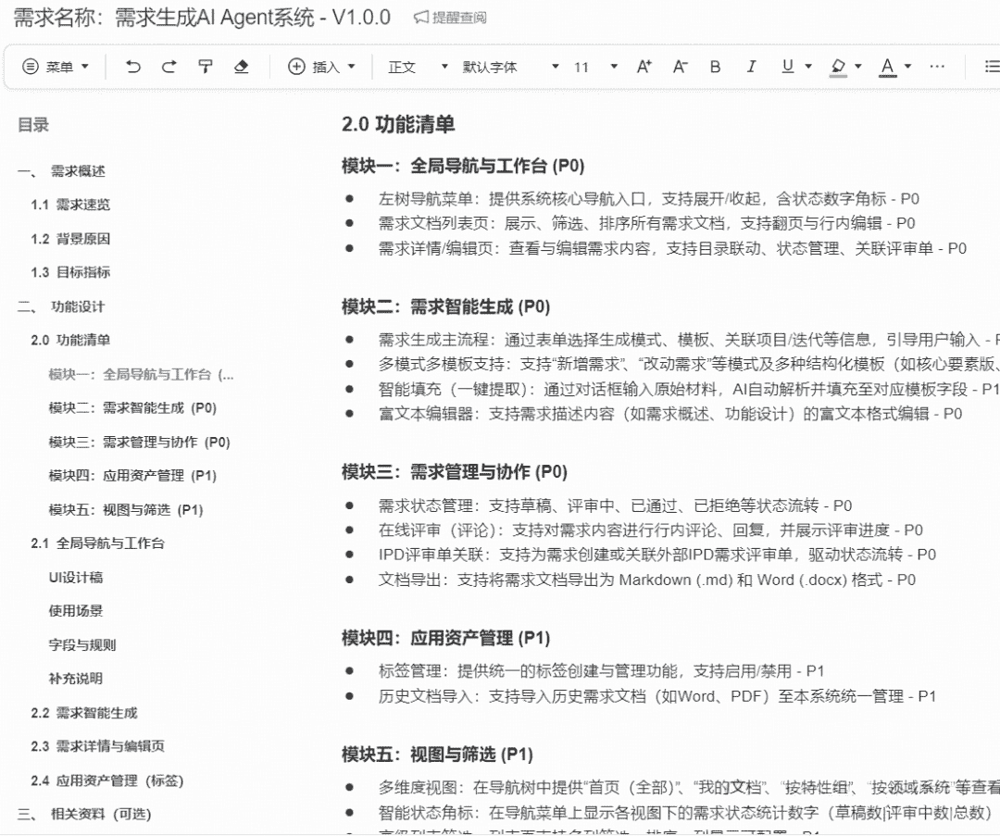

## 用AI辅助做产品功能设计 1.0

### 1）**让 AI 帮我们拆解需求内容**

> 比如：产品到底要解决什么问题？有没有什么限制条件？评判标准是啥？它能一步步帮我们拆解出来，相当于是先把方向搞明白，别一开始就瞎忙活。

**Prompt模版参考：**

```
我现在有一份个产品idea，我希望你能像一位产品策略专家一样帮我逐步拆解它的核心要素。请你按照以下逻辑来分析：
问题定义：这个产品解决的核心问题是什么？能不能帮我总结成一句话的问题描述？
目标澄清：最终希望达到的结果是什么？目标是产品交付、用户增长，还是解决某个痛点？
评判标准：有没有明确的评分维度或隐含的成功标准？比如技术可行性、商业价值、用户体验等。
约束条件：有没有给出特定的使用范围、时间限制、技术框架或者团队配置要求？
用户视角：从用户角度出发，这个题目服务的核心人群是谁？他们有什么痛点或需求？
帮我用结构化的方式回答，最好每点用简洁直白的语言概括清楚，适合后续直接拿去写 PRD 或进入头脑风暴阶段。
```

> 这个 P**rompt 的核心设计是参考了 设计**思维（Design Thinking）中的问题定义阶段，以及 产品经理常用的 4W1H 框架（What/Why/Who/When/How），同时也留了很大的空间让 Amazon Q 用自己的知识和分析能力展开拆解。

也可以把这个模板稍微调整一下用在不同方向上，比如补充上下文或加上具体的想法，AI 就能更准确地帮你分析。

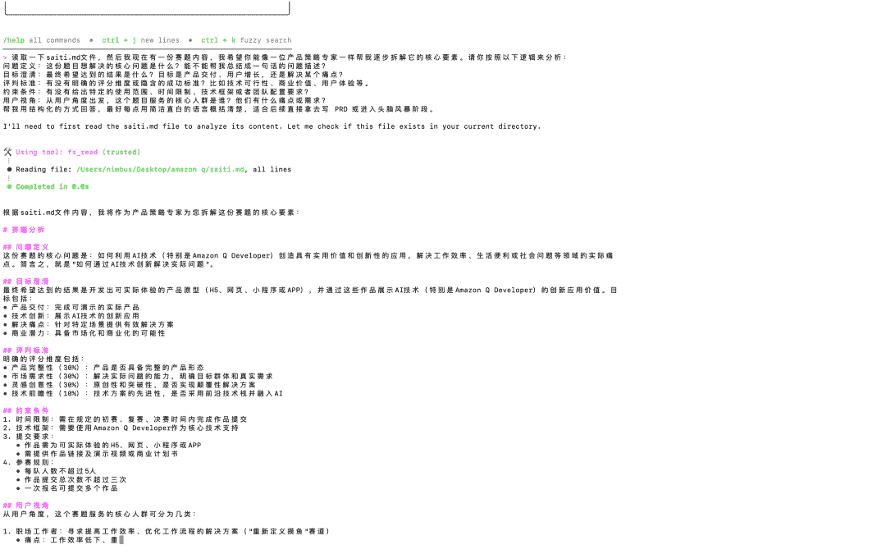

### 2）**让 AI 帮我们完成用户分析**

如果手上有用户反馈、竞品资料或者数据报告，直接扔给 Gemini 3，它就能帮你分析哪些问题是用户反复提的，哪一类人最常碰到这些问题，还有哪些功能可能会被忽略但其实很关键。它会帮你从这些杂乱信息里捞出有价值的洞察，告诉你应该往哪个方向优化或者创新。

Prompt 模板：帮我从用户反馈或竞品资料中提炼出有价值的洞察

```
我现在有一批资料（包括用户反馈、调研记录、竞品分析报告等等），信息量比较大，也比较杂，我想请你像一个懂产品和用户研究的分析师一样，帮我把这些内容整理出清晰的洞察结果。请从下面这些角度来分析：
高频问题归类：哪些问题或需求是被反复提到的？能不能帮我分成几个主题或类目？
用户群画像：根据提问或反馈的内容，哪些用户群体最关注这些问题？有没有可以细分的人群特征？
潜在痛点挖掘：有没有哪些隐含的问题不是直接被说出来的，但可以从表述中读出背后的需求？
机会点识别：从用户的角度看，有哪些功能是他们觉得不方便、但市面上的竞品也没做好的？我们有没有机会切入？
体验差异化建议：有没有什么需求点是可以作为我们产品的差异化亮点来设计的？
最后，请你用结构化的方式输出这些分析结果，最好能分点呈现，便于我下一步进入功能梳理和产品方案设计阶段。
```

这个 Prompt 参考了用户体验研究和产品洞察中的典型分析结构，例如：

+   Affinity Mapping（相似观点归类）

+   Jobs to be Done（用户要完成什么任务）

+   Pain-Gain Map（痛点与收益分析）

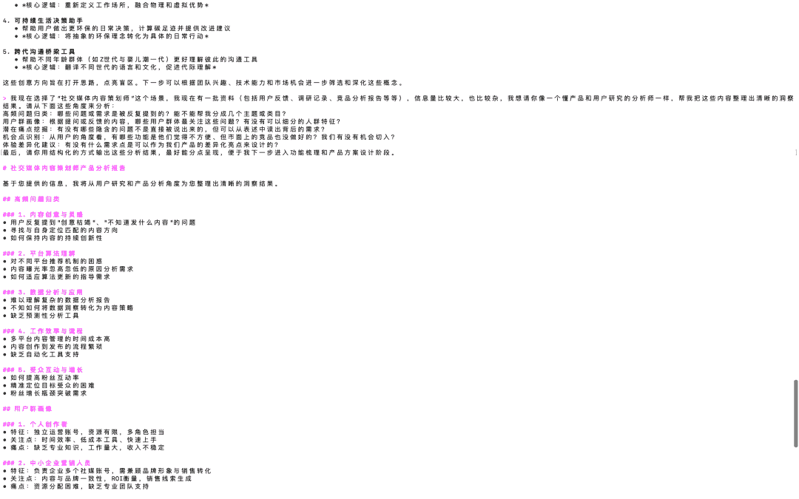

### 3）**让 AI 帮我们梳理功能需求**

上面已经基本清晰了用户的画像和痛点信息，接下来其实主要就是根据这些场景去梳理出咱们的MVP（最小可行产品）的功能模块分别是什么，然后需要一份清晰的需求清单。

当有了大概的产品想法或者解决方向，下一步就是把它拆成一个个具体功能。

> AI会根据前面分析的结果，帮你列出“这个产品应该包括哪些功能”“每个功能解决什么问题”“用户是怎么一步步操作的”。

> 这一块它特别擅长，能把我们脑子里模糊的想法变成一条条写得清楚的功能点，给设计和开发用起来也方便。

Prompt 模板：帮我把产品想法拆成一份清晰的功能需求清单

```
我现在有一个初步的产品构想（或者一个明确的目标/场景），我希望你能根据我们前面的分析结果，帮我整理出这个产品应该包含的核心功能。请从下面几个维度来帮我一步步梳理出来：
功能清单：这个产品从“用户第一次使用”到“完成主要任务”应该包括哪些主要功能模块？请列出每一块并简单解释下它是干嘛的。
用户操作路径：站在用户的角度，整个使用过程大概是怎么一步步走下来的？每个功能点出现在哪个环节？
每个功能解决什么问题：帮我对齐一下：每个功能点的设计目的是什么？它具体是在解决哪个用户痛点或需求？
功能之间的逻辑关系：有没有依赖关系、优先级？哪些是核心功能，哪些是辅助功能？
MVP视角收敛：如果我要先做一个最小可用版本（MVP），应该保留哪些功能？可以先放弃哪些？
请把回答整理成结构清晰的段落或表格，方便我直接拿去做 PRD 或和团队沟通设计方案。
```

这个 Prompt 的设计参考了产品规划中的经典方法论：

+   功能-需求映射表（Function vs. Need）

+   用户路径分解（User Journey Mapping）

+   **MoSCoW 优先级模型（Must, S**hould, Could, Won’t）

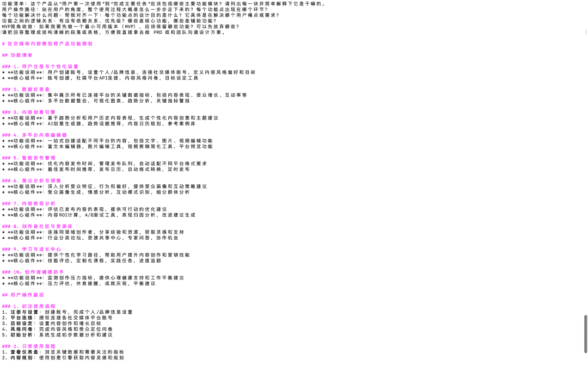

### 4）让 AI 生成一份 AI 看得懂的 PRD 文档

现在写 PRD，不光是给人看的，还得让 AI 工具也能读懂。

> AI 会根据我们前面聊出来的功能，自动生成一份结构清晰的产品需求文档。

> 里面包括功能说明、用户流程、接口逻辑这些关键点。

> 它写出来的文档逻辑很清楚，拿去跟团队同步，或者对接别的智能工具，都能直接用。

Prompt 模板：帮我生成一份结构清晰、AI 可读的 PRD 文档

```
我已经有了产品的基本构想和功能列表，现在想请你帮我整理成一份AI 能看懂也能继续执行的 PRD（产品需求文档）。这份 PRD 不仅要让人看得懂，更要考虑结构的清晰度、格式的规范性，方便后续接入自动化流程或智能工具调用。请按以下结构来输出：
产品背景和目标：简单描述产品要解决什么问题，服务什么场景，核心目标是什么。
核心功能模块列表：列出每个功能模块的名称、功能描述、使用场景，最好补充一句“这个功能解决的问题”。
用户流程图（文字版）：从用户视角出发，描述用户从进入产品到完成关键任务的操作路径（可分步骤标序号）。
每个功能的输入/输出：列清楚用户或系统输入了什么、期望的输出结果是什么，适合后续和大模型交互或和 API 对接。
接口需求（如有）：说明每个功能点是否需要接口支持，如果需要，说明接口用途、调用方式、数据结构要求。
边界条件和异常处理：列举常见的边界情况和异常场景，说明系统应如何响应。
请按模块清晰排版，内容尽量结构化，避免散乱描述，最好用 Markdown 或表格格式输出，便于后续被其他智能工具或工程团队复用。
最后保存到当前文件夹中，以md格式存储。
```

这个 Prompt 融合了：

+   **机器友好型 PRD 写作法**（结构明确、模块分割、数据流清晰）

+   **产品六要素**（目标、用户、功能、流程、数据、边界）

+   **适用于自动化系统理解的语法习惯**（如 Markdown 表达、明确的输入输出分离）

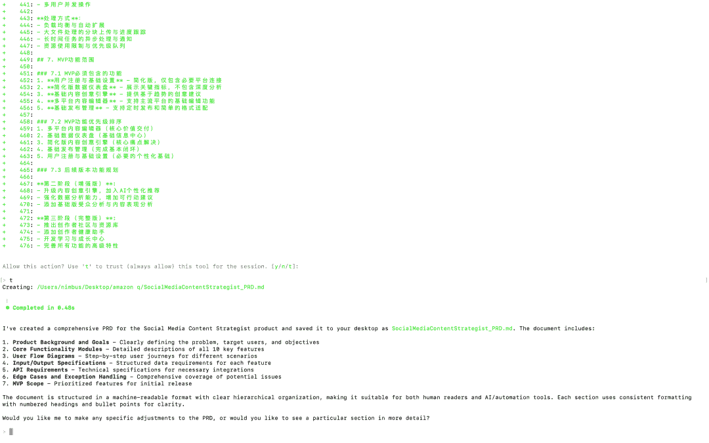

### 5）**让模型知道我们想要的界面长啥样**

**让**模型知道我们想象中的界面长什么样子，使用 Figma MCP 的服务，把 Figma链接放进去就可以了。

主要用到的是figma的mcp服务

更多mcp服务可以在mcp.so找到。

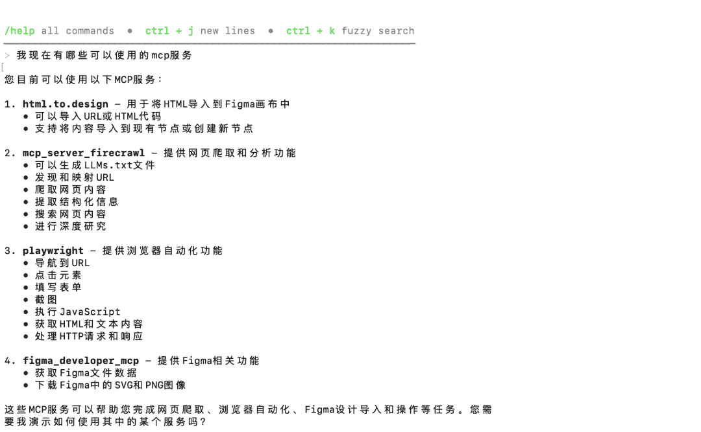

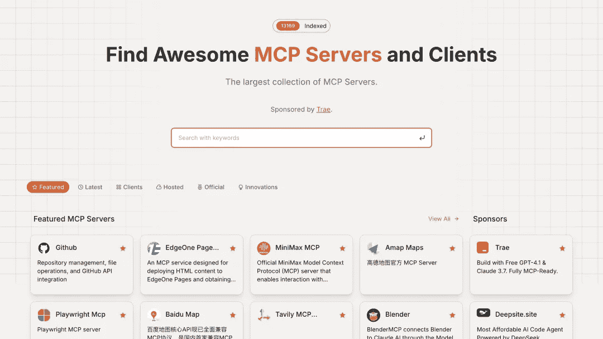

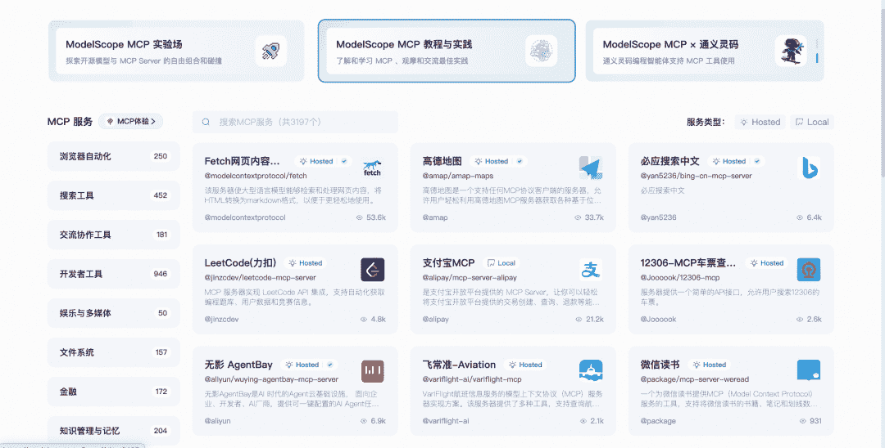

有时候我们脑子里已经有了产品大概的样子，甚至已经在 Figma 上画好页面了，这时候完全可以让模型直接“看图说话”。

**我**们只需要把 Figma 的设计丢给它，它就能通过 MCP 服务自动识别页面结构、组件类型、交互关系这些细节。

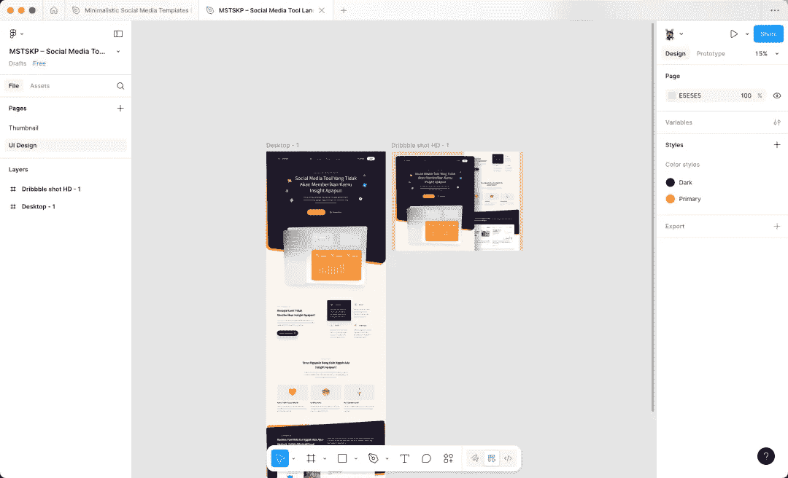

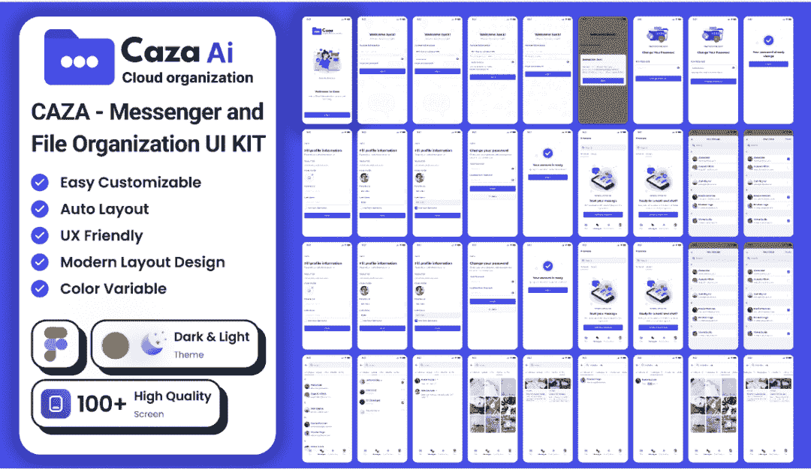

这一步最大的好处是，**模型理解界面的方式就跟人一样，知道哪个是按钮、**哪个是输入框，知道用户点一下会发生什么。后面你要让它写前端代码，或者生成交互逻辑，就会顺畅很多，省得我们一个个功能再解释一遍。

Prompt提示词这个就很简单：

```
结合我的figma设计稿
读取我的prd文档，帮我实现这个功能，
遵循Tailwind Css设计规范，使用CND图标替换，
使用Unspalsh图片替换对应的图片信息。
```

### 6）给 AI 准备好对应的 API 文档

想让它进一步帮我们动手干活，比如调用数据库、调取用户信息，那就得先把 API 文档给它。

> 只要我们把接口说明、参数规则、请求方式写清楚，它就能“学会”怎么调用这些服务，后面可以自动帮我们写代码、拉数据、生成内容，不用我们手动对接每个环节。

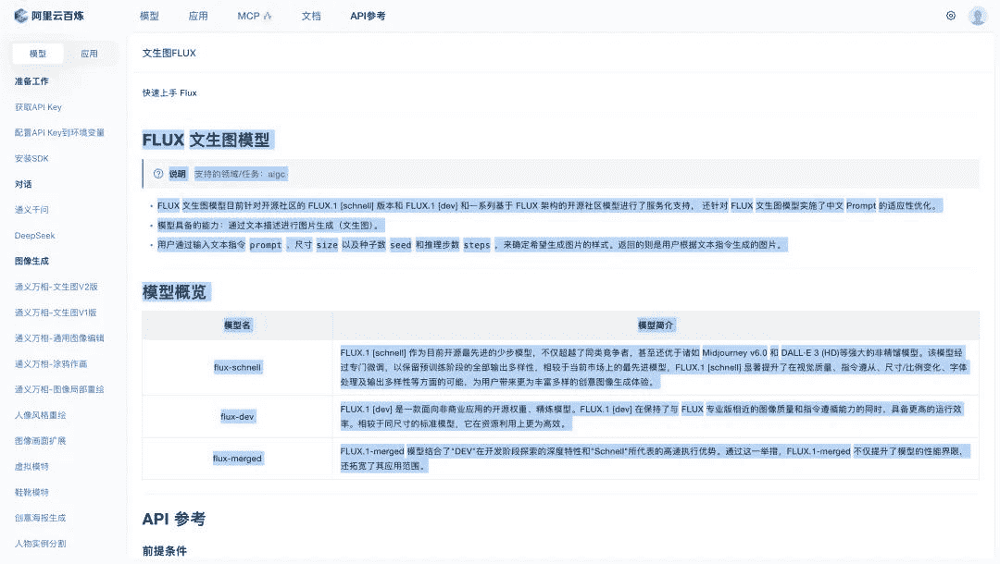

### 7）让 AI 开始读取文档帮我们干活

PRD 和接口都搞定了，就可以让 Gemini 3 正式“上岗”。我们可以直接告诉让它去读取我们的需求文档、API文档，它就能根据文档自动处理，真正把分析、设计、开发串在一起干了。

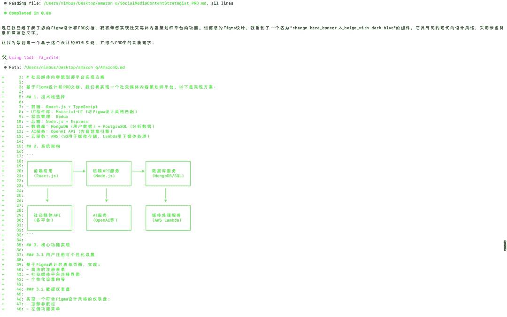

可以来看看最后运行完成实现的效果：

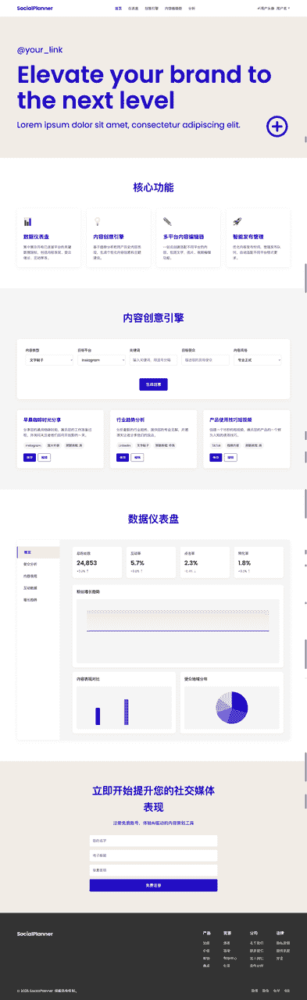


### 8）让 AI 帮我们写一份产品介绍文档

**产品做出来了，总得有个对外或对内的介绍材料。这**个时候也可以让 Gemini 3 来写。

> 它能根据我们之前的需求文档、用户场景和产品功能，总结成一份像样的介绍内容。

> 不管是给团队成员看，还是用于内部评审，它写出来的内容结构都挺专业的，不啰嗦，重点也很清楚。

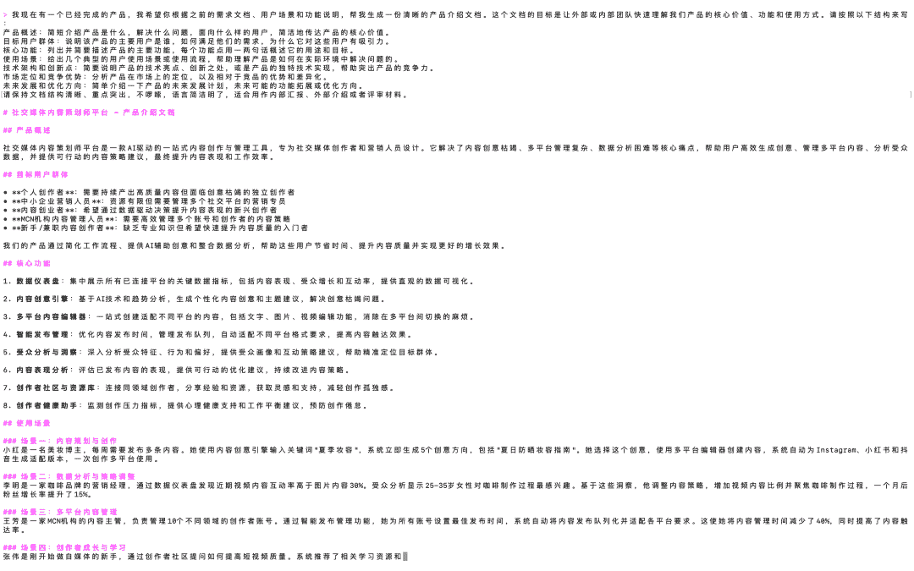

Prompt 模板：帮我写一份简洁且专业的产品介绍文档

```
我现在有一个已经完成的产品，我希望你根据之前的需求文档、用户场景和功能说明，帮我生成一份清晰的产品介绍文档。这个文档的目标是让外部或内部团队快速理解我们产品的核心价值、功能和使用方式。请按照以下结构来写：
产品概述：简短介绍产品是什么，解决什么问题，面向什么样的用户，简洁地传达产品的核心价值。
目标用户群体：说明该产品的主要用户是谁，如何满足他们的需求，为什么它对这些用户有吸引力。
核心功能：列出并简要描述产品的主要功能，每个功能点用一两句话概述它的用途和目标。
使用场景：给出几个典型的用户使用场景或使用流程，帮助理解产品是如何在实际环境中解决问题的。
技术架构和创新点：简要说明产品的技术亮点、创新之处，或是产品的独特技术实现，帮助突出产品的竞争力。
市场定位和竞争优势：分析产品在市场上的定位，以及相对于竞品的优势和差异化。
未来发展和优化方向：简单介绍一下产品的未来发展计划，未来可能的功能拓展或优化方向。
请保持文档结构清晰、重点突出，不啰嗦，语言简洁明了，适合用作内部汇报、外部介绍或者评审材料。
```