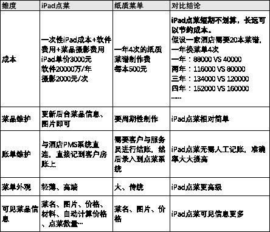
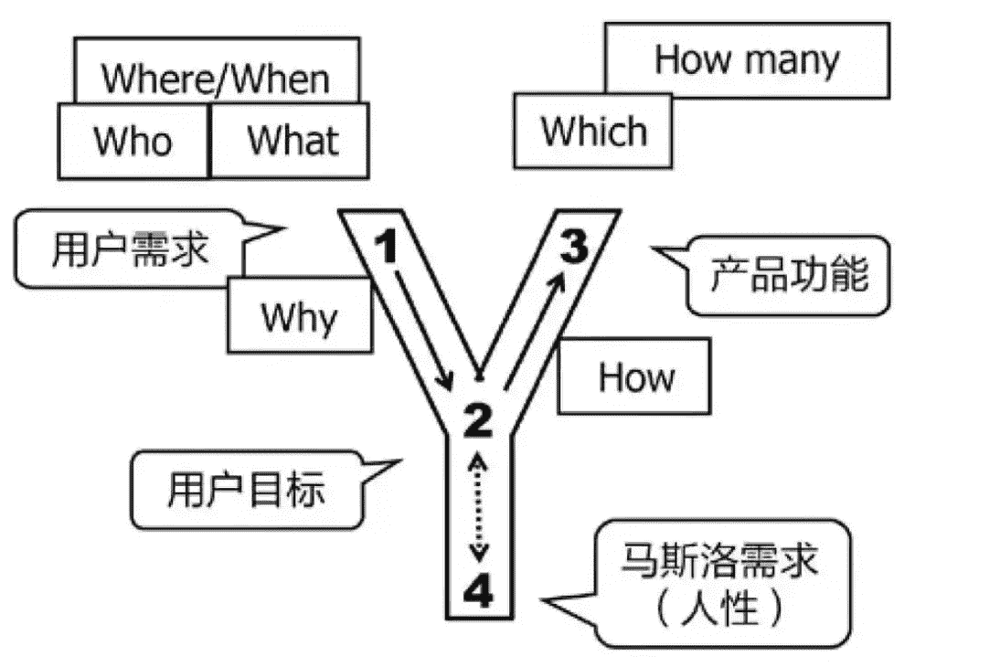
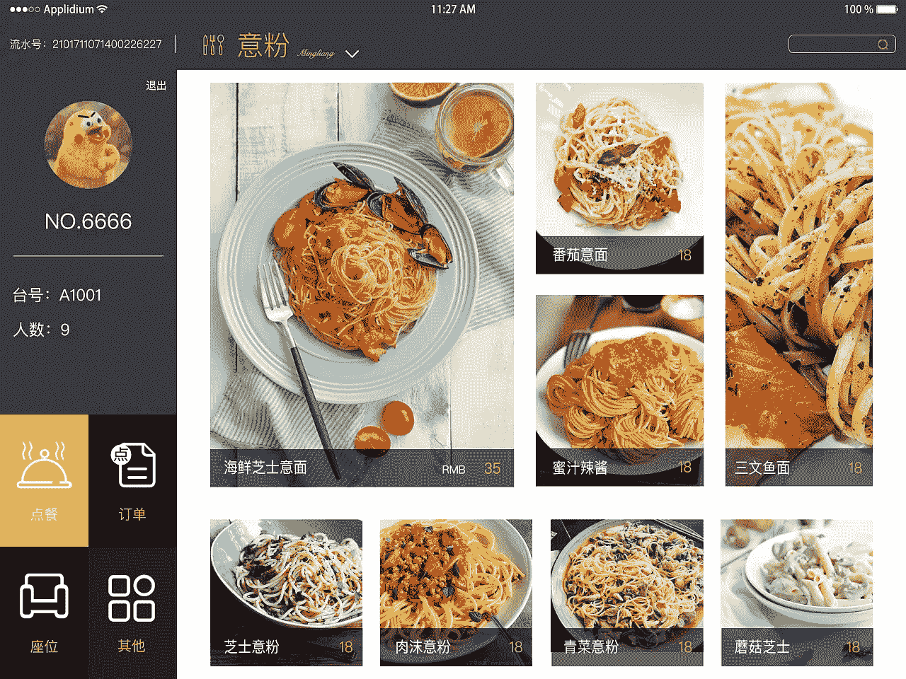
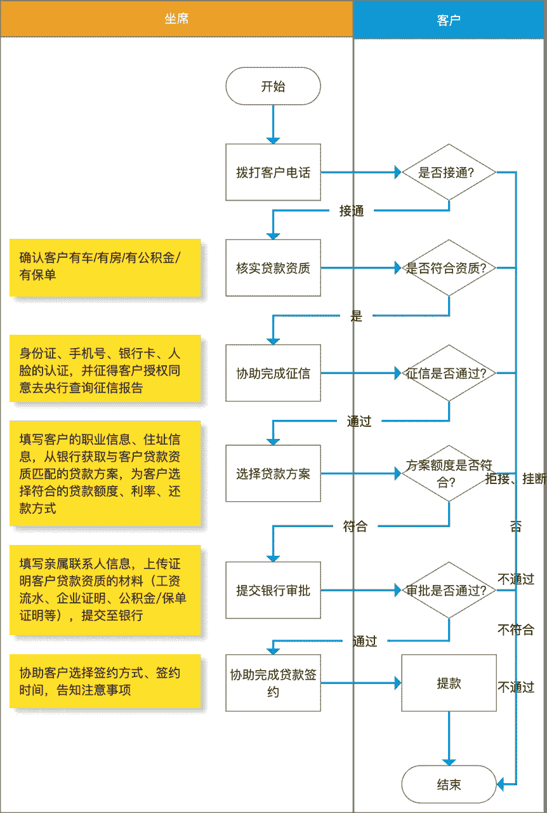
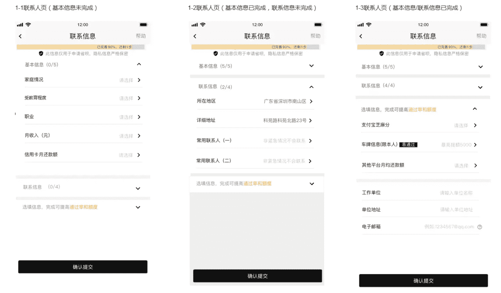

# 需求辩伪

> 来源：[https://qqs7y1hozd1.feishu.cn/docx/QKEtdoD8JotIjgxEgDZc7L1Lnof](https://qqs7y1hozd1.feishu.cn/docx/QKEtdoD8JotIjgxEgDZc7L1Lnof)

对于产品经理来说，需求分析第一步一定是做需求辩伪。

> **一般而言****，****这个阶段****花****最多心思**的是提炼需求、优化需求、权衡利弊，但往往忽略了对需求的真伪做一个辩证分析。

因此，需求分析时排除伪需求乃重中之重。

> 那分辨伪需求有什么比较好的办法呢？本文将以“iPad点菜”和“客户自助式信息提交H5页面”2个需求案例，分别使用Y模型分析方法、用户场景流程分析方法与大家演示辩证的过程。

## 01

**需求：**iPad点菜

> **背景：**A公司是一家以提供高端定制化软件为卖点的技术公司，主要客户是国内高端的餐饮酒店。

> 彼时餐饮酒店的菜单多为纸质菜单，单本价格不菲，而餐饮酒店的菜单随着季节交替变更较为频繁。于是，一些大客户餐饮酒店提出在iPad上实现点菜。

> **目的：**开发一款在iPad上点菜的APP，取代纸质菜单。

**A公司拿到这个需求的时候，主要从以下几个维**度分析，并得出了开发iPad点菜的结论。

分析得出的结论都没问题，但这是一个伪需求。为什么？让我们用Y模型来分析一下。

**Y模型需求分析的思路浅析：**

> 第一层：用户提出的诉求，

> 第二层：诉求的目的，

> 第三层：心理上的诉求。

> 结合成一句话就是：收集到用户的诉求时，我们要了解他诉求背后的目的，再确定他心理上想满足的点，最终设计出一个可以满足他心理诉求的功能。

那么，我们开始分析iPad点菜需求。

> **第一层（用户提出的诉求）**：大客户餐饮酒店提出在iPad上实现点菜；

> **第二层（诉求的目的）**：更低的成本、方便菜品维护、方便账单维护、更高级的外观、客人可以看见更多的菜品信息；

> **第三层（心理上的诉求）**：分类归纳为，对酒店而言可以降低成本，对客人而言可以让客户感到更高级的服务。

> 由此我们发现iPad点菜实际上是满足2B（酒店）和2C（来酒店吃饭的客人）两类用户的诉求，为酒店省钱，让客人感到高级有面子。但是这里有一个很大的坑就是，对于提出需求的的酒店，更低的成本、方便菜品维护、方便账单维护这几个目的确实可以通过iPad点菜很好的实现。但是，客人真的能通过iPad点菜体验到更高级的服务吗？

我们不能听需求提出人的一面之词，一定要站在用户的角度想一想，再通过Y模型的第三层反推一下客人会不会想要iPad点菜。

> **第三层（心理上的诉求）**：我要吃饭的时候体验更高级的服务；

> **第二层（诉求的目的）**：多样化的服务体验、贴心恭敬的服务员、优雅的就餐环境、很难吃到的美食……

> **第一层（用户提出的诉求）**：能享受按摩、美甲服务、全程服务员伺候、拍照美美的高级包厢、品尝法国红酒……

> 这么一想会发现，对于客户而言，高级服务基本不会是iPad点菜。因为，对于普通人而言，有一个在身边供自己使唤的人带来的优越感远比一台贵重的机器多得多。

> 可以回忆一下近几年去餐厅吃饭，基本没有餐厅会在客户落座后会递上一个iPad。高级点的餐厅在客人点菜时，肯定会有一个服务员毕恭毕敬地站着，给你介绍菜品，给你记菜。

> PS1：这也可以解释为什么餐厅、酒店、美发等行业宁愿多花一些钱在雇佣员工、装修上，以及一些花里胡哨的地方，也不会为了提高效率去落实电子化、数字化，因为那会减少他们的客流。

## 02

**需求：**客户自助式贷款信息提交H5页面；

> **背景：**B公司是国内领先的金融助贷服务公司，有一个与银行直连的CRM系统，每天有2000名坐席在该系统通过“电话销售+文字沟通+系统录单”的模式进行作业。而随着国内的监管日益严格，公司的安全合规部门也提出更加严厉的规定：不允许销售员工接触任何的客户敏感信息（手机号、身份证号、银行卡号、家庭住址等）。为客户办理贷款期间，大概有100个字段需要客户提供，如果完全按照规定执行会导致部分贷款业务无法开展。

> **目的：**通过让客户自主完成贷款信息填写，规避安全合规风险。

我当初想到自助式贷款信息提交H5页面这个方案的时候，半夜激动的睡不着觉，但与富有经验的销售主管聊过之后，便彻底否定了这个方案。接下来，让我们以用户、场景、流程来的分析方法得出以上结论。

**用户：**有贷款意向的白领、小微企业主，年龄段为40岁的正态分布。

**场景：**坐席端：上班时间，通过CRM系统呼叫客户，此时除了知道客户有意向办理贷款和一个掩码的手机号（132*****888）之外，其他信息均需客户提供；客户端：上班时间，收到一个标记为B公司的号码。

**流程：**见以下流程图。

通过以上分析可以比较简单的得出：

> 流程较为复杂，所需的信息较多，而主流的贷款客户并不是移动互联网的高端玩家，难以完成贷款信息的自主提交。

> 作为产品经理想到这么完美的一个解决方案，我当然不愿就此放弃。公司还有专业的坐席，如果不只是甩给客户一个表单H5，而是给H5的同时，坐席给予操作引导，那么不就可以让客户完成贷款信息提交了吗？这样当客户提交后，系统再自动同步表单数据至坐席端，坐席只要负责简单的内容校验即可。

> 如果真这么做了，那产品经理就是想当然的闭门造车了。实际上，在上述流程图中，客户流失率非常高，基本每一个客户端的判断都要损失50%的客户。而将表单交给客户填写，意味着留给客户思考的时间增加，客户思考得越多，乱七八糟的想法就越多，流失率就越高！

