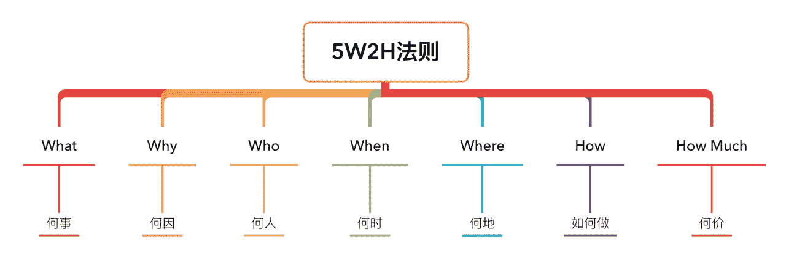
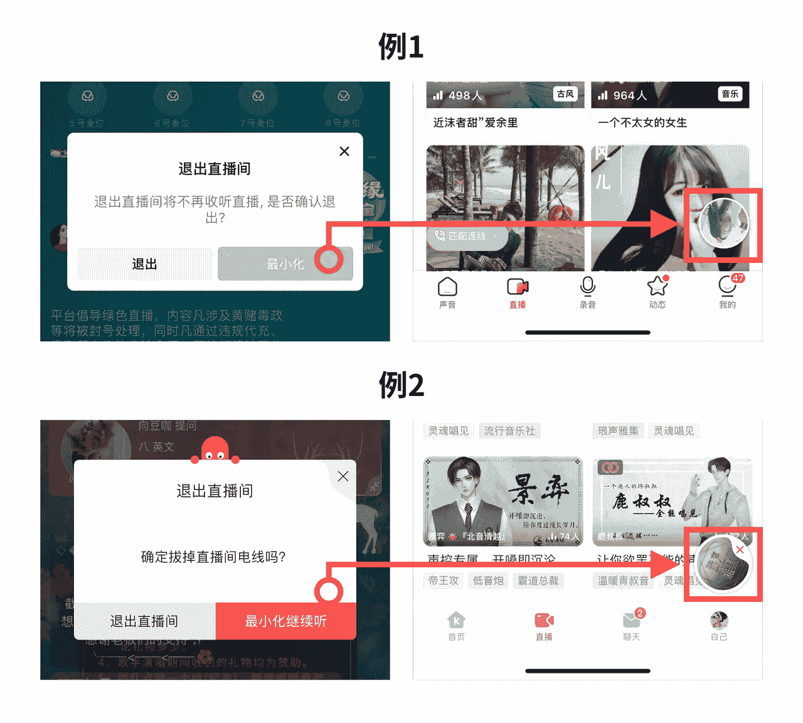

# 5w2h分析法

> 来源：[https://qqs7y1hozd1.feishu.cn/docx/Clz8dzfy9owcTsxy3cec6TLHnah](https://qqs7y1hozd1.feishu.cn/docx/Clz8dzfy9owcTsxy3cec6TLHnah)

> 需求分析中的5W2H分析法是一种实用的思考方法，可以帮助我们全面、系统地理解和分析问题。

**这种分析方法主要包括七个方面：**

> **What——是什么：**明确需要解决的问题或实现的目标是什么。这涉及到对问题的定义和范围的界定，是需求分析的起点。

> **Why——为什么：**探究问题产生的背景和原因。通过深入了解问题的根源，我们可以更准确地把握需求，提出更有效的解决方案。

> **Who——是谁：**确定问题的涉及者是谁，包括受影响的群体、利益相关者等。这有助于我们更好地理解他们的需求和期望，从而制定出更符合实际情况的解决方案。

> **When——什么时候：**分析问题发生的时间节点和时序关系。这有助于我们把握问题的紧迫性，合理安排解决方案的实施时间。

> **Where——在哪里：**确定问题发生的地点或范围。了解问题的空间分布和影响因素，有助于我们提出更具针对性的解决方案。

> **How——怎么做：**思考解决问题的具体方法和途径。这包括制定详细的实施计划、采取适当的措施等，以确保解决方案的有效性和可行性。

> **How much——多少：**评估解决问题的成本、效益和资源需求。这有助于我们在制定解决方案时充分考虑经济性和可持续性，确保投入与产出的平衡。

## 如何结合使用？

了解清楚了5W2H法则，我们用例子来看一下，在语音直播产品中场景的几个模块，他们是怎么运用的。

首先我们先抛出几个语音直播产品最常见也是最关心的问题，然后把问题具体化。

### 问题1：直播间听众流失跳出率很高呀，为啥留不住用户呢？

+   **What：**直播间听众用户的互动越来越少；

+   **Where：**直播间里在线人数和发言互动人数减少；

+   **When：**最近一段时间（明确时间、几周、几日、几月、哪个时间段）；

+   **Who：**以前活跃的人，现在都不怎么在线或发言互动了；

+   **How Much：**以前直播间至少几千的在线人数，互动发言的能占百分之三十，现在在线人数减少到一两百人，活跃的不到百分之十几；

+   **Why：**可能是主播内容质量不够新颖互动不够强烈？直播间功能单一无趣了？用户被其他平台更大魅力吸引去了？产品的用户体验不够完善？或者一些不确定的外因等等。

**那该如何用呢？**

> 为什么直播间在线/互动人数减少了？

> 因为直播间无趣，内容质量差，没有吸引力，留不住用户。

> 为什么直播间会无趣，没有吸引力呢？

> 因为内容差，且主播与听众之间的互动少。

> 为什么互动少呢？

**因为直播间功能玩法、活动单一、缺乏新鲜感，缺少主播与**听众的互动纽带桥梁，或主播业务能力欠缺。

**换个角度说，你需要：**

+   **对用户做一个调研，**明确用户更偏向喜欢什么样类型的业务，什么样的主播，针对性的提升主播的业务能力；

+   通过分析用户数据，做一些多元化玩法功能，在满足用户的基本需求基础上，增添一些期望需求和魅力需求，不定期制造惊喜功能，刺激用户；

+   对听众从进来到出去流程的数据节点做一个分析，是哪个环节出现了问题，导致用户流失的，有无办法补救，无法补救的话，是否需要悬崖勒马，重新探索一条更适合的路径呢（考虑时间成本和技术成本）。

**举例：**

**分析：**

**这**是目前市场上基本常见到的，退出直播间时会弹出的二次确认退出弹窗，最小化房间可悬浮在首页右下角继续听直播。

看似不起眼的小功能点，却对直播间用户留存起到很大的作用。

> 首先从功能上讲，按照市场上视频直播间的设计，一键返回便退出了直播间，而语音直播间却多了一个最小化继续听的功能；一是因为语音直播关键是在“听”，不像视频直播关键在“看”，所以在使用场景上并没有那么局限，提供最小化继续听；即使人不在直播间，也可以边做其他事边听直播，在用户听到很精彩内容的时候也可以马上返回直播间，进行互动，把用户再重新拉回来，留住用户。

> 其次，从用户体验上讲，这个弹窗的最小化按钮设置在右边高亮的位置而不是左边；而人在以往产品中点击右边高亮位置的使用习惯早已养成，巧妙利用这一惯性，可以让用户自然而然不知不觉的点击最小化继续听，降低了直接流失的几率。

> 而例1和例2中，有一个不同点，就是房间浮窗，一个多了不用返回直播间即可直接关闭房间的交互功能，一个则是需要用户再次进入直播间，才能关闭直播。

> 从用户的角度出发，用户不用再次进入直播间就能关闭直播，路径缩短，能量消耗少，可谓是非常方便快捷的设计了。

> 从平台的角度出发，如果用户在外面就关闭了直播，缩短了路径，虽然方便了用户，但是降低了平台留住用户的几率；如果让用户进入直播间在关闭直播，或许用户刚好看到直播间里精彩的互动和内容，吸引住，又留下来继续参与直播呢，说不定还能产生消费。

> 把路径这么增加一个点，就能有希望留住用户，产生价值，平台怎么会轻易放个这个机会呢？

**这个功能点相当于利弊共存了，具体采用哪种方式**，还是要看公司具体想舍弃什么保住什么了。

### 问题2：直播间听众付费率越来越低，为啥呢？

+   **What：**直播间付费用户越来越少；

+   **Where：**直播间里愿意花钱消费的人数逐渐减少；

+   **When：**最近一段时间（明确时间、几周、几月）；

+   **Who：**以前付费的用户或现在的新用户，现在都不怎么产生消费行为了；

+   **How Much：**以前直播间上万的流水，现在流水在原先基础上减少一半；

+   **Why：**可能是直播间氛围不是很好？付费路径入口太少，门槛高或缺乏引导？礼物样式不够独特新颖，缺乏创新？运营活动单一，优惠不够完善？怎么用？

> 为什么直播间用户付费人数减少了？

> 因为直播间付费动力不足。

> 为什么直播间付费的动力不足呢？

> 因为直播间缺少刺激用户付费的因素。

> 为什么无法刺激用户付费呢？

因为直播内容质量、氛围差、付费消耗路径少、门槛高或缺乏引导、礼物样式不够独特新颖，缺乏创新、运营活动单一，优惠不够完善。

**换个角度说，你需要：**

+   增设更多的创新运营活动，给平台注入活力，制造氛围；

+   按用户分类，调整付费结构，适当增设付费路径；

+   跟随时代潮流和热点，抓住用户从众心理，实时更新礼物样式，不断创新；