# HMW分析法

> 来源：[https://qqs7y1hozd1.feishu.cn/docx/L82IdOelQocLn9xph22czaysn2b](https://qqs7y1hozd1.feishu.cn/docx/L82IdOelQocLn9xph22czaysn2b)

HMW，全称“How Might We”，即“我们可以怎样”，其中：

+   **How：**表示我们假设问题是可以解决的，只是我们尚不知道如何解决。

+   **Might：**暗示现在讨论的想法不用太完美，支出大概有哪些方向即可，问题有无数的解法，我们可以有很宽广的创造空间。

+   **We：**强调团队的重要性，不是单一成员的努力就可以解决问题，是需要整个团队的力量才可以解决这个问题。

> How Might We（简称HWM）分析法是一种创新思维工具，通常用于设计思维或用户研究中，帮助团队从用户的角度出发，重新定义问题并探索可能的解决方案。这种方法鼓励团队从用户的角度出发，思考如何满足他们的需求和期望。

> 可以改变固有的思维逻辑方式，防止自己圈定在一个圈层或者方向中，开拓自己的思维层面，不受单种方式的拘束，使得我们在同个问题上可以发散性地对多个方向进行剖析，确保创新者正在使用最佳的措辞提出正确的问题。

**HMW分析法的核心步骤包括：**

> **深入了解用户：**通过用户访谈、观察、问卷等方式，深入了解用户的需求、痛点和期望。

> **定义问题：**根据收集到的用户信息，将问题或挑战转化为更具体和用户导向的表述。拆解问题的方向：

> **否定（逆向思维）：**如何想办法让用户放弃这个想法。

> **积极（发挥积极影响）：**如何让用户提升自己来解决这个问题。

> 转移（移除消极影响/换其他方案）：如何让其他人解决问题，继而解决这个用户的问题。

> **脑洞大开：**发散思维，从需求或环境中创造类似的体验，或改变现状……

> **分解：**将大问题拆分成很多小问题。

> **生成HWM问题：**基于定义的问题，创建一系列以“How Might We”开头的开放性问题。这些问题旨在激发团队的创新思维，探索可能的解决方案。

> **讨论与头脑风暴：**团队成员针对这些HWM问题进行讨论和头脑风暴，产生各种可能的解决方案或想法。

> **筛选与优化：**评估并筛选出最具潜力和可行性的想法，进一步优化和完善这些解决方案。

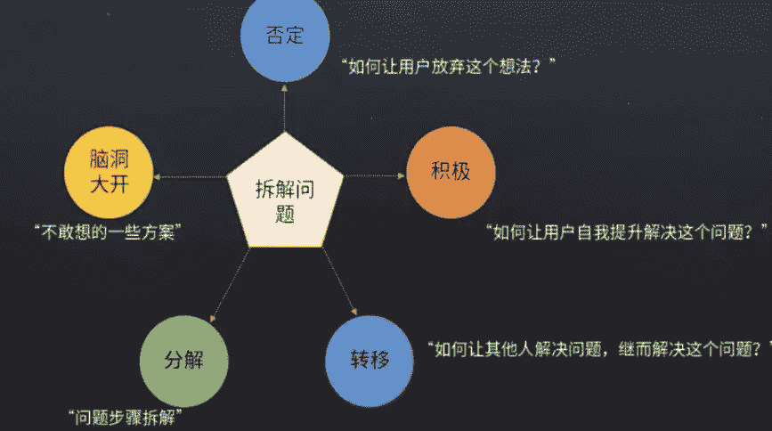

### 示例：小物说（小程序）

一个好物互送的平台，越来越多的人在“单纯物品交换”环境下产生了很多互动。

以下用HMW法分析，如何优化小物说这一平台的社交效果。

#### 1.产品概述

> 小物说是一个闲置商品的c2c交易平台，用户只要支付虚拟代币“小红花”和邮费，就可以购买其他人发布的二手商品。在平台上出售商品，卖家（赠送方，以下均称为“卖家”）收到“小红花”，可以用小红花交换其它物品。

二手商品的价值最终由供需关系决定，以代币作为数值的衡量。

##### 1.1 产品主要逻辑

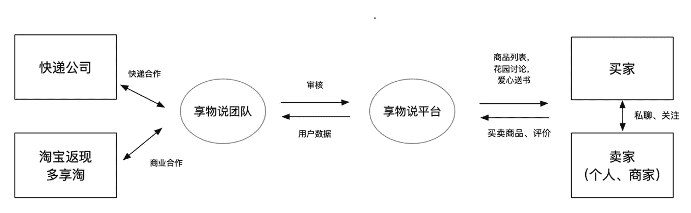

小物说的主要逻辑就是用户之间在平台上“买卖”二手（也可能全新）物品，只是这个平台用鲜花作为货币进行交易，鲜花不能换成通用货币。

##### 1.2 用户定位

> 根据《爬取20万数据 我们深扒了风口上的小物说》、百度指数小物说的用户地域分布（图1）、中国省级行政区人均GDP分布图（图2）、中国互联网普及率（图3），可以看出赠送者大多分布在东南沿海地区，向西部内陆递减。领取商品的主力用户（需求方）主要来自于三四线城市。

用户集中在30~39岁之间，男女比例较均衡，男性稍多。

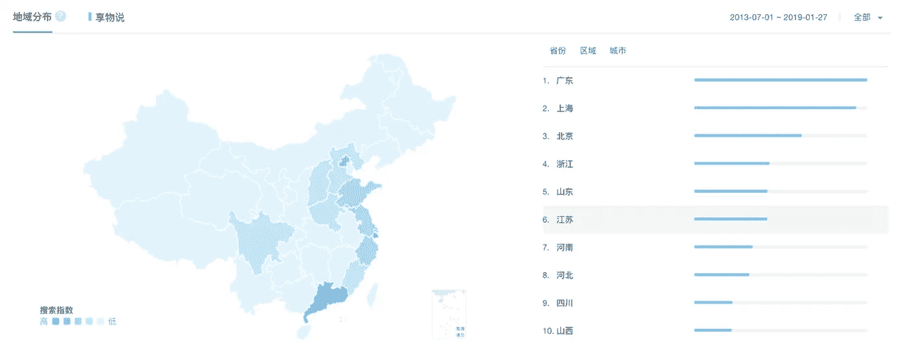

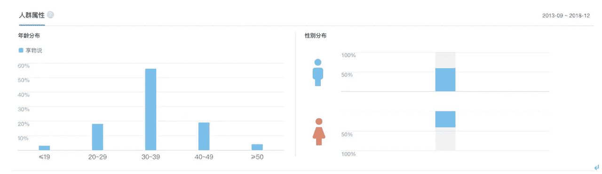

> 基于在平台上最流行的品类主要是手机壳、口红、面膜、玩具、娃娃**等单价低**、复购率高的特点，推测用户主要是价格敏感，有贪便宜的心理。

赠送方一方面出于环保考虑“废物再利用”，其中也存在不少通过置换免费获得其他低价物品的需求的人。

#### 2.小物说产品体验

##### 2.1 社交功能现状

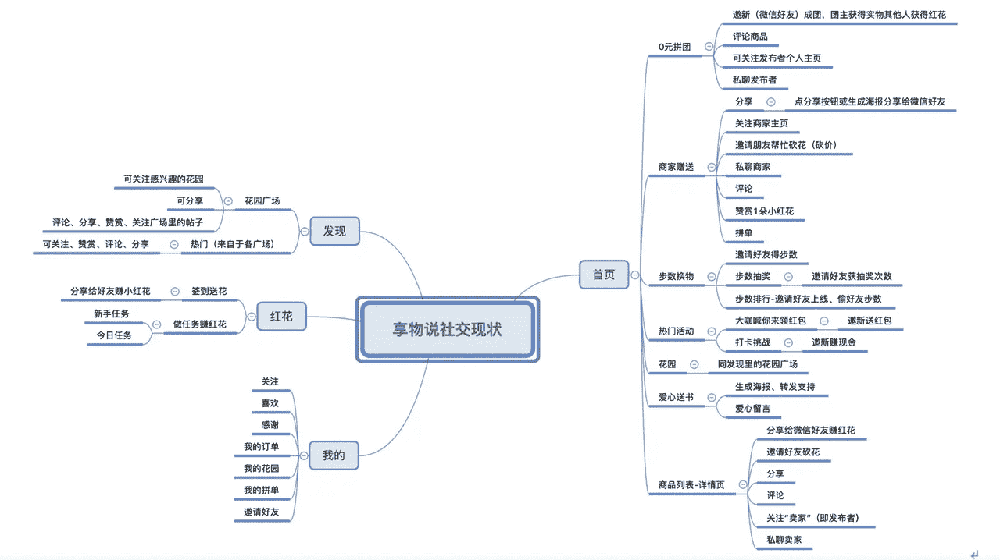

##### 2.2 社交方面主要问题

> 通过平台功能体验可以发现，平台花了很多心思在拉新上，通过拼团、领红包、裂变拉新等“拼多多”式增长策略，获得了很多的用户，但是作为交易平台光有拉新是不够的，留存率、活跃度、转化率也很重要。

如何优化小物说平台的社交体验让用户更愿意在平台上进行互动，提高留存及转化是此次分析的问题核心。

体验中发现的社交方面的主要问题如下：

1.  小程序与app的功能菜单等不一致,初次使用缺乏引导说明。

1.  私聊入口特别深也很不明显，需要找到“卖家”的个人主页后，点击卖家名称右边很小的私聊按钮，才可发起与卖家的一对一沟通，不便于对商品情况的咨询交流。

1.  消息提示不明显，特别容易忽略和错过别人的留言等互动。

1.  小程序的商品列表无法按照价格、时间等关键信息排序，不利于用户快速查找和定位，App的排序入口不明显。

1.  花园里的内容混乱，很多与主题不符的内容。

1.  参与砍花说明不清晰，app邀请朋友砍花只是收到一个小物说小程序介绍的图片，没有扫码帮朋友砍价等说明，让用户无所适从。

1.  只能在微信中分享。

1.  查看物流，小程序端需要重新下载不知道是什么的app，APP端会出现“暂无信息”的提示，体验很差。

#### 3.HMW分析优化享物的社交

**从HMW五个维度展开：**

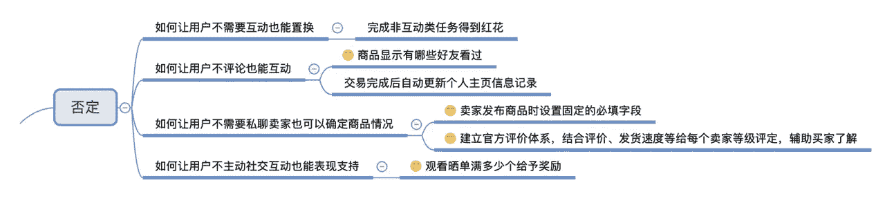

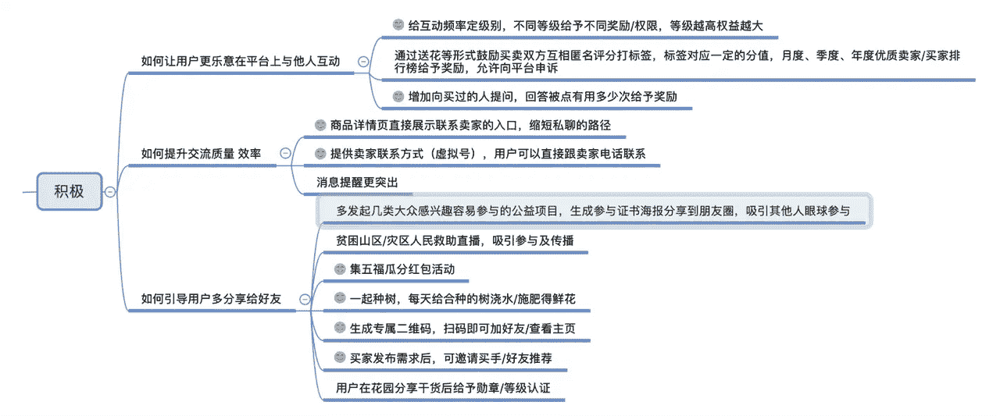

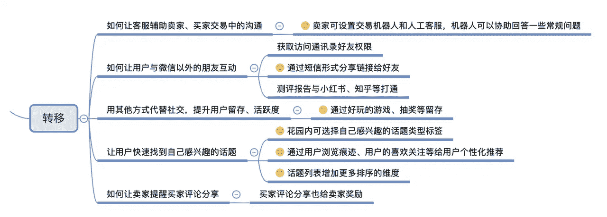

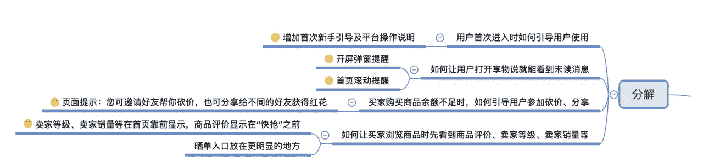

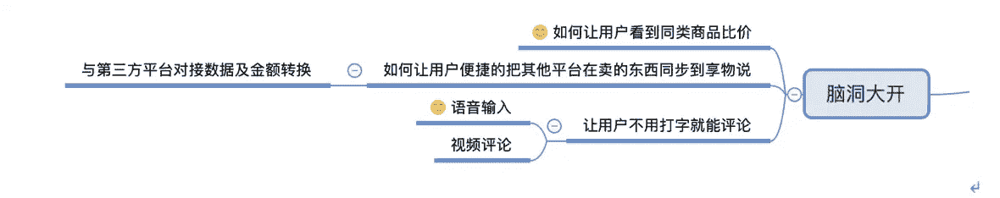

#### 4.筛选出5个靠谱需求

##### 4.1 需求分组

**HMW中，比较靠谱的优化社交交互体验方面的需求都标注了笑**脸，根据解决问题的类型，进行了筛选分组：

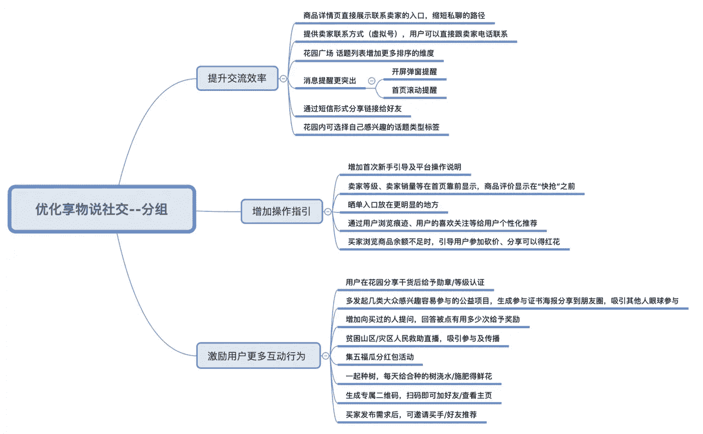

##### 4.2 分组的优先级排序

**根据“优先解决大用户量高频的问题”**、“优先解决见效快且开发难度低”的原则。

+   优先级1：提升交流效率组

+   优先级2：增加操作指引组

+   优先级3：激励用户更多的互动行为组

##### 4.3 针对以上分析结果，初步对解决方案筛选过滤出以下5个需求

1.  商品详情页直接展示联系卖家的入口，缩短私聊的路径；

1.  增加开屏弹窗等消息提醒，使消息提醒更突出；

1.  花园广场话题列表增加更多排序的维度；

1.  卖家等级、卖家销量等在首页靠前显示，商品评价显示在“快抢”之前；

1.  买家想买商品发现余额不足时，引导用户可以邀请朋友砍价，分享可以得红花。

1.  需求优先级排序

基于用户量、发生频率、开发难度和见效效果、用户迫切程度等方面对5个需求的优先级进行排序。

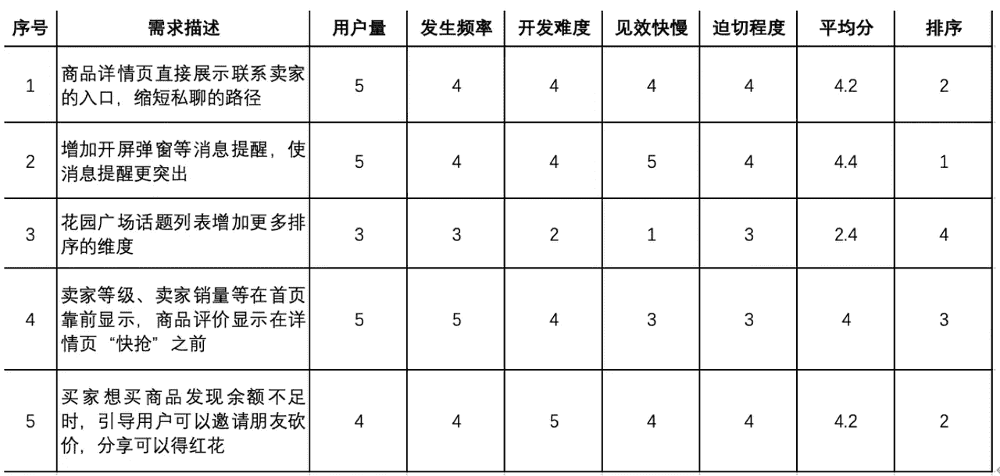

KANO分析：

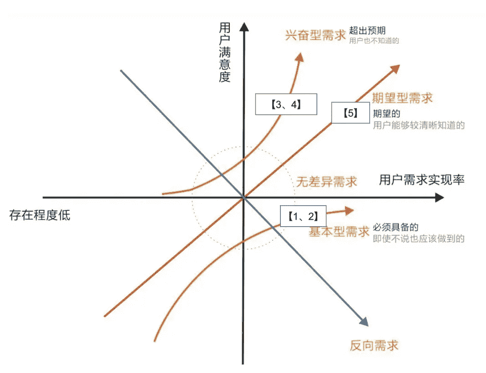

#### 5.梳理3个用户故事

从纳入需求池的5个需求中，选择3个讲述用户故事，让同事更理解这一需求的价值。

**故事1：**

+   **用户：**某刚被种草小物说的妈妈

+   **场景：**刚被种草小物说这个平台，准备体验一下，平台给新用户赠送了200多个鲜花还有一个免邮券，看看能换点什么日常能用到的东西。

+   **问题：**很多商品的描述特别简单，就几个字，也不知道商品是几成新，在哪买入的过没过保质期，而且我的问题有点多难道只能在评论里留言？在哪能联系到卖家了解一下，摸索了半天才发现卖家的主页里有个私聊按钮。

+   **解决方案：**商品详情页直接展示联系卖家的入口，缩短私聊的路径。

**故事2：**

+   **用户：**某80/90后女性上班族

+   **场景：**平时剁手太多，有好多衣服没穿几次就不想穿了，挂闲鱼上好久也没人买，小物说有微信小程序也方便，在这上面也挂上我要卖的衣服。

+   **问题:**平时上班很忙，微信有时候都顾不上回复，偶尔闲下来才想起来小物说上有没有人要买我的东西呀，也不给我个推送提醒的消息，打开小程序平台也没有明显提示。点开了“我的”才发现有人催我发快递了！

+   **解决方案：**增加开屏弹窗等消息提醒，使消息提醒更突出。

**故事3：**

+   **用户：**一个80后上班族，同事说她用的那个笔筒是在小物说小程序上免费得到的，白送的东西我也去看看。

+   **场景：**逛小物说发现了想要的东西。

+   **问题：**但是置换物品的鲜花要888个，我现在只有565个，还差一点不够该怎么办。

+   **解决方案：**买家浏览商品余额不足时，引导用户可以邀请朋友砍价，分享可以得红花。