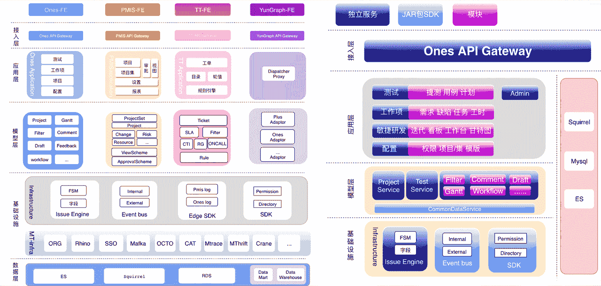
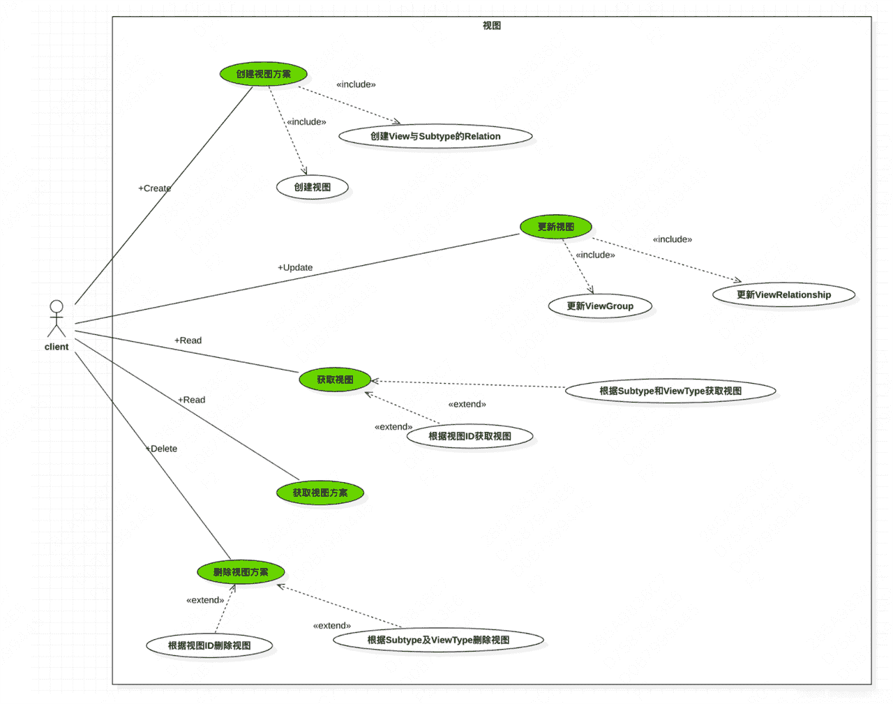
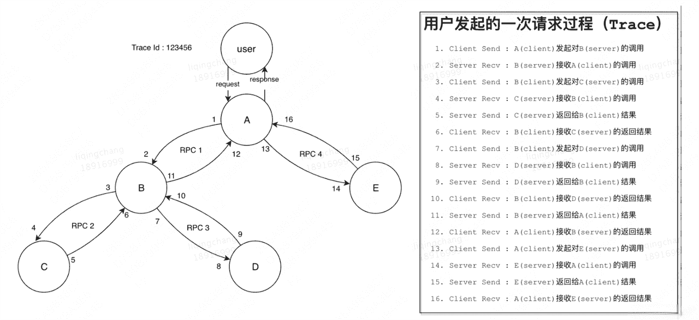
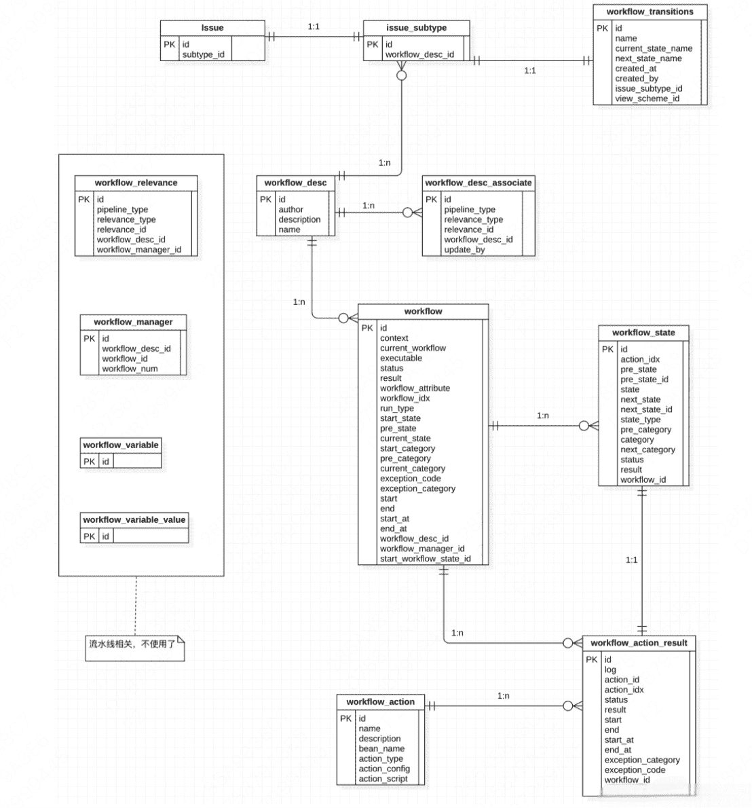
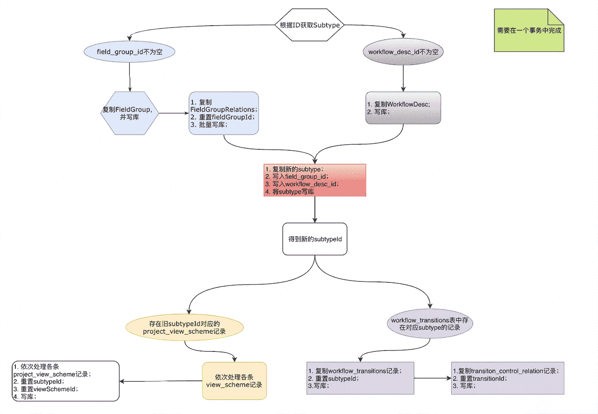
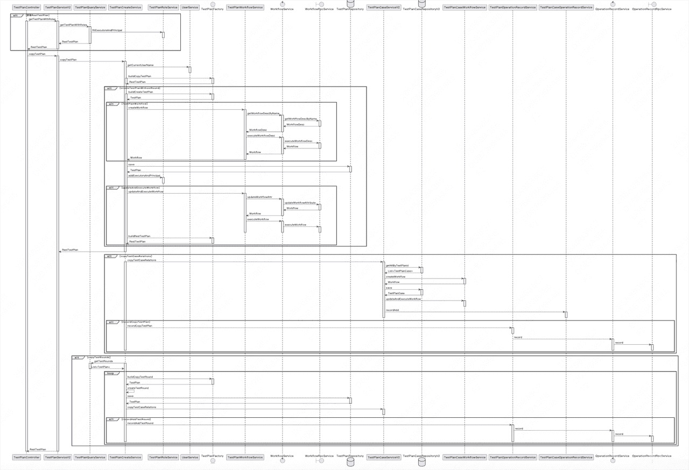
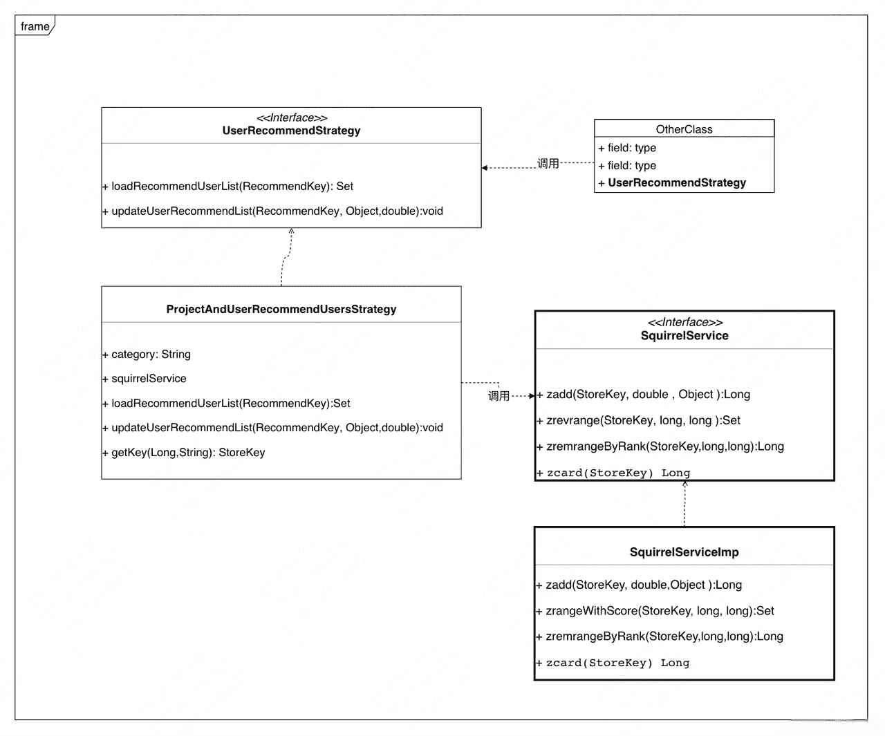

# 需求文档规范

> 来源：[https://qqs7y1hozd1.feishu.cn/docx/DLCwdDxw6odep2xCGRScTGfMnio](https://qqs7y1hozd1.feishu.cn/docx/DLCwdDxw6odep2xCGRScTGfMnio)

## 一、需求文档分析

产品经理通常会在产品开发过程中编写和使用不同层次的文档来指导产品的设计、开发和推广。

> 这些文档的三个主要层次分别是BRD（业务需求文档），MRD（市场需求文档）和PRD（产品需求文档）。

该部分应该直接将对应的相关文档url进行展示和做简要说明。

| **文档类型** | **说明** | **主要信息** |
| --- | --- | --- |
| **BRD** | 商业需求文档 | 项目背景（产品介绍）、市场分析、团队、产品路线、财务计划、竞争对手分析 等 |
| **MRD** | 市场需求文档 | 目标市场分析（目标、规模、特征、趋势）、目标用户分析（用户描述、用户使用场景、用户分类统计、核心用户、用户分类分析、竞争对手分析 、产品需求概况（定位、前景）） |
| **PRD** | 产品需求文档 | 详细功能说明（功能清单、优先级、功能目的、功能详细说明）、业务流程（业务流程、用例）、业务规则、界面原型（界面流程、界面原型）、数据要求（输入输出、极限范围、数据格式等） |

> **备注：**在进行需求评审的时候，也可以从这几个层面去考虑和分析，与产品经理进行沟通。

> 从开发的角度对产品需求进行分析和思考是非常重要的，其在很大层面上可以确保产品开发过程中的合理性和可行性。

+   **需求的清晰性和合理性：**评估PRD或产品需求文档中提供的需求是否足够清晰、具体且合理。如果需求存在模糊或矛盾之处，应及早与产品经理进行沟通，以澄清和完善需求。

+   **技术可行性：**分析产品需求是否在技术上可行。包括检查是否有合适的技术解决方案来实现需求，以及是否需要额外的资源或工具来支持实施。

+   **性能和可扩展性：**考虑产品需求对系统性能和可扩展性的影响。确保需求不会导致性能问题或限制产品未来的扩展能力。

+   **数据和存储需求：**了解产品需求对于数据模型和存储的要求。确保数据的采集、存储和处理都能够满足需求，同时考虑数据的安全性和隐私问题。

+   **用户体验：**关注产品需求对用户界面和用户体验的影响。确保需求能够提供良好的用户体验，并考虑用户友好性和易用性。

+   **测试和质量保证：**确定产品需求的测试策略和质量保证计划。确保所有需求都能够被充分测试，并且产品能够在生产环境中稳定运行。

+   **风险评估：**识别潜在的风险和问题，以及它们对项目进度和质量的影响。建议与产品经理和团队讨论并寻找解决方案。

+   **建议改进和优化：**提出改进和优化的建议，与产品经理一起讨论，以找到最佳解决方案，以提高产品的效率、性能或用户体验。

> 在设计文档过程中需要分析和思考，与产品经理的协作和沟通，确保产品在开发过程中考虑到了所有关键方面，并能够满足业务需求和用户期望。

## 二、需求分析

### （一）交互层分析

主要是针对产品原型，也就是前端部分的分析。

> 作为后端开发，对前端部分的分析有助于我们梳理需求的业务、功能流程，进而方便我们进行实现环节的用例分析和接口分析。

### （二）功能需求分析

> 从产品模块的角度进行分析，梳理会对我们的哪些模块产生影响，判断是一个通用需求还是一个特性需求，判断是一个横向需求还是一个纵向需求，功能的运作流程是怎样的。

> 产品进行服务拆分后，会涉及到多少个服务？这些影响之间是彼此独立的，还是相互耦合的？

功能触发以后的业务流程是怎样的的？数据是怎么流转的？

### （三）数据分析

> 该功能的实现，是在现有的数据模型基础上开发，还是需要增加新的数据模型？

对原有的数据模型会产生怎样的影响，是否有可能需求进行数据清洗？

### （四）兼容性分析

> 有一些需求可能属于已有功能的改造，那么有必要考虑兼容性方面的内容。

是否对原有实现有侵入，是否可以兼容，如果不能兼容的处理方案是什么样的？

### （五）非功能性分析

这个属于一个提前判断，判断是否可能存在性能问题，可能存在调用链路混乱问题，可能存在的痛点和需要技术攻关的点。

## 三、系统现状分析

系统现状分析，主要是针对现有功能改造，以及与现有接口耦合比较紧密的功能开发。

### （一）功能模块现状分析

判断要开发的功能属于哪个模块，需要与哪几个模块联动？

+   **模块分类和定位：**首先，要对要开发的功能进行分类和定位，明确它属于哪个模块或子系统。

+   **模块依赖关系：**确定新功能与其他模块之间的依赖关系和交互方式。识别哪些模块需要与新功能进行联动，以确保功能的完整性和一致性。

+   **接口和数据传递：**了解模块间的数据传递方式和接口，以确保数据的正确流转和互操作性。确保接口的参数和返回值能够满足联动模块的需求。

### （二）接口开发现状分析

要开发的功能属于新接口开发，还是既有接口的基础上进行改造，对哪些接口有影响？

> **接口设计决策：**确定新功能是否需要引入全新的接口，还是在现有接口的基础上进行改造和扩展。这需要权衡新功能的特殊需求和现有接口的可扩展性。

> **接口影响分析：**分析新功能对现有接口的影响范围。特别关注那些依赖于接口的其他功能，以确保改动不会破坏现有功能的稳定性。

> **向后兼容性：**确保接口改动是向后兼容的，以不影响现有客户端代码。如果需要破坏性的改动，要提前通知相关开发者并制定过渡计划。

### （三）数据库结构现状分析

现有数据库结构是怎样的？

> **数据库结构调研：**详细了解现有数据库的结构，包括表、字段、关系、索引等。

> **数据模型分析：**分析新功能对数据库的需求，可能需要进行数据模型的改变或扩展。确保新数据的存储方式符合业务需求。

> **数据迁移和一致性：**考虑数据库迁移和数据一致性方案，以确保数据的平滑过渡和完整性。

### （四）缓存方案现状分析

是否涉及到缓存，当前的缓存使用方案是何逻辑？

> **缓存需求评估：**分析新功能是否需要使用缓存来提高性能或减轻数据库负载。

> **缓存逻辑和策略：**了解当前的缓存逻辑，包括何时更新缓存、缓存的失效策略以及缓存清理策略等。

> **新功能的缓存策略：**制定新功能的缓存策略，确保与现有缓存逻辑协调一致。

### （五）消息队列MQ现状分析

是否涉及MQ，消息队列的使用方案是怎样的？

> **MQ需求分析：**确定新功能是否需要利用消息队列来处理异步任务或事件，以提高系统的响应性。

> **MQ方案调研：**了解现有消息队列的使用方案，包括消息的生产、消费、失败处理和重试策略等。

> **新功能的MQ集成：**确保新功能与消息队列的集成和消息传递方案。

### （六）ES现状分析

是否涉及ES，现有的mapping方案、搜索逻辑是怎样的？是否涉及聚合分析？

> Elasticsearch需求评估：判断是否需要使用Elasticsearch支持新功能的搜索和聚合分析需求。

> mapping方案和搜索逻辑分析：了解现有的mapping方案、搜索逻辑和聚合分析需求，看是否需要进行改进以适应新功能。

> 新功能的Elasticsearch集成：确保新功能能够与Elasticsearch的索引、搜索和聚合功能正确集成。

这些分析和思考能够帮助确保新功能的开发与现有系统的无缝集成，并在不破坏现有功能的前提下实现改进。同时，与各个相关团队和利益相关者的积极协作和沟通是成功的关键。

## 四、概要设计

### （一）架构图

> 如果是系统层级的设计，需要提供架构设计图（构件图、 部署图等单独列出）。

**范例如下：**

### （二）用例设计

**用**例图是指由参与者（Actor）、用例（Use Case），边界以及它们之间的关系构成的用于描述系统功能的视图。

> 用例图（User Case）是外部用户（被称为参与者）所能观察到的系统功能的模型图。用例图是系统的蓝图。

> 用例图呈现了一些参与者，一些用例，以及它们之间的关系，主要用于对系统、子系统或类的功能行为进行建模。

**范例如下：**

### （三）接口梳理

#### 1、对外提供的接口

大部分情况下，我们的交互方主要是前端团队，为前端提供相应的接口进行CRUD。另外一些情况，譬如OpenApi以及与外部团队合作的时候，也会提供相应的调用接口。（Http接口/Thrift接口/grpc接口等）

**设计文档中，需要识别当前功能开发中相关的已存**在的接口，同时还要识别需要新提供的接口。

> 在对非前端团队提供的对外接口中，需要考虑接口鉴权方式、接口调用频率、数据安全隔离、交互数据格式标准、系统解耦、接口复用等方面的内容。

同时，在进行设计时，应该了解一些设计原则（并不是严格对照，但是对这些原则内心有了认同之后，会不自觉地贯彻和应用）。

接口设计也应该尽量遵循设计模式相关的原则，如下所示

> **SRP：**单一职责原则

> **OCP：**开放封闭原则

> **LSP：**里式替换原则

> **LOD：**迪米特法则

> **ISP：**接口隔离原则

> **DIP：**依赖倒置原则

#### 2、外部提供的接口

在与外部系统对接的情况下，需要关注如下一些层面的内容：

> 外部提供的接口类型；

> 外部接口的鉴权方式；

> 外部接口的接入方式；

> 必要时要考虑是否有降级处理方案；

### （四）核心接口流程梳理

概要设计部分中的接口流程，可以达到服务调用级别。

> 服务调用级别的话，这里也需要把一些横切层面的功能（譬如鉴权、譬如操作记录等）囊括进来。

### （五）数据ER图梳理

数据ER图在两种场景下都可以使用，并起到各自不同的作用：

> 对现有的数据库结构设计，可以帮忙梳理数据关系（尤其是我们现在使用逻辑外键的情况下）；

> 对新的数据库结构设计，可以帮忙进行数据库设计范式（规范化目的是使结构更合理，消除存储异常，使数据冗余尽量小。便于插入、删除和更新。）

同时在ER图梳理过程中，可以分析相应的约束（主键约束、外键约束、非空约束、唯一约束、默认约束）；

如果表关系极其复杂（可能出现类似图的情况），可能出现多表join或者多级查询的情况；要仔细分析是否可以改善，并分析可能的慢查询以及索引优化的可能性；

**ER图范例如下：**

## 五、详细设计

### （一）核心接口流程图&时序图

> 在详细设计的层面，接口流程就要涉及具体的服务内部的调用了。这里需要把接口的整个业务流程表现出来，进行文档说明。

当然《用图表说话》会更形象，接口流程图如下所示范例：

** 时序图如下所示范例：**

### （二）核心算法设计&类图

算法就是解决问题的方法和步骤！

算法可以采用自然语言、流程图、伪代码进行描述！

> 有一些功能开发是涉及到一些算法在里面的，我们的系统主要是上层的应用，就算法而言可能并不是太深入，主要还是一些业务算法（譬如工时的计算逻辑等）。

针对这些算法，详细设计部分需要对算法进行准确的描述，这一部分也是功能上线后的统一对外口径。

在类图层面的设计上，建议进行设计模式的相关学习。

> 有一些典型的设计模式应用场景可以在此时起到化腐朽为神奇的作用（常见的如工厂、装饰者、观察者、外观、组合、适配器、模板方法、策略等）。

**范例如下：**

### （三）数据库DDL方案&数据清洗方案

**如果新功能的开发对于已有的数据结构或者数据本身有影响**的话，那么就会涉及DDL和DML的操作。

**这里需要关注的点：**

+   数据库结构设计能达到哪个范式，是否会出现冗余导致的不一致问题；

+   数据库更新的时机问题，尽量避免高峰使用期做数据库Scheme变更；

+   动线上数据是一件很危险的事情，是否考虑全面了，是否有回滚方案；

+   如果是效率层面考虑的索引优化，需要给出全面的分析（整理系统目前的SQL查询情况，分析当前索引的缺失之处，增加索引之后的SQL执行方案是怎样的，explain效果如何等）；

+   数据清洗方案采用的是接口方案，还是SQL工单方案？是否在线下进行了测试？

### （四）中间件平台使用

关于中间件的使用，缓存、消息队列、搜索引擎都有对应的场景。譬如缓存在DB之前分担数据库的读压力，MQ可以进行解耦，搜索引擎可以进行复杂查询和聚合分析等。

在方案设计遇到相应的场景时应该考虑采用对应的中间件平台。

而使用的具体规范就不在这里赘述了，这一块的内容需要大家自行研究相应的中间件，并参考优秀的实践方案，采取合理的使用方式。

### （五）第三方类库或开源框架引入

> 开源或者第三方类库引入之前，要做相应的成熟度评估，不要引入尚不成熟或者未规模化应用的类库或框架。在设计文档中应该对此进行说明，设计方案评审时需要考核此项内容。

> 要说明引入该框架所要解决的问题，该框架解决该问题的方案和思路；

> 是否有方案比选，为何选择该框架；

> 对于一些成熟的类库，譬如**apache****，****guava****，****joda****，****json**相关的几个，无需说明。对于一些不广为人知的类库，需要在设计文档中进行说明。

## 六、测试方案

目前QA团队做的是白盒测试，同时开发团队自身也要制定相应的功能测试方案以及联调方案。

### （一）单元测试

对于核心算法接口的单元测试，确保测试覆盖面广泛且可靠是非常重要的：

> 使用Spring Boot的test模块：Spring Boot提供了强大的测试支持，可以轻松地进行单元测试。使用Spring Boot的测试框架来编写和执行单元测试是一个不错的选择，它能够帮助模拟应用程序的上下文环境，包括依赖注入和数据库连接等。

> **边界测试：**确保单元测试涵盖了各种边界情况，例如针对输入参数的最小值、最大值，边界值以及异常情况的测试。这有助于发现潜在的边界条件错误。

> **异常测试：**编写测试用例来模拟可能出现的异常情况，例如无效的输入、资源不足、连接失败等。确保你的代码在异常情况下能够适当地处理和报告错误。

> **Assert机制：**使用Assert机制来验证测试的预期结果与实际结果是否一致。这有助于确保代码的正确性，并在测试失败时提供明确的错误信息。

> **测试结果自动化：**不要依赖于人工识别测试结果。确保测试用例的结果可以自动化地验证，以减少人为误差。Spring Boot提供了丰富的断言工具，可以方便地验证结果。

> **数据库还原：**在测试数据库相关的代码时，确保能够还原数据库的现场状态。可以使用事务管理来实现测试前将数据库状态置于预期状态，然后在测试完成后回滚事务以还原数据库。

> **模拟依赖：**尽量模拟依赖的行为，而不是实际地依赖外部服务或组件。这有助于测试的独立性，避免对外部资源的不必要依赖。

> **持续集成：**将单元测试纳入持续集成流程中，确保每次代码提交后都运行测试。这有助于及早发现和解决问题，并提高代码质量。

> **覆盖率报告：**使用工具来生成代码覆盖率报告，以了解测试覆盖的程度。这可以帮助确定是否有未覆盖的代码路径。

> **测试文档：**编写良好的测试文档，描述测试的目的、输入和预期结果。这有助于其他开发人员理解和维护测试用例。

综合考虑这些建议，可以编写高质量的单元测试，提高代码的可靠性和稳定性。单元测试是确保核心算法接口的可靠性和正确性的重要手段，也有助于减少未来的回归问题。

### （二）联调测试

与前端或外部团队的联调是确保整个系统顺利运行的关键步骤之一：

| **时间咬合计划** | 提前确定时间咬合计划，确保双方团队在同一频道上，并有足够的时间进行联调。 |
| --- | --- |
|  | 协调双方的工作时间表，以确保在联调期间有足够的资源和人员。 |
| **联调方案制定** | 制定详细的联调方案，明确联调的目标、范围和流程。 |
|  | 定义联调的入口点和出口点，以确保各个模块能够正确地对接和集成。 |
| **联调用例设计** | 编写联调用例，确保用例涵盖各类情况，包括正常情况和异常情况。 |
|  | 确保用例包括数据的输入和输出，以验证数据的正确传递和处理。 |
| **数据准备** | 提前准备好测试数据，包括正常数据和边界数据，以用于联调测试。 |
|  | 确保测试数据的一致性，以防止因数据问题引起的错误。 |
| **日志和调试工具** | 配置日志和调试工具，以便在联调期间能够有效地监控和调试系统。 |
|  | 确保双方都具备必要的日志和调试信息，以便快速定位和解决问题。 |
| **沟通和协作** | 保持良好的沟通和协作，及时共享问题和进展。 |
|  | 确保有明确的联调负责人或团队，负责统筹和协调联调过程。 |
| **版本控制** | 确保双方使用相同的代码版本和依赖库，以避免版本兼容性问题。 |
| **性能测试** | 如果涉及性能问题，可以在联调期间进行基本的性能测试，以发现和解决潜在的性能瓶颈。 |
| **自动化测试** | 考虑使用自动化测试工具来执行重复性的联调测试，以节省时间和提高可重复性。 |
| **备份和恢复计划** | 准备好备份和恢复计划，以防在联调期间发生不可预测的问题，可以迅速回滚到稳定状态。 |

联调期间要保持冷静和耐心，理解在整合不同组件和系统时可能会出现的挑战。密切关注问题并及时解决，确保联调的成功，以实现整个系统的顺利运行。

### （三）性能测试

对于可能频繁调用的接口，需要进行性能测试。利用quake平台进行测试，并可在trace平台观察压测结果。

## 七、上线方案

"可灰度，可回滚，可监控" 是上线新版本或功能时的关键原则，确保平稳的发布和稳定的运行。

### （一）可灰度 (Canary Deployment)

可灰度是指在生产环境中逐步发布新版本或功能，而不是一次性全部发布。

> 实施可灰度部署时，通常将一小部分用户或流量导向新版本，而其他用户仍然使用旧版本。

> 如果在可灰度发布期间出现问题，可以快速回滚到之前的稳定版本，而不会影响所有用户。

### （二）可回滚 (Rollback)

可回滚是指在发布新版本后，如果发现问题或出现严重故障可以快速恢复到之前的稳定版本。

> 实施可回滚需要确保在发布过程中能够追踪并保存旧版本的备份或状态，可以通过备份数据库、代码版本控制等方式来实现。

在出现问题时，迅速回滚到之前的版本可以降低系统的停机时间和对用户的影响。

### （三）可监控 (Monitoring)

可监控是指在上线后，需要实时监测系统的性能、稳定性和安全性。这可以通过各种监控工具和指标来实现。

> 实时监控可以帮助发现潜在问题和异常，及早采取措施解决。监控指标可以包括服务器负载、响应时间、错误率、内存使用、数据库查询性能等。

> 可监控还包括警报机制，当系统达到一定阈值或发生异常时，能够及时通知相关团队，以便迅速响应和解决问题。

> 这三板斧是确保上线新版本或功能的关键步骤，旨在最大程度地减少风险、提高可用性，并提供高质量的用户体验。

## 八、风险分析

风险分析是项目管理的关键步骤，它旨在识别、评估和应对可能影响项目成功的潜在风险。

| **步骤** | **详细内容** |
| --- | --- |
| **确定风险的类型** | 识别可能影响项目的不同类型的风险，如技术风险、资源风险、市场风险、法律风险等。 |
| **建立风险清单** | 创建详细的风险清单，列出可能的风险事件。每个风险事件都应该包括描述、潜在的影响和可能性。 |
| **评估风险的影响和可能性** | 对每个风险事件进行定量或定性评估，以确定其可能的影响程度和发生的可能性。可以使用风险矩阵或其他评估工具来进行评估。 |
| **优先排序风险** | 根据影响和可能性的评估，对风险事件进行优先排序，以确定哪些风险最值得关注。 |
| **制定风险应对策略** | 为每个高优先级的风险事件制定具体的风险应对策略。包括确定如何降低风险、减轻风险的影响、转移风险或接受风险。 |
| **执行风险应对计划** | 实施已经制定的风险应对策略。这可能包括采取预防措施、建立备用计划、购买保险或与利益相关者协商。 |
| **监控和更新风险清单** | 定期监控项目的进展，以确定是否有新的风险出现或现有的风险发生了变化。 |
|  | 更新风险清单和应对策略，以反映新的信息和情况。 |
| **沟通和共享信息** | 确保项目团队和利益相关者了解项目的风险情况。透明的沟通可以帮助各方共同努力来应对风险。 |
| **文档和记录** | 记录风险分析的过程和结果。这有助于项目管理团队和利益相关者了解项目的风险历史和应对措施。 |

风险分析是项目管理的重要组成部分，它有助于降低不确定性，提高项目成功的机会。通过系统地识别、评估和应对风险，项目团队可以更好地应对挑战，确保项目按时、按预算并达到预期的目标。

## 九、排期

> **具体操作：**输出表格指定对应人员和时间线等，正常办公中可以借助现有的框架进行管理分析。

> 任务排期和时间估算是项目管理中的核心活动之一。通过合理的拆分、估算和透明的沟通，可以帮助项目团队更好地管理时间，降低风险，确保项目按时交付。

## 十、总结

> 通过对需求的深入分析，能够确保系统功能满足用户的真实需求，避免后期因需求变更而产生的高额成本。而系统现状分析则帮助我们充分理解已有功能的局限性和潜在改进点，确保新功能的顺利集成。概要设计和详细设计的合理安排则确保了开发过程的顺畅与高效。

> 测试方案和上线策略的合理制定不仅可以降低上线风险，更能提升用户体验。通过风险分析，我们能够预见并规避潜在问题，确保项目的顺利推进。排期的合理安排更是为项目的按时交付提供了保障。