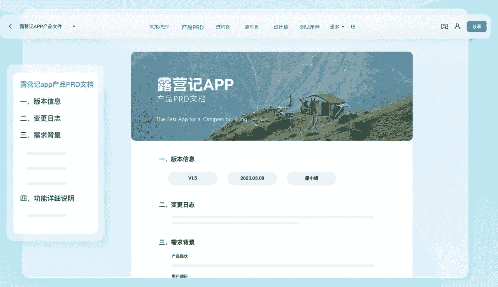
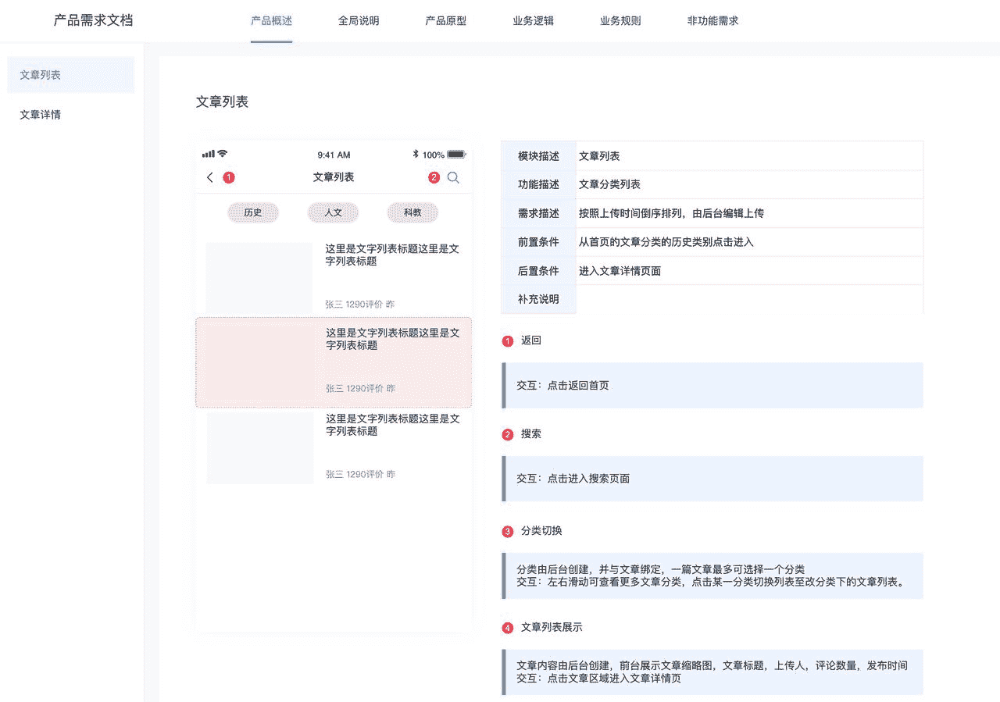
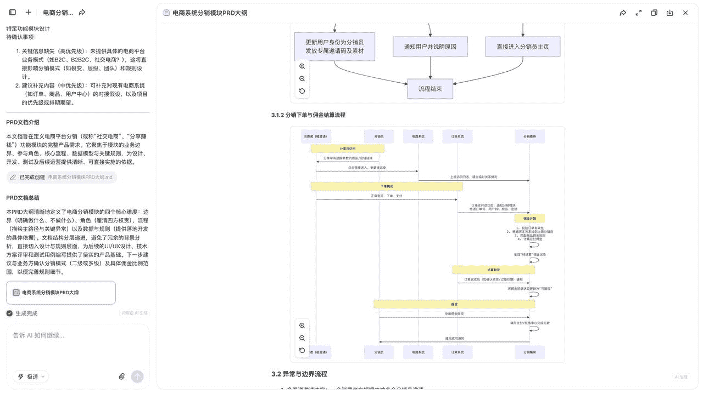

# 没人想看Word长篇大论！2026年产品经理要学会“视觉化PRD”

> 来源：[https://qqs7y1hozd1.feishu.cn/docx/MnYidUhWqoy41txk3qScFAs8nmd](https://qqs7y1hozd1.feishu.cn/docx/MnYidUhWqoy41txk3qScFAs8nmd)

PRD本身没什么难度，难的是大家的耐心越来越少了。

如果只闷头搞那种大几十页的Word文档，哪怕你写得再天花乱坠，你的PRD可能早就成了开发和测试眼里的“催眠剂”。这篇文章分享我总结出来的一个新颖的观点，产品经理要学会“视觉化PRD”。

### **一、PRD**

PRD就是产品的魂。前端看着它敲代码，后端看着它建数据库，测试看着它找茬。产品经理的专业度底线，基本就摆在这一份文档里了。

### **二、PRD应该怎么写？**

> 1. 信息分层清晰，打开三秒能不能知道重点？

> 2. 可以快速扫描，十分钟内能不能看完结构？

> 3. 支持快速定位，出问题时能不能快速找到那一段？

> 现实一点说，谁会从头到尾认真读一份几十页的PRD？所以这几年我干脆开始折腾一件事——给PRD“瘦身”。不是删内容，而是改变表达方式。

### **三、什么是视觉化PRD？**

如果现在有新人问我产品经理如何写PRD，或者想要点实操技巧，我一般会建议大家学着做“视觉化PRD”。简单来说，就是能用图**表示的坚决不用长句**，该放画板里的放画板；文字多的地方可以利用不同**色块来区分优先级；用画板展示**页面逻辑，让人一眼看到重点。看上去薄了，其实信息反而更扎实。

前阵子我跑一个相对复杂的电商分销模块，试着做了一份视觉化PRD丢到项目群。结果那天群里出奇的安静，以前满天飞的“这里有个逻辑没看懂”，夺命连环问都少了。后来我才意识到，不一定非要自己从头码到尾，AI能帮你把结构先搭起来。

视觉化PRD实战：

很多同行习惯遇到需求，直接甩给DeepSeek、GPT或者豆包，让它们帮忙写PRD。这几位逻辑推演能力确实不错，可以帮你补全边缘场景和异常流。但它们输出的都是干巴巴的文字版。要想做到“视觉化”，你得转换一下思路。

我当时试了一款能生成可视化PRD的工具墨刀AI，直接生成一份可视化的PRD初稿文档，导出后我再稍微修改填充一下。结果就是文档页数变少了，评审效率也高了，甚至设计和研发提问的次数也比以前少很多。

除了这个方法，我也尝试过在**协作白板Boardmix**里借助AI把PRD里的几个模块用图表来展示。大家的反馈也是比较“好读”，还能把反馈意见在协作白板中评论出来，方便了很多。所以配合带有AI能力的产研协作工具或协作白板工具，就能帮我们生成视觉化PRD，如果不放心前期可以利用大模型给出框架逻辑搭配使用。无论选择什么样的方法，别让他们再抱怨“看不懂”“翻不到”就行了。

写PRD其实是在帮别人理解你的思路，如果你的PRD没人愿意看，那它就算写了30页，也没有价值。当你把文字比例降下来，把视觉直观度提上去，很多沟通摩擦自然就消失了。