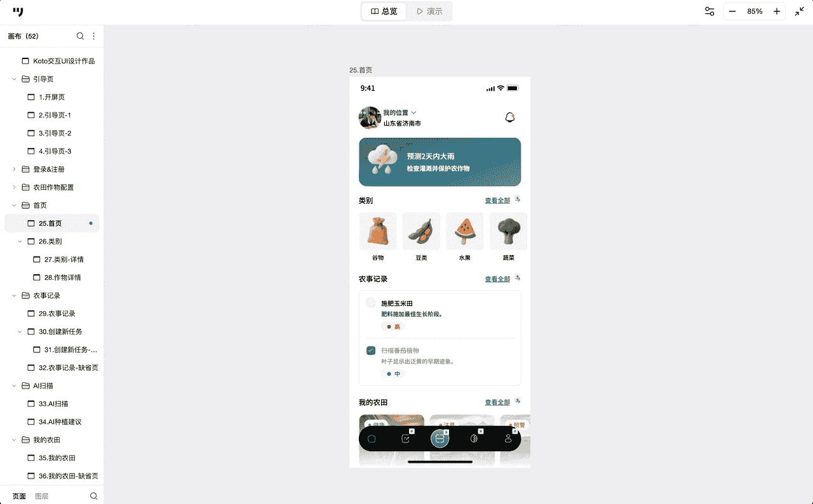
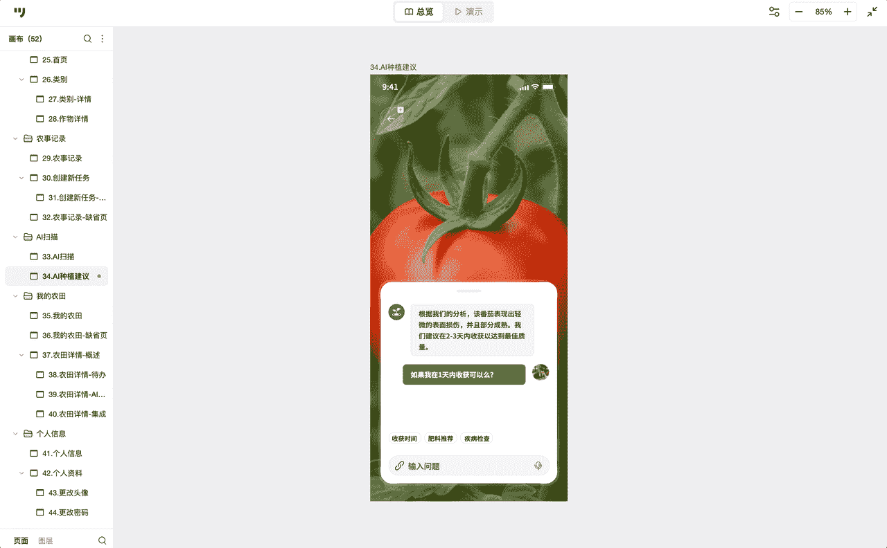
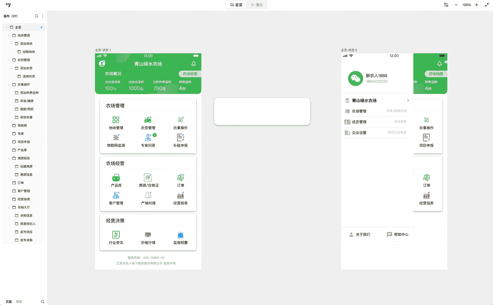
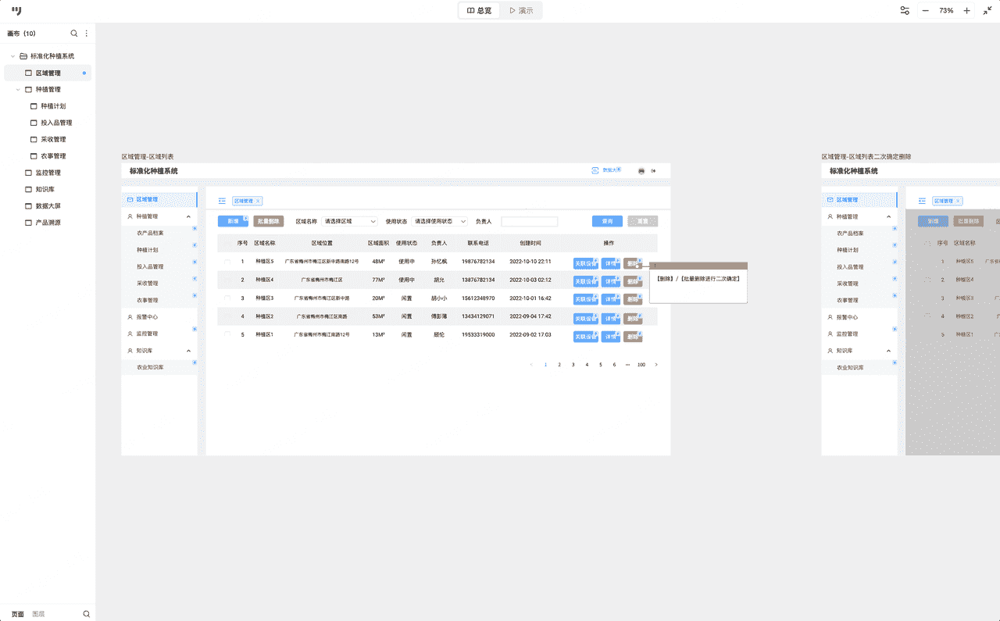
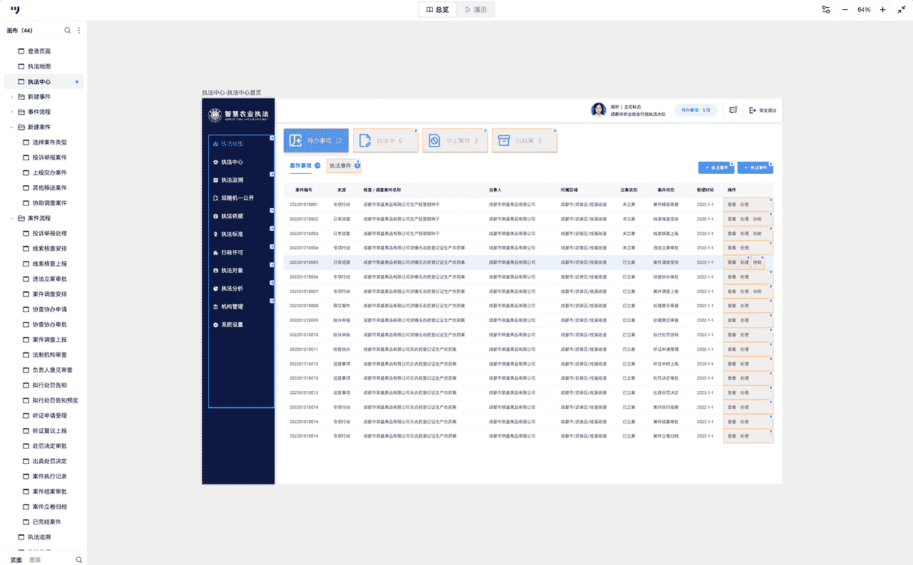

# 原型图案例：APP原型素材解析与模版

> 来源：[https://qqs7y1hozd1.feishu.cn/docx/KU7cdUVLsoU9bJxcatCcrmRpn2e](https://qqs7y1hozd1.feishu.cn/docx/KU7cdUVLsoU9bJxcatCcrmRpn2e)

本文通过对“**AI农业种植**”**APP原型素材**进行详细解析，并总结出智慧农业相关的原型素材设计要点，在文末附上相关农业原型素材模版，供产品经理参考。

### **一、智慧农业类APP原型详解**

该原型为一款 “**AI农业种植****”APP，整**体采用底**部Tab导航结**构，包含首页、农事记录、AI扫描、我的农田、个人信息五大核心模块。模块间通过悬浮式导航按钮切换，保证了操作路径的简洁与一致性。

1、首页模块

首页采用信息聚合式布局，从上至下共分为四个功能区：

+   **个人信息区**：左上角为用户头像与地理位置，右侧为系统通知提醒，确保用户在进入应用时即可获取关键信息。

+   **气象信息区**：通过卡片式组件展示未来天气，帮助用户评估气候对作物的影响，提升农业决策的及时性。

+   **作物概览区**：横向滚动列表展示作物类别，结合图文信息，方便用户快速浏览和进入相关作物管理页面。

+   **农事与农田区**：待办事项列表用于展示农事任务状态（待办、已完成），下方则是用户农田缩略卡片，结合预警标识，直观呈现田间状态。

**2、农事记录模块**

该模块强**调任务管理与执行闭**环。

+   页面顶部设有帮助中心，提供常见问题FAQ，降低用户学习成本。

+   中间区域以分栏切换形式展示“进行中”“计划中”“已完成”任务，支持用户快速定位。

+   每项任务可勾选完成，结合红/绿标签标识紧急程度，提升任务优先级的辨识度。

+   右下角的“新增按钮”采用悬浮设计，保证随时可创建任务，优化操作流。

**3、AI扫描模块**

该模块是**智能识别与交互核**心：

+   页面中部设有扫描取景框，支持实时识别农作物。

+   识别完成后，系统通过底部半屏弹窗展示作物基础信息、成熟时间、疾病检测等结果。

+   支持多模态交互：输入框文字输入、快捷问题一键提问、语音输入，满足不同使用场景。

**4、我的农田模块**

采**用卡片式信息呈**现，每块农田以独立卡片展示：

+   左下角标明农田名称，右侧附带扩展箭头，点击进入详细数据。

+   卡片中集成农田状态、养殖周期等信息，帮助用户快速感知全局农田情况。

**5、个人信息模块**

该模块承**担用户画像与系统偏好设**置功能：

+   上方展示头像、昵称、位置，并支持资料编辑。

+   中部以摘要卡片形式展示用户农田与作物总览。

+   下方为系统设置列表，涵盖语言、单位、通知、主题、隐私、帮助及退出登录，逻辑清晰、功能全面。

### 二、智慧农业类APP原型设计要点

**结合以上模块，可归纳出智****慧农业类APP原型的设计****要点：

1. 信息分层与****聚合展示：首页以气象、作****物、农事、农田为核心信息入**口，遵循“重要信息上移”的设计原则。

2. 任务驱动的交互逻辑：农事记录以任务状态流转为核心，形成计划—执行—完成的闭环管理。

3. 智能识别与人机协同：AI扫描模块通过图像识别与多模态交互提升农户的决策效率，兼顾专业与易用性。

4. 模块化与卡片化设计：农田、作物等对象均采用卡片式呈现，既保证信息独立性，又增强可视化效果。

5. 个性化与系统设置并存：个人信息模块兼顾用户画像与功能配置，满足农业场景下多样化使用需求。

### **三、智慧农业类原型模版分享**

**1、智慧农场设计**

**2、农业大屏**

**3、智慧农业-标准化种植系统**

**4、智慧农业综合行政执法平台**

