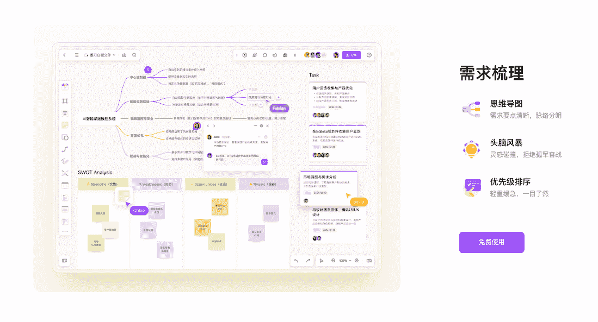
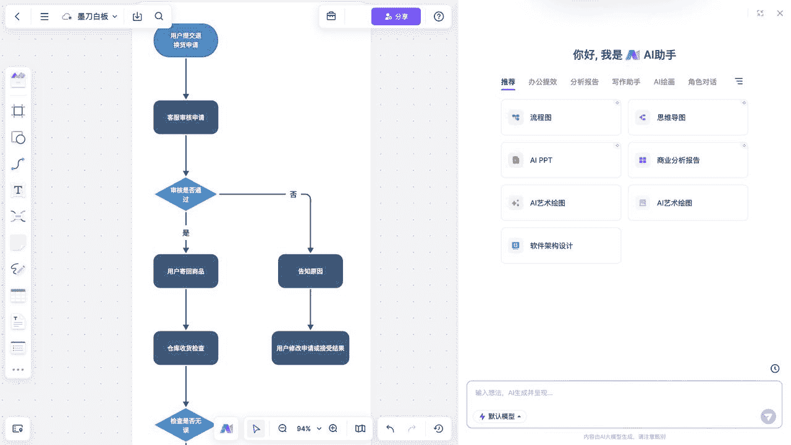
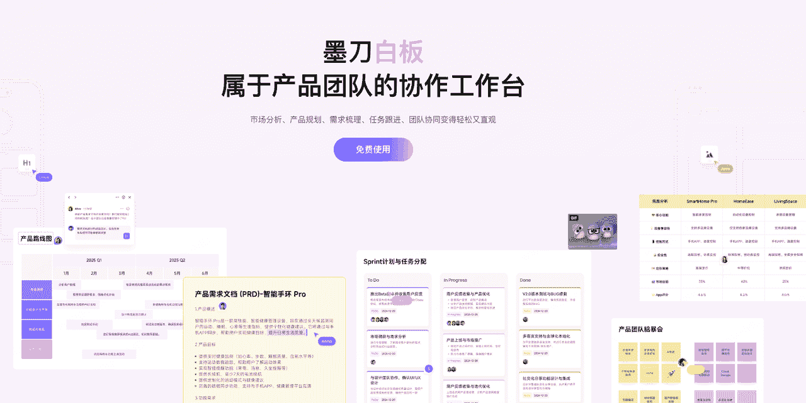

# 产品经理必看！在线白板如何嵌入产品经理工作流

> 来源：[https://qqs7y1hozd1.feishu.cn/docx/W0tPdzxV6okCgKxlB64cSzAjnVb](https://qqs7y1hozd1.feishu.cn/docx/W0tPdzxV6okCgKxlB64cSzAjnVb)

对于产品经理这样不断与团队成员交涉的工作性质来说，在线白板正在成为日常工作流中不可或缺的一部分。从需求收集到复盘总结，几乎每一个环节都可以借助白板来提升效率与协同效果。本文通过梳理产品经理的工作流，看白板是如何内嵌于产品经理工作的每一部分的。

### **一、需求收集**

需求收集作为产品设计的源头，信息通常比较分散，且不成体系，容易在信息的传递过程中失真或丢失。在线白板工具提供了一个实时整理和可视化的环境，让产品经理聚合碎片信息，并将其转化为清晰的结构。具体而言：

+   **头脑风暴**：组织团队成员在白板上实时写下想法，利用便签功能快速聚合创意，避免遗漏。

+   **用户画像/旅程图**：通过模板建立用户画像与体验路径，直观呈现调研结果，便于团队达成共识。

+   **竞品分析**：利用对比矩阵模板，直观呈现竞品差异点，团队可以边看边讨论。

### **二、需求分析**

在需求分析阶段，白板的作用在于帮助团队把抽象的需求转化为可讨论的逻辑结构。白板工具通过灵活的构图能力和互动特性，能够将产品经理通常用到的用户旅程图、Kano模型、优先级矩阵等展示出来，帮助团队在同一视角下理解产品逻辑与实现路径。典型场景包括：

+   **功能拆解**：通过思维导图或结构图，把业务目标逐步拆解为模块和功能点。

+   **优先级排序**：在白板上使用二维坐标（价值/投入）或优先级矩阵，把功能点拖拽到合适位置。

+   **MVP划定**：明确哪些功能属于核心，哪些可以延后迭代。

### **三、方案设计**

当产品方向与核心需求基本确定，方案设计就成为下一步的工作重点。此时白板能够以低门槛、高灵活度的方式支持流程与原型绘制，把用户路径、页面跳转关系或者业务逻辑梳理出来，大幅降低沟通成本，尤其适合跨职能同步与早期验证：

+   **流程图绘制**：快速绘制用户流程、业务流程，替代传统文档，直观易懂。

+   **版本迭代**：每次产品需求的迭代都可以在白板留痕，便于团队追溯和复盘。

### **四、团队协作**

产品方案需要经过团队的多轮评审与意见征询，白板工具能将讨论过程可视化、互动化，显著提升沟通效率与决策透明度，也方便后续的方案修改。

+   **远程会议白板**：在例会或评审中，作为实时演示与记录工具，替代PPT或Word。

+   **会议纪要**：会后导出白板内容，即可直接作为会议沉淀。
对于产品经理来说，白板的选择和使用不止是与团队间的协作工具，更重要的是，它能够嵌入到产品经理现有工作流中，避免产品经理在多工具中切换带来的信息断层，确保思路细节不丢失。

