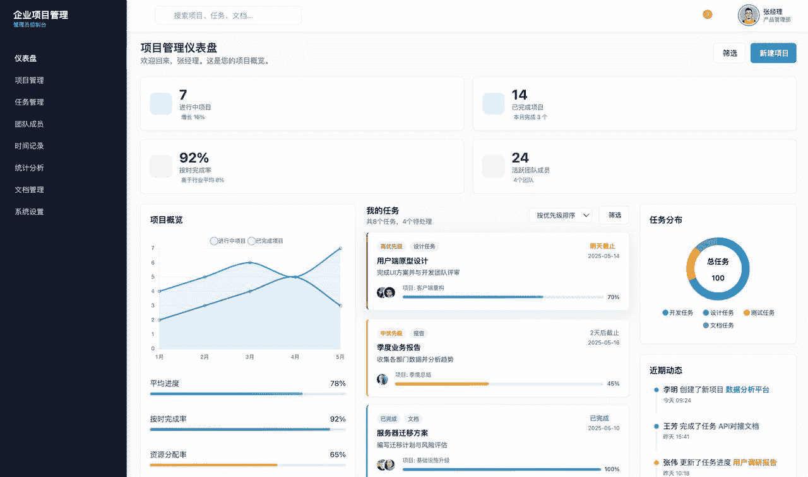
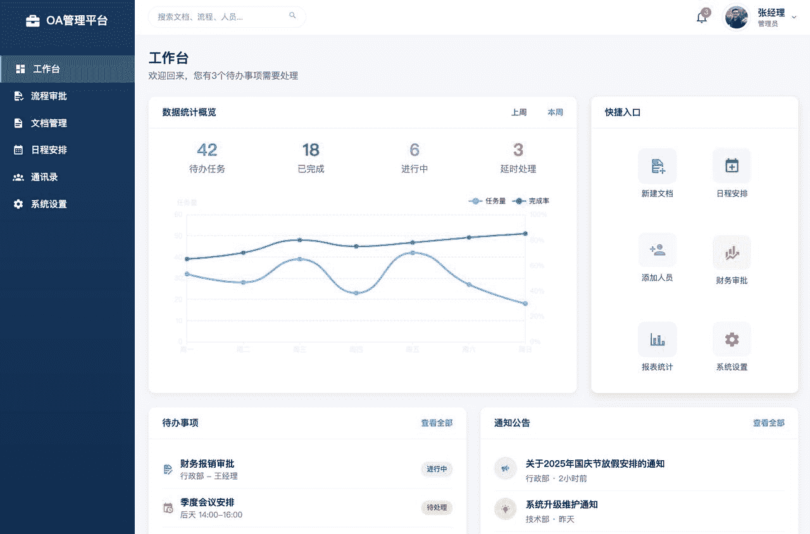
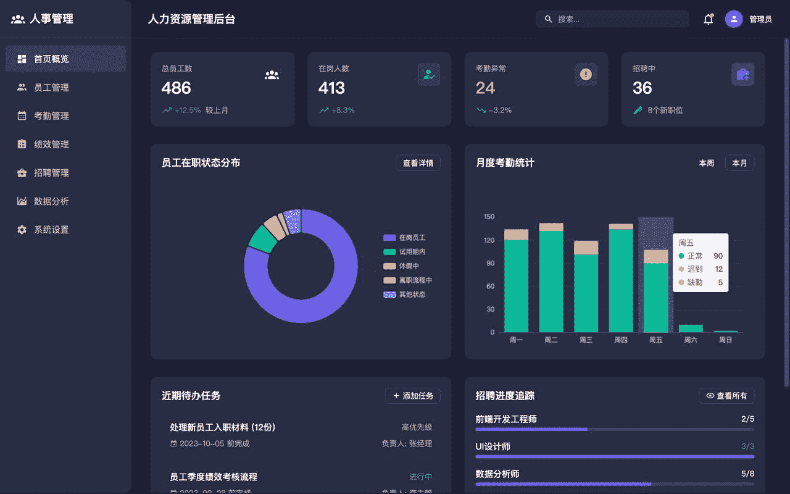
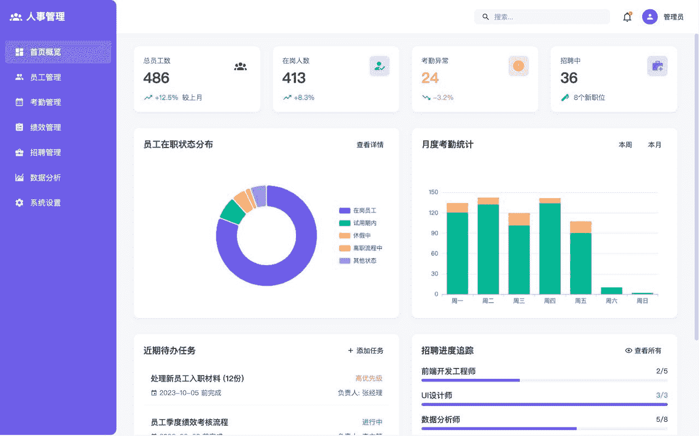
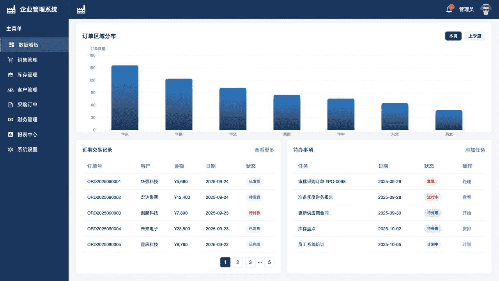

# AI原型设计实战：5类Web后台管理系统原型图自动生成

> 来源：[https://qqs7y1hozd1.feishu.cn/docx/J0EIdUZ4CoIG1Rxim2KcVQIonUc](https://qqs7y1hozd1.feishu.cn/docx/J0EIdUZ4CoIG1Rxim2KcVQIonUc)

本文基于某款国内主流AI原型设计工具，带大家直观感受AI生成B端后台管理系统原型图的实际表现。（以下案例均为AI初次生成的原型图效果）

### **一、项目管理系统**

**这是AI生成的项目管理**系**统首页仪表盘原型图，整体设**计简洁、偏商务风。页面顶部罗列四个数据卡片，分别展示进行中项目数、已完成项目数、按时完成率与活跃成员情况（初稿中卡片占位略大，可在后续优化）。下方区域则划分为三大板块：折线面积图与进度条结合呈现项目概览，任务卡片支持排序与筛选，最右侧通过圆环图展现任务分类占比，并辅以动态信息列表。

除顶部卡片布局稍显生硬外，整体的内容结构和视觉排布已经相当完善。像这样的后台首页，如果手动绘制可能需要几个小时，而AI原型设计仅仅耗时几分钟，大大提升了速度与效率。

### **二、OA办公系统**

AI生成的OA办公系统工作台页面，风格简洁，重心放在办公事项的看板与快捷处理上。顶部左侧为任务统计总览，展示本周待办、已完成、进行中及延时任务情况，并配合折线趋势图体现任务量与完成率；右侧设置常用功能入口，包括新建文档、日程安排、人员管理、财务审批、报表统计与系统设置等。下方左侧展示待办事项列表，并标注状态（如进行中/待处理/紧急），右侧为公告通知，方便快速浏览。

AI生成的这个OA办公系统整体生成效果中规中矩，无论是布局还是界面设计，既满足基础需求，又为后续迭代留足空间。

### **三、人资管理系统**

在人力资源管理系统的生成**案例中，AI根据指令输出了浅**色与深色两套主题方案。界面仍然沿用左侧导航栏+主内容区的常见布局。首页顶部设有四个数据卡片，涵盖总员工数、在岗人数、考勤异常和在招职位数，并附带环比数据。下方则由四个功能模块构成：环形图呈现员工在职分布，柱状图展示考勤统计，下方左侧为近期待办任务，并且设有添加新任务按钮，右侧以进度条显示招聘岗位进度。

无论是浅色还是深色方案，整体结构与视觉层级都比较成熟，如果AI原型设计能直接用于客户方案展示，也可以起到较好的支撑作用。

### **四、财务管理系统**

在AI生成的财务管理系统原型中，首页控制台顶部展示核心指标，包括总收入、总支出、税后利润**与账户余额，并附带同**比数据。下方折线面积图展现近6个月的收入、支出与净利润走势，帮助快速洞察财务趋势。

页面底部划分为三个区域：左侧为近期交易记录表格，并通过不同颜色标记交易状态（如红色=失败、黄色=处理中、绿色=已支付）；右侧则整合快捷操作入口与预算进度条，直观展现部门预算使用情况。整体布局完整，信息清晰易读。

### **五、ERP管理系统**

**AI生成的ERP管理**系统首页原型初稿，同样以数据看板为核心。顶部四个数据卡片展示今日销售额、新增订单、库存周转率及新增客户数量；下面以折线图来显示销售额趋势，饼图反映库存分布情况，中间部位用柱状图展现订单区域分布；底部两个表格则分别为近期交易记录与待办事项。

虽然整体布局偏向常规，但对于ERP这类系统而言，AI生成的ERP后台管理系统原型能够满足这类产品原型的初稿需求了。

