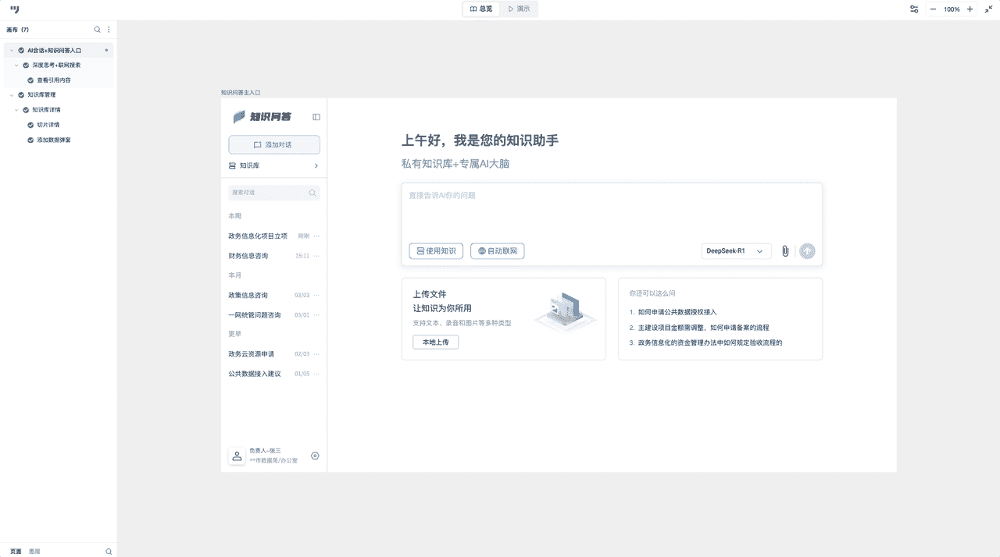
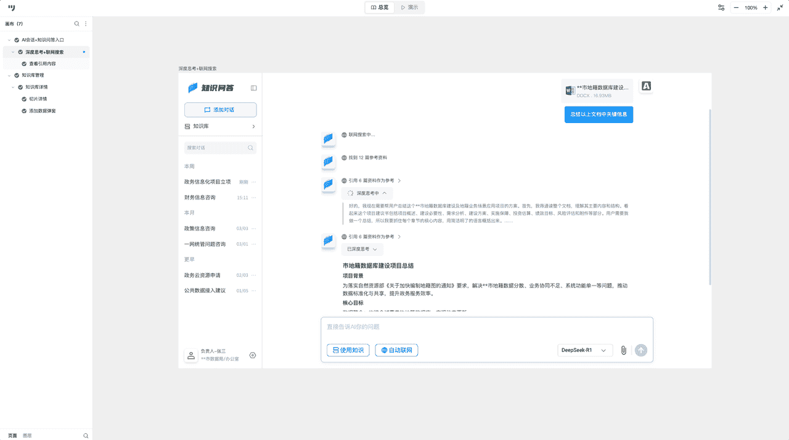
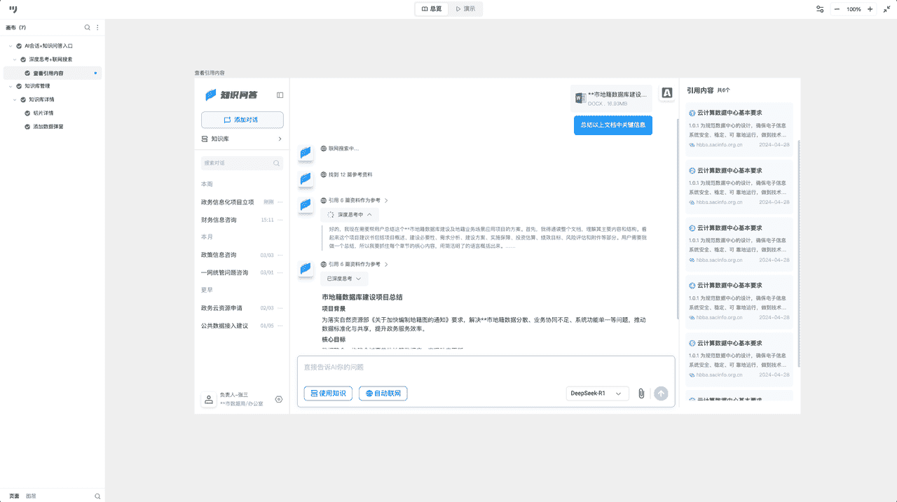
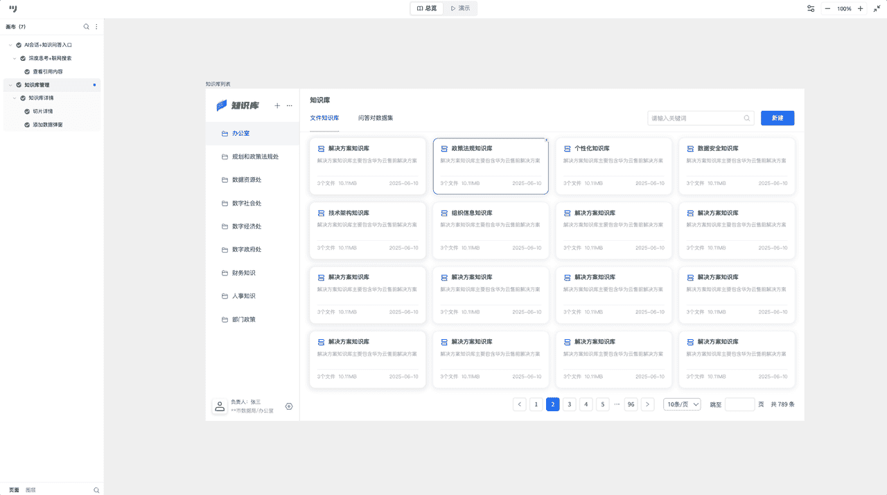
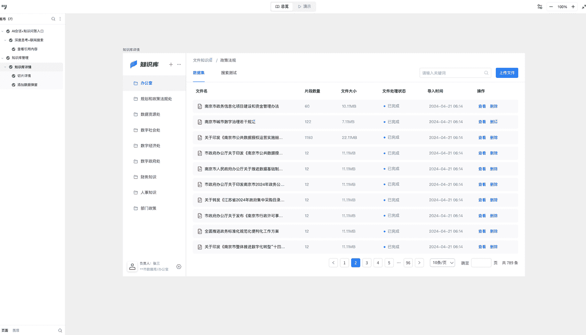
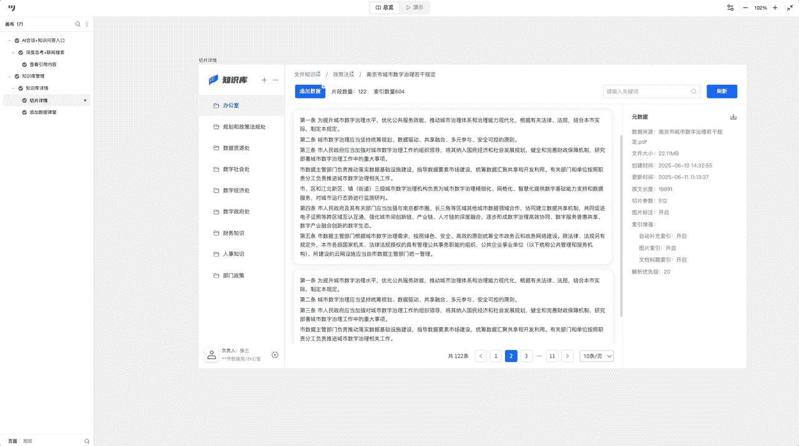
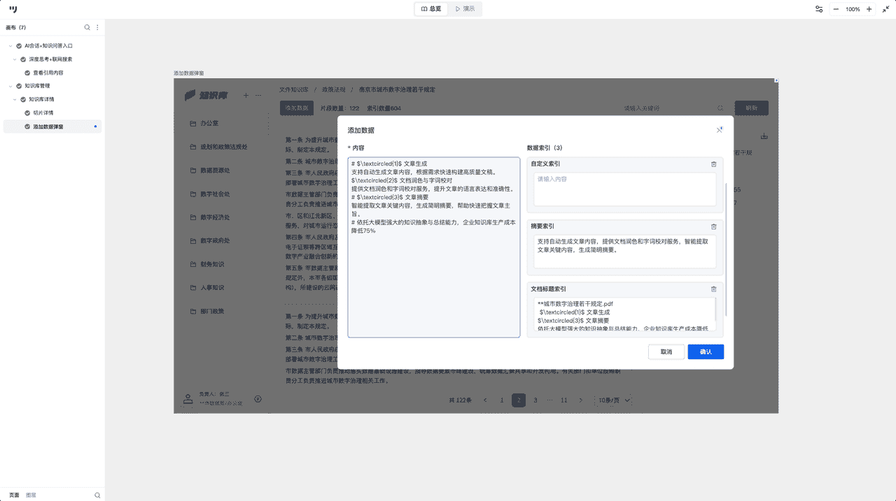
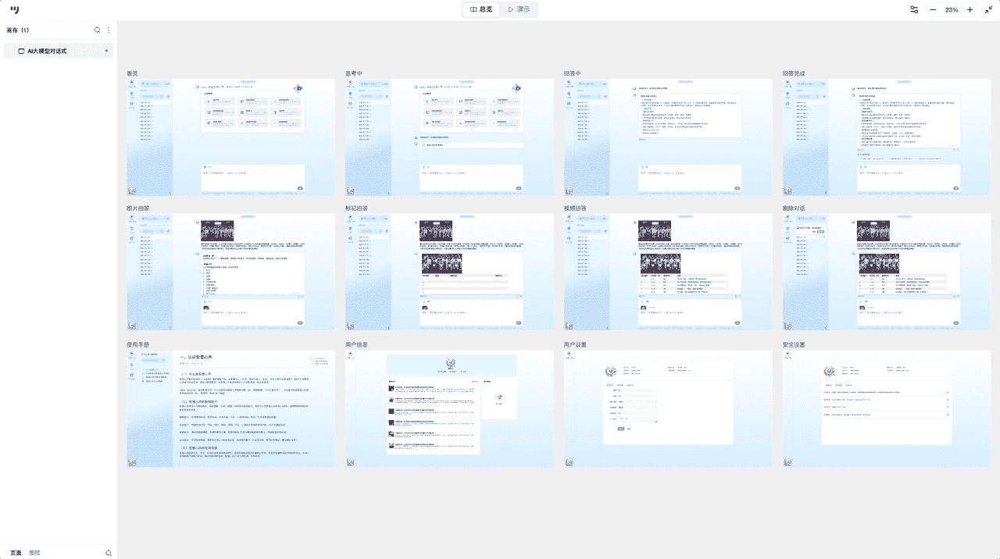
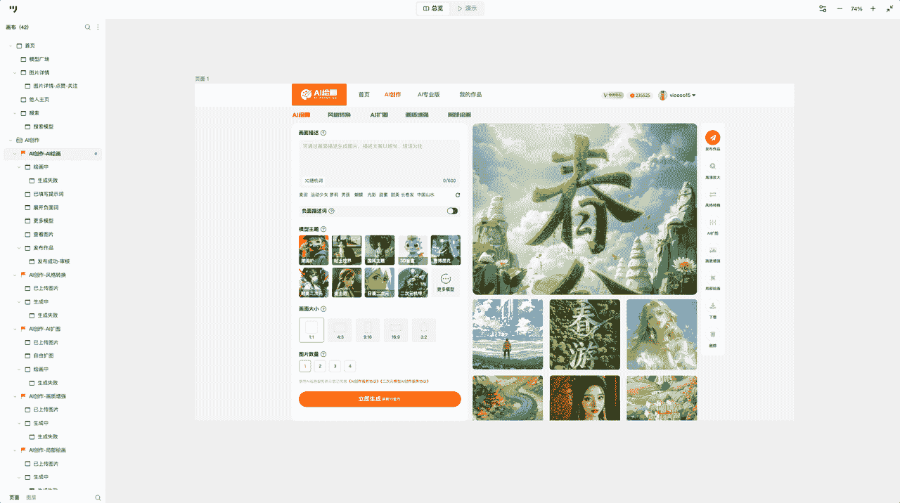

# AI智能会话原型解析：知识问答与知识库管理的设计思路（附模版）

> 来源：[https://qqs7y1hozd1.feishu.cn/docx/U37DdUIoyoapZfx2eMFcvQysnHh](https://qqs7y1hozd1.feishu.cn/docx/U37DdUIoyoapZfx2eMFcvQysnHh)

本文以墨刀素材广场的AI智能会话/知识问答/知识库管理原型为例，对其进行逐页解析，并结合产品经理的工作场景总结设计要点。文末附上对应的原型模版，供大家直接取用。

### **一、AI智能会话原型解析**

该原型属于网页版场景，分为AI会话+知识问答入口与知识库管理两大模块，共包含7个页面，覆盖了从对话交互到知识库配置的完整流程。

#### **1、AI会话+知识问答入口**

该页面采用3:7的双栏布局。左侧主要承担导航功能，包括历史对话入口、新建对话按钮、知识库切换、搜索框以及对话记录列表，底部还预留了用户头像与账户设置。右侧是核心对话区域，提供大尺寸输入框，支持AI模型下拉选择、文件上传，并在输入框下方提供推荐的提示词。整体交互既贴近即时通讯工具的使用习惯，又兼顾AI产品的特殊场景。

#### **2、深度思考+联网搜索**

该页面承接主对话区的逻辑，但在交互上强调了过程反馈。用户在上传文件或输入问题后，AI会逐步显示推理过程，例如“联网搜索中 → 找到12篇参考资料 → 引用6篇资料作为参考”。逐步展示搜索与引用过程，使用户能够理解答案的来龙去脉，从而减少不确定感并提升对系统的依赖度。

#### **3、查看引用内容**

在用户选择查看引用来源时，对话页面会收缩，让右侧腾出空间展示引用信息。页面首先呈现引用资料的数量，其次以卡片形式逐条显示标题、摘要、来源链接和时间信息。用户可以上下滑动，快速检索所有引用条目。这种设计实现了结果的可追溯性，使用户能够验证AI输出的可靠性。

#### **4、知识库管理**

知识库管理页面依然采用3:7结构。左侧提供文件夹导航和知识库新建按钮，右侧则以网格卡片形式展示知识库概览，包括文件数量、存储大小和创建时间等关键信息。同时，用户可通过关键词搜索定位目标内容，或通过分页组件快速跳转。该页面将知识库抽象为高层次的管理对象，帮助用户在全局层面快速掌握数据分布。

#### **5、知识库详情**

在知识库详情页，用户可以查看具体文件清单。页面顶部提供“数据集”和“搜索测试”两个功能分栏，右上角则提供搜索与上传入口。文件列表以顺序排列，支持点击查看和删除操作，并带有分页功能。这样保证了数据集管理的可扩展性和灵活性，适合应对不断增长的知识库规模。

#### **6、切片详情**

切片详情页进一步深入到文件内部。主页面以悬浮框的形式展示文档片段，每个切片都附有索引编号，右侧同时显示文件的元信息，包括来源、大小、创建与更新时间。顶部提供添加数据按钮，右上角则支持搜索与刷新。该设计兼顾了内容展示与数据治理，方便用户在更精细的粒度上对知识进行管理。

#### **7、添加数据弹窗**

在切片详情页中，用户可通过弹窗新增数据。弹窗左侧为数据输入区域，右侧依次排列三类索引方式：自定义索引、摘要索引和文档标题索引。每个索引块都支持单独删除，页面底部提供取消与确认按钮，保证操作的可控性与明确性。整体交互简洁直观，符合后台管理类产品的使用习惯。

### **二、AI智能会话原型设计要点**

#### **模块化结构**

原型通过“会话模块”与“知识库模块”的划分，清晰定义了用户操作的上下文。这样的模块化结构降低了认知负担，同时也便于后续功能扩展。

#### **可解释性与可追溯性**

在对话过程中实时展示搜索与引用进度，并提供引用来源的详细展示，使用户能理解AI的思考过程并追溯答案依据。这类设计直接提升了AI产品的可信度。

#### **多入口交互**

页面同时支持文件上传、本地知识库检索和联网搜索，用户可根据业务需求选择不同的数据源。这种多入口设计增强了系统的灵活性和适配性。

#### **数据管理**

从知识库→文件→切片的三级结构设计，符合企业级知识管理的操作逻辑。多维度索引配置（如自定义、摘要、标题），提升了数据检索的灵活性和覆盖面。

### **三、AI对话类模版分享**

以下模版分享均来源于墨刀素材广场。

#### **1、AI对话/聊天机器人/生成式AI/网页对话/ChatG**PT/文心一言/讯飞星火/AI对话机器人

#### 2、AI智能对话/语言大模型/chat GPT/图文解答/文档分析

#### 3、AI绘画/SD/webui/文生图/ai/图生图/mj

