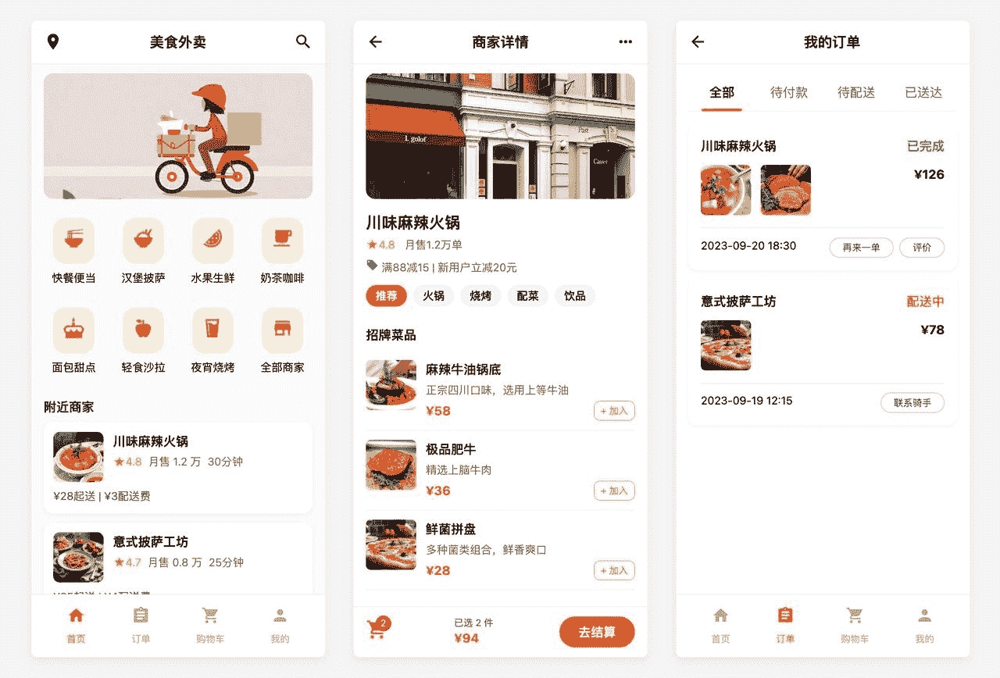
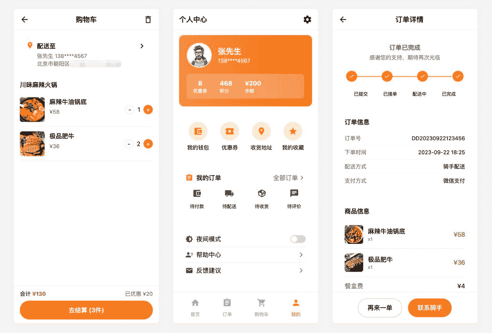
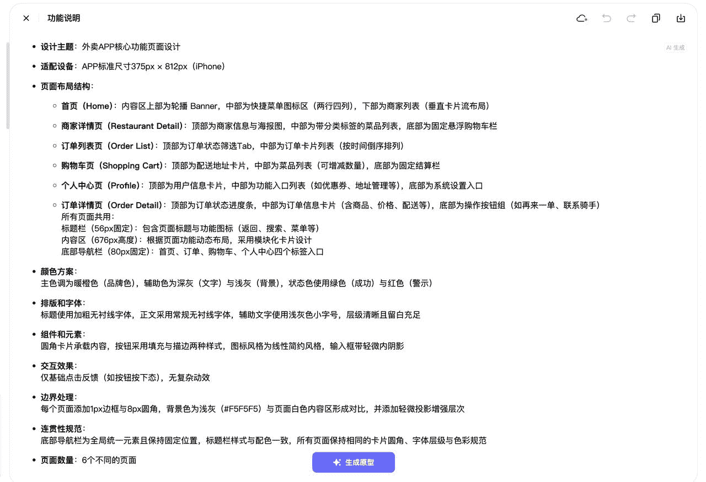
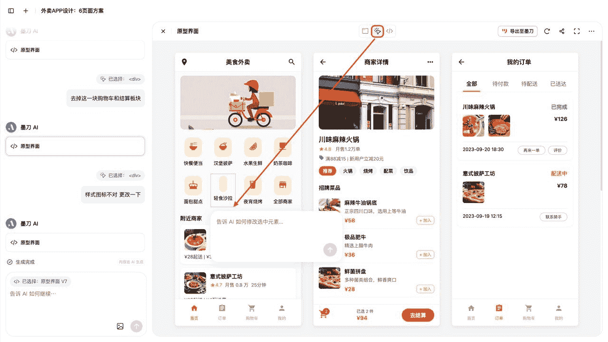
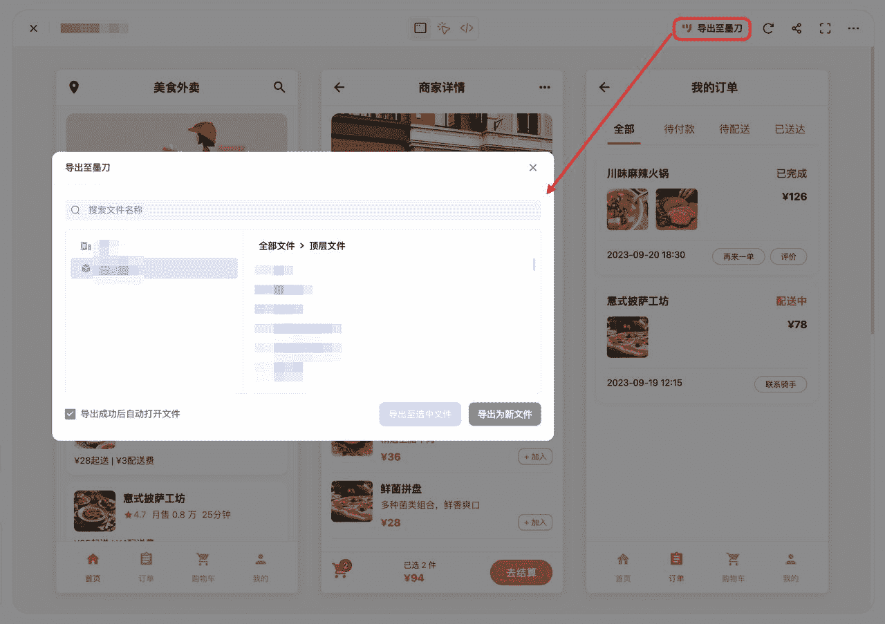
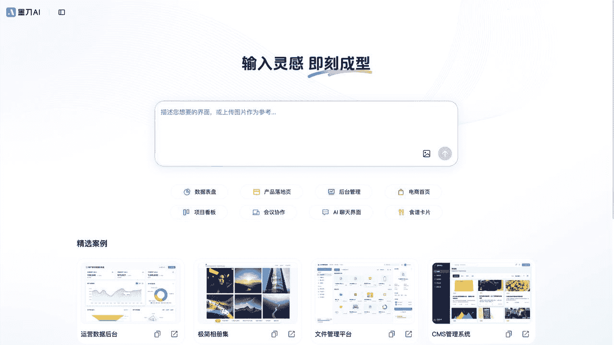

# 如何让AI生成多页面APP原型图？AI原型设计实用指南

> 来源：[https://qqs7y1hozd1.feishu.cn/docx/ORbAdzZIxoFVItx4LOSclBAEnod](https://qqs7y1hozd1.feishu.cn/docx/ORbAdzZIxoFVItx4LOSclBAEnod)

**很多产品经理已经**在实际项目中开**始使用AI原型设计工具，尤**其是在制作APP原型图、小程序原型图等产品项目中。AI可以帮助产品经理快速产出原型图，但是也有一些容易被忽视的实用功能。例如：如何一次性生成多个页面的APP原型图？本文将结合一个实战案例，带大家直观了解AI生成多页面APP原型图的流程与注意事项。

### **一、AI原型设计三大实用功能**

目前市面上的AI原型设计工具功能大同小异，但对产品经理来说，除了可以输入自然语言指令自动生成原型图，还有三项非常实用的能力：

#### **多页面生成**

一些AI原型设计工具仅支持一次生成单个页面，无法同时生成多个页面。这样每个页面都需要单独进行**二次调整，不仅操作**频繁，在连续生成多个页面时还会额外消耗大量时间。相比之下，能够一次性生成多个页面的AI原型图工具，可以在同一时间完成整体原型页面的生成与二次修改，大大提升效率。多页面生成功能很实用，能节省大量时间，是选工具时的重要考量。

#### **局部修改**

AI生成原型图后，可能需要对某些细节进行进一步调整。如果继续通过对话方式下达修改指令，可能会导致全局性的改动。如果只想调整某个组件或元素时，可以借助AI原型设计工具中的“选择模式”，精准选中目标组件，再发布修改指令。这样AI就会只针对局部进行优化，不影响其他已有的设计。

#### **导出编辑**

**大多数AI原型设计功能其**实是由原型设计平台（如本案例使用的墨刀AI等）衍生而来，依托于其完整的工具体系。AI生成原型图后，可以直接导出到平台已创建的项目中，再利用专业的原型设计功能进行手动微调与优化。不仅能确保不同页面之间的风格与设计保持一致，还方便后续的云端协作和团队评审。

### 二、AI生成多页APP原型图实战

这里以AI生成一个多页面的外卖APP原型图为例，展示如何通过AI快速生成多页面APP原型：

#### **生成功能说明文档**

首先输入需求指令，明确告诉AI需要设计的原型图类型（如APP、小程序、Web、大屏等），以及所需页面数量。AI接收到指令后，会自动生成一份功能说明文档，将需求条理化、结构化地呈现出来。你可以直接对文档进行编辑，也可以通过与AI对话的方式修改内容。最终确认后，点击下方的“生成原型”即可进入下一步。

#### **生成与修改原型图**

点击“生成原型”后，AI会以非常快的速度生成APP原型图。本次根据输入的需求，AI自动生成了6个APP页面。可以在预览区点击选择模式，在页面中选中需要修改的元素，发送指令告诉AI如何修改。这样不仅能满足局部修改的需求，也能避免对整体布局造成影响。

#### **导出原型项目中编辑**

经过AI的二次调整和修改后，原型基本成型，就可以导出到原型项目中。只需要在界面右上角选择“导出”功能，指定保存的项目位置，导出完成后即可直接在工作台中打开。在原型编辑区，可以利用平台丰富的手动绘制功能，对原型图进行进一步的编辑和优化，保障设计与其他页面保持统一，同时便于后续的云端协作与团队评审。

### 三、AI生成APP原型图注意事项

利用AI原型设计工具生成APP原型图时，需要注意几个小细节：

#### **APP原型图风格很重要**

在输入需求指令之前，一定要明确写清楚设计风格，比如“扁平化、清新”。一方面，高保真APP原型对视觉效果要求比较高；另一方面，如果缺少风格需求，AI会自动套用某种默认风格，但结果不一定符合你的预期，就可能需要额外的二次修改。因此，建议在前期指令中就明确提出风格要求。

#### **细节繁多建议导出修改**

APP原型图尤其是涉及复杂业务逻辑的，一个页面就可能包含不少细节。例如本文案例中，每个页面的按钮与布局都相对精细化，这就容易出现细节需要后期修改的地方。这时候不要陷入细节漩涡，尤其是配图类元素。如果整体框架已经满足了基本需求，建议直接导出到原型项目中，再借助手动功能进行优化调整，这样效率更高，也能快速完成设计。

另外**，需要**注意的是AI原型设计工具虽然效率高，但是在实际使用中还是有一些不足的，例如AI生成原型图偶尔偏离需求，或者有时在二次修改后仍未修改成功的现象，对待这类AI工具需要有一定的容错率。