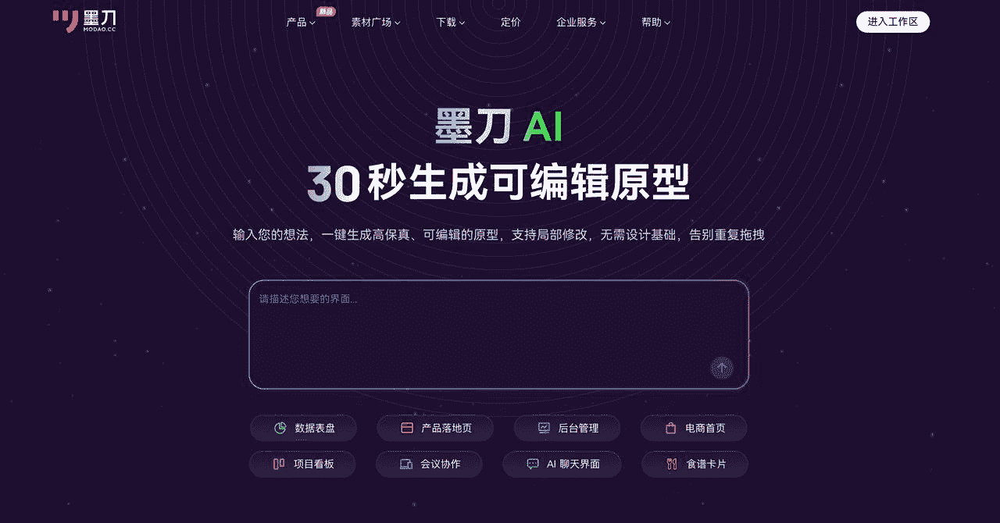
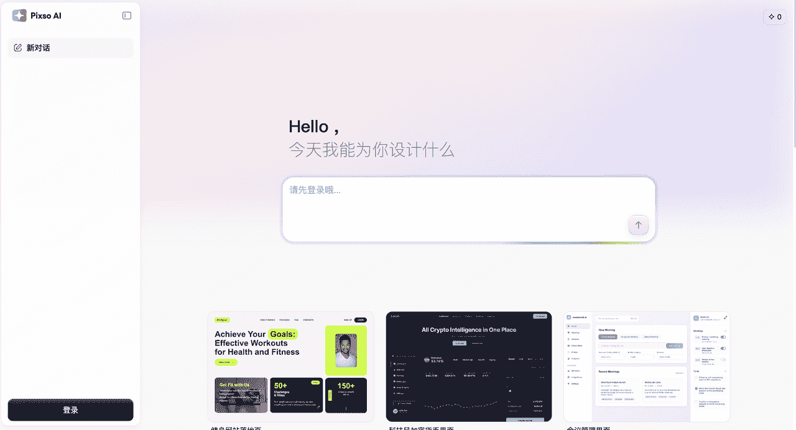
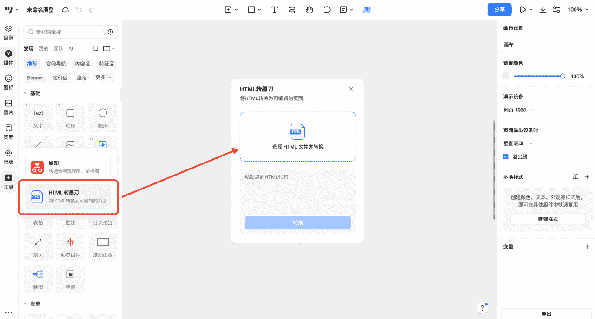

# 从原型到交付：3大AI功能助力产品设计高效落地

> 来源：[https://qqs7y1hozd1.feishu.cn/docx/EhMwdxySXo7C4MxqHm4cHChwnkf](https://qqs7y1hozd1.feishu.cn/docx/EhMwdxySXo7C4MxqHm4cHChwnkf)

在产品开发的过程中，设计阶段往往是最消耗精力的环节之一。无论是原型图、设计稿，还是交互细节，产品经理都需要花费大量时间与设计、研发沟通。如今，AI功能逐渐延伸到产品设计环节，帮助产品经理减少重复性工作、提升整体效率。本文将分享产品设计中的三大AI功能。

### **一、AI生成原型图**

原型图是产品设计起点，目前常见的AI原型功能包括：

+   **AI一键生成原型图**。用户只需输入清晰的需求描述，例如“健身类APP首页包含运动打卡、饮食记录和课程推荐模块”，AI即可自动生成对应的原型初稿。

+   **草图生成原型图**。产品经理如果习惯在纸上快速画草图，可以直接上传手绘稿，AI会识别并转化为高保真原型。

+   **AI对话修改**。当AI生成初版原型后，用户可以通过自然语言与AI对话交互，调整原型细节。

+   **导出编辑器人工修改**。生成的原型可以进一步导出到编辑器中（如墨刀编辑器），进行人工细化，确保与最终需求高度匹配。

**常见的AI原型工具有**：

+   **墨刀AI**：适合国内用户，可以与墨刀生态联动。

+   **Uizard**：以草图转原型见长。

+   **Galileo AI**：支持自然语言到高保真UI的生成，适合快速概念验证。

### **二、AI生成设计稿**

原型图只是产品设计的第一步，设计稿才是交付开发的核心成果。AI设计稿的主要功能包括：

+   **自动生成设计稿**：输入设计需求或导入原型，AI即可生成符合视觉规范的UI界面。

+   **智能配色与排版**：AI会根据行业特性自动提供合理的配色方案和排版建议，避免“撞脸”或不协调的问题。

+   **快速组件替换**：AI能识别页面中可替换的元素，例如按钮样式、字体，进行一键批量修改。

**常用的AI生成设计稿工具**：

+   **Pixso**：国产设计工具，支持协同和AI生成，适合团队使用。

+   **Figma**：适合国际团队，支持生成设计稿、智能图标推荐和自动布局。
对于产品经理而言，这意味着可以更快拿到可交付的设计稿，减少对设计师的依赖，在需求初期就能进行多版本的快速评审。

### **三、HTML转原型**

HTML转原型是连接产品经理与开发的桥梁，能帮助产品经理在已有代码基础上，快速得到更精准的原型页面。HTML转原型功能主要包括：

+   **快速导入HTML代码**：直接将已有的前端代码导入，AI会自动转化为可编辑的原型页面。

+   **交互还原**：保留基本交互逻辑，例如跳转、点击效果，方便进行用户体验测试。

+   **再次编辑**：产品经理可以在原型工具中对页面进行删改，补充新需求。

**常用HTML转原型工具**：

+   **墨刀**：除了AI生成原型外，还支持HTML转原型，帮助国内团队在已有代码与设计之间实现无缝衔接。

+   **TeleportHQ**：支持将HTML/CSS/JS文件直接导入并生成可编辑界面，适合前端与产品协作场景。