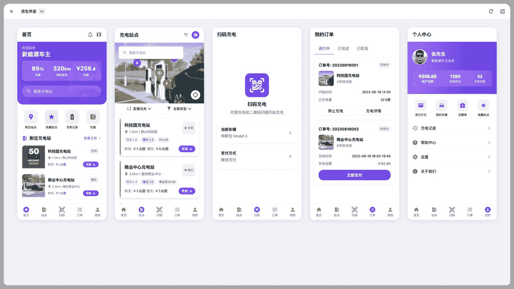
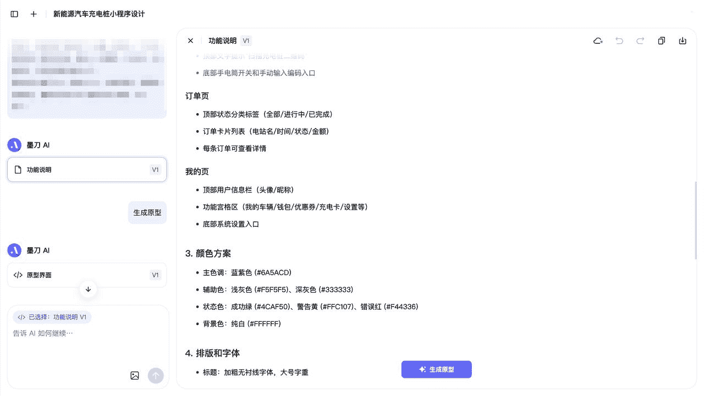
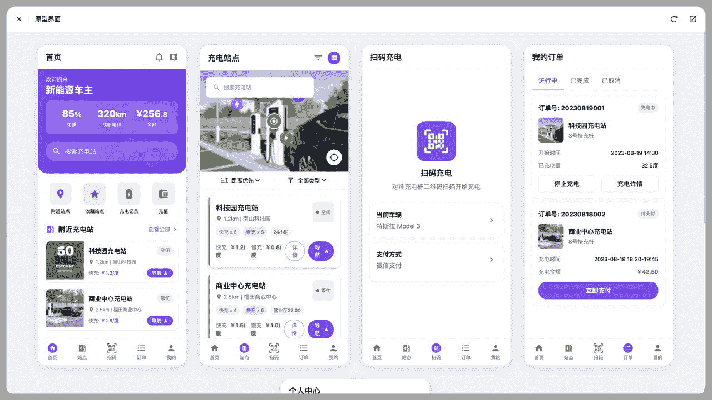
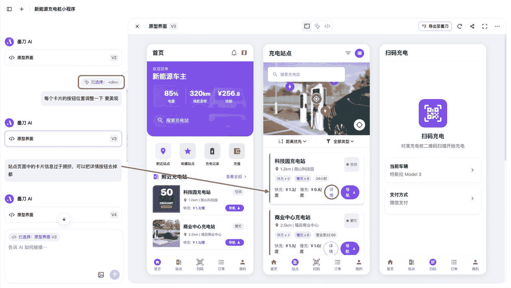
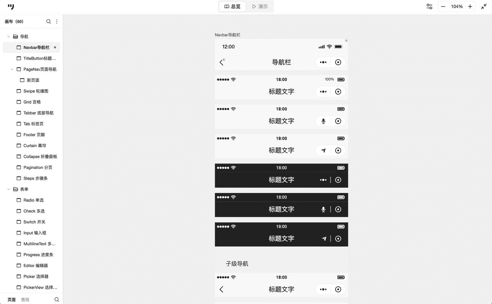

# 小程序原型设计指南：AI生成原型图+标准组件库

> 来源：[https://qqs7y1hozd1.feishu.cn/docx/BX8XdSOtfosK4xxpbBjceSP4n1d](https://qqs7y1hozd1.feishu.cn/docx/BX8XdSOtfosK4xxpbBjceSP4n1d)

对产品经理来说，设计一个小程序不仅要保证页面体验流畅、功能逻辑清晰，还要考虑开发落地。怎么在有限的时间里高效完成小程序原型设计，一直是许多产品经理的难点。

在最近的项目中，我尝试过两种方法，效果不错：一是利用AI原型图工具生成初稿，二是复用小程序组件库来提升一致性。下面结合实际经验展开讲讲：

### **一、AI生成小程序原型实战**

以前**做小程序原型，总要从导**航结构开始搭建，十几个页面下来基本要耗上一整天。现在，一些原型工具推出了AI生成原型图功能，支持通过输入需求来生成原型框架，这个功能在小程序场景下挺好用。接下来分享我们利用墨刀AI生成原型图工具来快速搭建小程序框架的实战过程：

#### **1.明确需求指令**

例如**设计一个新能源**汽车充电桩小程序，通常需要：首页、站点页、扫码页、订单页、个人中心等模块。我会把这些模块列出来写出对应的结构布局，和整体生成风格的要求。这样的需求指令发送给AI后，就收获到一份完整的功能说明，确认没有问题后就可以生成原型。

#### **2.生成原型图**

AI会根据产品功能说明文档生成每个页面的原型图，并且保持页面连贯性，把大部分页面和导航关系搭好。如下图，生成的原型页面与预期的产品还是比较符合的。

#### **二次调整编辑**

接下来就是补充和修改一些细节，比如卡片中的某个图标位置移动、某个按钮去除等，只需要与AI对话就可以实现局部修改。也可以点击右上角导出到原型编辑区，修改编辑的这一步最终还是要产品经理亲自把关。

### **二、60页🛰️小程序组件库**

AI生成原型图**可以帮助我们快速构建页面框**架，但是框架搭好后，原型还需要进入到细节层面。按钮、输入框、弹窗、导航栏这些基础组件，如果每次都重新绘制，不仅慢还容易不统一。这时可以在原型工具素材广场中利用这类资源。

给大家分享一套60+页的🛰️小程序组件库，可以快捷复用，包含的有：按钮、表单、编辑器、列表、滑块、图片上传、文章、徽标、评分、折叠面板、标签、布局、页脚、画廊、九宫格、图标、加载更多、面板、表单预览、进度条、弹出式菜单、对话框、提示页、选择器、弹出式提示、标题导航、顶部导航、底部导航、搜索栏、层级关系、统计图、媒体、轮播、地图、手机框、键盘、状态栏、计数、分页、步骤条、文字提示、气泡组成。

**组件库可以**直接复用，另外在团队协作时，可以把常用组件整理成团队资源库会更便捷。这样每个人都能直接调用同样的组件，减少了反复沟通，也让版本迭代时的修改更集中。

除了组件，还能在素材广场里找到很多完整的小程序模板。有时候遇到与自身产品框架一致的模板，基于模板二次修改甚至比从头画起或者AI生成的效率更高。

### **三、小程序原型设计注意事项**

虽然分享了以上两个方法，能够助力产品经理高效设计🛰️小程序产品，但是还是有一些注意事项的，值得大家关注：

#### **AI工具明确需求指令**

AI自动生成小程序原型的效果更多取决于输入的指令内容。模糊的需求会得到模糊的结果，最后还是要返工。不过如果当你没有灵感时，一句话AI也能立即生成完整原型图，或许能够得到一些设计方面的启发。

#### **原型设计统一规范**

在小程序原型设计中，按钮风格、导航方式、表单样式最好保持一致，团队要有一套通用规范。这样无论是在设计阶段还是开发阶段，都不会产生割裂感。

#### **不要忽略交互场景**

在小程序原型设计阶段产品经理容易只盯着“正常流程”，但是一些异常情况、空页面、错误提示的交互反馈很容易被忽略，因此在原型设计时要充分考虑这些细节，避免遗漏返工。