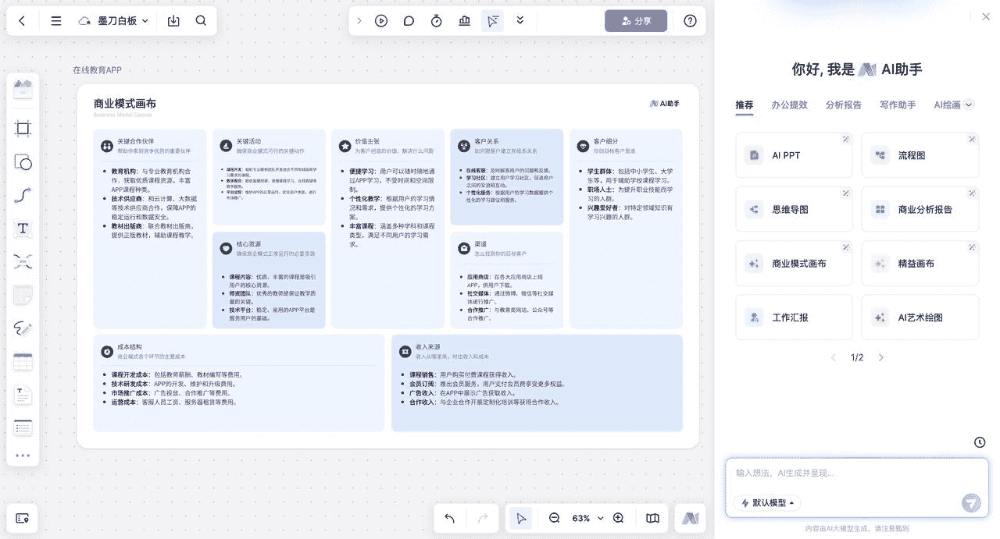
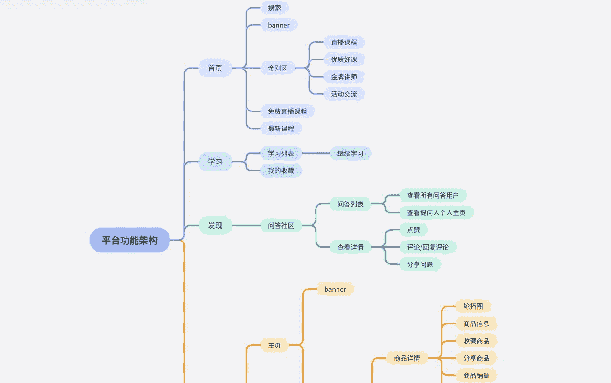
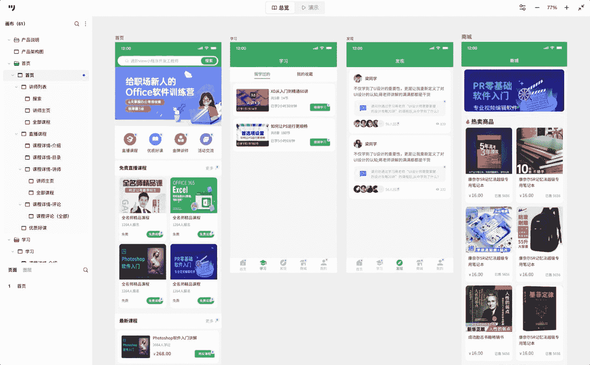
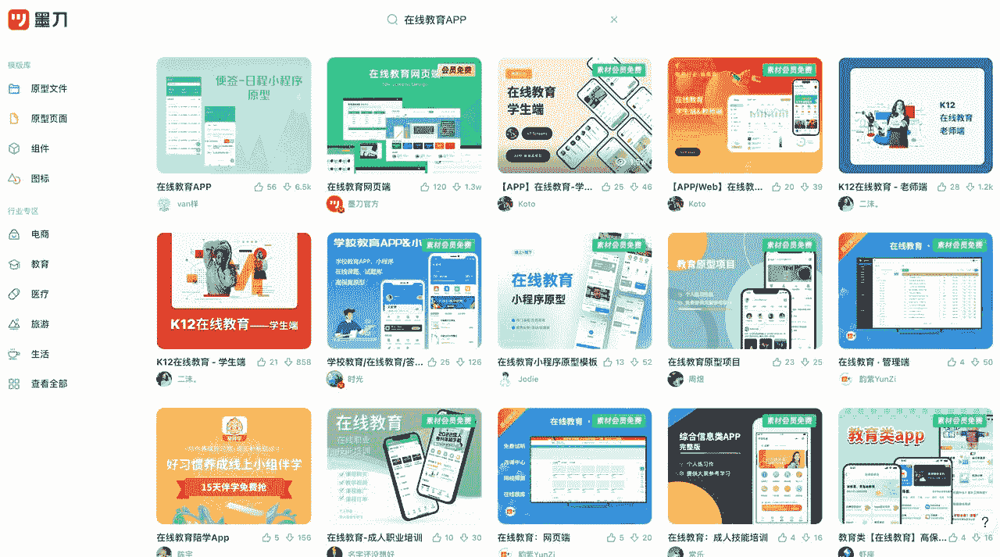
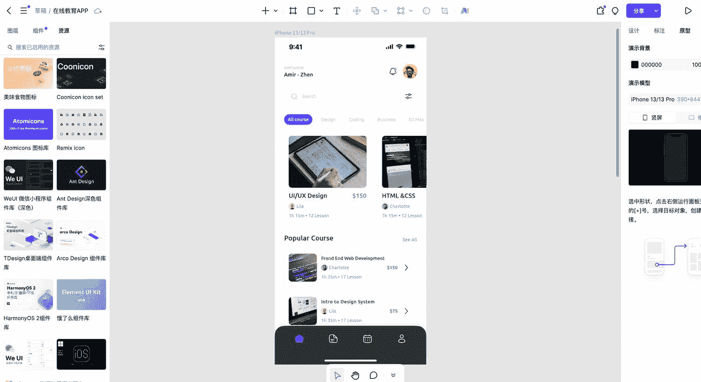

# K12在线教育APP原型设计怎么做？实战案例分享

> 来源：[https://qqs7y1hozd1.feishu.cn/docx/NPMMdyaQ4ocUPux0oZccUTDjn4f](https://qqs7y1hozd1.feishu.cn/docx/NPMMdyaQ4ocUPux0oZccUTDjn4f)

目前**K12在线教育APP****依然是一个竞争激烈但机会充足**的赛道，每年毕业季和暑假都是在线教育平台的黄金期，大量学生等群体涌入线上平台，寻求个性化、灵活性的学习方式。

那么在线教育APP应该如何进行原型设计？本文将结合据实战案例分析，从设计流程、核心要点、工具选择等方面进行深入剖析，供产品经理参考。

### **一、在线教育APP原型设计流程**

#### **1.市场调研分析**

在线教育市场日趋成熟，但**细分领域和用户需求依然千变万化**。产品经理在设计初期需进行充分的市场调研，包括：

+   目标用户画像：年龄层、学习需求、学习时间偏好等；

+   竞品分析：优缺点、功能亮点、商业模式；

+   **行业趋势**：AI辅助教**学、直播互动**、个性化推荐等。
Tips：如下图借助白板AI工具，可以快速整理调研结论并生成可视化竞品分析图、用户画像图等，提升沟通效率。

#### **2.明确产品架构**

在进行市场分析后挖掘出用户痛点，需要将用户需求转化为具体的**功能点，构建产品信**息架构。此步骤建议使用流程图和功能结构图辅助思考，通过上述举例的AI工具，帮助产品经理快速制作功能架构图（如下图为一款在线教育APP的功能架构图），为产品原型设计打下基础。

#### **3.产品原型设计**

原型设计通过视觉表达将架构落地为具体页面交互，通常分为低保真（线框草图）与高保真（接**近真实产品）原型**两类。通常情况下如果是软件外包公司，产品经理需要为客户设计出一款高保真可交互原型，来尽量接近真实产品体验，并在早期快速验证产品逻辑。这就需要产品经理在设计的过程中明确核心要点，掌握一款高效的原型设计工具。

以下为一个在**线教育A**PP实战案例：

这款APP以直播课程为核心卖点。首页设计**采用金刚区四**大功能入口：直播课程、精品好课、金牌讲师、社区交流。首页中部以“免费直播课程”模块吸引用户点击学习，降低首次使用门槛，提升用户信任度与转化率。整体色彩明亮，布局简洁，信息分层清晰。

### **二、在线教育APP原型设计要点**

**在实际项目中，在线教育**APP的原型设计容易陷入“堆功能”、“堆模块”的误区。以下是几个需要特别注意的设计要点：

#### **简洁可达的导航设计**

用户进入APP后的操作路径应尽可能要短，课程分类明确、入口清晰，确保2~3步内可以达到核心目标页。

#### **强化直播与社交体验**

在线教育区别于传统录播，直播+社交是关键价值点。设计中应考虑：弹幕、互动答题、课后讨论、群组学习等功能的入口与呈现方式。

#### **支持多终端学习**

尤其是K12与职场类课程，用户使用手机、平板、电脑的场景频繁切换。原型设计中应兼顾响应式设计思路，保证跨平台一致性。

#### **用户留存与激励机制**

在原型阶段就应规划好签到打卡、等级成长、课程奖励等激励机制的位置与呈现方式，避免后期功能堆叠导致用户体验混乱。

### **三、在线教育APP原型设计工具**

高效的原型设计工具可以达到**事半功倍**的效果。满足在线教育APP的原型设计工具有很多，建议使用轻量高效的工具。这里举例如下：

#### **1.墨刀**

**支持快速搭建高保真原**型，适合产品经理与开**发协作；其内**置丰富的教育类组件与模板素材，尤其适合教育场**景；白板A**I功能也十分强大，适用于产品团队为在线教育APP头脑风暴、需求梳理；另外，这个原型工具支持私有化部署，可以满足教育机构对数据安全的高要求。

#### **2.Pixso**

Pixso协作能力强大，适合**产品+设计多角色**同步编辑，尤其适合对视觉要求较高的客户，在原型阶段就满足其视觉统一的需求；无论是学生端还是教师端的在线教育APP，可以通过组件复用与样式继承，快速构建标准化的原型页面。

**以上两款是无数产**品经理使用和验证过的主流原型设计工具，仅供参考。还有其他好用的工具例如Axure（功能强大但学习曲线略高）、Figma（适合注重设计感的项目）、ProtoPie（侧重交互效果演示）等，产品经理可按需选择适合自己的工具。