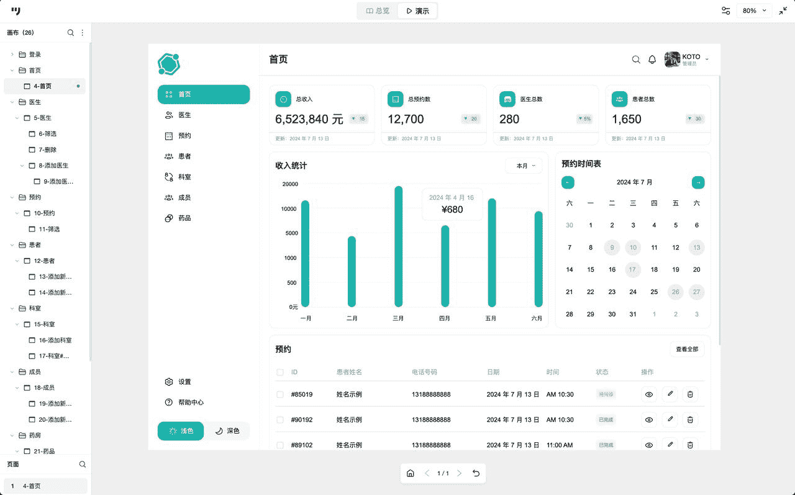
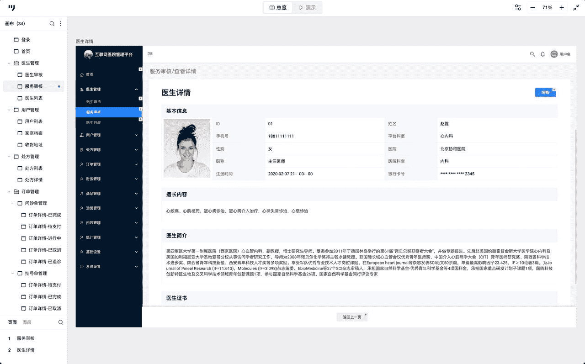
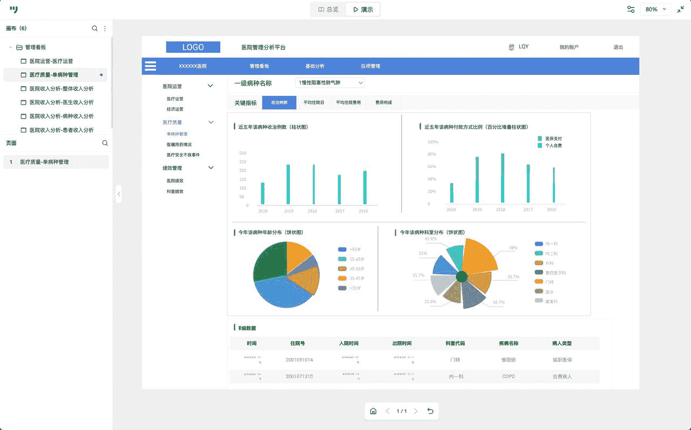
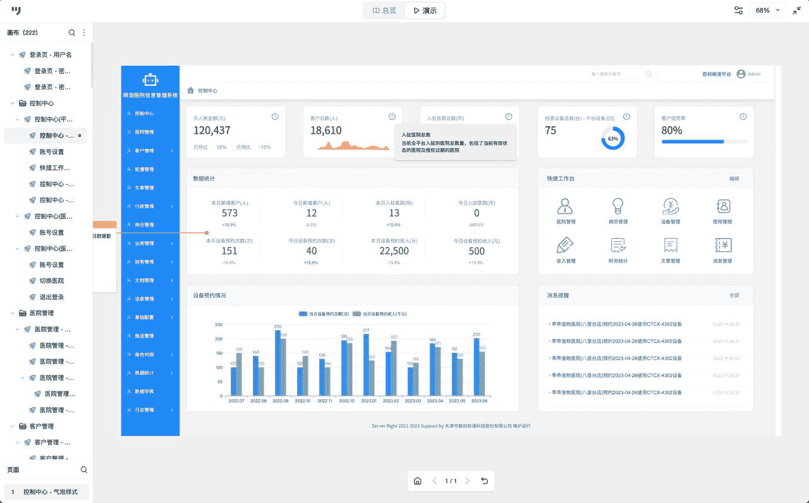

# 6个值得收藏的医院后台管理系统原型设计案例

> 来源：[https://qqs7y1hozd1.feishu.cn/docx/Q6Bed9ukioaR7FxpU45cWFYvnbc](https://qqs7y1hozd1.feishu.cn/docx/Q6Bed9ukioaR7FxpU45cWFYvnbc)

### **1.医院预约挂号管理后台**

该**原型专为医院**的预约挂号业务设计，首页以可视化图表的方式直观呈现核心指标，如挂号量、充值总额、绑卡数据、热门科室分布等情况。系统功能划分为预约管理、费用管理、医院管理、系统管理四大模块，帮助医院清晰掌握业务数据与操作入口。

在预约管理中，支持挂号、体检预约及医生排班的多维度信息管理与操作，简化前台接诊流程，提高整体运营效率。

产品设计思路：预约挂号类后台系统应以数据驱动决策，聚焦预约全流程的精细化管理。

### **2.医疗问诊管理后台（简洁版）**

**这是一个轻量**化的医疗问诊后台管理系统，围绕“医生、预约、患者、科室、成员、药品”六个核心功能板块构建。首页面板集中展示收入、预约总量、医生/患者数量，以及可视化时间表和患者列表，便于快速了解运营情况。

医生板块便于信息筛选与查看，患者信息页面支持搜索、编辑与详细补充。药品管理与科室管理也以操作简洁、功能聚焦为核心设计思路。

产品设计思路：简洁版医疗问诊后台系统应聚焦核心功能，提升操作效率，降低学习成本。

### 3.互联网医院管理后台（综合型）

这是一个**覆盖面广、结构完整**的互联网医院后台系统原型模板，包括但不限于医生管理、用**户管理、处方****管理、订单与财务模块、药品管**理、内容运营、统计与系统配置等功能。

该原型不仅支持在线问诊与开药等基础业务，还整合了网络药品售卖、内容分发与数据洞察功能，是典型的全流程、全角色覆盖的互联网医院解决方案。

产品设计思路：针对互联网医院的复杂特性，后台应将线上医疗服务与数据整合一体化有序设计。

### **4.医院管理分析平台**

这是一个偏重**数据分析**的医院后台管理原型，聚焦于医院的运营管理、医疗质量控制和绩效考核。核心板块分为：

*** 医疗问诊与收入数据**：以图表方式展示日常运营趋势；

+   **医疗质量管理**：支持病种细分与质量指标查看；

+   **绩效管理**：细化到科室、医生个人的收入与绩效分析。

**系统设计追求**数据的可视化与可追溯，便于医院领导层精准决策和科学考核。

产品设计思路：医院分析型后台系统应注重数据的结构化呈现和可操作性支持，助力运营精细化管理。

### **5.口腔医院管理后台**

**口腔医疗机构的业务逻辑与综合医****院存在差异，更加注****重预约精准性**、会员管理和营销转化。该原型特别设计了“预约管理+爽约管理”组合机制，有效降低患者爽约率。

会员系统细致划分等级，支持优惠规则设定与消费记录管理。同时，整合线上商城与营销模块，包括商品管理、优惠券设置、广告位配置等，支持医院实现私域流量运营。

产品设计思路：口腔医院后台系统应聚焦用户粘性与消费转化，强化会员运营与营销闭环管理。

### **6.宠物医院管理后台**

**这是一个宠物**医院后台管理**系统原型****，该系统服务**于宠物医疗场景，在左侧导航栏设置了控制中心、医院管理、客户管理、轮播管理、文章管理、行政管理、病历管理、业务管理、财务管理、库存管理、文档管理、设备管理、基础配置、推送管理、角色权限、数据统计，根据不同角色权限展现对应的模块方便操作。

此案例有一些设计亮点：控制中心快速工作台+数据看板；医院管理、客户与病历管理：便于查看宠物信息与历史记录；检查、治疗、住院流程清晰记录宠物就诊每一环节；支持模块可见性、操作权限自定义，适配不同岗位人员操作需求。

产品设计思路：宠物医院管理系统应结合就诊流程与角色差异，实现权限灵活与流程闭环设计。

