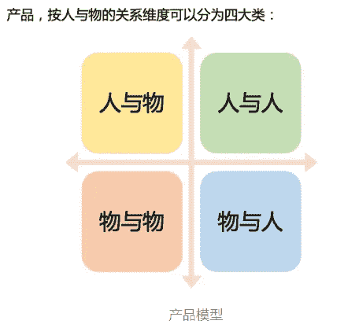
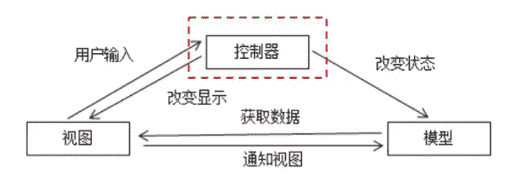
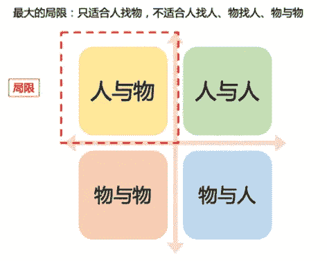
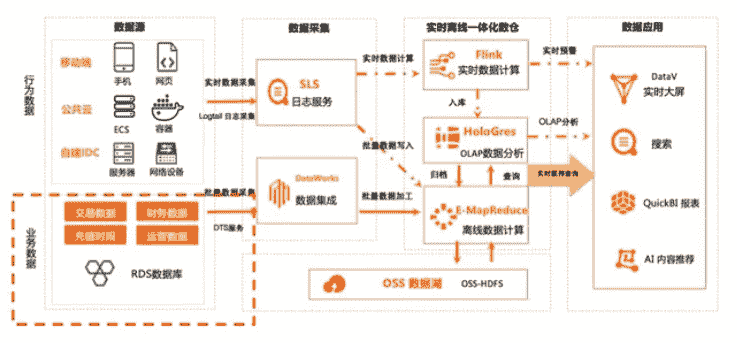

# 大厂 | 数据埋点方法

> 来源：[https://qqs7y1hozd1.feishu.cn/docx/MsdldUfEoo1yAPxstE7cmrvmnqc](https://qqs7y1hozd1.feishu.cn/docx/MsdldUfEoo1yAPxstE7cmrvmnqc)

> 埋点的本质是用户行为描述，为用户洞察、业务迭代提供数据支持。

# 埋点基础

> 第一部分，从**埋点****、****产品模型****、****用户模型**等三个方面介绍埋点的基础。

### 1.1. 埋点

**埋点的定义：**

埋点，又称打点、事件追踪（event tracking）。

> 指通过在互联网产品中**加入埋点代码，****在用户使用产品时触发相应的**代码，并记录相关数据（行为、属性）的一种技术。

> **埋点的主体：①产品；②用户**

> 从定义可知，**埋点的主体有产品和用户**** **，接下来介绍一下产品模型和用户模型。

> 产品模型、用户模型是多样的，这里仅仅从埋点视角切入。

### 1.2. 产品模型

按人与物的关系维度可以分为四大类：

> **人与物、**

> **人与人、**

> **物与人、**

> **物与物。**



**这里尝试给出部分产品划分：**

+   **人与人：****社交****、****游戏****、****直播****、****运动**

+   **人与物：****电商****、****探索****、****内容****、****知识付费****、****工具****、****金融**

+   **物与人：****物流****、****快递**

+   **物与物：****机器人****、****数字农业****、****数字工业**

人与人可以进一步划分，比如社交：

+   **1对1：****陌生人（陌陌、Soul、探探）**

+   **1对多：****兴趣（微博、知乎 、豆瓣）****、**职场（脉脉、领英、BOSS直聘）

+   **多对多：****熟人（微信、QQ）**

产品来源于需求，一个大的APP产品往往由多个需求、功能、模块构成。

> 大产品模型下，产品的模块、功能、需求中依然含有“人与物的关系”。

> 比如京东电商是个”人找物“产品，但京东的信息流就包含“物找人“。

> **产品又有具体的业务和属性，**比如拼多多的商品信息，抖音的创作视频信息等等。

### 1.3. 用户模型

**用户通过行为与产品建立联系。**

用户也具有属性，一方面具有年龄、性别、地域等自然属性；

> **另一方****面****，在产****品****中用户又具**有业务属性，不如主客态、新老客、是否是会员。

# 埋点原理

> 第二部分，从**埋点的方法****、****埋点的技术****、****埋点的流程**等三个方面介绍埋点的原理。

### 2.1. 埋点的方法

**埋点的方法：**①多维度模型；②事件模型。

> **多维度模型**，即把点位用多维度信息标识出来，通常用二维标识。

> **多维度标识的一个原则：**见名知意。

> **事件模型**，是用户使用产品的行为描述。

> **事件模型的要素：**事件（Event）、用户（User）、对象和环境。

属性描述行为，属性值是指在某个状态下描述行为。

属性可以分为全局属性、自定义属性：

+   **全局属性，**又称公共属性，即每个事件都要上报；

+   **自定义属性，**又称私有属性，即单个事件上报。

> **长期视野看，**事件设计、**属性设计要有整体性**，并兼顾未来业务发展的扩展性。

> **降本增效视角看，**事件、**属性不是越多越好，**因为属性上报是依赖计算存储资源。

### 2.2. 埋点的技术

> **技术视角看，埋点可以分为：****全埋点****、****可视化埋点****、****代码埋点****。**

> 代码埋点按程序员的分工，又分为前端埋点、客户端埋点（又称APP埋点）、后端埋点（又称服务端埋点）。

| **埋点方式** |  | **优点** | **缺点** | **适用场景** |
| --- | --- | --- | --- | --- |
| 全埋点 |  | 成本低 | 只覆盖基本行为 | 业务简单 |
| 可视化埋点 |  | 自助采集 | 不支持与服务端交互 | 业务标准化 |
| 代码埋点 | 前端埋点 | 采集全面 | 非登录场景采集复杂 | 业务复杂 |
|  | 客户端埋点 | 采集准确 | 依赖版本、延迟上报 | 业务复杂 |
|  | 后端埋点 | 实时有效，属性整合 | 只支持调接口 | 整合属性 |

> 注意，通常埋点采集是记录逻辑，但一些事件是可变事件（比如购买）则是更新逻辑。

**H5埋点代码示例如下：**

```
this.$point.sendParams({
  &#x27;view_name&#x27;:&#x27;h5_return&#x27;,
  &#x27;click_name&#x27;:notSelfBack ? &#x27;return_show&#x27; : &#x27;return_click&#x27;,
    ref: this.$tool.getChannelType(),
    ad: &#x27;ad&#x27;,
    web: this.$tool.getDominPoint(),
    ck: ck,
    hz: this.$tool.getContendIdGroup(),
    url: escape(location.href),
    abtest: this.backActionConf.name &amp;&amp; this.backActionConf.name.replace(&#x27;%&#x27;, &#x27;&#x27;),
    return_num: 0
    }
```

从MVC框架视角看，后端埋点通常在控制层（Control，C）。



### 2.3. 埋点的流程

**埋点的主要流程如下：**业务需求→数据需求→埋点设计→埋点开发→埋点验证。

**注意，这里只是概要流程，不同公司**不同的组织架构，具体流程和分工会有差异。

+   **数据需求，**可以借助E-R图、流程图、时序图，梳理确认业务需求，注意显性需求和隐形需求。

+   **埋点设计，**要做好同类抽象、规范标准。

+   **大的埋点项目，**最好要有指标体系指导，体系化买单治理更高效。

# 埋点应用

**第三部分，从自研埋点、友盟埋点、友**盟埋点等三个方面介绍埋点的应用（实战）。

> 结合多维度模型、**事件模型的埋点方法**，分别介绍其在自研埋点、友盟埋点、神策埋点上的实战。

### 3.1. 自研埋点

自研埋点的方案，比如唯一标识：应用+页面+元素+点位。

| **名称** | **含义** | **命名规则** |
| --- | --- | --- |
| view_name | 所在页面 | 业务_页面 |
| click_name | 元素事件 | 业务_元素_事件 |

**自研的埋点设计如下：**

| **页面** | **广告类型** | **埋点事件名称** | **view_name** | **click_name** | **ext（参数）** | **上报机制** |
| --- | --- | --- | --- | --- | --- | --- |
| 文章页 | 返回广告 | 文章页-返回广告-曝光 | ad_article | ad_return_show | (id:广告id,&quot;ck&quot;:&quot;流量分组&quot;) | 点击返回按钮触发广告 |
|  |  | 文章页-返回广告-点击 | ad_article | ad_return_click | (id:广告id,&quot;ck&quot;:&quot;流量分组&quot;) | 点击广告触发 |
|  | 触底广告 | 文章页-触底广告-曝光 | ad_article | ad_slide_bottom_show | (id:广告id,&quot;ck&quot;:&quot;流量分组&quot;) | 浏览文章触底时触发 |
|  |  | 文章页-触底广告-点击 | ad_article | ad_slide_bottlm_click | (id:广告id,&quot;ck&quot;:&quot;流量分组&quot;) | 点击广告触发 |

**自研埋点的SQL提取数据如下：**

```
--返回广告曝光
SELECT
        pt    AS 日期
        ,count(1) AS 返回广告曝光pv
FROM  XXX
WHERE  pt BETWEEN&#x27;20231001&#x27;AND&#x27;20231031&#x27;
AND    view_name IN (&#x27;ad_article&#x27;)
AND    click_name IN (&#x27;ad_return_show&#x27;)
GROUP BY pt
ORDER BY pt
LIMIT 10000
;
```

### 3.2. 友盟埋点

**友盟的事件埋点设计如下：**

| **事件定义** |  | **事件变量定义** |  |  |  |
| --- | --- | --- | --- | --- | --- |
| **事件名称** | **事件上报id** | **参数名称** | **参数上报id** | **参数类型** | **参数值说明** |
| 广告曝光 | UM_Event_ADExposure | 广告ID | UM_key_ADID | string | 获取当前广告ID |
|  |  | 广告位 | UM_key_ADLocation | string | 获取当前曝光广告展示的位置 |
|  |  | 广告媒体 | UM_key_MediaChannel | num | 广告枚举 |
|  |  | 耗时 | UM_key_Duration | float | 获取当前广告请求耗时 |
|  |  | 广告展示页面 | UM_key_DisplayPage | string | 开屏，推荐流 |

### 3.3. 神策埋点

**神策的事件模型如下：**

**神策的事件埋点设计如下：**

| **事件英文变量名** | **事件显示名（必填）** | **属性英文变量名（必填）** | **属性显示名（必填）** | **数据类型（必填）** | **属性值示例或说明** | **应埋点平台（必填）** |
| --- | --- | --- | --- | --- | --- | --- |
| $pageview | Web浏览页面 | $预置属性 |  |  |  |  |
|  |  | $is first time | 是否首次 | BOOL | 新用户首次访问页面时，出发的第一个$pageview该属性值为true，后续再出发$pageview事件时，该属性都false | JavaScript |
|  |  | $url path | 页面路径 | STRING | 主域名后的目录 |  |
|  |  | $url host | 页面地址域名 | STRING | 由服务端进行解析，如果事件中上报了$url，则会解析出来该属性 |  |

**神策的事件分析如下：**

```
--微信pv
SELECT
        to_date(date) AS&#x27;日期&#x27;
        ,count(1)     AS&#x27;微信pv&#x27;
FROM    events
WHERE   date  BETWEEN&#x27;2023-0710&#x27;AND&#x27;2023-09-30&#x27;
AND     event    =&#x27;Spageview&#x27;
AND     $browser=&#x27;WeChat&#x27;
GROUP BY to_date(date)
ORDER BY to_date(date)ASC
;
```

**除**了上面友盟、神策，市面上还有很多第三方埋点工具，比如GrowingIO、火山引擎埋点（字节跳动旗下的）、阿里云等埋点，但都大同小异。

> **一方面，**每个埋点工具差异这里没有进行展开，但在新旧埋点工具切换——从友盟切到神策，或者从火山切到自研埋点，又或者自研埋点迭代升级，就要系统对比区分了。

> **另一方面，**选择埋点工具时，埋点生产链路的稳定性、可靠性在接入前很难判断，只有使用后才知道。

# 埋点总结

> 第四部分，从**埋点的局限****、****AB实验埋点****、****埋点治理**等三个方面对埋点进行总结。

### 4.1. 埋点的局限

**因为埋点的本质是行为的描述，所以埋点的最大局限：只适**合人找物，不适合人找人、物找人、物与物。

> 市面上的埋点工具也有该局限。

比如公司明年战略是做社交（人与人），要采购第三方埋点工具，估计数据战略是服务不好企业战略的。





**除埋点数据（行为数据），还有业务数据（交易、**运营数据、用户信息数据、创作内容数据）。

### 4.2. AB实验埋点

AB实验埋点，主要解决标识问题，比如实验标识、实验分组标识、用户标识。

> AB实验埋点分组标识，**首先要区分：**什么是用户分组和实验分组？

> **策略实际影响的用户，**才是你的实验组，奇偶只是用户分组方式。

> **实验组、对照组要显**性标识（公共属性），模拟是低效且不准的。

## 4.3. 埋点治理

> **一方面，**埋点数据是有生命周期的，需要体系化治理。

> **另一方面 ，**业务发展迅速，埋点需要迭代升级。