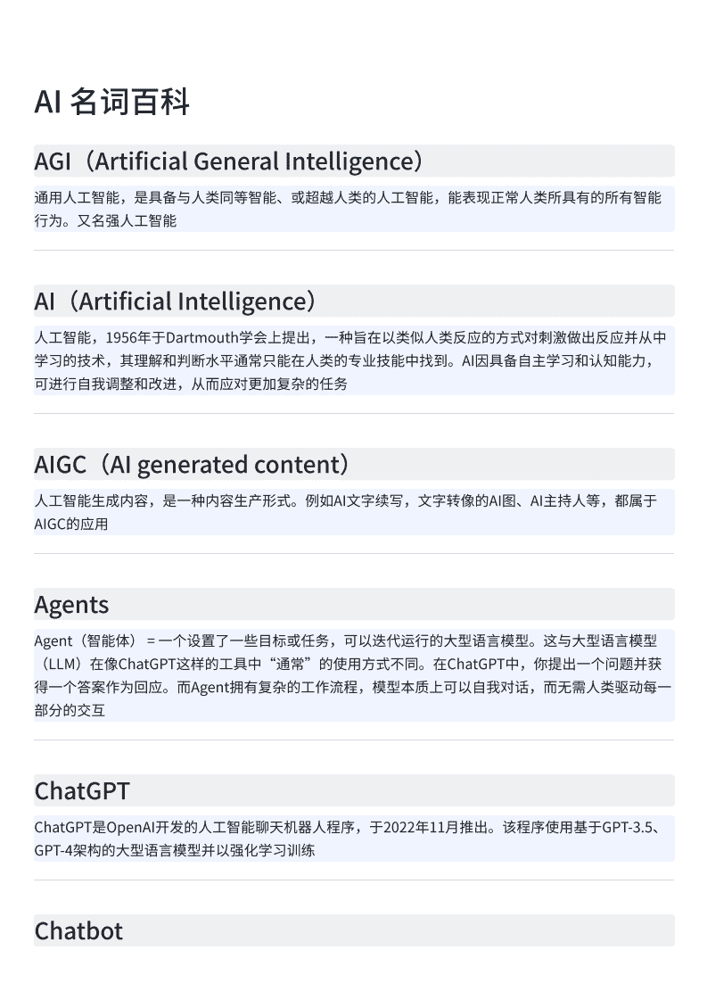

# 人工智能基础

> 来源：[https://qqs7y1hozd1.feishu.cn/docx/G6LhdaDvXogRY0xNxI8cWzF5njh](https://qqs7y1hozd1.feishu.cn/docx/G6LhdaDvXogRY0xNxI8cWzF5njh)

<https://qqs7y1hozd1.feishu.cn/sync/WsLwdK9UMsOqdhb16EFcUL0qn4d>

# AI 名词百科

[AI 名词百科.pdf](https://internal-api-drive-stream.feishu.cn/space/api/box/stream/download/all/Z3kkbbpIVoItPfxrO2pcdppTnTe)

---

# 零基础入门

| ##### [从零开始如何学习人工智能？](https://qqs7y1hozd1.feishu.cn/wiki/WxZ3w2ioLiXXOGkAEiJc3c2pnXb) | ##### [零基础人员如何入门AI？](https://qqs7y1hozd1.feishu.cn/wiki/L1MIwj0JviUKMkkh3fUcBFOqnT0) |
| --- | --- |
| ##### [解读AI大模型，从了解token开始](https://qqs7y1hozd1.feishu.cn/wiki/D23gwlmUWij5FAk39oXcy9ednAe) | #####  |

---

# 生成式人工智能 （Generative AI）

| ##### [一文纵览文生图/文生视频技术发展路径与应用场景](https://qqs7y1hozd1.feishu.cn/wiki/GnKVwjiEziWxQekKZJncjiyunDh) |  |
| --- | --- |